# Mermaid dijagrami sa primerima iz projekata

## Kako je vodič podeljen

Ovaj vodič nastaje u fazama. Svaka faza se dodaje u posebnom odgovoru, kako bi objašnjenja i primeri mogli pažljivo da se provere.

1. **Osnove Mermaid-a i ER dijagrama** — ovaj deo.
2. **TodoApp** — stvarni modeli, ERD i objašnjenje veza.
3. **Chinook** — stvarna SQLite šema i čitanje njenih veza.
4. **SQLAlchemy ORM Fundamentals** — modeli, veze i poređenje ORM-a i baze.
5. **Završno ponavljanje i vežbe** — samostalni zadaci, rešenja i zaključak.

Projekti nisu nužno završeni: dijagram treba da opiše **provereno trenutno stanje** i da razlikuje postojeću šemu od planiranih izmena. Podaci koje prikazuje ranija slika šeme nisu zamena za proveru konkretne baze.

---

## Faza 1 — Osnove Mermaid-a i ER dijagrama

> U ovom vodiču koristićemo **Mermaid** za crtanje ER dijagrama i drugih dijagrama. Svaki primer je fokusiran na razumevanje veza između entiteta i kako ih predstaviti vizuelno. Cilj nije generisanje baze ili izvršavanje SQL-a, već jasna vizualizacija odnosa i strukture podataka. Mermaid dijagrami služe kao alat za razumevanje i komunikaciju modela, a ne za direktno upravljanje bazom.

---

### 1. Šta je Mermaid?

**Mermaid** je način da dijagram opišeš tekstom. Alat koji podržava Mermaid taj tekst zatim pretvara u vizuelni dijagram.

Na primer:

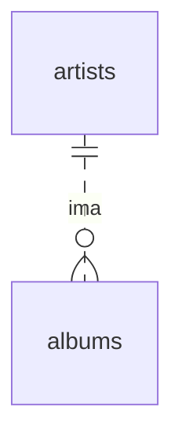

Ovaj tekst opisuje odnos umetnika i albuma. **Mermaid ne kreira tabele, ne izvršava SQL i ne proverava tvoju bazu.** Ako promeniš SQL ili model, dijagram se neće automatski ažurirati, osim ako koristiš poseban alat koji ga generiše iz šeme.

---

#### ERD i Mermaid nisu dve različite vrste baze

- **ERD** (_Entity Relationship Diagram_) jeste **vrsta dijagrama**: pokazuje entitete i njihove odnose.
- **Mermaid** je **jezik i alat** kojim možeš nacrtati ERD, ali i druge dijagrame.
- **SQL šema** predstavlja stvarne definicije tabela i ograničenja u bazi.
- **SQLAlchemy model** je Python opis mapiranja i ograničenja; ne mora automatski odgovarati već postojećoj bazi.

> Ukratko, ERD je vizuelni prikaz, Mermaid je alat za crtanje tog prikaza, SQL šema je stvarna struktura baze, a SQLAlchemy model je Python reprezentacija te strukture. Svi ovi elementi treba da budu u skladu, ali se ne ažuriraju automatski jedan iz drugog.

Dakle, **ERD napisan Mermaid sintaksom je istovremeno i ERD i Mermaid dijagram**. ERD može biti nacrtan i u `draw.io` alatu. Sadržaj oba prikaza treba zasebno proveriti prema modelu ili bazi.

---

#### ERD naspram dijagrama toka

| Dijagram                    | Pitanje na koje odgovara                           | Primer                                      |
| --------------------------- | -------------------------------------------------- | ------------------------------------------- |
| ERD (`erDiagram`)           | Koji entiteti postoje i kako su povezani?          | Umetnik, album i strani ključ albuma.       |
| Dijagram toka (`flowchart`) | Kuda prolazi zahtev ili koji koraci se izvršavaju? | HTTP zahtev → validacija → endpoint → baza. |

ER linija **ne znači** da podaci u tom trenutku putuju od jednog pravougaonika do drugog. Za tok zahteva koristimo strelice u dijagramu toka. Detaljniji primeri toka biće obrađeni uz projekte.

---

### 2. Kako prikazati dijagram u VS Code-u

1. Otvori Markdown fajl u editoru.

2. Sačuvaj izmene sa **Ctrl+S**.

3. Otvori Markdown pregled pomoću **Ctrl+Shift+V**.

4. Pronađi dijagram u pregledu. Ako vidiš samo kod ili grešku, proveri da li pregled koji koristiš podržava Mermaid i da li je blok ispravno napisan.

Izvorni kod dijagrama u Markdown fajlu počinje sa tri obrnuta apostrofa i rečju `mermaid`, a završava se sa još tri. Na primer, u editoru izgleda ovako:

````text

````

Prvi red `erDiagram` bira vrstu dijagrama. Ostatak bloka govori Mermaid-u **šta da nacrta**, a ne šta da izvrši u bazi.

> Prikaz, boje i raspored mogu zavisiti od verzije Mermaid-a, teme i Markdown pregleda. Različit raspored ne mora značiti da je veza drugačija.

---

### 3. Od teksta do ERD-a: umetnik i album

Zamisli ovaj **mali model za učenje**, a ne kompletnu šemu projekta:

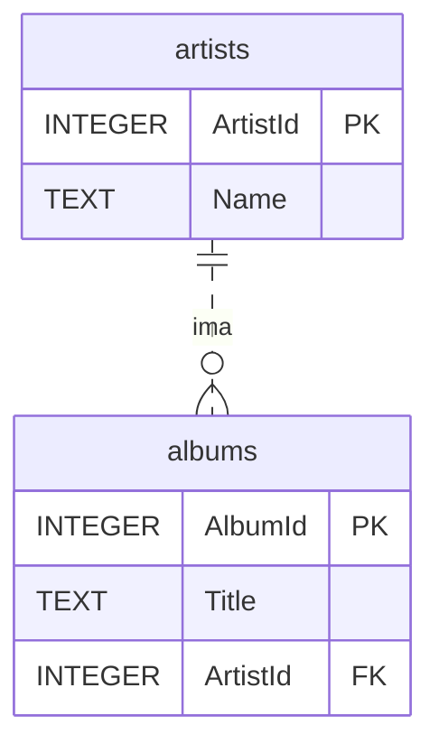

---

#### 3.1. Šta je entitet, a šta red?

- `artists` i `albums` su u ovom primeru nazivi **tabela**, odnosno entiteta koje predstavljamo.
- Pravougaonik `artists` predstavlja celu tabelu, **ne jednog konkretnog umetnika**.
- Jedan red te tabele može predstavljati jednog umetnika, na primer `ArtistId = 1`.
- Jedan red `albums` može predstavljati jedan album koji ima `ArtistId = 1`.

Ovo su izmišljeni podaci za čitanje dijagrama:

| artists.ArtistId | artists.Name |
| ---------------: | ------------ |
|                1 | Umetnik A    |
|                2 | Umetnik B    |

| albums.AlbumId | albums.Title | albums.ArtistId |
| -------------: | ------------ | --------------: |
|             10 | Album X      |               1 |
|             11 | Album Y      |               1 |

Umetnik A je povezan sa dva albuma; umetnik B u prikazanim podacima nema nijedan. `ArtistId` u albumu govori sa kojim je umetnikom povezan. Broj povezanih redova **trenutno u podacima** nije isto što i broj koji model **dopušta**.

---

#### 3.2. Šta su atributi?

U delu:

```text
artists {
    INTEGER ArtistId PK
    TEXT Name
}
```

1. `artists` je naziv entiteta.
2. `{` i `}` omeđavaju listu atributa.
3. `INTEGER` i `TEXT` su tekstualne oznake tipova koje smo odabrali za prikaz.
4. `ArtistId` i `Name` su nazivi atributa, ovde kolona.
5. `PK` označava primarni ključ.

Mermaid ove oznake **prikazuje**, ali ih ne pretvara u SQL i ne proverava odgovaraju li stvarnim tipovima u bazi. Dijagram može prikazati samo važne kolone, ne nužno sve.

| Oznaka | Puno ime    | Značenje u ovom vodiču                                            |
| ------ | ----------- | ----------------------------------------------------------------- |
| `PK`   | Primary Key | Primarni ključ koji identifikuje red.                             |
| `FK`   | Foreign Key | Strani ključ koji upućuje na ključ u drugoj ili istoj tabeli.     |
| `UK`   | Unique Key  | Oznaka jedinstvenog ključa; stvarni uslovi se proveravaju u šemi. |

Ako je neka kolona istovremeno deo primarnog i strani ključ, u Mermaid-u može se napisati, na primer, `INTEGER FruitId PK, FK`. To je i dalje samo opis u dijagramu.

---

### 4. Kako se čita veza?

Rastavimo jedan red:

```text
artists ||..o{ albums : "ima"
```

| Deo       | Značenje                                                          |
| --------- | ----------------------------------------------------------------- |
| `artists` | Prva tabela.                                                      |
| `\|\|`    | Za **jedan album**, model predviđa tačno jednog umetnika.         |
| `..`      | Isprekidana, neidentifikujuća veza.                               |
| `o{`      | Za **jednog umetnika**, model dopušta nula ili više albuma.       |
| `albums`  | Druga tabela.                                                     |
| `: "ima"` | Tekstualna oznaka odnosa iz ugla prve tabele: umetnik ima albume. |

**Najvažnije pravilo za čitanje:** oznaka uz jednu tabelu govori koliko njenih redova može biti povezano sa **jednim redom druge tabele**.

Zato postavljamo dva odvojena pitanja:

1. **Za jedan album: koliko umetnika?** Pogledaj oznaku uz `artists`: `||` = tačno jedan.
2. **Za jednog umetnika: koliko albuma?** Pogledaj oznaku uz `albums`: `o{` = nula ili više.

Izraz **1:N** označava odnos jedan-prema-više, ali sam po sebi često ne govori dovoljno jasno šta je obavezno. Zato čitaj i minimalni broj: `0` ili `1`, kao i maksimalni broj: `1` ili više.

---

#### 4.1. Tabela oznaka kardinalnosti

Oznake su ogledalne na dva kraja linije:

| Levo od linije | Desno od linije | Broj mogućih povezanih redova |
| -------------- | --------------- | ----------------------------- |
| `\|\|`         | `\|\|`          | Tačno jedan.                  |
| `\|o`          | `o\|`           | Nula ili jedan.               |
| `}o`           | `o{`            | Nula ili više.                |
| `}\|`          | `\|{`           | Jedan ili više.               |

Ovde `o` označava da je minimum nula, `|` može označavati jedan, a „račva” `{` ili `}` označava više. Oznaku treba čitati kao **par znakova** na odgovarajućem kraju, a ne kao zasebnu formulu.

Primeri za desni kraj:

- `||` → minimum 1, maksimum 1.
- `o|` → minimum 0, maksimum 1.
- `o{` → minimum 0, maksimum više.
- `|{` → minimum 1, maksimum više.

`0` ne znači da je „NULL red“ u tabeli. Na primer, umetnik sa nula albuma znači da trenutno **nema reda u `albums` koji upućuje na tog umetnika**.

---

#### 4.2. Puna i isprekidana linija

U Mermaid ER notaciji:

- `--` crta **identifikujuću** vezu.
- `..` crta **neidentifikujuću** vezu.

U primerima relacionih tabela koje ovde koristimo, identifikujuću vezu prikazujemo kada je roditeljski FK **deo primarnog ključa deteta**. Ako FK nije deo tog ključa, koristimo isprekidanu liniju. Na primer, `albums.ArtistId` nije deo PK-a `albums.AlbumId`, pa pišemo `..`.

**Obaveznost ne određuje oblik linije:** `..` ne znači automatski „opciono“. Opcionost se čita iz oznaka na krajevima i proverava u SQL ograničenjima.

---

### 5. Povezivanje ERD-a sa SQLite šemom

Sledeći SQL je samostalan primer za **novu, praznu, odvojenu bazu**. Ne izvršavaj ga u postojećoj Chinook ili TodoApp bazi:

```sql
PRAGMA foreign_keys = ON;

CREATE TABLE artists (
    ArtistId INTEGER PRIMARY KEY,
    Name TEXT NOT NULL
);

CREATE TABLE albums (
    AlbumId INTEGER PRIMARY KEY,
    Title TEXT NOT NULL,
    ArtistId INTEGER NOT NULL,
    FOREIGN KEY (ArtistId) REFERENCES artists(ArtistId)
);
```

Kako dobijamo prethodni dijagram?

1. `ArtistId INTEGER PRIMARY KEY` identifikuje umetnika; `AlbumId` identifikuje album.
2. `albums.ArtistId INTEGER NOT NULL` zahteva vrednost za svaki album.
3. `FOREIGN KEY ... REFERENCES` kaže da ta vrednost upućuje na `artists.ArtistId`.

4. Sa uključenom proverom FK-a, vrednost mora odgovarati postojećem umetniku. Zato je za album u dijagramu **jedan** umetnik: `||`.

5. Više albuma sme imati isti `ArtistId`, jer ta kolona nema `UNIQUE`. Nijedno prikazano ograničenje ne zahteva album za svakog umetnika. Zato je za umetnika **nula ili više** albuma: `o{`.

6. FK `albums.ArtistId` nije deo primarnog ključa albuma. Zato je veza u ovom primeru `..`.

`NOT NULL` i `FOREIGN KEY` rade različite stvari: prvi zabranjuje `NULL`, drugi uz uključenu proveru odbija referencu na nepostojeći red. U SQLite-u `PRAGMA foreign_keys = ON;` treba postaviti **za svaku konekciju**, pre aktivne transakcije. Ako je u postojećoj bazi ranije bilo upisa bez provere, samo uključivanje ne popravlja već neispravne redove; za proveru služi `PRAGMA foreign_key_check;`.

---

#### Ako bi album smeo da bude bez zabeleženog umetnika

Kada bi `albums.ArtistId` bio definisan bez `NOT NULL`, SQL bi dozvolio `NULL`. Odgovarajući model tada bi bio:

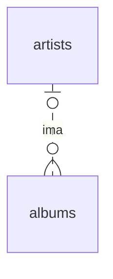

Za jedan album sada postoji **nula ili jedan zabeležen umetnik**, a jedan umetnik i dalje može imati nula ili više albuma. To ne mora značiti da album u stvarnosti nema umetnika — podatak možda nije poznat ili unet.

---

### 6. Više-prema-više: jedan zapis i više boja

Zamisli da isti zapis voća može imati više boja, a istu boju može deliti više zapisa voća. Jedna kolona `fruits.ColorId` u jednostavnom modelu ne može označiti više različitih boja u istom redu. U relacionoj bazi čest pristup je **poveznička tabela**:

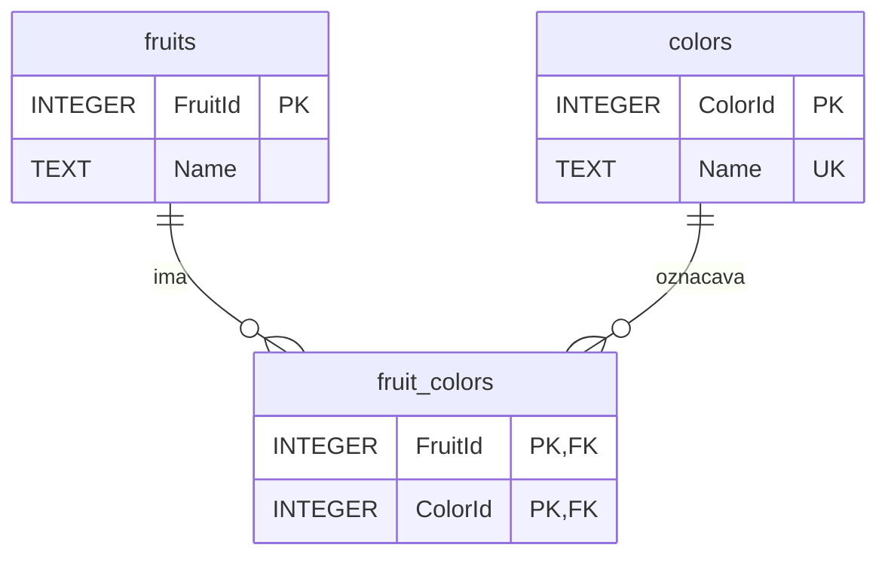

| FruitId | ColorId | Značenje, ako je 1 jabuka, a 1 zelena i 2 crvena |
| ------: | ------: | ------------------------------------------------ |
|       1 |       1 | Jabuka je povezana sa zelenom bojom.             |
|       1 |       2 | Ista jabuka je povezana sa crvenom bojom.        |

Svaki red `fruit_colors` predstavlja **jedan par**, ne spisak boja u jednoj ćeliji. `FruitId` i `ColorId` zajedno čine složeni PK: isti par ne sme dva puta, ali isti `FruitId` sme da se ponovi uz različit `ColorId`. Svaka kolona je i zaseban strani ključ.

Kardinalnost iz dijagrama čitamo po svakoj vezi:

- Jedan red `fruit_colors` upućuje na tačno jedno voće i tačno jednu boju, uz odgovarajuće `NOT NULL` i uključenu FK proveru.

- Jedno voće može imati **nula ili više** redova u `fruit_colors`; isto važi i za jednu boju.
- Zajedno, ove dve veze predstavljaju odnos **više-prema-više (N:M)** između voća i boja.

Ako je poslovno pravilo da svaki zapis voća mora imati **bar jednu zabeleženu boju**, ovaj dijagram ga **ne garantuje**: `o{` prikazuje da šema može dopustiti nula povezanih redova. To se mora dodatno obezbediti u dizajnu i kontroli upisa. Nula zabeleženih boja ne znači da stvarno voće nema boju.

Potpun SQL primer i detaljnija objašnjenja su u [Vežbi 2 lekcije o bazama](../../../fast-api-course-my-work/sqlite_for_beginners/00_intro/04_database_concepts.md#vežba-2--ispravi-model-voća-i-povrća).

---

### 7. Najčešće zabune

1. **„Dijagram je baza.”** Nije: on je opis. Izvor istine za postojeću SQLite bazu je njena stvarna šema, ne sama slika.

2. **„Puna linija znači obavezno.”** Ne: `--` opisuje identifikujuću vezu; obaveznost se čita iz kardinalnosti.

3. **„Nula povezanih redova je NULL red.”** Nije. `NULL` je odsutna vrednost u koloni; nula redova znači da povezanog reda nema.

4. **„FK uvek zabranjuje NULL.”** Ne: zasebno je potrebno `NOT NULL` ako vrednost mora biti prisutna.

5. **„Sama deklaracija FK-a u SQLite-u uvek proverava podatke.”** Ne: proveri da li je `PRAGMA foreign_keys` uključena u konkretnoj konekciji.

6. **„1:N znači da jedan roditelj mora imati dete.”** Ne nužno. `o{` znači da može imati nula; `|{` označava najmanje jedno.

7. **„Stvarno stanje i mogućnosti šeme su isto.”** Nisu: svi umetnici trenutno mogu imati albume iako šema dozvoljava umetnika bez albuma.

---

### 8. Kratka provera razumevanja

Bez gledanja u odgovore, pročitaj:

```text
artists ||..o{ albums : "ima"
```

1. Koliko umetnika sme da bude zabeleženo za jedan album?
2. Može li umetnik biti u tabeli bez ijednog albuma?
3. Da li `..` govori da je FK opcionalan?
4. Da li dijagram sam kreira FK u SQLite-u?

**Odgovori:** 1. Tačno jedan. 2. Da. 3. Ne; oznake na krajevima određuju kardinalnost. 4. Ne; potrebna je odgovarajuća SQL šema i uključena FK provera.

---

### Izvori za fazu 1

- [Mermaid — Entity Relationship Diagrams](https://mermaid.js.org/syntax/entityRelationshipDiagram.html)
- [Mermaid — Flowcharts](https://mermaid.js.org/syntax/flowchart.html)
- [Pitanje 23 i odgovor 23](../../../fast-api-course-my-work/sqlite_for_beginners/pitanja_i_odgovori/dan_02_intro.md#odgovor-23)

---

## Faza 2 — TodoApp: korisnici, zadaci i njihove veze

### 1. Šta je provereno?

TodoApp je projekat koji još razvijaš. Ovaj deo opisuje **trenutno provereno stanje**, ne buduće funkcionalnosti. Poređeni su:

1. SQLAlchemy modeli `Users` i `Todos` u [models.py](../../../fast-api-course-my-work/TodoApp/models.py).

2. Šema fajla [todosapp.db](../../../fast-api-course-my-work/TodoApp/data/todosapp.db), otvorenog samo za čitanje.

3. Podešavanje konekcije u [database.py](../../../fast-api-course-my-work/TodoApp/db/database.py), validacija u [schemas.py](../../../fast-api-course-my-work/TodoApp/schemas.py) i rad sa zadacima u [todos.py](../../../fast-api-course-my-work/TodoApp/api/routes/todos.py).

Modeli i navedeni fajl baze pri proveri imaju dve tabele: `users` i `todos`. Ovo je **stanje na dan provere**, a ne obećanje da se projekat ili druga kopija baze neće razlikovati.

> **Važno:** URL `sqlite:///./TodoApp/data/todosapp.db` koristi relativnu putanju. Ona zavisi od radnog direktorijuma procesa koji pokreće aplikaciju. Proveravani fajl odgovara tom URL-u kada je radni direktorijum `fast-api-course-my-work`; drugačiji direktorijum može značiti drugu putanju.

---

### 2. ERD u draw.io i Mermaid-u

Pripremljena su dva prikaza **iste proverene šeme**:

1. [ERD TodoApp u draw.io formatu](../../../fast-api-course-my-work/TodoApp/ERD_TodoApp.drawio) — možeš ga otvoriti i uređivati u VS Code draw.io ekstenziji.

2. Mermaid ER dijagram ispod — nalazi se direktno u ovom Markdown fajlu.

**ERD i Mermaid ovde nisu različite šeme:** prvi fajl je poseban vizuelni prikaz, a drugi je ERD opisan Mermaid tekstom. Nijedan od njih ne menja bazu niti se automatski sinhronizuje sa njom.

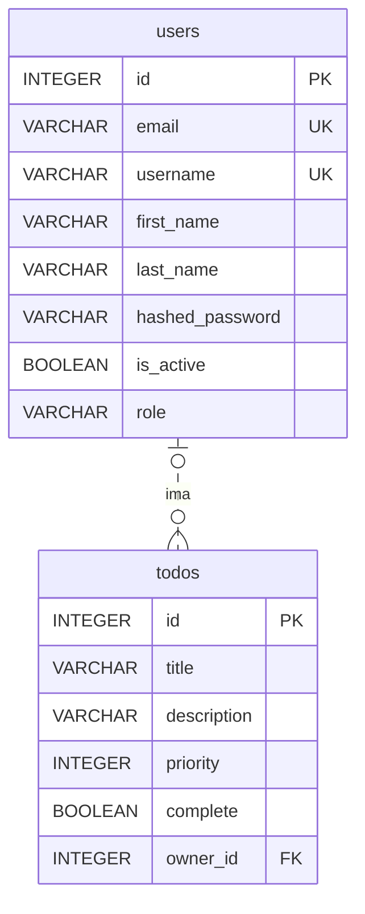

Oznake `UK` prikazuju `UNIQUE` ograničenja za `email` i `username`. **Mermaid blok ne prikazuje sva pravila:** u proveravanoj šemi sve kolone osim `id` dozvoljavaju `NULL`, uključujući `owner_id`, `email` i `username`. Za tačna ograničenja pogledaj tabelu u nastavku i SQL šemu.

---

### 3. Kako čitati vezu `users`–`todos`?

Posmatraj samo liniju koja opisuje vezu između tabela `users` i `todos` u ER dijagramu:

```text
users |o..o{ todos : "ima"
```

| Deo       | Značenje                                                             |
| --------- | -------------------------------------------------------------------- |
| `users`   | Tabela korisnika.                                                    |
| `\|o`     | Za jedan zadatak: nula ili jedan zabeležen korisnik.                 |
| `..`      | Neidentifikujuća veza: `owner_id` nije deo primarnog ključa zadatka. |
| `o{`      | Za jednog korisnika: nula ili više povezanih zadataka.               |
| `todos`   | Tabela zadataka.                                                     |
| `: "ima"` | Opis veze iz ugla korisnika; sam tekst ne nameće pravilo bazi.       |

---

#### Prvo pitanje: koliko korisnika ima jedan zadatak?

`todos.owner_id` sadrži **jednu vrednost** ili `NULL`. Zato model predviđa **nula ili jednog** zabeleženog korisnika za jedan zadatak. To je oznaka `|o` uz `users`.

Ako je `owner_id` `NULL`, korisnik nije zabeležen. Ako nije `NULL`, sa uključenom FK proverom pri upisu mora odgovarati postojećem `users.id`. Bez te provere može postojati i vrednost koja **ne odgovara nijednom korisniku**; sam dijagram to ne sprečava.

---

#### Drugo pitanje: koliko zadataka ima jedan korisnik?

Više redova `todos` može imati isti `owner_id`, jer on nije `UNIQUE`. Korisnik može postojati i bez ijednog reda u `todos`. Zato je uz `todos` oznaka `o{`: **nula, jedan ili više** zadataka.

Ovo je veza **jedan-prema-više**, pri čemu je vlasnik zadatka u šemi opcion. Nula zadataka ne znači „zadatak sa `NULL` vrednostima“, već da nema povezanog reda.

---

### 4. Primer sa izmišljenim podacima

Ovo nisu očitani korisnici niti stvarni zadaci iz tvoje baze; brojevi služe samo za objašnjenje.

| users.id | users.username |
| -------: | -------------- |
|        1 | ana            |
|        2 | marko          |

| todos.id | todos.title        | todos.owner_id |
| -------: | ------------------ | -------------: |
|       10 | Naučiti Mermaid    |              1 |
|       11 | Pročitati o SQLite |              1 |
|       12 | Pregledati beleške |           NULL |

- Ana (`id = 1`) povezana je sa dva zadatka jer oba imaju `owner_id = 1`.
- Marko (`id = 2`) u ovom primeru nema povezan zadatak.
- Zadatak 12 nema **zabeleženog** vlasnika. To je dozvoljeno šemom, iako ga uobičajeni API za kreiranje zadatka povezuje sa prijavljenim korisnikom.
- `owner_id = 1` je vrednost u **koloni reda zadatka**; ona upućuje na `users.id = 1`. To nije novi korisnički red.

---

### 5. Šta znače PK, FK, `NULL`, `UNIQUE` i `INDEX`?

| Element                      | Uloga u trenutno proverenoj šemi                                      |
| ---------------------------- | --------------------------------------------------------------------- |
| `users.id`                   | Primarni ključ koji identifikuje korisnika.                           |
| `todos.id`                   | Primarni ključ koji identifikuje zadatak.                             |
| `todos.owner_id`             | Strani ključ ka `users.id`; dozvoljava `NULL` i nije deo PK-a.        |
| `users.email`                | `UNIQUE`, ali dozvoljava `NULL`.                                      |
| `users.username`             | `UNIQUE`, ali dozvoljava `NULL`.                                      |
| `ix_users_id`, `ix_todos_id` | Obični indeksi nad kolonama `id`; nisu dodatne tabele ni novi odnosi. |

`UNIQUE` sprečava ponavljanje iste nenull vrednosti prema poređenju kolone, ali SQLite dozvoljava više `NULL` vrednosti u jedinstvenoj koloni. `NOT NULL` bi bio zasebno ograničenje. Primarni ključevi `id` već identifikuju red; indeksi `ix_users_id` i `ix_todos_id` proizlaze iz `index=True` u ORM modelu i nisu ono što stvara vezu među tabelama.

`title`, `description`, `priority` i `complete` su u bazi takođe **nullable**. Python modeli za `complete` i `is_active` imaju SQLAlchemy `default`, ali u proveravanom `CREATE TABLE` nema SQL `DEFAULT` klauzule za te kolone. ORM podrazumevana vrednost pri upisu nije isto što i `NOT NULL` ili automatsko popunjavanje kod svih direktnih SQL upisa.

---

### 6. Šema, provera FK-a i ponašanje API-ja nisu isto

#### Šta kaže model i šema?

U modelu je veza definisana ovako:

```python
owner_id: Mapped[int | None] = mapped_column(ForeignKey("users.id"), nullable=True)
```

`ForeignKey("users.id")` deklaracijom upućuje na `users.id`; `nullable=True` dozvoljava `NULL`. Model trenutno nema `relationship()` atribut za ove dve klase. FK kolona i ORM `relationship()` nisu isto.

U proveravanoj bazi FK ima `ON DELETE NO ACTION` i `ON UPDATE NO ACTION`. Kada se FK provera sprovodi, brisanje ili promena korisničkog ključa koji ostavlja nevažeću vezu može biti odbijena. To nije automatsko brisanje korisnikovih zadataka.

---

#### Da li se FK provera zaista sprovodi?

U trenutnoj proveri nove konekcije preko **konfigurisanog TodoApp engine-a** rezultat `PRAGMA foreign_keys;` bio je **`0`**. U pregledanom podešavanju nije pronađeno uključivanje te provere. To znači da ne treba pretpostaviti da sama deklaracija FK-a sprečava nevažeći `owner_id` u aplikaciji.

Provera je urađena bez izmene podešavanja ili podataka. Rezultat se odnosi na proverenu konekciju; FK je podešavanje **po konekciji**. Ako u posebnom SQLite CLI-ju pokreneš `PRAGMA foreign_keys = ON;`, time **ne uključuješ** proveru za postojeće ili buduće konekcije aplikacije.

Na proveravanoj bazi `PRAGMA foreign_key_check;` nije vratio redove: u trenutku provere nisu prijavljene postojeće FK povrede. To ne znači da će budući upisi sa isključenom proverom biti zaštićeni.

---

#### Šta radi API za kreiranje?

U endpoint-u `POST /todos/` aplikacija:

1. Zahteva prijavljenog korisnika preko dependency-ja `get_current_user`.

2. Validira zahtev kroz `CreateTodoRequest`: `title` i `description` imaju najmanje tri karaktera, `priority` mora biti od 1 do 5, a `complete` je obavezan.

3. Postavlja `owner_id=current_user.id`: klijent ne bira `owner_id` kroz taj zahtev.

4. Dodaje objekat u sesiju, poziva `commit()`, zatim `refresh()` i vraća `TodoResponse` sa statusom `201`.

To je **ponašanje ove API rute**, ne garancija svih mogućih upisa u bazu. Drugi kod ili direktan SQL može zaobići Pydantic validaciju i ovo postavljanje vlasnika. Takođe, API odgovor ne sadrži `owner_id`; Pydantic i SQL kolone ne moraju biti identične.

Pri čitanju, izmeni i brisanju obične `/todos` rute filtriraju zadatke prema `current_user.id`. Posebne `/admin` rute proveravaju administratorsku ulogu i ne primenjuju isti filter vlasnika na svoje upite. To je **pravilo pristupa u aplikaciji**, a ne nova veza u ERD-u.

---

### 7. Mermaid dijagram toka kreiranja zadatka

ERD pokazuje **strukturu** i moguću povezanost podataka. Sledeći dijagram toka pokazuje pojednostavljenu **uspešnu putanju** kroz aplikaciju:

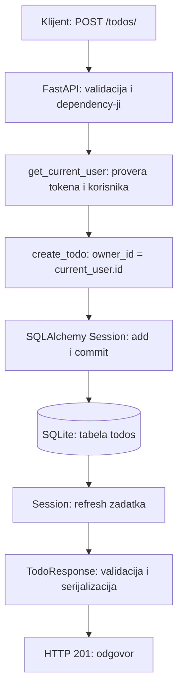

Ovo nije detaljan dijagram redosleda svih FastAPI internih koraka: validacija zahteva i dependency-ji prikazani su zajedno, a moguće greške i njihove grane nisu nacrtane. Neispravan zahtev ili nevažeći token ne prati ovu uspešnu putanju.

---

#### Šta znači svaki deo sintakse?

| Deo                                | Značenje                                                          |
| ---------------------------------- | ----------------------------------------------------------------- |
| `flowchart TD`                     | Dijagram toka odozgo nadole (_top down_).                         |
| `client`                           | Interni identifikator čvora koji koristimo pri povezivanju.       |
| `["Klijent: POST /todos/"]`        | Tekst prikazan u pravougaonom čvoru.                              |
| `-->`                              | Strelica ka sledećem koraku.                                      |
| `sqlite[("SQLite: tabela todos")]` | Čvor u obliku cilindra za skladištenje; sam oblik ne kreira bazu. |

`commit()` potvrđuje transakciju; `refresh()` učitava stanje objekta iz baze pre pretvaranja u `TodoResponse`. Ako dođe do greške pri upisu ili pretvaranju odgovora, ne treba ovaj dijagram tumačiti kao obećanje da će klijent dobiti `201`.

---

### 8. Kako samostalno proveriti šemu?

Ovo su naredbe za **SQLite CLI**, ne za Bash. Prvo otvori proveravani fajl iz korena repozitorijuma samo za čitanje:

```bash
sqlite3 -readonly fast-api-course-my-work/TodoApp/data/todosapp.db
```

Zatim u SQLite CLI-ju:

```sql
PRAGMA table_info('users');
PRAGMA table_info('todos');
PRAGMA foreign_key_list('todos');
PRAGMA index_list('users');
PRAGMA index_list('todos');
PRAGMA foreign_key_check;
```

U `table_info`, `notnull = 0` znači da deklaracija ne sadrži `NOT NULL`; kod `INTEGER PRIMARY KEY` treba uvažiti SQLite-ov poseban tretman primarnog ključa. U `foreign_key_list`, red za `owner_id` pokazuje tabelu `users` i ciljnu kolonu `id`. `foreign_key_check` vraća redove za pronađene povrede; prazan rezultat znači da ih nije prijavio u trenutku provere.

Za izlazak upiši `.quit`. `PRAGMA foreign_keys;` u tom CLI-ju prikazuje stanje **CLI konekcije**, ne stanje konekcije FastAPI aplikacije.

---

### 9. Kratka provera razumevanja

1. Zašto uz `users` stoji `|o`, a ne `||`?
2. Zašto jedan korisnik može imati više zadataka?
3. Da li `UNIQUE` na `username` automatski znači `NOT NULL` u SQLite-u?
4. Da li `POST /todos/` dozvoljava klijentu da odabere `owner_id`?
5. Da li `PRAGMA foreign_keys = ON;` u zasebnom CLI-ju uključuje proveru i u aplikaciji?

**Odgovori:** 1. `owner_id` dozvoljava `NULL`. 2. Više redova sme imati isti `owner_id`. 3. Ne. 4. Ne; ruta koristi ID prijavljenog korisnika. 5. Ne; podešavanje je po konekciji.

---

### Izvori za fazu 2

- [TodoApp modeli](../../../fast-api-course-my-work/TodoApp/models.py)
- [TodoApp Pydantic šeme](../../../fast-api-course-my-work/TodoApp/schemas.py)
- [Todo rute](../../../fast-api-course-my-work/TodoApp/api/routes/todos.py)
- [Autentifikacija i trenutni korisnik](../../../fast-api-course-my-work/TodoApp/core/security.py)

- [Admin rute](../../../fast-api-course-my-work/TodoApp/api/routes/admin.py)
- [Podešavanje baze](../../../fast-api-course-my-work/TodoApp/db/database.py)

---

## Faza 3 — Chinook: stvarna SQLite šema i čitanje njenih veza

### 1. Šta je provereno?

Chinook je primer baze za prodavnicu muzike: sadrži izvođače, albume, numere, plejliste, kupce, fakture i zaposlene. Ovo nije šema TodoApp-a i ne treba mešati njihove tabele.

Za ovu fazu pregledane su šeme:

1. Originalne baze [chinook.db](../../../fast-api-course-my-work/sqlite_for_beginners/chinook/chinook.db).

2. Radne kopije [chinook_practice.db](../../../fast-api-course-my-work/sqlite_for_beginners/playground/databases/chinook_practice.db).

Obe su otvorene **samo za čitanje**. Pri proveri imaju istu strukturu 11 korisničkih tabela prikazanih ispod. Radna kopija može kasnije da se promeni nezavisno od originala, pa proveri koju bazu imaš otvorenu.

Postojeći [Chinook ERD u draw.io formatu](../../../fast-api-course-my-work/sqlite_for_beginners/chinook/ERD.drawio) možeš otvoriti u VS Code-u. U njemu su za `genres`–`tracks` i `employees`–`customers` oznake dopunjene u `0..1 : 0..N`, jer odgovarajući FK-ovi dozvoljavaju `NULL`. Originalna [slika šeme](../../../fast-api-course-my-work/sqlite_for_beginners/chinook/db_schema.jpg) služi za poređenje, ali stvarna SQL šema ostaje merodavna.

> **Uslov za čitanje veza:** Dijagrami opisuju deklarisanu šemu i pretpostavljaju ispravne reference. SQLite proverava FK pri upisima samo kada je `PRAGMA foreign_keys = ON` uključena za konkretnu konekciju; ranije neispravne redove treba zasebno proveriti.

---

### 2. Kojih 11 tabela postoji?

| Tabela           | Šta predstavlja                                            |
| ---------------- | ---------------------------------------------------------- |
| `artists`        | Izvođače.                                                  |
| `albums`         | Albume i njihovog izvođača.                                |
| `tracks`         | Numere, sa vezama ka albumu, žanru i tipu medija.          |
| `genres`         | Žanrove numera.                                            |
| `media_types`    | Tipove medija numera.                                      |
| `playlists`      | Plejliste.                                                 |
| `playlist_track` | Parove plejlista i numera: povezničku tabelu.              |
| `customers`      | Kupce i opciono njihovog zaposlenog za podršku.            |
| `employees`      | Zaposlene i opciono njihove neposredne rukovodioce.        |
| `invoices`       | Fakture kupaca.                                            |
| `invoice_items`  | Pojedinačne stavke faktura i numere na koje se one odnose. |

`sqlite_sequence` se može pojaviti među internim SQLite tabelama zbog `AUTOINCREMENT`, ali nije jedna od 11 korisničkih tabela ovog modela.

---

### 3. Celokupni Mermaid ER dijagram

Ovaj dijagram prikazuje **svih 11 tabela i svih 11 deklarisanih stranih ključeva**, ali samo kolone potrebne za razumevanje veza. Ostale kolone nisu obrisane iz baze: jednostavno nisu iscrtane.

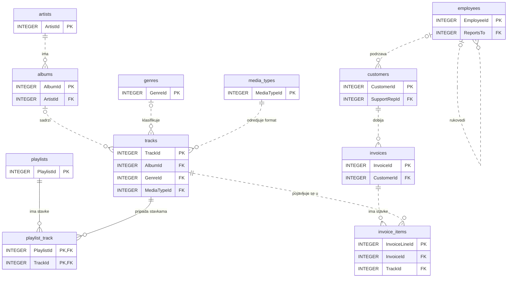

`PK, FK` znači da je kolona istovremeno **deo primarnog ključa** i **strani ključ**. `playlist_track` ima **jedan složeni PK od dve kolone**, a ne dva zasebna primarna ključa. Veze `--` su identifikujuće jer su ti FK-ovi deo složenog PK-a. Preostale veze su `..` jer odgovarajući FK nije deo PK-a deteta.

Veliki dijagram može biti sitan u Markdown pregledu. Zato su ispod izdvojene manje celine sa objašnjenjima. Položaj pravougaonika može se razlikovati od draw.io prikaza; bitne su oznake na krajevima veza, ne raspored na ekranu.

---

### 4. Sve veze na jednom mestu

Tabelu čitaj ovako: **„po jednom redu deteta: koliko roditelja”**, zatim **„po jednom roditelju: koliko redova deteta”**.

| Strani ključ → cilj                                  | Roditelj po jednom detetu | Dete po jednom roditelju | Zašto?                                |
| ---------------------------------------------------- | ------------------------- | ------------------------ | ------------------------------------- |
| `albums.ArtistId` → `artists.ArtistId`               | Tačno 1                   | 0..N                     | FK je `NOT NULL`, nije `UNIQUE`.      |
| `tracks.AlbumId` → `albums.AlbumId`                  | 0..1                      | 0..N                     | FK dozvoljava `NULL`, nije `UNIQUE`.  |
| `tracks.GenreId` → `genres.GenreId`                  | 0..1                      | 0..N                     | FK dozvoljava `NULL`, nije `UNIQUE`.  |
| `tracks.MediaTypeId` → `media_types.MediaTypeId`     | Tačno 1                   | 0..N                     | FK je `NOT NULL`, nije `UNIQUE`.      |
| `playlist_track.PlaylistId` → `playlists.PlaylistId` | Tačno 1                   | 0..N                     | FK je `NOT NULL` i deo složenog PK-a. |
| `playlist_track.TrackId` → `tracks.TrackId`          | Tačno 1                   | 0..N                     | FK je `NOT NULL` i deo složenog PK-a. |
| `customers.SupportRepId` → `employees.EmployeeId`    | 0..1                      | 0..N                     | FK dozvoljava `NULL`, nije `UNIQUE`.  |
| `employees.ReportsTo` → `employees.EmployeeId`       | 0..1                      | 0..N                     | FK dozvoljava `NULL`, nije `UNIQUE`.  |
| `invoices.CustomerId` → `customers.CustomerId`       | Tačno 1                   | 0..N                     | FK je `NOT NULL`, nije `UNIQUE`.      |
| `invoice_items.InvoiceId` → `invoices.InvoiceId`     | Tačno 1                   | 0..N                     | FK je `NOT NULL`, nije `UNIQUE`.      |
| `invoice_items.TrackId` → `tracks.TrackId`           | Tačno 1                   | 0..N                     | FK je `NOT NULL`, nije `UNIQUE`.      |

`NOT NULL` zahteva upisan ID, a uključen FK zahteva da odgovarajući roditelj postoji. Nijedan od ovih FK-ova sam ne zahteva da roditelj ima makar jedan red deteta; zato je na strani deteta u svakom redu tabele `0..N`.

---

### 5. Izvođači, albumi i numere

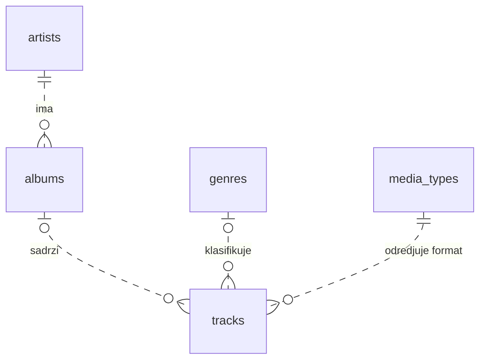

#### 5.1. `artists`–`albums`

```text
artists ||..o{ albums : "ima"
```

- **Jedan album → tačno jedan izvođač:** `albums.ArtistId` je `NOT NULL` FK ka `artists.ArtistId`.
- **Jedan izvođač → nula ili više albuma:** više albuma može imati isti `ArtistId`, a šema ne zahteva bar jedan album.
- `..` znači da `ArtistId` nije deo primarnog ključa albuma `AlbumId`.

#### 5.2. `albums`–`tracks`

```text
albums |o..o{ tracks : "sadrzi"
```

- **Jedna numera → nula ili jedan zabeležen album:** `tracks.AlbumId` dozvoljava `NULL`.
- **Jedan album → nula ili više numera:** više numera može upućivati na isti album; šema ne zahteva nijednu.

**Nula numera nije `NULL` numera:** nema nijednog reda `tracks` koji upućuje na album. To je tehnička mogućnost SQL šeme, ne tvrdnja da je album bez pesama poželjan u stvarnosti. Ako aplikacija želi da svaki album ima bar jednu numeru, potrebna je dodatna kontrola.

U proveri **originalne** baze bilo je 347 albuma i 3.503 numere; nijedan album nije bio bez povezane numere i nijedna numera nije imala `NULL` za `AlbumId`. To je tadašnje stanje podataka, ne pravilo šeme.

#### 5.3. Žanr i tip medija

- `genres |o..o{ tracks`: `tracks.GenreId` dozvoljava `NULL`. Za numeru može biti zabeleženo nula ili jedan žanr; jedan žanr može imati nula ili više numera.
- `media_types ||..o{ tracks`: `tracks.MediaTypeId` je `NOT NULL`. Za numeru se zahteva jedan tip medija; jedan tip može imati nula ili više numera.

Oznaka `|o` opisuje koliko je veza **zabeleženo**, ne da li numera u stvarnosti ima žanr.

---

### 6. Plejliste i numere: N:M preko `playlist_track`

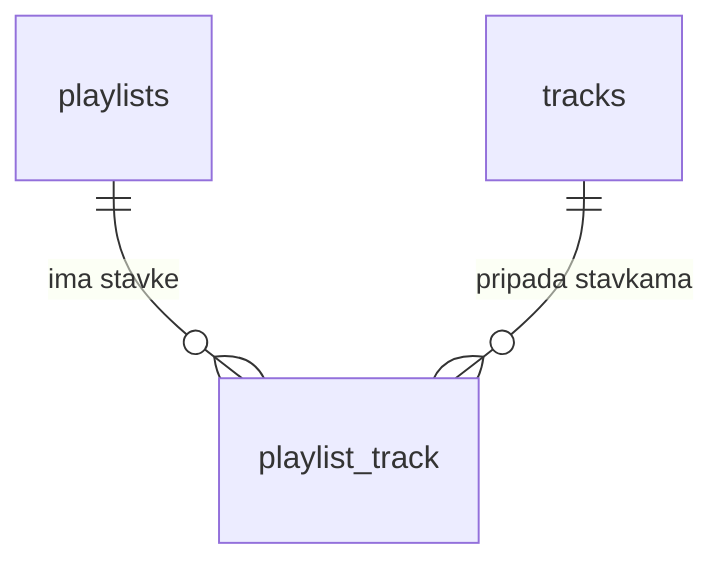

Jedna plejlista može sadržati više numera, a jedna numera može pripadati više plejlista. Zato je ukupni odnos `playlists`–`tracks` **više-prema-više (N:M)**.

Tabela `playlist_track` ostvaruje to pomoću po jednog reda za svaki par:

| PlaylistId | TrackId | Objašnjenje                     |
| ---------: | ------: | ------------------------------- |
|          1 |      10 | Numera 10 je u plejlisti 1.     |
|          1 |      11 | Plejlista 1 sadrži i numeru 11. |
|          2 |      10 | Numera 10 je i u plejlisti 2.   |

Ovo su **izmišljeni parovi** za objašnjenje, ne tvrdnja o sadržaju tvoje baze.

- Svaki red međutabele ima **tačno jednu** plejlistu i **tačno jednu** numeru, uz sprovodivu FK proveru.
- Plejlista može imati **nula ili više** povezanih redova; isto važi za numeru.
- Složeni PK je `(PlaylistId, TrackId)`: drugi red sa istim parom nije dozvoljen. Nijedna kolona sama nije jedinstvena, pa se može ponavljati uz drugi ID.
- Oba FK-a su deo složenog PK-a, zato je u ovim vezama linija `--`.
- Ova šema nema kolonu za redosled numera u plejlisti. Sortiranje po `TrackId` ne dokazuje stvarni redosled u plejlisti.

---

### 7. Kupci, fakture i stavke

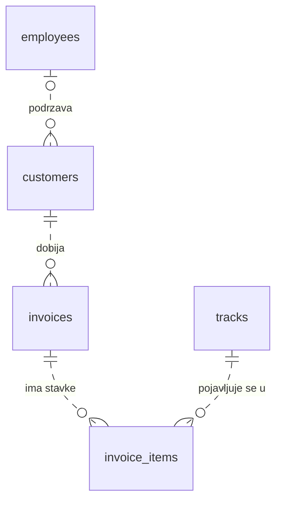

1. **Zaposleni i kupac:** jedan kupac ima nula ili jednog zabeleženog zaposlenog za podršku (`SupportRepId` je nullable); jedan zaposleni može podržavati nula ili više kupaca.

2. **Kupac i faktura:** svaka faktura zahteva jednog kupca (`CustomerId` je `NOT NULL` FK); kupac može imati nula ili više faktura.

3. **Faktura i stavka:** svaka stavka upućuje na jednu fakturu (`InvoiceId` je `NOT NULL` FK); faktura po šemi može imati nula ili više stavki. Ako poslovno pravilo zahteva bar jednu, potrebno ga je dodatno obezbediti.

4. **Numera i stavka:** svaka stavka upućuje na jednu numeru (`TrackId` je `NOT NULL` FK); numera može biti u nula ili više stavki, uključujući stavke različitih faktura.

`invoice_items` povezuje fakture i numere, ali **nije isto što i `playlist_track`**: ima sopstveni PK `InvoiceLineId`, kao i `Quantity` i `UnitPrice`. Šema ne nameće jedinstvenost para `(InvoiceId, TrackId)`, pa nije isto pravilo kao za par u `playlist_track`. Njeni FK-ovi nisu deo PK-a, zato su linije `..`.

---

### 8. Samoreferencirajuća veza zaposlenih

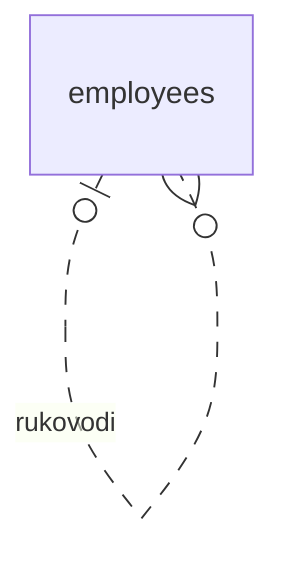

Oba kraja imaju isti naziv tabele, ali predstavljaju **dve uloge različitih redova**:

- Levo: mogući **rukovodilac**.
- Desno: **zaposleni** čija kolona `ReportsTo` upućuje na rukovodiočev `EmployeeId`.

Jedan zaposleni može imati **nula ili jednog** zabeleženog rukovodioca (`ReportsTo` dozvoljava `NULL`). Jedan rukovodilac može imati **nula ili više** zaposlenih koji na njega upućuju.

FK proverava postojanje upisanog ID-ja kada je uključena, ali sam po sebi ne dokazuje da je hijerarhija poslovno ispravna: na primer, ne zabranjuje automatski samoreferencu ili ciklus. Za takva pravila potrebna je dodatna kontrola.

---

### 9. Kako sam proveriš šemu i podatke?

Iz korena repozitorijuma otvori **originalnu bazu samo za čitanje**:

```bash
sqlite3 -readonly fast-api-course-my-work/sqlite_for_beginners/chinook/chinook.db
```

Ako želiš da ispituješ **radnu kopiju**, zameni putanju sa `fast-api-course-my-work/sqlite_for_beginners/playground/databases/chinook_practice.db`. U SQLite CLI-ju proveri otvoreni fajl:

```text
.databases
.tables
.schema albums
.schema tracks
.schema playlist_track
```

Naredbe sa tačkom su SQLite CLI komande, ne SQL. `main` u `.databases` pokazuje koja baza je otvorena kao glavna.

#### 9.1. Provera ključeva i ograničenja

```sql
PRAGMA table_info('tracks');
PRAGMA foreign_key_list('tracks');
PRAGMA table_info('playlist_track');
PRAGMA foreign_key_list('playlist_track');
PRAGMA foreign_keys;
PRAGMA foreign_key_check;
```

- `table_info` prikazuje kolone, oznaku `notnull` i položaj u PK-u. Za `playlist_track` vrednosti `pk = 1` i `pk = 2` označavaju redosled delova **jednog složenog ključa**.
- `foreign_key_list` pokazuje ciljnu tabelu, izvornu i ciljnu kolonu, kao i akcije pri promeni ili brisanju roditelja.
- `foreign_keys` prikazuje stanje FK provere **ove CLI konekcije**. `1` znači uključena, `0` isključena.
- `foreign_key_check` prijavljuje postojeće FK povrede. Ako nema redova, u trenutku provere nisu prijavljene povrede; to ne garantuje zaštitu budućih upisa.

Primeri su samo za čitanje. Proveru FK-a za CLI možeš uključiti sa `PRAGMA foreign_keys = ON;` pre transakcije, ali to ne menja podešavanje drugih konekcija.

#### 9.2. Primer `JOIN`: izvođač, album i numera

```sql
SELECT ar.Name AS Artist, al.Title AS Album, t.Name AS Track
FROM artists AS ar
JOIN albums AS al ON al.ArtistId = ar.ArtistId
JOIN tracks AS t ON t.AlbumId = al.AlbumId
ORDER BY ar.ArtistId, al.AlbumId, t.TrackId
LIMIT 5;
```

`JOIN` povezuje redove poređenjem ključeva; jedan izvođač i album mogu se ponoviti u više izlaznih redova jer album može imati više numera. Ovo je **unutrašnji JOIN**: numere bez albuma ne pojavljuju se u ovom rezultatu. `ORDER BY` pre `LIMIT` daje određen redosled izbora prvih pet redova.

#### 9.3. Pronađi album bez numera

```sql
SELECT al.AlbumId, al.Title
FROM albums AS al
WHERE NOT EXISTS (
    SELECT 1
    FROM tracks AS t
    WHERE t.AlbumId = al.AlbumId
);
```

Ako nema rezultata, nijedan album u **trenutnim podacima te baze** ne ispunjava uslov. To ne menja činjenicu da šema može dopustiti album bez povezanih numera.

#### 9.4. Prikaži parove plejlista i numera

```sql
SELECT p.PlaylistId, p.Name AS Playlist, t.TrackId, t.Name AS Track
FROM playlists AS p
JOIN playlist_track AS pt ON pt.PlaylistId = p.PlaylistId
JOIN tracks AS t ON t.TrackId = pt.TrackId
ORDER BY p.PlaylistId, t.TrackId
LIMIT 5;
```

`pt` je alias za povezničku tabelu. Svaki rezultat ovde predstavlja jedan povezani par; sortiranje služi pregledu i nije redosled numera definisan u šemi.

Završi rad sa `.quit`. Ako želiš da isprobavaš `INSERT`, `UPDATE` ili `DELETE`, koristi zasebnu kopiju baze i prethodno razumi posledice, ne originalnu bazu.

---

### 10. Kratka provera razumevanja

1. Zašto `albums |o..o{ tracks` ima `|o` uz `albums`?
2. Da li nula numera znači da u bazi postoji `NULL` pesma?
3. Zašto `playlist_track` ima dve pune veze `--`?
4. Da li `invoice_items` zabranjuje isti par faktura–numera kao `playlist_track` isti par plejlista–numera?
5. Može li `employees.ReportsTo` upućivati na istu tabelu?
6. Da li `PRAGMA foreign_keys` u tvom CLI-ju opisuje i sve ostale konekcije?

**Odgovori:** 1. `tracks.AlbumId` dozvoljava `NULL`. 2. Ne; nema povezanog reda. 3. Oba FK-a su deo složenog PK-a. 4. Ne; par nije jedinstven po prikazanoj šemi. 5. Da; to je samoreferencirajući FK. 6. Ne; podešavanje je po konekciji.

---

### Izvori za fazu 3

- [Originalna Chinook baza](../../../fast-api-course-my-work/sqlite_for_beginners/chinook/chinook.db)

- [Chinook ERD](../../../fast-api-course-my-work/sqlite_for_beginners/chinook/ERD.drawio)

- [SQLite for Beginners — uputstvo](../../../fast-api-course-my-work/sqlite_for_beginners/README.md)

- [Vežba 3: relacije u Chinook bazi](../../../fast-api-course-my-work/sqlite_for_beginners/00_intro/04_database_concepts.md#vežba-3--istraži-relacije-u-chinook-bazi)

---

## Faza 4 — SQLAlchemy ORM Fundamentals: modeli, veze i baza

### 1. Šta je provereno?

Ovaj deo opisuje **tvoj praktični projekat**, a ne nužno svaku kasniju verziju kursnog izvornog koda:

- [Modeli kategorija, proizvoda i zaliha](../../../fast-api-course-my-work/sqlalchemy_orm_fundamentals/models/catalog.py).

- [Modeli korisnika i porudžbina](../../../fast-api-course-my-work/sqlalchemy_orm_fundamentals/models/orders.py).

- [Modeli promocija](../../../fast-api-course-my-work/sqlalchemy_orm_fundamentals/models/promotions.py).

- [Zajednička deklarativna baza](../../../fast-api-course-my-work/sqlalchemy_orm_fundamentals/db/base.py).

- [Uputstvo praktičnog projekta](../../../fast-api-course-my-work/sqlalchemy_orm_fundamentals/README.md).

Pregledom koda i SQLAlchemy metapodataka potvrđeno je **osam tabela i sedam FK-ova**.

Postojeći [ERD projekta u draw.io formatu](../../../fast-api-course-my-work/sqlalchemy_orm_fundamentals/ERD_project_1.drawio) prikazuje te modele.

> **Važno — model nije dokaz o postojećoj bazi:** praktični projekat u trenutku provere nema sopstvene implementirane `engine` i `session` module. Zato ovde ne tvrdimo da je njegova šema već kreirana u nekoj tvojoj bazi. Dijagram opisuje **trenutne ORM metapodatke i njihovu nameravanu šemu**.

Radi nezavisne provere, modeli su učitani i kreirani samo u **privremenoj SQLite bazi u memoriji**. Nije korišćena niti menjana TodoApp, Chinook ili PostgreSQL baza. PostgreSQL i SQLite nisu identični; stvarni DDL i ponašanje zavise od ciljnog DBMS-a.

---

### 2. Kojih osam modela postoji?

| Python klasa              | Naziv tabele                 | Uloga                                           |
| ------------------------- | ---------------------------- | ----------------------------------------------- |
| `Kategorija`              | `kategorija`                 | Kategorije i opciona hijerarhija roditelj–dete. |
| `Proizvod`                | `proizvod`                   | Proizvod koji pripada jednoj kategoriji.        |
| `StanjeZaliha`            | `stanje_zaliha`              | Podaci o količini i vremenu provere zaliha.     |
| `PromotivniDogadjaj`      | `promotivni_dogadjaj`        | Promotivni događaj.                             |
| `VezaProizvodaIPromocije` | `veza_proizvoda_i_promocije` | Poveznički zapis proizvoda i promocije.         |
| `Korisnik`                | `korisnik`                   | Korisnik koji može imati porudžbine.            |
| `Porudzbina`              | `porudzbina`                 | Porudžbina koja pripada korisniku.              |
| `StavkaPorudzbine`        | `stavka_porudzbine`          | Veza porudžbine i proizvoda uz količinu.        |

Naziv klase je Python ime, a `__tablename__` daje naziv SQL tabele. Objekat, na primer `Proizvod(...)`, nije sama tabela: on predstavlja jedan Python objekat koji ORM može povezati sa jednim redom.

**Posebno obrati pažnju na `StanjeZaliha`:** model za sada nema FK ka proizvodu ni ORM `relationship()` sa proizvodom. Iako takva veza može biti smislen budući korak, u trenutnom kodu **nije implementirana**; zato nećemo crtati izmišljenu vezu.

---

### 3. Mermaid ER dijagram trenutnih modela

Dijagram prikazuje svih osam tabela i svih sedam FK veza, uz **izbor ključnih kolona**. Ostale kolone modela nisu prikazane. `stanje_zaliha` je namerno odvojena tabela.

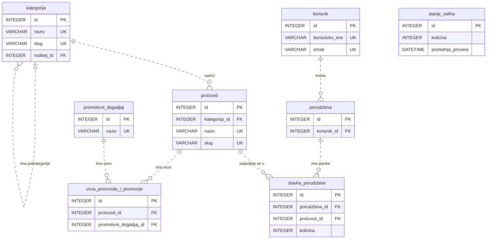

Kompozitni `UNIQUE` nad parom `(proizvod_id, promotivni_dogadjaj_id)` nije posebno iscrtan: odnosi se na **zajednički par**, ne na svaku kolonu pojedinačno. Njegova uloga objašnjena je u odeljku 7.

Sve linije su `..`: u ovim modelima FK kolone **nisu deo PK-a** deteta. To važi i za povezničku tabelu promocija, čiji je PK posebna kolona `id`. Nemoj je mešati sa Chinook tabelom `playlist_track`, gde su obe FK kolone deo složenog PK-a i linije su `--`.

---

### 4. Sve FK veze na jednom mestu

Kardinalnost opisuje šemu koja bi bila kreirana prema ovim modelima, uz ispravno sprovedena FK ograničenja:

| Strani ključ → cilj                                                            | Roditelj po jednom detetu | Dete po jednom roditelju | Posebnost                                      |
| ------------------------------------------------------------------------------ | ------------------------- | ------------------------ | ---------------------------------------------- |
| `kategorija.roditelj_id` → `kategorija.id`                                     | 0..1                      | 0..N                     | `NULL` je dozvoljen; samoreferencirajuća veza. |
| `proizvod.kategorija_id` → `kategorija.id`                                     | Tačno 1                   | 0..N                     | Obavezna kategorija proizvoda.                 |
| `porudzbina.korisnik_id` → `korisnik.id`                                       | Tačno 1                   | 0..N                     | Obavezni korisnik porudžbine.                  |
| `stavka_porudzbine.porudzbina_id` → `porudzbina.id`                            | Tačno 1                   | 0..N                     | Stavka pripada jednoj porudžbini.              |
| `stavka_porudzbine.proizvod_id` → `proizvod.id`                                | Tačno 1                   | 0..N                     | Stavka referencira jedan proizvod.             |
| `veza_proizvoda_i_promocije.proizvod_id` → `proizvod.id`                       | Tačno 1                   | 0..N                     | Jedna strana veze sa promocijom.               |
| `veza_proizvoda_i_promocije.promotivni_dogadjaj_id` → `promotivni_dogadjaj.id` | Tačno 1                   | 0..N                     | Druga strana iste povezničke tabele.           |

Kod svih šest obaveznih FK kolona `nullable=False` zahteva vrednost. Uz sproveden FK, ona mora odgovarati postojećem roditeljskom redu. Nijedan od ovih FK-ova sam ne zahteva bar jedan red deteta za svakog roditelja.

---

### 5. Kategorija i proizvod: jedna veza iz dva ugla

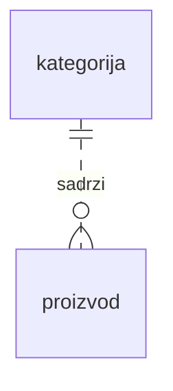

Čitaj oznake:

1. Za **jedan proizvod**: `||` uz `kategorija` znači tačno jednu kategoriju. `Proizvod.kategorija_id` je obavezan FK.

2. Za **jednu kategoriju**: `o{` uz `proizvod` znači nula ili više proizvoda. FK nije jedinstven, pa više proizvoda može imati isti `kategorija_id`.

3. Isprekidana veza `..` znači da `kategorija_id` nije deo PK-a proizvoda.

---

#### Ista veza u bazi i u ORM-u

| Gde?                        | Element         | Značenje                                            |
| --------------------------- | --------------- | --------------------------------------------------- |
| SQL tabela `proizvod`       | `kategorija_id` | Vrednost FK-a koja upućuje na `kategorija.id`.      |
| Python objekat `Proizvod`   | `kategorija`    | ORM atribut za pristup jednom objektu `Kategorija`. |
| Python objekat `Kategorija` | `proizvodi`     | ORM kolekcija povezanih objekata `Proizvod`.        |

`relationship()` **ne stvara dodatnu SQL kolonu**. On daje način za navigaciju Python objektima. U modelima:

```python
# Izdvojeni delovi postojećih modela; nisu samostalan Python program.
proizvodi: Mapped[list[Proizvod]] = relationship(
    back_populates="kategorija",
    passive_deletes="all",
)

kategorija: Mapped[Kategorija] = relationship(back_populates="proizvodi")
```

`back_populates="kategorija"` upućuje na **ime ORM atributa** `Proizvod.kategorija`, a obrnuti `back_populates="proizvodi"` na `Kategorija.proizvodi`. To nisu nazivi FK kolona.

---

#### Primer povezivanja u Python memoriji

Ovaj primer možeš pokrenuti iz **korena repozitorijuma**. On pravi samo Python objekte: ne otvara bazu i ništa ne upisuje.

```bash
PYTHONPATH=fast-api-course-my-work .venv/bin/python - <<'PY'
from decimal import Decimal
from sqlalchemy_orm_fundamentals.models import Kategorija, Proizvod

kategorija = Kategorija(naziv="Audio", slug="audio")
proizvod = Proizvod(
    naziv="Slusalice",
    slug="slusalice",
    opis="Primer proizvoda",
    cena=Decimal("1000.00"),
)

proizvod.kategorija = kategorija
print(proizvod.kategorija is kategorija)
print(proizvod in kategorija.proizvodi)
PY
```

Očekivani izlaz su dve vrednosti `True`. Dodela `proizvod.kategorija` povezuje i drugu stranu u memoriji zahvaljujući uparenim ORM atributima. **To nije `INSERT` niti `COMMIT`.** Za upis su potrebni engine, sesija, odgovarajuća šema i uspešan `flush()` / `commit()`. Ne treba pretpostaviti ni da je generisani ID dostupan pre upisa.

`flush()` šalje promene bazi unutar trenutne transakcije, ali ih sam ne potvrđuje trajno; `commit()` potvrđuje transakciju. Transakcija može biti poništena sa `rollback()`.

Pristup `relationship()` atributu učitanog objekta može pokrenuti dodatni SQL upit ako veza nije već učitana; Python navigacija nije uvek besplatno čitanje iz memorije.

---

### 6. Hijerarhija kategorija: ista tabela, dve uloge

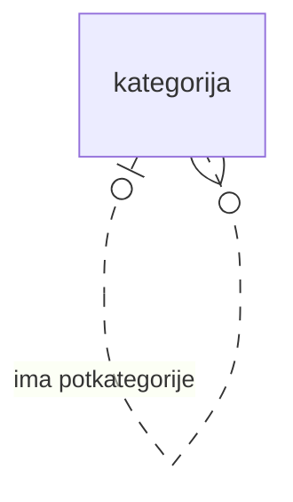

`Kategorija.roditelj_id` je FK ka `kategorija.id` **u istoj tabeli**. Leva strana linije predstavlja roditeljsku kategoriju, a desna potkategoriju:

- Jedna kategorija može imati **nula ili jednog** roditelja: `roditelj_id` dozvoljava `NULL`.
- Jedna kategorija može imati **nula ili više** direktnih potkategorija.
- `Kategorija.roditelj` je ORM atribut za jednog roditelja ili `None`.
- `Kategorija.deca` je ORM kolekcija direktne dece, ne automatski spisak svih potomaka.

Na atributu `roditelj`, `remote_side` pomaže ORM-u da u samoreferencirajućoj vezi razlikuje stranu roditelja. `back_populates` povezuje atribute `roditelj` i `deca`. FK sam po sebi ne sprečava sve cikluse u hijerarhiji; ako su zabranjeni, treba dodatno pravilo.

---

### 7. Proizvodi i promocije: N:M preko posebnog objekta

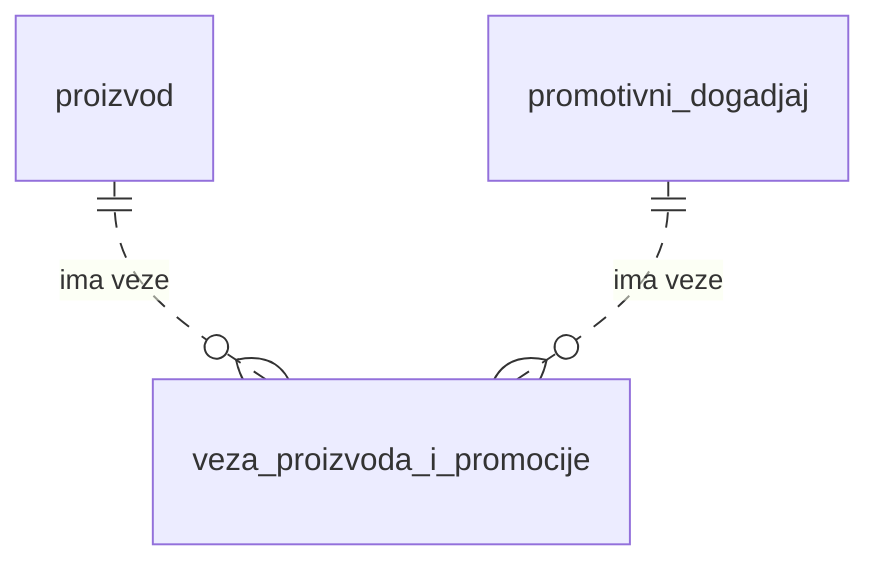

Jedan proizvod može učestvovati u više promocija, a jedna promocija može obuhvatiti više proizvoda. Poveznički model `VezaProizvodaIPromocije` beleži parove:

|  id | proizvod_id | promotivni_dogadjaj_id | Značenje                            |
| --: | ----------: | ---------------------: | ----------------------------------- |
|   1 |          10 |                      2 | Proizvod 10 je u promociji 2.       |
|   2 |          10 |                      3 | Isti proizvod je i u promociji 3.   |
|   3 |          11 |                      2 | Promocija 2 obuhvata i proizvod 11. |

Ovo su izmišljeni podaci, ne podaci iz korisničke baze.

- `id` je **jednostavni PK** povezničkog reda.
- Dve FK kolone su obavezne i upućuju na odgovarajući proizvod i promociju.

- `UniqueConstraint("proizvod_id", "promotivni_dogadjaj_id", name="uq_proizvod_promocija")` sprečava drugi red sa istim **parom**, a ne ponavljanje svakog ID-ja zasebno.

- Zato veza `(10, 2)` ne može biti upisana dvaput, ali `(10, 3)` i `(11, 2)` mogu.

U ovom praktičnom projektu ORM navigacija ide preko **mapiranog povezničkog objekta**, na primer `proizvod.veze_promocija` → `veza.promotivni_dogadjaj`. Trenutni modeli ne definišu direktnu kolekciju promocija sa `secondary=`. To je razlika između ovog projekta i nekih primera iz kursa.

---

### 8. Korisnik, porudžbina i stavke

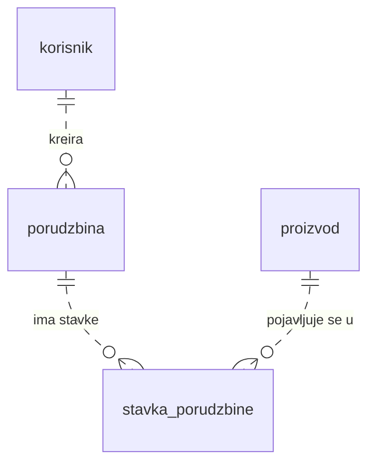

- Svaka porudžbina ima jednog korisnika; korisnik može imati nula ili više porudžbina.

- Svaka stavka ima jednu porudžbinu i jedan proizvod; porudžbina i proizvod mogu imati nula ili više povezanih stavki.

- `StavkaPorudzbine` ima svoj `id` kao PK i dodatni podatak `kolicina`.

Porudžbina i proizvod time imaju odnos **više-prema-više preko stavki**. Za razliku od povezničke tabele promocija, ovde trenutno **nema** `UNIQUE` ograničenja na paru `(porudzbina_id, proizvod_id)`. Zato sama šema ne zabranjuje da se isti proizvod pojavi u više stavki iste porudžbine. Ako poslovno pravilo treba drugačije ponašanje, mora se dodatno definisati.

Takođe, FK ne zahteva da svaka porudžbina ima bar jednu stavku. `o{` prikazuje šta šema dopušta, ne tvrdnju da je prazna porudžbina poželjna.

---

### 9. Gde je veza jedan-prema-jedan sa zalihama?

Na trenutnom ERD-u **nema veze** `proizvod`–`stanje_zaliha`: `StanjeZaliha` trenutno ima `id`, `kolicina` i `poslednja_provera`, ali nema `proizvod_id`. Ne zaključuj postojanje veze samo iz naziva tabela.

U [teoriji lekcije o jedan-prema-jedan vezi](<../../sqlalchemy_orm_fundamentals/01_defining_database_models(tables)/16_creating_a_one_to_one_relationship.md>) opisuje se mogući obrazac sa FK-om u tabeli zaliha. **To je obrazac za učenje, ne opis trenutno implementiranog praktičnog modela.**

Kada bi se kasnije usvojilo pravilo da svaki red zaliha pripada jednom proizvodu, a proizvod ima najviše jedan takav red, uobičajen dizajn bio bi FK ka proizvodu sa `NOT NULL` i `UNIQUE`:

```text
proizvod ||..o| stanje_zaliha : "ima"
```

To bi značilo: jedan zapis zaliha ima tačno jedan proizvod; jedan proizvod može imati nula ili jedan zapis zaliha. **Ovaj red je hipotetičan**, a samo skalarni ORM atribut ne bi zamenio bazni `UNIQUE`. Nijedan model ni šema nisu izmenjeni u ovoj fazi.

---

### 10. `ON DELETE`, ORM i ograničenja baze

U trenutnim modelima `ondelete="RESTRICT"` izričito je naveden za:

1. `kategorija.roditelj_id` → `kategorija.id`.
2. `proizvod.kategorija_id` → `kategorija.id`.
3. `porudzbina.korisnik_id` → `korisnik.id`.

To je namera da baza odbije brisanje roditelja koji je i dalje referenciran, **ako stvarno FK ograničenje postoji u bazi i DBMS ga sprovodi**. Na odgovarajućim roditeljskim ORM kolekcijama `deca`, `proizvodi` i `porudzbine` je `passive_deletes="all"`: ORM ne poništava te FK-ove pre nego što baza obradi brisanje.

Preostala četiri FK-a nemaju eksplicitni `ondelete`. Ne treba iz toga zaključiti da se deca automatski kaskadno brišu; ponašanje zavisi od stvarne šeme, DBMS-a i ORM konfiguracije. `RESTRICT`, ORM kaskade i `passive_deletes` su različita podešavanja.

U izdvojenom SQLite testu, sa FK proverom uključenom na konekciji, pokušaj brisanja kategorije sa povezanim proizvodom odbijen je. To je test privremene baze, ne dokaz o konfiguraciji neke buduće PostgreSQL baze.

---

### 11. Poređenje: Python model, SQL šema i stvarna baza

| Pojam            | Šta sadrži                                                         | Šta sam po sebi ne garantuje                     |
| ---------------- | ------------------------------------------------------------------ | ------------------------------------------------ |
| ORM klasa        | `mapped_column()`, tipove, FK i `relationship()` deklaracije.      | Da je tabela već kreirana u konkretnoj bazi.     |
| `Base.metadata`  | SQLAlchemy opise tabela registrovanih nakon uvoza modela.          | Da postojeća baza ima identičnu šemu.            |
| Stvarna SQL šema | Tabele i ograničenja koja zaista postoje u konkretnom DBMS-u.      | Da ORM model nije zastareo ili drugačiji.        |
| `Session`        | ORM rad sa objektima i transakcijom kada je povezana sa engine-om. | Trajni upis pre uspešnog `commit()`-a.           |
| Mermaid ERD      | Tekstualni i vizuelni opis odabranog modela.                       | Izvršavanje SQL-a ili automatsku sinhronizaciju. |

#### Zašto `NOT NULL`, `UNIQUE` i indeks nisu isto?

- `nullable=False` opisuje `NOT NULL`: na primer, `korisnik_id` porudžbine ne sme biti SQL `NULL`. `NULL` nije isto što i prazan string. Sam `NOT NULL` ne proverava da li taj korisnik postoji; za to je zadužen FK.

- `unique=True` zahteva jedinstvenu vrednost: na primer, dva korisnika ne mogu imati isti `email`. `NOT NULL` je zasebno naveden da email ne bi bio `NULL`.

- `INDEX` prvenstveno pomaže pri traženju i drugim operacijama; običan indeks sam ne zabranjuje duplikate. Jedinstveni indeks može ih zabraniti, ali nije isto što i `NOT NULL` ili FK.

- U trenutnim ORM metapodacima nema posebno deklarisanih `Index` objekata. To **ne znači** da konkretna baza nema indekse: DBMS može, na primer, kreirati indeks za sprovođenje `PRIMARY KEY` ili `UNIQUE` ograničenja. Proverava se konkretna baza.

Na primer, `default=func.now()` i `onupdate=func.now()` u modelima su SQLAlchemy podešavanja za generisanje vrednosti pri odgovarajućim operacijama. To nije isto što i DDL `server_default`: ne treba pretpostaviti da će direktan SQL van SQLAlchemy-ja dobiti iste podrazumevane vrednosti ili ažuriranja.

`Base.metadata.create_all()` može kreirati **nedostajuće** tabele u ciljnoj bazi; ne menja postojeće tabele da bi ih uskladio sa novim modelima. Promena modela ne znači da je postojeća baza automatski migrirana. Ciljnu bazu i posledice uvek proveri pre operacija nad šemom; ne pokreći `drop_all()` ili reset skripte nad podacima koje želiš da sačuvaš.

---

#### Proveri metapodatke bez povezivanja na bazu

Iz korena repozitorijuma:

```bash
PYTHONPATH=fast-api-course-my-work .venv/bin/python - <<'PY'
from sqlalchemy_orm_fundamentals.db.base import Base
import sqlalchemy_orm_fundamentals.models  # Registruje sve modele u Base.metadata.

for table in Base.metadata.sorted_tables:
    print(table.name)
    for fk in sorted(table.foreign_keys, key=lambda item: item.parent.name):
        print(f"  {fk.parent.name} -> {fk.target_fullname} (ondelete={fk.ondelete})")
PY
```

Uvoz modula sa modelima je bitan jer se tabela registruje u metapodacima kada se odgovarajuća klasa učita. Komanda ispisuje osam naziva i sedam FK-ova; ona **ne čita stvarnu bazu**. `ondelete=None` znači da opcija u tom modelu nije eksplicitno navedena, ne dokaz da je akcija u nekoj postojećoj bazi ista.

---

### 12. Kratka provera razumevanja

1. Zašto `stanje_zaliha` nema liniju ka `proizvod` u trenutnom dijagramu?
2. Da li `relationship()` stvara dodatnu FK kolonu?
3. Šta `back_populates` povezuje?
4. Zašto su veze do `veza_proizvoda_i_promocije` isprekidane?
5. Šta sprečava ponavljanje istog para proizvoda i promocije?
6. Da li sama šema traži da svaka porudžbina već ima stavku?
7. Da li promena modela automatski menja već postojeću tabelu u bazi?

**Odgovori:** 1. Nema definisanog FK-a ni ORM veze. 2. Ne. 3. Uparene ORM atribute dve strane. 4. FK-ovi nisu deo PK-a `id`. 5. Složeni `UniqueConstraint` nad parom. 6. Ne. 7. Ne; potrebna je odgovarajuća promena šeme odnosno migracija.

---

### Izvori za fazu 4

- [SQLAlchemy ORM Fundamentals: praktični projekat](../../../fast-api-course-my-work/sqlalchemy_orm_fundamentals/README.md)

- [ERD projekta u draw.io formatu](../../../fast-api-course-my-work/sqlalchemy_orm_fundamentals/ERD_project_1.drawio)

- [relationship i back_populates](../../sqlalchemy_orm_fundamentals/cheatsheets/relationship_i_back_populates.md)

- [Samoreferencirajuće veze](<../../sqlalchemy_orm_fundamentals/01_defining_database_models(tables)/13_self_referencing_relationships.md>)

- [Ponašanje pri brisanju](<../../sqlalchemy_orm_fundamentals/01_defining_database_models(tables)/14_on_delete_behaviour.md>)

- [Veza više-prema-više](<../../sqlalchemy_orm_fundamentals/01_defining_database_models(tables)/15_defining_many_to_many_relationships.md>)

- [Veza jedan-prema-jedan](<../../sqlalchemy_orm_fundamentals/01_defining_database_models(tables)/16_creating_a_one_to_one_relationship.md>)

---

## Faza 5 — Završno ponavljanje i samostalne vežbe

### 1. Kako da koristiš ovaj deo?

Cilj nije da napamet prepišeš Mermaid linije, već da iz šeme **samostalno zaključiš** šta oznake treba da budu. Vežbe idu od jednostavnog čitanja do poređenja tri projekta.

1. Pročitaj zadatak i zapiši odgovor svojim rečima.

2. Za crtanje napravi poseban Markdown dokument za svoje beleške ili koristi poseban blok u dokumentu po svom izboru. Ne moraš menjati projektne modele niti baze.

3. Napiši Mermaid blok, sačuvaj dokument i otvori Markdown pregled pomoću **Ctrl+Shift+V**. Ako pregled ne prikazuje dijagram, proveri podršku za Mermaid i sadržaj bloka.

4. Pročitaj oba kraja svake veze: prvo **jedan red deteta → koliko roditelja**, pa **jedan roditelj → koliko dece**.

5. Tek onda pogledaj odgovarajuće rešenje u odeljku 5 i ispravi svoj odgovor. Raspored čvorova i opis veze posle `:` ne moraju biti isti kao u rešenju.

Za probu možeš prekopirati sledeći obrazac, uključujući početnu i završnu liniju sa tri obrnuta apostrofa:

````text
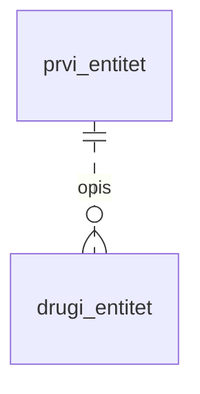
````

> **Bezbednost vežbanja:** ovde se ništa ne upisuje u baze. Podaci u tabelama zadataka su izmišljeni. Za SQL proveru koristi `sqlite3 -readonly` i samo navedene upite/PRAGMA naredbe. Hipotetične promene služe za crtanje: nemoj ih primenjivati na projektne modele ili šeme kao deo ovih vežbi.

---

### 2. Završni podsetnik pre vežbanja

| Pojam                | Šta proveravaš?                                           | Važna razlika                                                           |
| -------------------- | --------------------------------------------------------- | ----------------------------------------------------------------------- |
| ERD                  | Entitete, njihove atribute i odnose.                      | ERD nije sam po sebi SQL šema.                                          |
| Mermaid              | Tekstualni zapis koji alat prikazuje kao dijagram.        | Ispravan prikaz ne dokazuje da dijagram odgovara bazi.                  |
| `PK`                 | Koje kolone identifikuju red.                             | PK može biti jedna kolona ili kombinacija više kolona.                  |
| `FK`                 | Koja kolona upućuje na ključ druge ili iste tabele.       | FK nije isto što i `relationship()`.                                    |
| `NOT NULL`           | Da li vrednost mora biti upisana.                         | Ne proverava samo po sebi da li roditelj postoji.                       |
| `UNIQUE`             | Da li se vrednost ili kombinacija vrednosti sme ponoviti. | Pravila za `NULL` zavise od DBMS-a; `UNIQUE` nije zamena za `NOT NULL`. |
| `INDEX`              | Da li postoji indeks za pristup podacima.                 | Običan indeks sam ne zabranjuje duplikate.                              |
| ORM `relationship()` | Navigaciju povezanim Python objektima.                    | Ne stvara FK kolonu i nije dokaz o stvarnoj šemi.                       |

---

#### Brzi podsetnik za krajeve veze

Oznaku uvek čitaš **uz entitet čiji broj prebrojavaš**:

| Oznaka          | Koliko?        |
| --------------- | -------------- |
| `\|\|`          | tačno jedan    |
| `\|o` ili `o\|` | nula ili jedan |
| `o{` ili `}o`   | nula ili više  |
| `\|{` ili `}\|` | jedan ili više |

Na primer, u `users |o..o{ todos` uz `users` stoji `|o`: za **jedan zadatak** postoji nula ili jedan zabeležen korisnik. Uz `todos` stoji `o{`: za **jednog korisnika** postoji nula ili više zadataka.

U ovom vodiču `--` koristimo za **identifikujuću** vezu, kada je odgovarajući FK deo PK-a deteta; `..` za **neidentifikujuću**, kada nije. Oznaka ne govori da li je linija obavezna: za to služe oznake kardinalnosti na krajevima.

> U nastavku zadaci o SQLite šemi pretpostavljaju da FK ograničenja postoje i da se proveravaju. SQLite ih proverava po konekciji samo ako je za nju uključeno `PRAGMA foreign_keys = ON`; ranije podatke treba zasebno proveriti. Poslovna pravila i ono što se zatekne u podacima ne moraju biti ista kao mogućnosti šeme.

---

### 3. Vežbe — najpre samostalno

#### Vežba 1 — Pročitaj vezu iz oba ugla

Posmatraj izmišljenu vezu:

```text
autor ||..o{ knjiga : "napisao"
```

Pretpostavi da je FK `knjiga.autor_id` i da nije deo PK-a knjige.

1. Koliko autora ima jedan red knjige? Koliko knjiga može imati jedan red autora?

2. Može li autor postojati bez upisane knjige? Da li se tako tvrdi da je to nužno smisleno poslovno pravilo?

3. Zašto je linija `..`, a ne `--`? Da li `..` znači da je autor opcionalan?

4. Koji uslov, pored `NOT NULL`, mora važiti da bi upisani ID zaista ukazivao na postojećeg autora?

---

#### Vežba 2 — TodoApp: pronađi greške u dijagramu

Na osnovu proverenog `todos.owner_id`, koji je nullable FK ka `users.id` i nije deo PK-a `todos.id`, pregledaj ovaj **namerno pogrešan** dijagram:

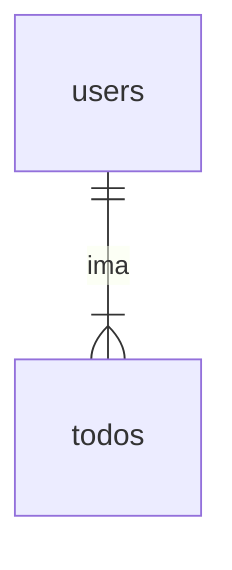

1. Ispravi sve tri pogrešne oznake i nacrtaj ispravnu liniju.

2. Zašto šema dopušta zadatak bez zabeleženog vlasnika, iako ga postojeća ruta za kreiranje povezuje sa prijavljenim korisnikom?

3. Da li jedan korisnik mora imati bar jedan zadatak?

---

#### Vežba 3 — TodoApp: podaci i veza nisu isto

Pretpostavi da su FK provere uključene i razmotri samo ove izmišljene redove:

| users.id |
| -------: |
|        1 |
|        2 |

| todos.id | todos.owner_id |
| -------: | -------------: |
|       10 |              1 |
|       11 |              1 |
|       12 |           NULL |

1. Koliko je zadataka povezano sa korisnikom 1, a koliko sa korisnikom 2?
2. Šta znači `NULL` za zadatak 12? Da li to znači da je korisnik 2 njegov vlasnik?

3. Da li bi novi red sa `owner_id = 99` bio dozvoljen ako korisnik 99 ne postoji? Šta se menja ako je provera FK-a isključena?

4. Da li prikazani podaci dokazuju da korisnik uvek mora imati dva zadatka?

---

#### Vežba 4 — Chinook: samostalno nacrtaj deo muzičke šeme

Nacrtaj ER dijagram za `artists`, `albums`, `tracks`, `genres` i `media_types`. Prikaži veze iz ovih činjenica:

- `albums.ArtistId` je obavezan FK ka `artists.ArtistId`.
- `tracks.AlbumId` i `tracks.GenreId` su nullable FK-ovi ka `albums.AlbumId`, odnosno `genres.GenreId`.

- `tracks.MediaTypeId` je obavezan FK ka `media_types.MediaTypeId`.

- Nijedan od navedenih FK-ova nije deo PK-a svoje tabele niti je pojedinačno `UNIQUE`. Nijedan roditelj nije primoran da ima red deteta.

1. Napiši četiri linije veza u jednom Mermaid bloku.
2. Zašto `tracks.GenreId = NULL` govori da žanr **nije zabeležen**, a ne da numera u stvarnosti nema žanr?

3. Može li album po šemi biti bez ijedne numere, čak i ako u konkretnoj bazi trenutno nema takvih albuma?

---

#### Vežba 5 — Chinook: poveznička tabela

U tabeli `playlist_track` su `PlaylistId` i `TrackId` obavezni FK-ovi. **Zajedno** čine primarni ključ `(PlaylistId, TrackId)`.

1. Nacrtaj `playlists`, `tracks` i `playlist_track` sa obe pojedinačne veze. Označi obe ključne kolone povezničke tabele.

2. Objasni ukupni odnos plejlista i numera.

3. Ako već postoji par `(1, 10)`, da li su dozvoljeni `(1, 11)`, `(2, 10)` i još jedan `(1, 10)`? Pretpostavi da svi navedeni roditelji postoje.

4. Zašto se ovde koristi `--`, a ne `..`?

---

#### Vežba 6 — SQLAlchemy: crtaj prema modelima, ne prema pretpostavci

U praktičnim modelima `Proizvod.kategorija_id` je obavezni FK, dok je `Kategorija.roditelj_id` nullable FK ka istoj tabeli. Nijedan od njih nije deo PK-a. `StanjeZaliha` trenutno nema FK ka proizvodu.

1. Nacrtaj kategorije, njihovu hijerarhiju i proizvode. Dodaj `stanje_zaliha` kao zaseban entitet.

2. Koliko roditeljskih kategorija može imati jedna kategorija? Koliko proizvoda može imati jedna kategorija?

3. Da li smeš da dodaš liniju od proizvoda do zaliha samo zato što ti deluje logično? Šta još treba proveriti?

4. Da li postojeća `relationship()` deklaracija u Pythonu automatski dokazuje da je tabela već kreirana u bazi?

---

#### Vežba 7 — Uporedi dve povezničke tabele

Uporedi Chinook `playlist_track` sa praktičnim ORM modelom `veza_proizvoda_i_promocije`. U drugoj tabeli je `id` zaseban PK, oba FK-a su obavezna i nad njihovim parom postoji `UniqueConstraint`.

1. Nacrtaj proizvod, promociju i njihovu povezničku tabelu.

2. Da li isti proizvod može biti u više promocija? Da li ista promocija može sadržati više proizvoda?

3. Da li ponovljeni par može proći ako dobije drugi `id`? Zašto?

4. Zašto su linije u ovom dijagramu drugačije od linija iz vežbe 5, iako obe tabele sprečavaju ponavljanje para?

5. Da li praktični model izlaže direktnu `secondary=` kolekciju ili se navigacija odvija preko povezničkog ORM objekta?

---

#### Vežba 8 — Hipotetična veza jedan-prema-jedan

Zamisli novu, **neimplementiranu** verziju modela u kojoj je `stanje_zaliha.proizvod_id` FK ka `proizvod.id`, ima `NOT NULL` i `UNIQUE`, ali nije deo PK-a zaliha. Nema dodatnog pravila koje zahteva zapis zaliha za svaki proizvod.

1. Nacrtaj vezu i pročitaj je iz oba ugla.
2. Koje ograničenje zabranjuje dva zapisa zaliha za isti proizvod?
3. Da li ova pravila sama zahtevaju da svaki proizvod ima zapis zaliha?

4. Da li bi crtanje dijagrama ili dodavanje samo skalarnog ORM atributa sprovelo ta SQL ograničenja?

---

### 4. Dodatna provera u terminalu — samo čitanje

Za sledeće primere pokreni terminal iz **korena repozitorijuma**. Ovo je provera konkretnih fajlova, koji se u budućnosti mogu razlikovati od dijagrama. `-readonly` otvara postojeću bazu bez dozvole za upis; ne prebacuj se u režim za izmenu da bi radio ove vežbe.

---

#### 4.1. TodoApp: proveri vežbu 2

U terminalu pokreni:

```bash
sqlite3 -readonly fast-api-course-my-work/TodoApp/data/todosapp.db
```

Zatim u SQLite prompt unesi:

```sql
.headers on
.mode box
PRAGMA table_info(todos);
PRAGMA foreign_key_list(todos);
.quit
```

U `table_info` pronađi red `owner_id` i kolone `notnull` i `pk`. Vrednost `0` za `notnull` znači da `NULL` nije zabranjen; `0` za `pk` da kolona nije deo PK-a. U `foreign_key_list` pronađi `from = owner_id`, `table = users`, `to = id`. To prikazuje deklarisani FK, ne dokazuje da ga svaka konekcija aplikacije sprovodi.

#### 4.2. Chinook: proveri vežbe 4 i 5

U terminalu pokreni originalnu bazu samo za čitanje:

```bash
sqlite3 -readonly fast-api-course-my-work/sqlite_for_beginners/chinook/chinook.db
```

Zatim u SQLite prompt unesi:

```sql
.headers on
.mode box
PRAGMA table_info(albums);
PRAGMA foreign_key_list(albums);
PRAGMA table_info(tracks);
PRAGMA foreign_key_list(tracks);
PRAGMA table_info(playlist_track);
PRAGMA foreign_key_list(playlist_track);
.quit
```

U `tracks` uporedi `notnull` za `AlbumId`, `GenreId` i `MediaTypeId`. U `playlist_track` pogledaj `pk`: vrednosti `1` i `2` označavaju **redosled kolona u jednom složenom PK-u**, a ne dva zasebna primarna ključa. FK ciljeve proveri u `foreign_key_list`. Ako želiš da proveriš radnu kopiju, navedi njenu putanju umesto originalne; dve kopije mogu naknadno da se razlikuju.

> `PRAGMA foreign_key_list(...)` prikazuje deklarisane reference. `PRAGMA foreign_keys;` prikazuje stanje provere za **trenutnu CLI konekciju**, ne za TodoApp ili neku drugu konekciju. Za proveru konkretnih ORM metapodataka bez baze koristi primer iz faze 4, odeljak 11.

---

### 5. Rešenja i objašnjenja

Ne moraš identično nazvati opis veze ili jednako rasporediti entitete. Bitno je da su entiteti, FK, obe kardinalnosti i vrsta linije ispravni.

---

#### Rešenje 1 — Čitanje veze

1. Jedna knjiga upućuje na **tačno jednog** autora; jedan autor može imati **nula ili više** knjiga.

2. Šema dopušta autora bez povezanog reda knjige. To opisuje tehničku mogućnost, ne odlučuje da li je autor bez knjige poželjan u nekoj aplikaciji.

3. `..` je neidentifikujuća veza jer FK nije deo PK-a knjige. Ne označava opcionalnost: `||` uz autora kaže da je autor obavezan.

4. FK ograničenje mora biti prisutno i sprovedeno, a upisana vrednost mora odgovarati postojećem autoru.

---

#### Rešenje 2 — TodoApp


- `||` uz `users` zamenjuje se sa `|o` jer `owner_id` dozvoljava `NULL`.
- `--` postaje `..` jer `owner_id` nije deo PK-a `todos.id`.
- `|{` uz `todos` postaje `o{` jer šema ne zahteva da korisnik ima zadatak.

- API ruta za kreiranje postavlja vlasnika prijavljenom korisniku; šema i ponašanje te rute predstavljaju različite nivoe pravila. Direktan upis ili drugi kod ne mora slediti isto pravilo rute.

---

#### Rešenje 3 — Podaci TodoApp-a

1. Korisnik 1 ima dva povezana zadatka, korisnik 2 nijedan.
2. Za zadatak 12 vlasnik nije zabeležen. `NULL` se ne pretvara u ID korisnika 2.

3. Uz uključenu FK proveru upis nepostojećeg ID-ja `99` bio bi odbijen. Uz isključenu proveru taj FK sam ne bi sprečio takvu nevažeću referencu.

4. Ne. To je samo izmišljeni trenutni skup redova. Šema omogućava da korisnik ima nula, jedan ili više zadataka.

---

#### Rešenje 4 — Chinook muzička šema

```mermaid
erDiagram
    artists ||..o{ albums : "ima"
    albums |o..o{ tracks : "sadrzi"
    genres |o..o{ tracks : "klasifikuje"
    media_types ||..o{ tracks : "odredjuje format"
```

- Album ima tačno jednog izvođača. Numera ima nula ili jedan zabeležen album, nula ili jedan zabeležen žanr i tačno jedan tip medija.

- Svaki od četiri roditelja može imati nula ili više povezanih redova deteta. Sve četiri veze su `..` jer odgovarajući FK nije deo PK-a deteta.

- `NULL` za žanr je odsustvo zabeležene veze, ne opis muzike u stvarnom svetu.

- Album bez numera dozvoljen je šemom čak i kada ga konkretni skup podataka trenutno ne sadrži.

---

#### Rešenje 5 — Plejliste i numere

```mermaid
erDiagram
    playlists ||--o{ playlist_track : "ima stavke"
    tracks ||--o{ playlist_track : "pripada stavkama"

    playlists {
        INTEGER PlaylistId PK
    }
    tracks {
        INTEGER TrackId PK
    }
    playlist_track {
        INTEGER PlaylistId PK, FK
        INTEGER TrackId PK, FK
    }
```

Svaki red `playlist_track` pripada tačno jednoj plejlisti i jednoj numeri; plejlista i numera mogu učestvovati u nula ili više redova veze. Ukupni odnos između plejlista i numera je **N:M**.

Uz navedenu pretpostavku da roditelji postoje, `(1, 11)` i `(2, 10)` su dozvoljeni ako već nisu upisani. Drugi `(1, 10)` nije dozvoljen zbog složenog PK-a. Obe linije su `--` zato što su oba FK-a deo **istog** složenog PK-a.

---

#### Rešenje 6 — Kategorije, proizvodi i zalihe

```mermaid
erDiagram
    kategorija |o..o{ kategorija : "ima potkategorije"
    kategorija ||..o{ proizvod : "sadrzi"

    kategorija {
        INTEGER id PK
        INTEGER roditelj_id FK
    }
    proizvod {
        INTEGER id PK
        INTEGER kategorija_id FK
    }
    stanje_zaliha {
        INTEGER id PK
        INTEGER kolicina
    }
```

Jedna kategorija može imati nula ili jednog roditelja i nula ili više proizvoda. Leva i desna `kategorija` su dve uloge iste tabele. `stanje_zaliha` je odvojena jer u proverenom modelu nema FK ni ORM vezu ka proizvodu.

Da bismo opisali **postojeće** stanje, proveravamo kod i metapodatke, a ako je cilj opis stvarne baze, proveravamo i njenu šemu. Sama `relationship()` deklaracija niti crtež ne kreiraju dokaz da takva tabela postoji u određenoj bazi.

---

#### Rešenje 7 — Promocije i poređenje sa Chinook-om

```mermaid
erDiagram
    proizvod ||..o{ veza_proizvoda_i_promocije : "ima veze"
    promotivni_dogadjaj ||..o{ veza_proizvoda_i_promocije : "ima veze"

    proizvod {
        INTEGER id PK
    }
    promotivni_dogadjaj {
        INTEGER id PK
    }
    veza_proizvoda_i_promocije {
        INTEGER id PK
        INTEGER proizvod_id FK
        INTEGER promotivni_dogadjaj_id FK
    }
```

Proizvod može biti povezan sa više promocija, a promocija sa više proizvoda. Isti par ne može drugi put, čak ni sa drugim `id`, zbog `UNIQUE` ograničenja nad **parom**. Pojedinačni ID-jevi mogu se ponavljati u različitim parovima.

U Chinook-u su FK-ovi deo složenog PK-a, pa su linije `--`. U modelu promocija zasebni `id` je PK, a FK-ovi nisu deo njega, pa su linije `..`. Zabrana istog para ne znači automatski da je taj par i primarni ključ.

Praktični ORM koristi poveznički objekat: na primer, `proizvod.veze_promocija` → `veza.promotivni_dogadjaj`. Ne definiše direktnu `secondary=` kolekciju proizvoda i promocija.

---

#### Rešenje 8 — Hipotetične zalihe

```mermaid
erDiagram
    proizvod ||..o| stanje_zaliha : "ima"
```

Ovo je **isključivo zamišljena izmena**, ne dijagram trenutno implementirane veze.

- Jedan zapis zaliha mora upućivati na tačno jedan proizvod: FK je `NOT NULL`, uz sprovedenu FK proveru.

- Proizvod može imati nula ili jedan zapis zaliha: `UNIQUE` sprečava više zapisa sa istim `proizvod_id`, ali ne zahteva da red postoji.

- Linija je `..` jer u zadatku FK nije deo PK-a.

- Dijagram ništa ne menja u bazi. Sam skalarni ORM atribut nije zamena za bazna ograničenja; za stvarnu primenu potrebni su odgovarajući model, šema i, po potrebi, migracija.

---

### 6. Završni zaključak i kontrolna lista

Kada ubuduće nacrtaš ili pročitaš ERD, prođi kroz ovu listu:

- [ ] Znam da li opisujem **trenutni model**, konkretnu postojeću bazu ili **predlog buduće šeme**.

- [ ] Za svaku vezu znam gde je FK i na koji ključ upućuje.
- [ ] Proverio sam `NULL` i FK ograničenje, ne samo nazive atributa.

- [ ] Pročitao sam broj povezanih redova iz **oba ugla** i nisam pomešao `0..N` sa postojanjem reda punog `NULL` vrednosti.

- [ ] Proverio sam `UNIQUE` nad jednom kolonom ili nad celim parom.
- [ ] Proverio sam da li je FK deo PK-a pre izbora `--` ili `..`.
- [ ] Razlikujem šemu od konkretnih podataka i poslovnih pravila aplikacije.
- [ ] Znam da Mermaid ne kreira bazu i ne potvrđuje da je FK provera uključena.
- [ ] Ako koristim ORM, razlikujem FK kolonu, `relationship()` i stvarnu šemu baze.

**Suština:** najpouzdaniji put je **izvor → pravila → kardinalnost iz oba ugla → dijagram → ponovna provera**. Dijagram je alat za razumevanje i komunikaciju; njegova tačnost zavisi od toga da li verno opisuje ono što smo proverili.

---
