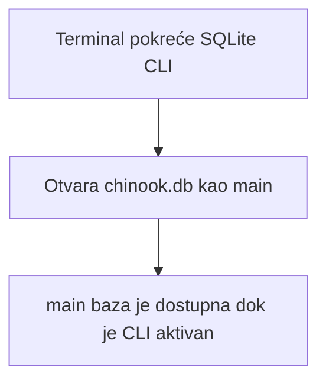
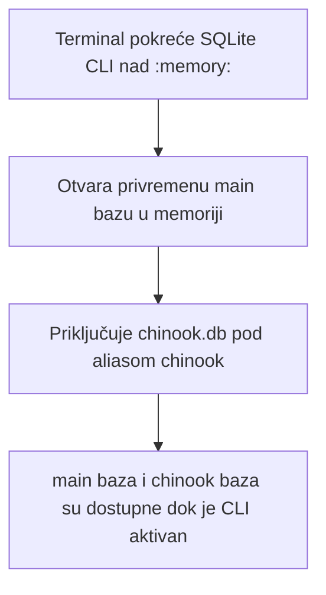

# 02 — Otvaranje i priključivanje Chinook baze

## Cilj lekcije

U ovoj lekciji otvorićeš Chinook bazu koja se nalazi u repozitorijumu i proverićeš da možeš da pristupiš njenim tabelama. Transkript koristi izraz „priključivanje baze“, ali je važno razlikovati otvaranje glavne baze u SQLite CLI-ju od SQL naredbe `ATTACH DATABASE`, kojom se dodatna baza priključuje postojećoj konekciji.

---

## Chinook baza je već u projektu

U folderu [chinook/](../chinook/) nalaze se baza `chinook.db` i dijagram šeme. Pošto je arhiva već raspakovana i fajl se nalazi u projektu, nije potrebno da ga ponovo preuzimaš niti da ga kopiraš u koren diska kao u video-lekciji.

Ovakav raspored čuva bazu uz materijale kursa i izbegava putanje specifične za jedan računar, poput `C:\SQLite\DB\Chinook.db`. Koristi putanju koja odgovara tvom repozitorijumu i proveri da naziv fajla `chinook.db` ispravan.

---

## Otvori Chinook kao glavnu bazu

Otvori integrisani terminal u VS Code-u i postavi trenutni direktorijum na koren repozitorijuma. Zatim pokreni:

```bash
sqlite3 "fast-api-course-my-work/sqlite_for_beginners/chinook/chinook.db"
```

Ova putanja je relativna u odnosu na trenutni direktorijum terminala. Ako se već nalaziš u folderu `fast-api-course-my-work/sqlite_for_beginners/chinook`, dovoljna je kraća komanda:

```bash
sqlite3 chinook.db
```

Pokretanje `sqlite3 putanja/do/baze.db` otvara tu bazu kao glavnu bazu trenutne SQLite CLI konekcije. U SQLite CLI-jevoj terminologiji glavna baza dostupna je pod imenom `main`.

Proveri da li je otvoren pravi fajl:

```text
.databases
```

Zatim prikaži tabele:

```text
.tables
```

U Chinook bazi treba da vidiš tabele kao što su `artists`, `albums`, `tracks`, `customers`, `invoices` i `invoice_items`. Za pregled definicije pojedinačne tabele koristi, na primer:

```text
.schema albums
```

Ako ne vidiš očekivane tabele, prvo proveri putanju u `.databases`. Kada SQLite CLI otvori nepostojeći fajl, može napraviti novu praznu bazu, pa pogrešna putanja često izgleda kao „prazna Chinook baza“.

---

## Otvaranje baze nije isto što i `ATTACH DATABASE`

U svakodnevnom govoru možeš čuti da se baza „priključuje“ u SQLite, ali postoje dva različita postupka:

- **Otvaranje baze kao glavne:** pokreneš `sqlite3 putanja/do/baze.db` ili u CLI-ju izvršiš `.open putanja/do/baze.db`. Time se glavna baza te konekcije otvara ili menja.

- **Priključivanje dodatne baze SQL naredbom:** dok je jedna baza već otvorena, izvršiš `ATTACH DATABASE ... AS ime;`. Time se dodatna baza dodaje istoj konekciji pod posebnim imenom, bez zamene glavne baze.

Video-lekcija pokazuje prvi postupak: pokretanjem CLI-ja sa putanjom do `Chinook.db` otvara se glavna baza. To nije SQL naredba `ATTACH DATABASE`.

---

## Priključi Chinook kao dodatnu bazu

Pravi `ATTACH DATABASE` možeš da isprobaš bez menjanja fajla Chinook baze. Pokreni privremenu bazu u memoriji iz korena repozitorijuma:

```bash
sqlite3 :memory:
```

U SQLite CLI-ju izvrši SQL naredbu:

```sql
ATTACH DATABASE 'fast-api-course-my-work/sqlite_for_beginners/chinook/chinook.db' AS chinook;
```

Putanja u SQL stringu računa se u odnosu na direktorijum iz kog je pokrenut SQLite proces. Ako si CLI pokrenuo iz drugog foldera, prilagodi putanju ili koristi apsolutnu putanju.

Proveri obe baze u konekciji:

```text
.databases
```

Privremena baza je dostupna pod imenom `main`, a priključena Chinook baza pod imenom `chinook`. Tabele iz priključene baze možeš da kvalifikuješ imenom šeme:

```sql
SELECT Name
FROM chinook.artists
ORDER BY Name
LIMIT 5;
```

Ovde `chinook` nije novo ime fajla, već alias koji si zadao u `ATTACH DATABASE` naredbi. Kvalifikovano ime `chinook.artists` znači tabelu `artists` u priključenoj bazi. Imena kao što su `main`, `temp` i aliasi priključenih baza predstavljaju šeme dostupne u toj konekciji.

Kada završiš, možeš da ukloniš priključenu bazu iz konekcije:

```sql
DETACH DATABASE chinook;
```

`DETACH DATABASE` prekida vezu sa tom bazom u trenutnoj konekciji. Ne briše fajl `chinook.db`. Kada izađeš iz CLI-ja, konekcija se zatvara; sledeći put kada želiš dodatnu bazu, moraš je ponovo priključiti.

---

## Važne napomene za aplikacije

`ATTACH DATABASE` ne kopira podatke i ne spaja dve baze u jednu. Omogućava jednoj konekciji da pristupi tabelama iz više baza, na primer radi čitanja ili upita koji spajaju podatke. Samo priključivanje baze ne menja njene redove.

Priključena baza dostupna je samo u konekciji u kojoj je izvršena naredba `ATTACH`. **U SQLAlchemy aplikaciji sa pool-om konekcija ne treba pretpostaviti da je svaka nova konekcija automatski priključila istu bazu**. Takvo podešavanje mora se eksplicitno i namerno uraditi za svaku konekciju kojoj je potrebno.

Strani ključevi **ne povezuju** tabele preko fajlova baze. **Relacione tabele** koje treba da garantuju referencijalni integritet obično treba držati u istoj SQLite bazi. `ATTACH` je koristan alat za određene scenarije, ali **nije zamena za pažljivo modeliranje podataka niti za klijent-server bazu kada aplikaciji treba centralizovan višekorisnički rad**.

Za ovu lekciju koristi Chinook samo za pregled i upite. Nemoj menjati ili brisati njene podatke; vežbaj izmene na posebnoj bazi koju napraviš za vežbe.

---

## Česte nedoumice

- **`.tables` ne prikazuje Chinook tabele:** proveri da li si otvorio ili priključio pravi fajl i da li `.databases` prikazuje očekivanu putanju.
- **CLI kaže da tabela ne postoji:** kod priključene baze koristi prefiks aliasa, na primer `chinook.artists`.
- **`ATTACH` prijavljuje grešku pri otvaranju fajla:** proveri relativnu putanju, dozvole za čitanje i da li fajl zaista postoji.
- **Ne možeš da pronađeš bazu:** trenutni direktorijum terminala možda nije koren repozitorijuma. Putanje iz primera nisu relativne u odnosu na Markdown fajl.
- **Pogrešno si otvorio praznu bazu:** izađi iz CLI-ja, vrati se u terminal i ponovi komandu sa tačnom putanjom do `chinook.db`.

---

## Provera razumevanja

1. Koja je razlika između pokretanja `sqlite3 chinook.db` i SQL naredbe `ATTACH DATABASE`?

- Pokretanje `sqlite3 chinook.db` otvara bazu kao glavnu (`main`) u toj konekciji, dok `ATTACH DATABASE` dodaje dodatnu bazu pod određenim aliasom u već postojećoj konekciji. Glavna baza (`main`) je uvek dostupna, dok priključene baze traju samo dok je konekcija aktivna i dok se ne izvrši `DETACH`.

2. Šta predstavlja alias `chinook` u primeru i kako se koristi u imenu `chinook.artists`?

- Alias `chinook` predstavlja ime pod kojim je priključena baza dostupna u trenutnoj konekciji. Kada se koristi u imenu `chinook.artists`, `chinook` označava bazu, a `artists` tabelu unutar te baze. Ovo omogućava upite nad tabelama iz različitih baza u istoj konekciji bez mešanja sa glavnom bazom (`main`).

3. Da li `DETACH DATABASE chinook` briše fajl baze?

- Ne, `DETACH DATABASE chinook` samo uklanja priključenu bazu iz trenutne konekcije. Fajl baze ostaje netaknut na disku i može se ponovo priključiti ili otvoriti kasnije.

4. Zašto priključivanje baze u jednoj konekciji ne znači da će ona biti priključena u svakoj SQLAlchemy konekciji?

- Svaka SQLAlchemy konekcija (`session`) predstavlja **novu SQLite konekciju**. Priključivanje baze (`ATTACH DATABASE`) važi samo za trenutnu konekciju, tako da nova konekcija neće imati priključenu bazu dok se ponovo ne izvrši `ATTACH`. Ovo ne znači da baza nestaje sa diska, već samo da nije dostupna u novoj konekciji dok se ponovo ne priključi.

5. Zašto je važno proveriti `.databases` pre nego što zaključiš da je baza prazna?

- Provera `.databases` omogućava da vidiš koje baze su trenutno priključene u konekciji. Čak i ako tabela ne postoji u glavnoj bazi (`main`), može postojati u nekoj priključenoj bazi. Bez provere `.databases`, možeš pogrešno zaključiti da je baza prazna, dok zapravo podaci mogu biti dostupni kroz priključene baze. Ovo je posebno važno kada radiš sa privremenim konekcijama ili u memoriji (`:memory:`), gde priključene baze traju samo dok je konekcija aktivna.

---

## Vežbe

### Vežba 1 — Otvori Chinook

1. Iz VS Code terminala, koristeći putanju iz korena repozitorijuma, otvori `chinook.db` kao glavnu bazu.

```bash

rlwrap -a -N -c -i -f "$HOME/.config/sqlite-cli/sqlite3-completions" \
sqlite3 fast-api-course-my-work/sqlite_for_beginners/chinook/chinook.db
```

2. U CLI-ju pokreni `.databases`, `.tables` i `.schema albums`.

```sql
.databases
.tables
.schema albums
```

3. Pronađi u izlazu `albums` strani ključ ka tabeli `artists`.
4. Izađi iz CLI-ja komandom `.quit` i ponovo otvori istu bazu.

---

### Vežba 2 — Priključi dodatnu bazu

1. Iz korena repozitorijuma pokreni `sqlite3 :memory:`.
2. Priključi Chinook bazu pod aliasom `chinook`.

```sql
ATTACH DATABASE 'fast-api-course-my-work/sqlite_for_beginners/chinook/chinook.db' AS chinook;
.databases
```

3. Izvrši `.databases` i objasni razliku između `main` i `chinook`.

- Razlika između `main` i `chinook` je u tome što `main` predstavlja trenutnu glavnu bazu u memoriji (`:memory:`), dok `chinook` predstavlja priključenu bazu sa stvarnog fajla. `main` je privremena baza koja postoji samo dok je konekcija aktivna, dok `chinook` pokazuje na postojeći fajl na disku. Nakon `DETACH DATABASE chinook;`, priključena baza se uklanja iz konekcije, ali fajl na disku ostaje netaknut. Ovo ilustruje zašto je važno proveriti `.databases` pre nego što zaključiš da je baza prazna — priključene baze mogu sadržati podatke koji nisu vidljivi u glavnoj bazi.

- Kada izvršiš `DETACH DATABASE chinook;`, konekcija više ne vidi podatke iz te baze. Ovo je korisno kada želiš da oslobodiš resurse ili da se uveriš da rad sa privremenom bazom ne utiče na postojeće fajlove. Provera `.databases` nakon `DETACH` potvrđuje da je priključena baza uklonjena iz trenutne sesije.

- **Napomena**: Kada pokušavaš da pristupiš tabelama iz priključene baze, **moraš koristiti prefiks sa aliasom baze** (npr. `chinook.artists`). Ako pokušaš da pristupiš tabeli bez prefiksa dok je baza priključena, SQLite će tražiti tabelu u glavnoj bazi (`main`), što može dovesti do greške ako tabela ne postoji tamo!

4. Pokreni `SELECT Name FROM chinook.artists ORDER BY Name LIMIT 5;`.

5. Izvrši `DETACH DATABASE chinook;` i proveri `.databases`.

---

### Vežba 3 — Istraži radne direktorijume

1. Pokreni `sqlite3` iz korena repozitorijuma i priključi Chinook putanjom iz lekcije.
2. Izađi iz CLI-ja, promeni trenutni direktorijum u folder `chinook` i ponovi postupak sa kraćom putanjom.

3. Objasni zašto ista relativna putanja ne mora da radi iz oba direktorijuma.

- Kada koristiš relativnu putanju za otvaranje baze, SQLite je u obavezi da je razreši u odnosu na trenutni radni direktorijum terminala. Ako se promeni radni direktorijum, ista relativna putanja može pokazivati na potpuno drugačiji fajl ili čak ne postojati. Zato je važno biti svestan trenutnog radnog direktorijuma kada otvaraš ili priključuješ baze koristeći relativne putanje.

- **Napomena**: Uvek možeš koristiti apsolutne putanje da bi izbegao nesigurnost u vezi sa trenutnim radnim direktorijumom. Apsolutne putanje garantuju da SQLite uvek pristupa istom fajlu, bez obzira na to iz kog direktorijuma pokrećeš CLI.

- **Savet**: Kada radiš sa više baza ili često menjaš radni direktorijum, razmisli o definisanju apsolutnih putanja u promenljivama okruženja ili u konfiguracionim fajlovima kako bi olakšao rad sa SQLite bazama i smanjio rizik od grešaka.

---

### Vežba 4 — Nacrtaj tok otvaranja

Nacrtaj dva kratka toka:

1. Terminal pokreće SQLite CLI, a `chinook.db` postaje glavna baza (`main`).



- U prvom toku, terminal pokreće SQLite CLI i otvara `chinook.db` kao glavnu bazu (`main`). Putanja do `chinook.db` se razrešava u odnosu na trenutni radni direktorijum terminala. Baza ostaje dostupna dok je CLI aktivan.

2. Terminal pokreće CLI nad `:memory:`, a Chinook se dodaje pod aliasom `chinook`.



- U drugom toku, terminal pokreće CLI nad `:memory:`, što znači da se kreira privremena baza u memoriji koja postoji samo tokom trajanja CLI sesije. Zatim se priključuje `chinook.db` pod aliasom `chinook`, pri čemu se putanja do `chinook.db` takođe razrešava u odnosu na trenutni radni direktorijum. Obe baze, `main` i `chinook`, ostaju dostupne dok je CLI aktivan.

- U oba toka, važno je primetiti kada se putanja razrešava i koliko dugo baza ostaje dostupna. U prvom toku, putanja do `chinook.db` se razrešava odmah pri otvaranju CLI-ja, a baza ostaje dostupna dok je CLI aktivan. U drugom toku, putanja do `chinook.db` se razrešava prilikom priključivanja baze, a baza ostaje dostupna dok je CLI aktivan. Privremena `:memory:` baza postoji samo tokom trajanja CLI sesije i nestaje kada se CLI zatvori.

**Napomena**: Uvek označi kada se putanja razrešava i koliko dugo baza ostaje dostupna, kako bi izbegao konfuziju prilikom rada sa više baza ili privremenim bazama u memoriji.

**Zadatak za tebe**: U svakom toku označi kada se putanja razrešava i koliko dugo baza ostaje dostupna. Pokušaj da identifikuješ tačan trenutak kada SQLite razrešava relativnu putanju i uporedi to sa trajanjem dostupnosti baze. Ovo će ti pomoći da bolje razumeš ponašanje SQLite-a prilikom rada sa glavnom bazom i priključenim bazama, kao i sa privremenim bazama u memoriji. Zapiši svoja zapažanja i razmisli o potencijalnim problemima koji mogu nastati ako se putanje ili trajanje dostupnosti baza ne razumeju pravilno.

**Rešenja**: Nakon što završiš zadatak, uporedi svoja zapažanja sa sledećim:

- U prvom toku, putanja do `chinook.db` se razrešava odmah pri otvaranju CLI-ja, a baza ostaje dostupna dok je CLI aktivan.

- U drugom toku, putanja do `chinook.db` se razrešava prilikom priključivanja baze, a baza ostaje dostupna dok je CLI aktivan.

- Privremena `:memory:` baza postoji samo tokom trajanja CLI sesije i nestaje kada se CLI zatvori.

Ova rešenja ti pomažu da razumeš kada SQLite razrešava relativne putanje i koliko dugo baze ostaju dostupne u različitim scenarijima. Razumevanje ovih detalja je ključno za pravilno upravljanje bazama podataka, posebno kada radiš sa privremenim bazama u memoriji ili kada priključuješ više baza u jednoj CLI sesiji.
