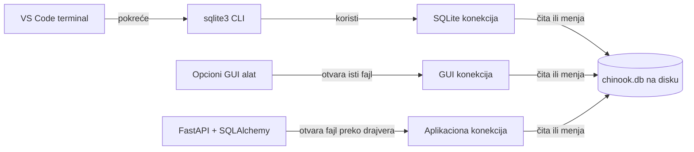
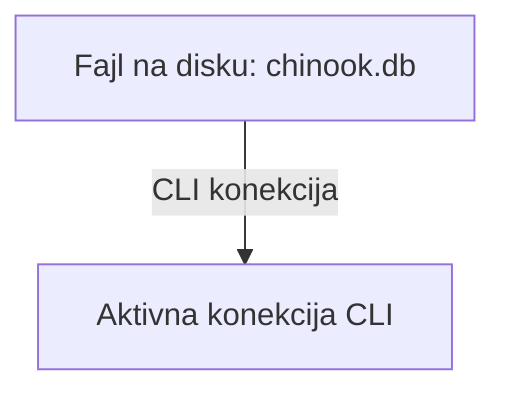
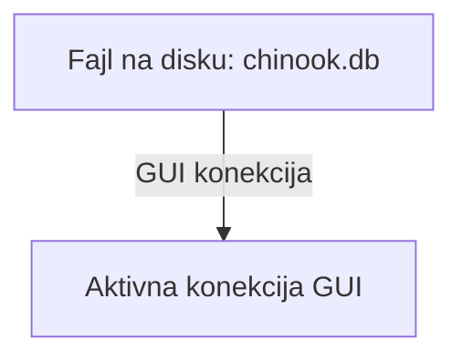
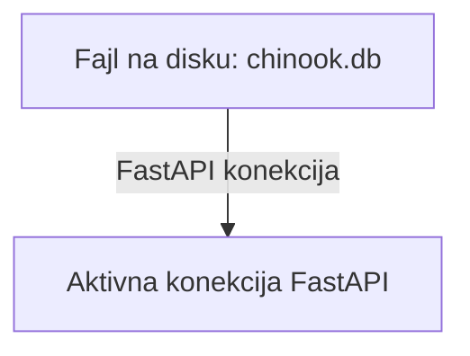

# 03 — Povezivanje sa SQLite bazom

## Cilj lekcije

U ovoj lekciji povezaćeš se sa preuzetom Chinook bazom iz VS Code-a, proveriti da gledaš pravi fajl i uporediti rad kroz komandni alat i grafički alat. Najvažnije je da razumeš razliku između fajla baze i konekcije koja je trenutno otvorena ka tom fajlu.

---

## Fajl baze i konekcija nisu isto

Fajl `chinook.db` čuva bazu na disku. **Konekcija** je aktivan pristup tom fajlu iz određenog programa, kao što su `sqlite3` CLI, SQLite Studio, VS Code ekstenzija ili FastAPI aplikacija.

Zatvaranje konekcije ne briše fajl baze. Isto tako, ako GUI alat sačuva profil za ponovno povezivanje, to obično znači da pamti putanju i podešavanja konekcije; ne znači da je baza kopirana u alat.

| Pojam            | Šta predstavlja                                          | Šta se dešava kada zatvoriš program                  |
| ---------------- | -------------------------------------------------------- | ---------------------------------------------------- |
| `chinook.db`     | Fajl baze na disku, sa tabelama i podacima               | Ostaje na disku.                                     |
| SQLite konekcija | Aktivni kanal preko kog program pristupa bazi            | Zatvara se; za sledeći rad otvara se nova.           |
| `sqlite3` CLI    | Program koji prima SQL i dot-komande iz terminala        | Zatvaranjem CLI-ja zatvara se i njegova konekcija.   |
| GUI profil       | Sačuvana podešavanja, često uključujući putanju do fajla | Može ostati sačuvan i omogućiti ponovno povezivanje. |

---

## Kako program pristupa SQLite fajlu

**SQLite je ugrađena baza:** CLI ili aplikacija koristi **SQLite biblioteku** da otvori fajl i izvrši upite. U tipičnom radu nema posebnog SQLite serverskog procesa koji mora da bude pokrenut.



Svaki program ima svoju konekciju. Ako svi otvore istu putanju, pristupaju istom fajlu baze; ako otvore fajlove na različitim putanjama, mogu da vide različite baze čak i kada su imena fajlova ista.

---

## Povezivanje kroz VS Code terminal

U kursu ćemo bazu prvenstveno otvarati pomoću `sqlite3` CLI-ja iz integrisanog terminala. Ako se nalaziš u korenu repozitorijuma, pokreni:

```bash
sqlite3 "fast-api-course-my-work/sqlite_for_beginners/chinook/chinook.db"
```

Ova komanda pokreće SQLite CLI i otvara navedeni fajl kao glavnu bazu te konekcije. U **SQLite CLI-ju glavna baza** je dostupna pod imenom `main`.

Proveri putanju i tabele:

```text
.databases
.tables
```

U listi bi trebalo da vidiš 11 Chinook tabela, između ostalih `artists`, `albums`, `tracks`, `customers`, `invoices` i `invoice_items`. Za prikaz definicije pojedinačne tabele možeš da koristiš:

```text
.schema albums
```

Komande `.databases`, `.tables` i `.schema` počinju tačkom i pripadaju SQLite CLI-ju. One nisu SQL naredbe koje se šalju aplikacionoj bazi. SQL naredba poput `SELECT sqlite_version();` unosi se u CLI bez početne tačke i završava se tačkom-zarezom.

| Unos                | Gde se izvršava           | Primer                            |
| ------------------- | ------------------------- | --------------------------------- |
| Pokretanje programa | VS Code terminal          | `sqlite3 "putanja/do/chinook.db"` |
| Dot-komanda         | SQLite CLI                | `.tables`                         |
| SQL naredba         | SQLite CLI ili aplikacija | `SELECT sqlite_version();`        |

---

## Koja se baza zapravo otvorila?

Relativna putanja se računa u odnosu na **trenutni direktorijum terminala**, ne u odnosu na ovaj Markdown fajl. Proveri trenutni direktorijum pre pokretanja komande:

| Terminal        | Provera trenutnog direktorijuma |
| --------------- | ------------------------------- |
| Linux ili macOS | `pwd`                           |
| PowerShell      | `Get-Location`                  |
| Command Prompt  | `cd`                            |

Komanda `sqlite3 putanja/do/fajla.db` može da napravi novu praznu bazu ako fajl ne postoji. Zato, ako `.tables` ne prikazuje očekivane tabele, proveri `.databases` pre nego što zaključiš da su podaci nestali. Najčešće je otvorena pogrešna putanja ili novonapravljeni prazan fajl.

Šemu kurske baze možeš da pregledaš i u [ERD.drawio](../chinook/ERD.drawio). Dijagram prikazuje tabele i njihove veze; CLI potvrđuje šta zaista postoji u fajlu baze koji si otvorio.

---

## Povezivanje pomoću grafičkog alata

Transkript pokazuje SQLite Studio kao grafičku alternativu. U ovom kursu nije obavezno da ga koristiš. Možeš ostati u VS Code terminalu. Ako koristiš **SQLite Studio ili neku SQLite ekstenziju za VS Code**, izaberi postojeći fajl `chinook.db` umesto da slučajno napraviš novu bazu.

Uopšteni koraci za GUI alat:

1. Izaberi opciju za dodavanje ili otvaranje SQLite baze.
2. Pronađi postojeći fajl `chinook.db` u folderu `fast-api-course-my-work/sqlite_for_beginners/chinook/`.
3. Proveri prikazanu putanju i potvrdi povezivanje.
4. Proširi bazu u panelu alata i proveri da su vidljive Chinook tabele.
5. Kada završiš, koristi opciju za prekid konekcije ili zatvori alat.

Nazivi dugmadi i ponašanje pri čuvanju konekcije zavise od izabranog alata. Sačuvan profil nije isto što i otvorena konekcija, a prekid konekcije ne briše fajl baze.

| Način rada           | Prednost                                                                   | Obrati pažnju                                                        |
| -------------------- | -------------------------------------------------------------------------- | -------------------------------------------------------------------- |
| `sqlite3` CLI        | Direktno izvršavaš SQL i dot-komande; primeri iz kursa lako se ponavljaju. | Proveravaj putanju i razlikuj dot-komande od SQL-a.                  |
| SQLite GUI alat      | Tabele, šema i podaci mogu se pregledati vizuelno.                         | Potvrdi da je izabran postojeći `chinook.db`, a ne nova prazna baza. |
| FastAPI + SQLAlchemy | Ovo je način na koji će aplikacija pristupati podacima.                    | Aplikaciona konekcija i njena putanja podešavaju se u kodu.          |

---

## Otvaranje, prekid konekcije i izlazak

U **CLI-ju** možeš da pregledaš bazu, pa da izađeš:

```text
.quit
```

`.quit` zatvara **SQLite CLI** i njegovu konekciju. Posle toga se vraćaš u VS Code terminal; tek tada možeš uneti terminalsku komandu poput `exit` ako želiš da zatvoriš i komandnu ljusku.

U **GUI alatu** opcija poput **Disconnect** zatvara aktivnu konekciju. Ako je alat sačuvao profil, možda ćeš moći da se povežeš ponovo bez ponovnog biranja fajla. U oba slučaja fajl `chinook.db` ostaje na disku.

U lekciji [02 — Otvaranje i priključivanje Chinook baze](02_attaching_sample_database_to_sqlite.md) obrađeno je i SQL `ATTACH DATABASE`. To je drugačije od otvaranja fajla kao glavne baze: `ATTACH` dodaje drugu bazu samo konkretnoj SQLite konekciji.

---

## Provera razumevanja

1. Koja je razlika između fajla baze i aktivne konekcije?

- Fajl baze je fizički fajl na disku koji sadrži sve podatke i šemu baze. Aktivna konekcija je instanca SQLite-a koja je otvorila taj fajl i omogućava izvršavanje SQL komandi nad njim. Fajl može postojati i bez aktivne konekcije, ali konekcija ne može postojati bez fajla.

2. Šta se zatvara kada u CLI-ju izvršiš `.quit`, a šta ostaje sačuvano?

- Kada izvršiš `.quit`, zatvara se **aktivna konekcija** u SQLite CLI-ju i sam CLI. Fajl baze ostaje na disku i svi podaci koji su prethodno sačuvani ostaju netaknuti.

3. Zašto isti naziv `chinook.db` ne garantuje da CLI i FastAPI koriste isti fajl?

- Isti naziv fajla ne garantuje istu putanju. CLI i FastAPI mogu koristiti različite relativne ili apsolutne putanje koje vode do različitih fajlova sa istim imenom. Da bi se osiguralo da oba koriste isti fajl, potrebno je proveriti pune putanje.

4. Koje komande iz lekcije su dot-komande, a koje se izvršavaju u terminalu?

- Dot-komande su specifične komande SQLite CLI-ja koje počinju sa tačkom, poput `.quit`, `.databases` i `.tables`. One se izvršavaju unutar SQLite CLI-ja i ne važe u terminalu ili GUI alatima.

- Terminalske komande se izvršavaju u samom terminalu ili komandnoj ljusci, a ne unutar SQLite CLI-ja. Na primer, `exit` zatvara terminal, dok `.quit` zatvara SQLite CLI.

5. Zašto treba proveriti `.databases` ako `.tables` ne prikazuje Chinook tabele?

- Ako `.tables` ne prikazuje očekivane tabele, to može značiti da CLI nije povezan na pravu bazu. Provera sa `.databases` omogućava da se vidi koja baza je trenutno aktivna i koja putanja se koristi, čime se može otkriti da li je otvoren pravi fajl.

6. Po čemu se GUI profil za povezivanje razlikuje od aktivne konekcije?

- **GUI profil za povezivanje** obično sadrži informacije o putanji do fajla baze i eventualno dodatne parametre za konekciju. **Aktivna konekcija** je stvarna instanca koja je otvorila fajl i omogućava izvršavanje SQL komandi. **GUI profil** može postojati bez aktivne konekcije, dok **aktivna konekcija** zavisi od profila ili direktnog otvaranja fajla.

- Dakle, **GUI profil** je više kao "plan" ili "postavka" za konekciju, dok je **aktivna konekcija** konkretna veza koja omogućava interakciju sa bazom.

- Aktivna konekcija može biti otvorena i bez GUI profila, na primer direktno iz CLI-ja ili FastAPI aplikacije, dok GUI profil sam po sebi ne otvara konekciju dok se ne inicira.

- Dakle, razlika je u tome što **GUI profil predstavlja konfiguraciju ili plan za konekciju, dok aktivna konekcija predstavlja stvarnu vezu koja omogućava interakciju sa bazom podataka**.

---

## Vežbe

### Vežba 1 — Otvori bazu i proveri putanju

1. Iz VS Code terminala, iz korena repozitorijuma, pokreni komandu za otvaranje Chinook baze.
2. U CLI-ju izvrši `.databases` i proveri da putanja završava sa `chinook/chinook.db`.
3. Pokreni `.tables` i proveri da se prikazuje 11 tabela.
4. Prikaži definiciju `albums` pomoću `.schema albums`.

---

### Vežba 2 — Nacrtaj konekcije

Koristeći Mermaid dijagram iz lekcije kao primer, nacrtaj ili opiši tri odvojene konekcije ka istom fajlu: jednu iz CLI-ja, jednu iz GUI alata i jednu iz FastAPI aplikacije. Označi koji deo je fajl na disku, a koji su aktivne konekcije.

**Konekcija iz CLI-ja:** Kada se povežeš na bazu iz CLI-ja, otvara se aktivna konekcija koja omogućava izvršavanje SQL komandi direktno u terminalu. Putanja do fajla baze se određuje prilikom otvaranja CLI-ja sa odgovarajućim fajlom ili putem relativne/apsolutne putanje. Aktivna konekcija traje dok se CLI ne zatvori ili dok se eksplicitno ne zatvori konekcija.



**Konekcija iz GUI alata:** Kada se povežeš na bazu iz GUI alata, kreira se aktivna konekcija koja omogućava interakciju sa bazom putem grafičkog interfejsa. GUI alat obično koristi profil ili konfiguraciju koja sadrži putanju do fajla baze. Aktivna konekcija traje dok se ne zatvori u okviru GUI alata.



**Konekcija iz FastAPI aplikacije:** Kada se povežeš na bazu iz FastAPI aplikacije koristeći SQLAlchemy, kreira se aktivna konekcija koja omogućava interakciju sa bazom kroz aplikaciju. Putanja do fajla baze se određuje u SQLite URL-u ili konfiguraciji SQLAlchemy. Aktivna konekcija traje dok aplikacija radi ili dok se eksplicitno ne zatvori.



---

### Vežba 3 — Istraži pogrešnu putanju

1. Zapiši trenutni direktorijum terminala.

```bash
pwd
```

2. Objasni šta može da se desi ako pokušaš da otvoriš `chinook.db` relativnom putanjom iz pogrešnog direktorijuma.

- Ako pokušaš da otvoriš `chinook.db` relativnom putanjom iz pogrešnog direktorijuma, SQLite će pokušati da kreira novi fajl sa tim imenom u trenutnom direktorijumu, što može dovesti do toga da radiš sa pogrešnom bazom ili da dobiješ grešku ako nemas prava za kreiranje fajla.

3. Opiši kako bi pomoću `.databases` i `.tables` otkrio da li si otvorio pravu bazu.

- Pomoću `.databases` možeš da proveriš putanju do trenutno otvorene baze i uporediš je sa očekivanom putanjom. Ako putanja ne odgovara, verovatno si otvorio pogrešan fajl. Pomoću `.tables` možeš da vidiš koje tabele postoje u bazi; ako se ne prikazuju očekivane tabele, to je dodatni znak da si otvorio pogrešnu bazu.

---

### Vežba 4 — Uporedi CLI i GUI

Popuni tabelu svojim rečima:

| Pitanje                                     | CLI                                                         | GUI alat                                                                  |
| ------------------------------------------- | ----------------------------------------------------------- | ------------------------------------------------------------------------- |
| Kako se bira fajl baze?                     | Fajl se bira relativnom ili apsolutnom putanjom u terminalu | U GUI alatu se fajl bira kroz dijalog za otvaranje fajla                  |
| Kako se proveravaju tabele?                 | Pomoću `.tables` komande u CLI                              | GUI alat obično prikazuje listu tabela u interfejsu                       |
| Kako se zatvara konekcija?                  | Pomoću `.exit` ili `.quit` komande                          | GUI alat obično ima opciju za zatvaranje konekcije ili zatvaranje prozora |
| Da li zatvaranje konekcije briše fajl baze? | Ne, fajl ostaje na disku                                    | Ne, fajl ostaje na disku                                                  |

---

### Vežba 5 — Poveži lekciju sa aplikacijom

U konfiguraciji svog FastAPI projekta (`TodoApp`) pronađi SQLite URL koji koristi SQLAlchemy. Pokreni aplikaciju, proveri radni direktorijum njenog procesa i uporedi putanju baze sa rezultatom `.databases` u SQLite CLI-ju.

**Pre pokretanja:** `TodoApp/main.py` pri učitavanju poziva `Base.metadata.create_all(bind=engine)`, što može napraviti nedostajuće tabele u bazi. Pokretanje aplikacije nije samo za čitanje. Proveri putanju i napravi rezervnu kopiju pre pokretanja ako ti postojeći podaci trebaju.

---

#### 1. Pronađi URL i pokreni aplikaciju

U prvom Bash terminalu, iz korena repozitorijuma:

```bash
source .venv/bin/activate
cd fast-api-course-my-work/
pwd
cat TodoApp/db/database.py
```

U konfiguraciji pronađi `SQLALCHEMY_DATABASE_URL = "sqlite:///./TodoApp/data/todosapp.db"`. Putanja posle `sqlite:///` je relativna u odnosu na **radni direktorijum procesa aplikacije**, a ne na lokaciju `database.py`.

U istom terminalu pokreni server:

```bash
python -m uvicorn TodoApp.main:app
```

`.venv` daje pristup projektnoj Python instalaciji i Uvicorn-u. `TodoApp.main:app` znači objekat `app` u modulu `TodoApp.main`. Ovaj primer ne koristi `--reload`, radi jednostavnijeg praćenja procesa. Server treba da nastavi da radi dok obavljaš proveru u drugom terminalu.

Uvicorn pri uspešnom pokretanju ispisuje `Started server process [PID]`; zabeleži prikazani broj procesa. Ako prijavi grešku, pročitaj poruku: na primer, aplikacija zahteva `JWT_SECRET_KEY` u okruženju ili `.env` fajlu. Ne ispisuj niti deli vrednost ključa.

---

#### 2. Proveri proces i bazu u drugom terminalu

Otvori drugi Bash terminal. U Linux-u i WSL-u proveri radni direktorijum **server procesa**, koristeći broj iz Uvicorn poruke:

```bash
readlink /proc/PID/cwd
```

Zameni `PID` stvarnim brojem, bez uglastih zagrada. Ako koristiš `--reload`, uzmi broj iz `Started server process`, a ne iz poruke o reloader-u; pri ponovnom učitavanju broj server procesa može se promeniti. Ovaj korak proverava konkretan proces aplikacije, dok `pwd` prikazuje direktorijum terminalskog shell-a.

Zatim u drugom terminalu iz korena repozitorijuma otvori postojeću TodoApp bazu samo za čitanje:

```bash
cd ~/code/python-automation-lab/fast-api-portfolio/fast-api-course-my-work
sqlite3 -readonly TodoApp/data/todosapp.db
```

Ovaj `cd` odnosi se samo na drugi terminal i ne menja radni direktorijum servera. Aktivacija `.venv` nije potrebna za sistemski `sqlite3`.

U SQLite CLI-ju unesi:

```text
.databases
.tables
.exit
```

U našoj proveri `.databases` je prikazao:

```text
main: /home/jole-pavlovic-dev/code/python-automation-lab/fast-api-portfolio/fast-api-course-my-work/TodoApp/data/todosapp.db r/o
```

`r/o` znači da je **CLI konekcija** otvorena samo za čitanje; ne određuje režim konekcije aplikacije.

---

#### 3. Uporedi i završi

Ako provera server procesa pokaže `fast-api-portfolio/fast-api-course-my-work`, URL iz konfiguracije razrešava se do istog fajla koji prikazuje `.databases`. U našoj stvarnoj proveri dodatno smo potvrdili da su oba procesa imala otvoren taj fajl. To su **odvojene konekcije ka istom fajlu**.

Rezultat proveri svaki put za konkretne procese: različiti radni direktorijumi mogu značiti različite fajlove. Ako odgovarajući direktorijum postoji, pogrešna putanja može dovesti do stvaranja prazne baze; u suprotnom može nastati greška. `.tables` je korisna za pregled, ali sama ne dokazuje da su dva fajla ista.

Kada završiš, `.exit` zatvara SQLite CLI; zatim u prvom terminalu zaustavi server pomoću `Ctrl+C`.

---
