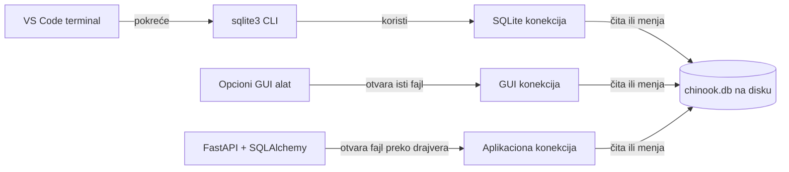

# 03 — Povezivanje sa SQLite bazom

## Cilj lekcije

U ovoj lekciji povezaćeš se sa preuzetom Chinook bazom iz VS Code-a, proveriti da gledaš pravi fajl i uporediti rad kroz komandni alat i grafički alat. Najvažnije je da razumeš razliku između fajla baze i konekcije koja je trenutno otvorena ka tom fajlu.

## Fajl baze i konekcija nisu isto

Fajl `chinook.db` čuva bazu na disku. **Konekcija** je aktivan pristup tom fajlu iz određenog programa, kao što su `sqlite3` CLI, SQLite Studio, VS Code ekstenzija ili FastAPI aplikacija.

Zatvaranje konekcije ne briše fajl baze. Isto tako, ako GUI alat sačuva profil za ponovno povezivanje, to obično znači da pamti putanju i podešavanja konekcije; ne znači da je baza kopirana u alat.

| Pojam            | Šta predstavlja                                          | Šta se dešava kada zatvoriš program                  |
| ---------------- | -------------------------------------------------------- | ---------------------------------------------------- |
| `chinook.db`     | Fajl baze na disku, sa tabelama i podacima               | Ostaje na disku.                                     |
| SQLite konekcija | Aktivni kanal preko kog program pristupa bazi            | Zatvara se; za sledeći rad otvara se nova.           |
| `sqlite3` CLI    | Program koji prima SQL i dot-komande iz terminala        | Zatvaranjem CLI-ja zatvara se i njegova konekcija.   |
| GUI profil       | Sačuvana podešavanja, često uključujući putanju do fajla | Može ostati sačuvan i omogućiti ponovno povezivanje. |

## Kako program pristupa SQLite fajlu

SQLite je ugrađena baza: CLI ili aplikacija koristi SQLite biblioteku da otvori fajl i izvrši upite. U tipičnom radu nema posebnog SQLite serverskog procesa koji mora da bude pokrenut.



Svaki program ima svoju konekciju. Ako svi otvore istu putanju, pristupaju istom fajlu baze; ako otvore fajlove na različitim putanjama, mogu da vide različite baze čak i kada su imena fajlova ista.

## Povezivanje kroz VS Code terminal

U kursu ćemo bazu prvenstveno otvarati pomoću `sqlite3` CLI-ja iz integrisanog terminala. Ako se nalaziš u korenu repozitorijuma, pokreni:

```bash
sqlite3 "fast-api-course-my-work/sqlite_for_beginners/chinook/chinook.db"
```

Ova komanda pokreće SQLite CLI i otvara navedeni fajl kao glavnu bazu te konekcije. U SQLite CLI-ju glavna baza dostupna je pod imenom `main`.

Proveri putanju i tabele:

```text
.databases
.tables
```

U listi bi trebalo da vidiš 11 Chinook tabela, između ostalih `artists`, `albums`, `tracks`, `customers`, `invoices` i `invoice_items`. Za prikaz definicije pojedinačne tabele možeš da koristiš:

```text
.schema albums
```

Komande `.databases`, `.tables` i `.schema` počinju tačkom i pripadaju SQLite CLI-ju. One nisu SQL naredbe koje se šalju aplikacionoj bazi. SQL naredba poput `SELECT sqlite_version();` unosi se u CLI bez početne tačke i završava se tačkom-zarezom.

| Unos                | Gde se izvršava           | Primer                            |
| ------------------- | ------------------------- | --------------------------------- |
| Pokretanje programa | VS Code terminal          | `sqlite3 "putanja/do/chinook.db"` |
| Dot-komanda         | SQLite CLI                | `.tables`                         |
| SQL naredba         | SQLite CLI ili aplikacija | `SELECT sqlite_version();`        |

## Koja se baza zapravo otvorila?

Relativna putanja se računa u odnosu na **trenutni direktorijum terminala**, ne u odnosu na ovaj Markdown fajl. Proveri trenutni direktorijum pre pokretanja komande:

| Terminal        | Provera trenutnog direktorijuma |
| --------------- | ------------------------------- |
| Linux ili macOS | `pwd`                           |
| PowerShell      | `Get-Location`                  |
| Command Prompt  | `cd`                            |

Komanda `sqlite3 putanja/do/fajla.db` može da napravi novu praznu bazu ako fajl ne postoji. Zato, ako `.tables` ne prikazuje očekivane tabele, proveri `.databases` pre nego što zaključiš da su podaci nestali. Najčešće je otvorena pogrešna putanja ili novonapravljeni prazan fajl.

Šemu kurske baze možeš da pregledaš i u [ERD.drawio](../chinook/ERD.drawio). Dijagram prikazuje tabele i njihove veze; CLI potvrđuje šta zaista postoji u fajlu baze koji si otvorio.

## Povezivanje pomoću grafičkog alata

Transkript pokazuje SQLite Studio kao grafičku alternativu. U ovom kursu nije obavezno da ga koristiš; možeš ostati u VS Code terminalu. Ako koristiš SQLite Studio ili neku SQLite ekstenziju za VS Code, izaberi postojeći fajl `chinook.db` umesto da slučajno napraviš novu bazu.

Uopšteni koraci za GUI alat:

1. Izaberi opciju za dodavanje ili otvaranje SQLite baze.
2. Pronađi postojeći fajl `chinook.db` u folderu `fast-api-course-my-work/sqlite_for_beginners/chinook/`.
3. Proveri prikazanu putanju i potvrdi povezivanje.
4. Proširi bazu u panelu alata i proveri da su vidljive Chinook tabele.
5. Kada završiš, koristi opciju za prekid konekcije ili zatvori alat.

Nazivi dugmadi i ponašanje pri čuvanju konekcije zavise od izabranog alata. Sačuvan profil nije isto što i otvorena konekcija, a prekid konekcije ne briše fajl baze.

| Način rada           | Prednost                                                                   | Obrati pažnju                                                        |
| -------------------- | -------------------------------------------------------------------------- | -------------------------------------------------------------------- |
| `sqlite3` CLI        | Direktno izvršavaš SQL i dot-komande; primeri iz kursa lako se ponavljaju. | Proveravaj putanju i razlikuj dot-komande od SQL-a.                  |
| SQLite GUI alat      | Tabele, šema i podaci mogu se pregledati vizuelno.                         | Potvrdi da je izabran postojeći `chinook.db`, a ne nova prazna baza. |
| FastAPI + SQLAlchemy | Ovo je način na koji će aplikacija pristupati podacima.                    | Aplikaciona konekcija i njena putanja podešavaju se u kodu.          |

## Otvaranje, prekid konekcije i izlazak

U CLI-ju možeš da pregledaš bazu, pa da izađeš:

```text
.quit
```

`.quit` zatvara SQLite CLI i njegovu konekciju. Posle toga se vraćaš u VS Code terminal; tek tada možeš uneti terminalsku komandu poput `exit` ako želiš da zatvoriš i komandnu ljusku.

U GUI alatu opcija poput **Disconnect** zatvara aktivnu konekciju. Ako je alat sačuvao profil, možda ćeš moći da se povežeš ponovo bez ponovnog biranja fajla. U oba slučaja fajl `chinook.db` ostaje na disku.

U lekciji [02 — Otvaranje i priključivanje Chinook baze](02_attaching_sample_database_to_sqlite.md) obrađeno je i SQL `ATTACH DATABASE`. To je drugačije od otvaranja fajla kao glavne baze: `ATTACH` dodaje drugu bazu samo konkretnoj SQLite konekciji.

## Provera razumevanja

1. Koja je razlika između fajla baze i aktivne konekcije?
2. Šta se zatvara kada u CLI-ju izvršiš `.quit`, a šta ostaje sačuvano?
3. Zašto isti naziv `chinook.db` ne garantuje da CLI i FastAPI koriste isti fajl?
4. Koje komande iz lekcije su dot-komande, a koje se izvršavaju u terminalu?
5. Zašto treba proveriti `.databases` ako `.tables` ne prikazuje Chinook tabele?
6. Po čemu se GUI profil za povezivanje razlikuje od aktivne konekcije?

## Vežbe

### Vežba 1 — Otvori bazu i proveri putanju

1. Iz VS Code terminala, iz korena repozitorijuma, pokreni komandu za otvaranje Chinook baze.
2. U CLI-ju izvrši `.databases` i proveri da putanja završava sa `chinook/chinook.db`.
3. Pokreni `.tables` i proveri da se prikazuje 11 tabela.
4. Prikaži definiciju `albums` pomoću `.schema albums`.

### Vežba 2 — Nacrtaj konekcije

Koristeći Mermaid dijagram iz lekcije kao primer, nacrtaj ili opiši tri odvojene konekcije ka istom fajlu: jednu iz CLI-ja, jednu iz GUI alata i jednu iz FastAPI aplikacije. Označi koji deo je fajl na disku, a koji su aktivne konekcije.

### Vežba 3 — Istraži pogrešnu putanju

1. Zapiši trenutni direktorijum terminala.
2. Objasni šta može da se desi ako pokušaš da otvoriš `chinook.db` relativnom putanjom iz pogrešnog direktorijuma.
3. Opiši kako bi pomoću `.databases` i `.tables` otkrio da li si otvorio pravu bazu.

### Vežba 4 — Uporedi CLI i GUI

Popuni tabelu svojim rečima:

| Pitanje                                     | CLI | GUI alat |
| ------------------------------------------- | --- | -------- |
| Kako se bira fajl baze?                     |     |          |
| Kako se proveravaju tabele?                 |     |          |
| Kako se zatvara konekcija?                  |     |          |
| Da li zatvaranje konekcije briše fajl baze? |     |          |

### Vežba 5 — Poveži lekciju sa aplikacijom

U konfiguraciji svog FastAPI projekta pronađi SQLite URL ili putanju koju koristi SQLAlchemy. Uporedi je sa putanjom koju prikazuje `.databases` i objasni da li obe vode do istog fajla.
