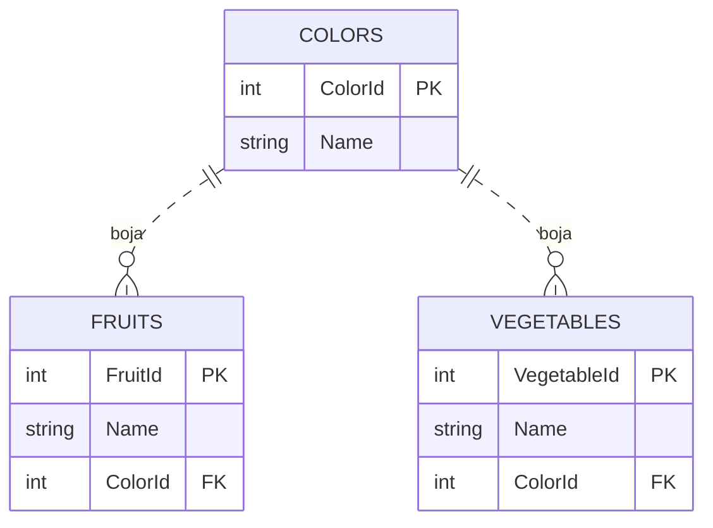
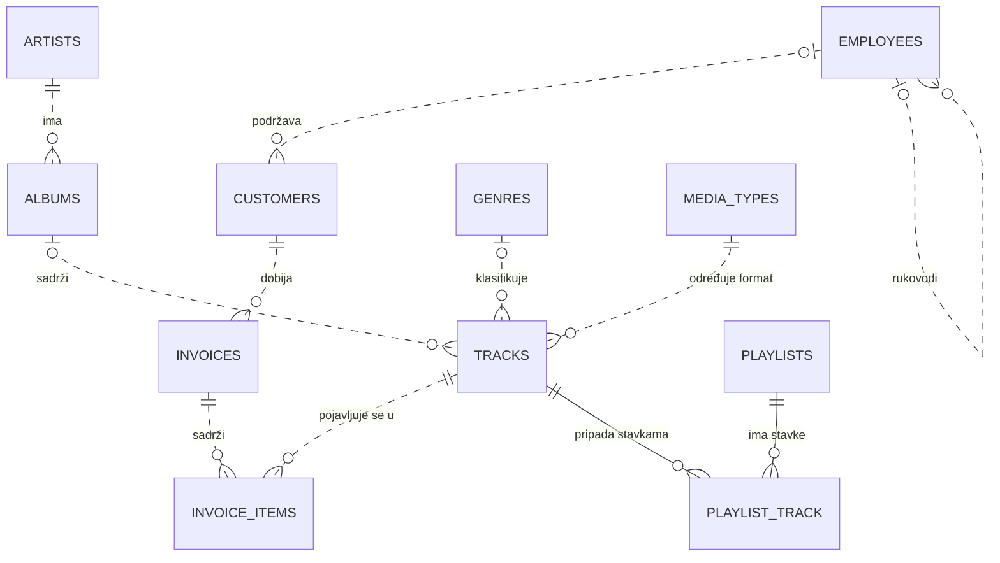
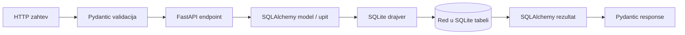
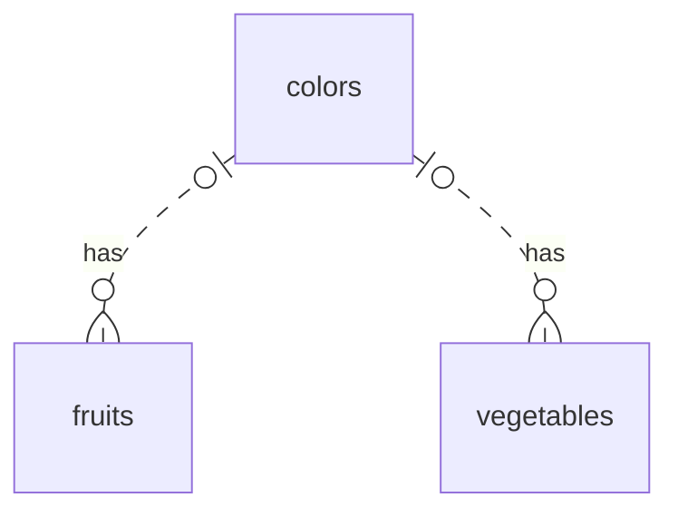
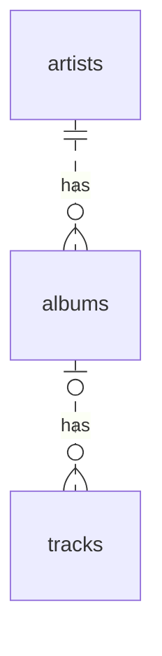
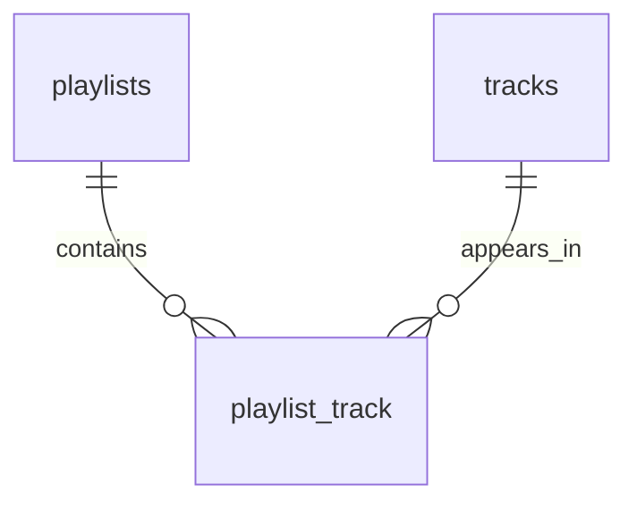
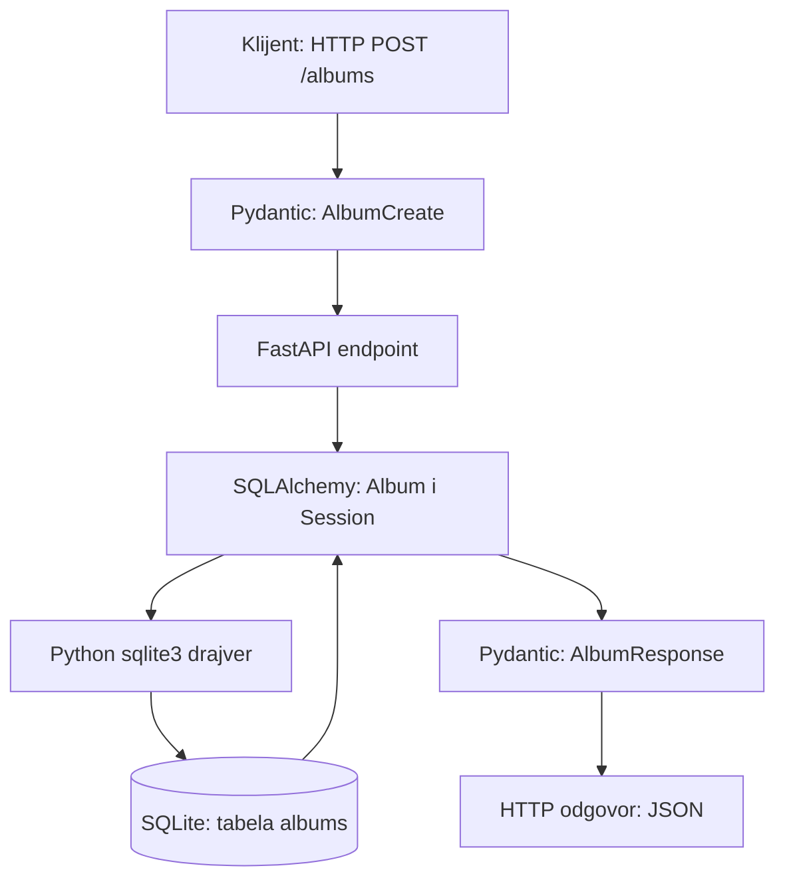

# 04 — Osnovni pojmovi o bazama podataka

## Cilj lekcije

U ovoj lekciji upoznaćeš pojmove baza podataka, tabele, reda, kolone, relacionog modela i sistema za upravljanje bazom podataka. Kroz primere ćeš naučiti kako se podaci predstavljaju u tabelama i zašto ponovljena vrednost u dve tabele sama po sebi još ne uspostavlja relaciju.

---

## Baza podataka i sistem koji njome upravlja

**Baza podataka** je organizovana kolekcija podataka i njihove strukture. Pored redova u tabelama, baza može da sadrži definicije tabela, indekse, ograničenja, poglede i druge objekte.

**Sistem za upravljanje bazom podataka** (DBMS — Database Management System) je softver koji omogućava da bazu napraviš, čitaš, menjaš i kontrolišeš pristup njenim podacima. **Relacioni DBMS** (RDBMS) organizuje podatke u relacije, koje se u praksi predstavljaju tabelama, kolonama, redovima i pravilima za povezivanje podataka.

| Pojam         | Značenje                                          | Primer iz ovog kursa               |
| ------------- | ------------------------------------------------- | ---------------------------------- |
| Baza podataka | Podaci zajedno sa njihovom strukturom i pravilima | Fajl `chinook.db`                  |
| DBMS / RDBMS  | Softver koji upravlja bazom i izvršava upite      | SQLite                             |
| Tabela        | Strukturisana celina sličnih zapisa               | `artists` ili `albums`             |
| SQL           | Jezik za definisanje, čitanje i menjanje podataka | `SELECT`, `CREATE TABLE`, `INSERT` |

Drugi poznati relacioni sistemi uključuju PostgreSQL, MySQL/MariaDB, Microsoft SQL Server i Oracle Database. SQLite je takođe relacioni DBMS, ali se u tipičnoj upotrebi ugrađuje u aplikaciju umesto da radi kao zaseban server.

---

## Tabela, red i kolona

Tabela opisuje jednu vrstu podataka, kao što su izvođači ili albumi. **Kolona** predstavlja svojstvo svakog zapisa, a **red** predstavlja jedan konkretan zapis. Izrazi **red** i **zapis** se često koriste kao sinonimi.

Primer tabele `fruits`:

| FruitId | Name  | Color |
| ------: | ----- | ----- |
|       1 | Apple | Green |
|       2 | Kiwi  | Brown |

U ovom primeru:

- `FruitId`, `Name` i `Color` su kolone.
- Red sa vrednostima `2`, `Kiwi` i `Brown` je jedan zapis o kiviju.
- Svaka vrednost u redu pripada odgovarajućoj koloni.

Baza nije Excel tabela sa podrazumevanim redosledom zapisa. U relacionoj bazi ne treba pretpostaviti da će redovi biti vraćeni redosledom kojim su dodati. Ako je redosled rezultata važan, upit mora izričito da ga zatraži, na primer pomoću `ORDER BY`; to ćemo obraditi u kasnijim lekcijama.

---

## Šta čini bazu relacionom

U transkriptu se prikazuju tabele `fruits` i `vegetables`, obe sa kolonom `Color`. To što obe tabele sadrže tekstualnu vrednost `Green` ili `Brown` **ne uspostavlja samo po sebi vezu između tabela**. Vrednosti mogu slučajno da se poklapaju, mogu biti različito napisane ili se mogu promeniti samo u jednoj tabeli.

SQL upit može da poredi dve tekstualne kolone i pronađe podudarne vrednosti, ali takvo poređenje samo po sebi ne garantuje integritet niti kaže da baza te vrednosti smatra zvaničnom relacijom.

### Primer: iste vrednosti, ali bez deklarisane relacije

| `fruits` |       |       | `vegetables` |          |       |
| -------- | ----- | ----- | ------------ | -------- | ----- |
| FruitId  | Name  | Color | VegetableId  | Name     | Color |
| 1        | Apple | Green | 1            | Cucumber | Green |
| 2        | Kiwi  | Brown | 2            | Potato   | Brown |

Kolona `Color` se ponavlja u obe tabele, ali nema stranog ključa koji bi povezao redove sa jednim zajedničkim zapisom boje. Ovaj prikaz je koristan da prepoznaš slične vrednosti, ali nije sam po sebi model referencijalnog integriteta.

---

## Eksplicitna relacija preko ključeva

Ako boja predstavlja podatak koji se deli između voća i povrća, možeš je predstaviti posebnom tabelom `colors`. U tabelama `fruits` i `vegetables` čuva se `ColorId`, koji referencira primarni ključ tabele `colors`.

Tabela `colors` čuva po jedan zapis za svaku boju:

| ColorId (PK) | Name  |
| -----------: | ----- |
|            1 | Green |
|            2 | Brown |
|            3 | Red   |

Tabela `fruits` čuva ključ boje umesto ponavljanja naziva boje:

| FruitId (PK) | Name  | ColorId (FK) |
| -----------: | ----- | -----------: |
|            1 | Apple |            1 |
|            2 | Kiwi  |            2 |

Isto važi i za tabelu `vegetables`:

| VegetableId (PK) | Name     | ColorId (FK) |
| ---------------: | -------- | -----------: |
|                1 | Cucumber |            1 |
|                2 | Potato   |            2 |

Sada `fruits.ColorId` i `vegetables.ColorId` imaju jasno definisano značenje: oba referenciraju `colors.ColorId`. Po želji, možeš postaviti i ograničenje `UNIQUE` na `colors.Name` da sprečiš dupliranje istog naziva boje.



U ovom modelu jedan zapis u `colors` može biti povezan sa više zapisa u `fruits` ili `vegetables`. Svako voće i svako povrće upućuje na jedan zapis boje. `PK` znači **primarni ključ**, `FK` **strani ključ**, a `UK` **jedinstven ključ**.

---

## Primarni i strani ključevi

**Primarni ključ** (Primary Key, PK) jednoznačno identifikuje svaki red u tabeli. **Strani ključ** (Foreign Key, FK) upućuje na primarni ili jedinstveni ključ druge tabele.

| Ključ          | Uloga                                                   | Primer                                          |
| -------------- | ------------------------------------------------------- | ----------------------------------------------- |
| Primarni ključ | Jedinstveno identifikuje zapis u svojoj tabeli          | `artists.ArtistId`                              |
| Strani ključ   | Povezuje zapis sa odgovarajućim zapisom u drugoj tabeli | `albums.ArtistId` upućuje na `artists.ArtistId` |

U Chinook bazi `albums.ArtistId` povezuje album sa njegovim izvođačem. Relacija ne nastaje samo zato što se broj `ArtistId` pojavljuje u obe tabele; ona je definisana kao strani ključ u šemi baze.

SQLite ima važnu posebnost: provera stranih ključeva zavisi od podešavanja konekcije (`PRAGMA foreign_keys`). Zato treba razlikovati **deklaraciju ključa u šemi** od toga da li konkretna konekcija trenutno sprovodi proveru. O ovome ćemo više raditi kada budemo pravili šemu i povezivali SQLAlchemy.

---

## Vrste relacija između tabela

| Vrsta relacije          | Primer                            | Tipična realizacija                                |
| ----------------------- | --------------------------------- | -------------------------------------------------- |
| 1:1 (jedan-prema-jedan) | Korisnik ima jedan profil         | Strani ključ uz ograničenje `UNIQUE`               |
| 1:N (jedan-prema-više)  | Jedan izvođač ima više albuma     | Strani ključ se čuva u tabeli na strani „više“     |
| N:M (više-prema-više)   | Više plejlista sadrži više numera | Pomoćna tabela sa stranim ključevima ka obe tabele |

Chinook baza sadrži primere relacija 1:N i N:M:



`PLAYLIST_TRACK` je pomoćna tabela za N:M relaciju između `PLAYLISTS` i `TRACKS`. U njoj su `PlaylistId` i `TrackId` zajedno kompozitni primarni ključ, a oba su ujedno i strani ključevi. Svaki red povezuje jednu plejlistu sa jednom numerom.

U dijagramu `|o` sa leve strane linije označava da veza sa te strane može biti prazna ili pokazivati na jedan zapis. Na primer, `tracks.AlbumId` i `tracks.GenreId` mogu biti `NULL` u Chinook bazi. Dijagram je vizuelni sažetak; tačne kolone i ograničenja proveravaju se u šemi baze.

Pogledaj i [ERD.drawio](../chinook/ERD.drawio), koji prikazuje svih 11 tabela i njihove veze prema stvarnoj Chinook šemi.

---

## Relacioni DBMS i primeri

SQLite, PostgreSQL, MySQL/MariaDB, Microsoft SQL Server i Oracle Database su primeri relacionih sistema za upravljanje bazama. Razlikuju se po arhitekturi, funkcijama i načinu administracije, ali svi podržavaju relacionu organizaciju podataka i SQL.

| DBMS                 | Uobičajen način korišćenja                            |
| -------------------- | ----------------------------------------------------- |
| SQLite               | Ugrađen u aplikaciju; najčešće radi sa fajlom baze    |
| PostgreSQL           | Klijent-server baza, čest izbor za web aplikacije     |
| MySQL/MariaDB        | Klijent-server sistemi, česti u web aplikacijama      |
| Microsoft SQL Server | Klijent-server sistem u Microsoft ekosistemu          |
| Oracle Database      | Klijent-server sistem za različite poslovne scenarije |

Relaciona baza ne mora da ima najmanje dve tabele. Može početi od jedne tabele; relacije se pojavljuju kada model podataka sadrži veze između zapisa, najčešće izražene primarnim i stranim ključevima.

---

## Kako se pojmovi preslikavaju na FastAPI i SQLAlchemy

Tabela, SQLAlchemy model, Pydantic šema i API odgovor su povezani, ali nisu isti objekat. Na primer, SQLAlchemy model opisuje rad sa bazom, dok Pydantic šema opisuje strukturu podataka koju endpoint prima ili vraća.

| Koncept baze | Uobičajen pojam u SQLAlchemy-ju | Značenje u FastAPI aplikaciji                      |
| ------------ | ------------------------------- | -------------------------------------------------- |
| Tabela       | ORM model ili `Table` objekat   | Trajno skladištenje tipa podataka                  |
| Red          | ORM instanca                    | Jedan konkretan zapis, npr. jedan album            |
| Kolona       | Mapirani atribut                | Jedno polje zapisa                                 |
| Strani ključ | FK kolona i ORM relacija        | Veza između povezanih zapisa                       |
| API šema     | Nema nužno direktnu DB tabelu   | Validacija request/response podataka kroz Pydantic |

Tipičan tok jednog zahteva izgleda ovako:



Ovaj prikaz je konceptualan: stvarni endpoint može imati dodatne slojeve, a ne mora svaki Pydantic model da odgovara jednoj tabeli. Važno je da validacija API podataka, pristup bazi i pravila integriteta imaju jasno razdvojene odgovornosti.

---

## Provera razumevanja

1. Koja je razlika između baze podataka i sistema koji njome upravlja?

- Baza podataka je skup organizovanih podataka, dok DBMS (Database Management System) je softver koji omogućava kreiranje, čuvanje, pristup i upravljanje tim podacima.

2. Kako razlikuješ red od kolone u tabeli?

- Red predstavlja jedan zapis u tabeli, dok kolona predstavlja jedno polje tog zapisa. Na primer, u tabeli `albums`, red bi mogao biti konkretan album, dok kolone mogu biti `Title`, `ArtistId` itd. Svaka kolona ima svoj tip podataka i može imati dodatna ograničenja, kao što su primarni ključ, strani ključ ili jedinstvenost.

3. Zašto podudaranje teksta `Green` u dve tabele samo po sebi ne uspostavlja relaciju?

- Podudaranje teksta `Green` u dve tabele samo po sebi ne uspostavlja relaciju jer relacija u bazi podataka zavisi od primarnih i stranih ključeva, a ne od vrednosti teksta. Tekstualne vrednosti mogu biti iste, ali to ne garantuje da su zapisi povezani na način koji baza može da razume i održava integritet podataka.

4. Koja je razlika između primarnog i stranog ključa?

- Primarni ključ je kolona ili skup kolona koje jedinstveno identifikuju svaki red u tabeli. Strani ključ je kolona ili skup kolona koje referenciraju primarni ključ druge tabele, uspostavljajući relaciju između zapisa u različitim tabelama. Primarni ključ garantuje jedinstvenost unutar svoje tabele, dok strani ključ omogućava povezivanje i održavanje referencijalnog integriteta između tabela.

5. Kako se N:M relacija između plejlista i numera ostvaruje u Chinook bazi?

- N:M relacija između plejlista i numera u Chinook bazi ostvaruje se pomoću pomoćne tabele `playlist_track`, koja sadrži strane ključeve `PlaylistId` i `TrackId`. Ova tabela omogućava da jedna plejlista sadrži više numera, a jedna numera može biti u više plejlista, čime se uspostavlja mnogostruka veza između `playlists` i `tracks`.

6. Zašto SQLAlchemy model i Pydantic šema nisu isto?

- SQLAlchemy model predstavlja strukturu tabele u bazi podataka i koristi se za interakciju sa bazom, dok Pydantic šema definiše validaciju i serijalizaciju podataka koji ulaze i izlaze iz API-ja. Model je vezan za bazu i njene relacije, dok šema služi za osiguranje da podaci imaju ispravan oblik i tip pre nego što se obrade ili pošalju klijentu. Drugim rečima, model je za perzistenciju podataka, a šema za validaciju i transformaciju podataka.

7. Da li relaciona baza može da ima samo jednu tabelu?

- Tehnički, relaciona baza može imati samo jednu tabelu, ali u praksi se to retko dešava jer relacije između tabela predstavljaju osnovnu snagu relacionih baza. Sa samo jednom tabelom, ne postoji potreba za stranim ključevima i relacijama, što ograničava mogućnosti normalizacije i održavanja integriteta podataka. U takvom slučaju, baza gubi prednosti koje pruža relaciona struktura, kao što su eliminacija redundancije i jednostavnije održavanje konzistentnosti podataka.

---

## Vežbe

### Vežba 1 — Prepoznaj delove tabele

Koristeći normalizovani primer tabele `fruits` iz odeljka „Eksplicitna relacija preko ključeva“:

1. Navedi njene kolone.

| Kolona  | Tip podatka |
| ------- | ----------- |
| FruitId | INTEGER     |
| Name    | TEXT        |
| ColorId | INTEGER     |

2. Prepiši jedan red kao celovit zapis i objasni šta svaka vrednost znači.

```text
FruitId = 1, Name = 'Apple', ColorId = 1
```

`FruitId = 1` identifikuje zapis; `Name = 'Apple'` je naziv voća; `ColorId = 1` upućuje na boju `Green` u primeru tabele `colors`. Ovo je **prikaz reda**, ne naredba koja ga upisuje. U prethodnom tekstualnom primeru bez tabele boja kolone su `FruitId`, `Name` i `Color`, umesto `ColorId`.

3. Predloži kolonu koja bi mogla da bude primarni ključ i objasni zašto.

`FruitId` je dobar kandidat za primarni ključ: identifikuje pojedinačan zapis i ne bi smeo da se ponovi. Naziv voća nije dobar izbor ako više zapisa može imati isti naziv.

Pri pravljenju nove SQLite tabele može se definisati kao `FruitId INTEGER PRIMARY KEY`, kao u Vežbi 2. SQLite ne podržava `ALTER TABLE fruits ADD PRIMARY KEY (FruitId)` za naknadno dodavanje PK-a postojećoj tabeli; promena postojeće šeme obično zahteva ponovno pravljenje tabele i pažljivo prebacivanje podataka.

---

### Vežba 2 — Ispravi model voća i povrća

1. Objasni zašto iste tekstualne vrednosti u kolonama `Color` ne garantuju referencijalni integritet.

- Tekstualne vrednosti same po sebi ne garantuju jedinstvenost i mogu se razlikovati u pisanju (npr. "Red" vs "red"), što može dovesti do nekonzistentnosti i problema sa referencijalnim integritetom.

- Korišćenjem primarnog ključa (`ColorId`) u tabeli `colors` i stranih ključeva u tabelama `fruits` i `vegetables`, uz uključenu proveru stranih ključeva, svaka upisana neprazna vrednost mora odgovarati postojećoj boji. Ključ može biti i tekstualan ako ispunjava potrebne uslove; nije nužno numerički.

- Kada promenimo naziv boje u tabeli `colors`, upit koji povezuje tabele prikazuje novi naziv za sve odgovarajuće zapise; vrednosti `ColorId` u njima se ne menjaju.

- U modelu gde je tekst ponovljen u svakom redu, promena naziva boje zahtevala bi ažuriranje svakog reda pojedinačno, što povećava rizik od grešaka i nekonzistentnosti.

- Strani ključevi štite vezu, ali sami ne sprečavaju dva različita ID-ja boje sa istim nazivom; za to je potrebno dodatno ograničenje poput `UNIQUE` nad nazivom.

2. Dopuni model tako da `colors.ColorId` bude primarni ključ, a `fruits.ColorId` i `vegetables.ColorId` strani ključevi.

```sql
CREATE TABLE colors (
    ColorId INTEGER PRIMARY KEY,
    Color TEXT NOT NULL
);

CREATE TABLE fruits (
    FruitId INTEGER PRIMARY KEY,
    Name TEXT NOT NULL,
    ColorId INTEGER,
    FOREIGN KEY (ColorId) REFERENCES colors(ColorId)
);

CREATE TABLE vegetables (
    VegetableId INTEGER PRIMARY KEY,
    Name TEXT NOT NULL,
    ColorId INTEGER,
    FOREIGN KEY (ColorId) REFERENCES colors(ColorId)
);
```

Ovo je primer za novu, odvojenu bazu, ne za izvršavanje nad Chinook tabelama. Kolona sa nazivom boje ovde se zove `Color`, dok se u ranijem ilustrativnom prikazu zvala `Name`. Pošto obe kolone `ColorId` u tabelama voća i povrća dozvoljavaju `NULL`, boja nije obavezna. U SQLite-u uključi proveru FK-ova pomoću `PRAGMA foreign_keys = ON;` van aktivne transakcije ako želiš da se ograničenja proveravaju.

3. Nacrtaj relacije u Mermaid `erDiagram` formatu ili na papiru.



`|o` označava nula ili jednu boju za jedan zapis, a `o{` nula ili više zapisa za jednu boju. Isprekidana veza `..` označava da strani ključ nije deo primarnog ključa deteta.

4. Opiši šta bi se dogodilo kada bi naziv boje trebalo promeniti u modelu sa jednom tabelom boja, a šta u modelu gde je tekst ponovljen u svakom redu.

U modelu sa tabelom `colors`, promeni se naziv u jednom redu te tabele; povezani redovi zadržavaju isti ID, a povezani upiti vide novi naziv. Kada se tekst čuva u svakom redu obe tabele, potrebno je ažurirati odgovarajuće redove na svim mestima; propušteni redovi mogu ostati sa starim nazivom.

---

### Vežba 3 — Istraži relacije u Chinook bazi

1. Otvori [ERD.drawio](../chinook/ERD.drawio) i pronađi relacije `artists`–`albums` i `albums`–`tracks`.



Relacija `artists`–`albums` je jedan-prema-više (1 : 0..N): jedan umetnik ne mora imati album, ali može imati jedan ili više albuma, dok svaki album mora imati upisan jednog umetnika: `albums.ArtistId` je `NOT NULL`. Kada je provera stranih ključeva uključena, taj umetnik mora postojati u tabeli `artists`.

Relacija `albums`–`tracks` je **jedan-prema-više, uz opcionu vezu** (`0..1 : 0..N`):

- Jedna numera može imati **nula ili jedan** zabeležen album. `tracks.AlbumId` je strani ključ koji dozvoljava `NULL`; to može značiti da album nije poznat ili nije unet. Ako nije `NULL`, uz uključenu proveru stranih ključeva mora odgovarati postojećem albumu.

- Jedan album može imati **nula, jednu ili više** povezanih numera. Više redova u `tracks` može imati isti `AlbumId`, jer ta kolona nije jedinstvena.

**Nula numera nije `NULL` pesma.** To znači da u tabeli `tracks` trenutno ne postoji nijedan red koji pokazuje na taj album. Šema dozvoljava takav zapis, na primer dok se podaci o albumu tek unose. To ne znači da autor tvrdi da je album bez pesama smislen u svakom stvarnom kontekstu. Ako je poslovno pravilo da svaki album mora imati bar jednu numeru, aplikacija mora dodatno obezbediti to pravilo. Prikazani strani ključ ga sam ne nameće.

U gornjem Mermaid dijagramu `|o` označava nula ili jedan album po numeri, a `o{` nula ili više numera po albumu. Isprekidana linija `..` označava neidentifikujuću vezu: strani ključ nije deo primarnog ključa deteta.

U radnoj bazi je u trenutku provere bilo **347 albuma i 3.503 numere**: nijedan album nije bio bez povezane numere i nijedna numera nije imala `NULL` u `AlbumId`. To je stanje podataka, ne ograničenje šeme. Možeš proveriti:

```sql
-- Albumi bez povezanih numera
SELECT a.AlbumId, a.Title
FROM albums AS a
WHERE NOT EXISTS (
    SELECT 1 FROM tracks AS t WHERE t.AlbumId = a.AlbumId
);

-- Numere bez zabeleženog albuma
SELECT TrackId, Name
FROM tracks
WHERE AlbumId IS NULL;
```

2. U CLI-ju proveri `.schema albums` i `.schema tracks`.

U **SQLite CLI-ju**, kada je Chinook baza otvorena ili priključena, unesi:

```text
.schema albums
.schema tracks
```

Komande prikazuju `CREATE TABLE` definicije i mogu prikazati i povezane indekse. Ovo je pregled strukture; ne menja bazu.

3. Pronađi primarni ključ i strane ključeve u tim definicijama.

U izdvojenim delovima rezultata vidi se:

```sql
-- albums
[AlbumId] INTEGER PRIMARY KEY AUTOINCREMENT NOT NULL,
[ArtistId] INTEGER NOT NULL,
FOREIGN KEY ([ArtistId]) REFERENCES "artists" ([ArtistId])
    ON DELETE NO ACTION ON UPDATE NO ACTION

-- tracks
[TrackId] INTEGER PRIMARY KEY AUTOINCREMENT NOT NULL,
[AlbumId] INTEGER,
[MediaTypeId] INTEGER NOT NULL,
[GenreId] INTEGER,
FOREIGN KEY ([AlbumId]) REFERENCES "albums" ([AlbumId])
    ON DELETE NO ACTION ON UPDATE NO ACTION,
FOREIGN KEY ([GenreId]) REFERENCES "genres" ([GenreId])
    ON DELETE NO ACTION ON UPDATE NO ACTION,
FOREIGN KEY ([MediaTypeId]) REFERENCES "media_types" ([MediaTypeId])
    ON DELETE NO ACTION ON UPDATE NO ACTION
```

Ovo su **delovi definicija**, ne samostalne SQL naredbe.

| Tabela   | Kolona        | Uloga i značenje                                                                   |
| -------- | ------------- | ---------------------------------------------------------------------------------- |
| `albums` | `AlbumId`     | PK: jedinstveno identifikuje album.                                                |
| `albums` | `ArtistId`    | FK ka `artists.ArtistId`; `NOT NULL`, pa album mora imati upisanog umetnika.       |
| `tracks` | `TrackId`     | PK: jedinstveno identifikuje numeru.                                               |
| `tracks` | `AlbumId`     | FK ka `albums.AlbumId`; dozvoljava `NULL`, pa album numere ne mora biti zabeležen. |
| `tracks` | `GenreId`     | FK ka `genres.GenreId`; dozvoljava `NULL`, pa žanr ne mora biti zabeležen.         |
| `tracks` | `MediaTypeId` | FK ka `media_types.MediaTypeId`; `NOT NULL`, pa tip medija mora biti upisan.       |

`NOT NULL` zahteva vrednost, a **FK određuje na koji ključ vrednost upućuje**. Da bi SQLite odbio nepraznu vrednost koja ne postoji u roditeljskoj tabeli, provera stranih ključeva mora biti uključena za tu konekciju; proveri je pomoću `PRAGMA foreign_keys;`.

Kod svih navedenih FK-ova `ON DELETE NO ACTION` i `ON UPDATE NO ACTION` ne menjaju automatski povezane redove kada se obriše roditeljski red ili promeni njegov ključ. Uz uključenu FK proveru, operacija koja ostavi nevažeću vezu može biti odbijena.

4. Objasni zašto `playlist_track` postoji između `playlists` i `tracks`.

**`playlists` i `tracks` imaju vezu više-prema-više (N:M):** jedna plejlista može sadržati više numera, a ista numera može biti u više plejlista. Numeru možemo imati i bez plejliste, a plejlistu bez numera.

Međutabela `playlist_track` beleži te veze. Svaki njen red označava **jedan par: jedna plejlista i jedna numera**. Uprošćen, izmišljen primer:

| `PlaylistId` | `TrackId` | Značenje                           |
| ------------ | --------- | ---------------------------------- |
| 1            | 10        | Numera 10 je u plejlisti 1.        |
| 1            | 11        | Numera 11 je takođe u plejlisti 1. |
| 2            | 10        | Numera 10 je i u plejlisti 2.      |

Ponavljanje `PlaylistId = 1` pokazuje više numera u jednoj plejlisti; ponavljanje `TrackId = 10` pokazuje istu numeru u više plejlista. Ovo su dve veze 1:N prema međutabeli:



Puna linija označava identifikujuću vezu: oba strana ključa su ujedno deo primarnog ključa međutabele. Jedan red u `playlist_track` pripada tačno jednoj plejlisti i jednoj numeri, pod uslovom da se FK ograničenja sprovode.

Proveri samu definiciju:

```text
.schema playlist_track
```

Bitni delovi su:

```sql
[PlaylistId] INTEGER NOT NULL,
[TrackId] INTEGER NOT NULL,
PRIMARY KEY ([PlaylistId], [TrackId]),
FOREIGN KEY ([PlaylistId]) REFERENCES "playlists" ([PlaylistId]),
FOREIGN KEY ([TrackId]) REFERENCES "tracks" ([TrackId])
```

Primarni ključ je **složen**: jedinstven mora biti ceo par `(PlaylistId, TrackId)`, a ne svaka kolona zasebno. Tako su dozvoljeni parovi `(1, 10)`, `(1, 11)` i `(2, 10)`, ali drugi `(1, 10)` nije. Zbog toga u ovoj šemi istu numeru nije moguće dodati dva puta u istu plejlistu. Ove dve kolone su istovremeno **dva odvojena strana ključa**, ne jedan složeni FK.

Umesto liste ID-jeva u jednoj ćeliji ili dodavanja novih kolona za svaku plejlistu, međutabela čuva po jedan red za svaku vezu. Ona sama u ovoj šemi ne beleži redosled numera u plejlisti.

Za pregled stvarnih veza u radnoj Chinook bazi:

```sql
-- Tri numere iz plejliste 1 sa najmanjim TrackId
SELECT p.PlaylistId, p.Name AS plejlista, t.TrackId, t.Name AS numera
FROM playlists AS p
JOIN playlist_track AS pt ON p.PlaylistId = pt.PlaylistId
JOIN tracks AS t ON t.TrackId = pt.TrackId
WHERE p.PlaylistId = 1
ORDER BY t.TrackId
LIMIT 3;

-- Sve plejliste koje sadrže numeru 1
SELECT p.PlaylistId, p.Name AS plejlista
FROM playlists AS p
JOIN playlist_track AS pt ON p.PlaylistId = pt.PlaylistId
WHERE pt.TrackId = 1
ORDER BY p.PlaylistId;
```

U proveri radne baze plejlista 1 imala je više numera, a numera 1 bila je u tri plejliste. `ORDER BY TrackId` u prvom upitu služi samo za stabilan prikaz rezultata, ne predstavlja redosled numera u plejlisti.

---

### Vežba 4 — Poveži bazu sa ORM pojmovima

Izaberi tabelu `albums` i napravi tabelu sa sledećim kolonama:

| Pojam                                                  | Odgovor                                                                                                                              |
| ------------------------------------------------------ | ------------------------------------------------------------------------------------------------------------------------------------ |
| SQLAlchemy model koji bi mogao da je predstavlja       | Primer klase `Album` ispod, sa `__tablename__ = "albums"`.                                                                           |
| Primer jednog reda / ORM instance                      | Red sa `AlbumId = 1`, naslovom `For Those About To Rock We Salute You` i `ArtistId = 1`; ORM može da ga predstavi instancom `Album`. |
| Primer kolone / mapiranog atributa                     | Kolona `albums.Title` odgovara Python atributu `Album.title`.                                                                        |
| Pydantic šema koja bi mogla da posluži kao API odgovor | `AlbumResponse`, sa poljima `album_id`, `title` i `artist_id`.                                                                       |
| Veza ka drugoj tabeli preko stranog ključa             | `albums.ArtistId` upućuje na `artists.ArtistId`.                                                                                     |

Ovo je **ilustrativan model za Chinook**, ne postojeća TodoApp klasa. Tabela i njena imena kolona već postoje u Chinook bazi; Python atributi mogu imati druga imena:

```python
from sqlalchemy import ForeignKey, Integer, String
from sqlalchemy.orm import DeclarativeBase, Mapped, mapped_column
from pydantic import BaseModel, ConfigDict


class Base(DeclarativeBase):
    pass


class Album(Base):
    __tablename__ = "albums"

    album_id: Mapped[int] = mapped_column("AlbumId", Integer, primary_key=True)
    title: Mapped[str] = mapped_column("Title", String(160), nullable=False)
    artist_id: Mapped[int] = mapped_column(
        "ArtistId", ForeignKey("artists.ArtistId"), nullable=False
    )


class AlbumResponse(BaseModel):
    album_id: int
    title: str
    artist_id: int

    model_config = ConfigDict(from_attributes=True)
```

- `Album` je **klasa koja mapira tabelu**, a `Album(...)` ili objekat dobijen ORM upitom je instanca koja predstavlja jedan red. Kreiranje Python objekta samo po sebi ne upisuje red u bazu.
- `mapped_column("Title", ...)` povezuje Python atribut `title` sa postojećom SQL kolonom `Title`. `ForeignKey("artists.ArtistId")` opisuje vezu u SQLAlchemy modelu; za pravljenje cele šeme nedostaje i definicija ili reflektovana tabela `artists`.
- `AlbumResponse` je zasebna Pydantic šema za API; `from_attributes=True` omogućava da čita vrednosti iz ORM instance. Na primer, `AlbumResponse.model_validate(album)` pravi šemu iz učitanog objekta.
- `ForeignKey` i ORM `relationship()` nisu isto: prvi opisuje strani ključ, a drugi po želji daje pogodnost za rad sa povezanim ORM objektima. U ovom primeru `relationship()` nije definisan.

Model i pretvaranje učitanog albuma u `AlbumResponse` provereni su nad radnom Chinook bazom **samo za čitanje**. Primer ne poziva `create_all()` i ne menja bazu.

---

### Vežba 5 — Prikaži putanju podatka

Nacrtaj dijagram koji prikazuje putanju albuma od HTTP zahteva do odgovora FastAPI endpoint-a. Uključi Pydantic validaciju, SQLAlchemy, SQLite drajver i tabelu `albums`, a uz svaki element napiši njegovu odgovornost.

Primer ispod je **zamišljeni endpoint** za kreiranje albuma u aplikaciji koja koristi Chinook; nije postojeći TodoApp endpoint. Ne treba ga pokretati nad radnom bazom samo radi čitanja primera.



---

#### Primer toka

1. **Klijent šalje HTTP zahtev.** Na primer, telo zamišljenog zahteva `POST /albums`:

   ```json
   {
     "title": "Novi album",
     "artist_id": 1
   }
   ```

2. **FastAPI i Pydantic proveravaju ulaz.** Zamišljena ulazna šema `AlbumCreate` ima `title: str` i `artist_id: int`. Pydantic proverava i obrađuje primljena polja; ne dokazuje sam po sebi da umetnik sa tim ID-jem postoji u bazi. Pri neuspešnoj validaciji FastAPI vraća grešku klijentu.

3. **Endpoint obrađuje zahtev.** Na osnovu validiranih podataka pravi ORM objekat `Album(title=..., artist_id=...)`, dodaje ga u `Session` i traži potvrdu transakcije pomoću `commit()`. Ako je potrebna provera poslovnih pravila, endpoint ili njegov servis je obavlja.

4. **SQLAlchemy i drajver pristupaju bazi.** SQLAlchemy prevodi ORM operaciju u SQL i prosleđuje ga Pythonovom SQLite drajveru `sqlite3`. Drajver poziva SQLite biblioteku koja izvršava upis u tabelu `albums` i primenjuje njena ograničenja. FK provera u SQLite-u mora biti uključena za tu konekciju; u suprotnom ne treba pretpostaviti da je `artist_id` proveren.

5. **Potvrđuje se promena.** Posle uspešnog `commit()` upis je potvrđen; kod baze na disku ostaje sačuvan. U slučaju greške, ne treba vraćati uspešan odgovor: transakciju treba poništiti i grešku odgovarajuće obraditi. Po potrebi se objekat osvežava sa `session.refresh(album)` da bi se pročitale vrednosti iz baze, uključujući generisani ID.

6. **Priprema se HTTP odgovor.** Aplikacija pretvara ORM objekat u `AlbumResponse`, a FastAPI priprema JSON odgovor. Na primer, ako je baza dodelila ID `348`, odgovor može biti:

   ```json
   {
     "album_id": 348,
     "title": "Novi album",
     "artist_id": 1
   }
   ```

   ID i podaci su ilustrativni; ID dodeljuje baza i ne treba unapred pretpostaviti njegovu vrednost.

**Razlika između slojeva:** Pydantic proverava oblik API podataka; SQLAlchemy upravlja ORM objektima i transakcijom; `sqlite3` je drajver; SQLite upravlja bazom i ograničenjima. `albums` je tabela u bazi, a ne Python klasa ili JSON odgovor. Kod `GET` zahteva tok je sličan, ali aplikacija čita postojeći album umesto da ga kreira.
