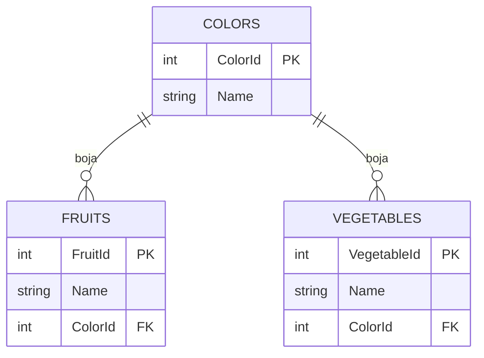
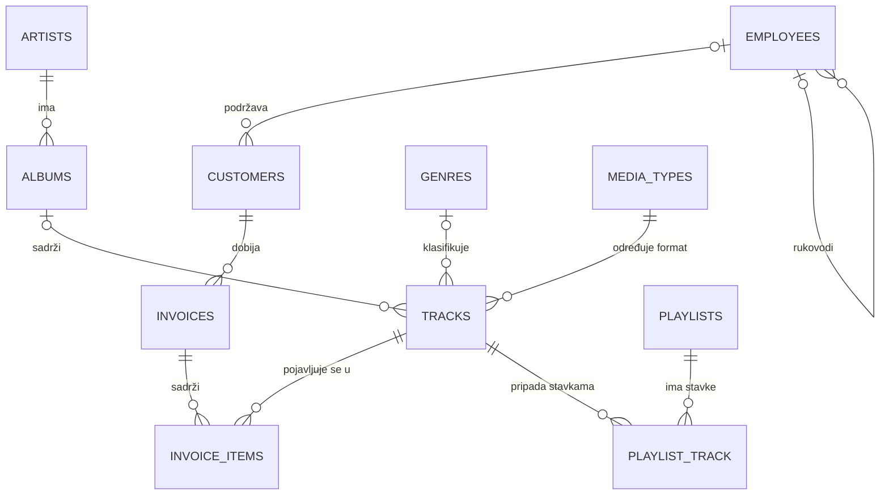
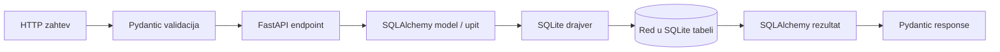

# 04 — Osnovni pojmovi o bazama podataka

## Cilj lekcije

U ovoj lekciji upoznaćeš pojmove baza podataka, tabele, reda, kolone, relacionog modela i sistema za upravljanje bazom podataka. Kroz primere ćeš naučiti kako se podaci predstavljaju u tabelama i zašto ponovljena vrednost u dve tabele sama po sebi još ne uspostavlja relaciju.

## Baza podataka i sistem koji njome upravlja

**Baza podataka** je organizovana kolekcija podataka i njihove strukture. Pored redova u tabelama, baza može da sadrži definicije tabela, indekse, ograničenja, poglede i druge objekte.

**Sistem za upravljanje bazom podataka** (DBMS — Database Management System) je softver koji omogućava da bazu napraviš, čitaš, menjaš i kontrolišeš pristup njenim podacima. **Relacioni DBMS** (RDBMS) organizuje podatke u relacije, koje se u praksi predstavljaju tabelama, kolonama, redovima i pravilima za povezivanje podataka.

| Pojam         | Značenje                                          | Primer iz ovog kursa               |
| ------------- | ------------------------------------------------- | ---------------------------------- |
| Baza podataka | Podaci zajedno sa njihovom strukturom i pravilima | Fajl `chinook.db`                  |
| DBMS / RDBMS  | Softver koji upravlja bazom i izvršava upite      | SQLite                             |
| Tabela        | Strukturisana celina sličnih zapisa               | `artists` ili `albums`             |
| SQL           | Jezik za definisanje, čitanje i menjanje podataka | `SELECT`, `CREATE TABLE`, `INSERT` |

Drugi poznati relacioni sistemi uključuju PostgreSQL, MySQL/MariaDB, Microsoft SQL Server i Oracle Database. SQLite je takođe relacioni DBMS, ali se u tipičnoj upotrebi ugrađuje u aplikaciju umesto da radi kao zaseban server.

## Tabela, red i kolona

Tabela opisuje jednu vrstu podataka, kao što su izvođači ili albumi. **Kolona** predstavlja svojstvo svakog zapisa, a **red** predstavlja jedan konkretan zapis. Izrazi **red** i **zapis** se često koriste kao sinonimi.

Primer tabele `fruits`:

| FruitId | Name  | Color |
| ------: | ----- | ----- |
|       1 | Apple | Green |
|       2 | Kiwi  | Brown |

U ovom primeru:

- `FruitId`, `Name` i `Color` su kolone.
- Red sa vrednostima `2`, `Kiwi` i `Brown` je jedan zapis o kiviju.
- Svaka vrednost u redu pripada odgovarajućoj koloni.

Baza nije Excel tabela sa podrazumevanim redosledom zapisa. U relacionoj bazi ne treba pretpostaviti da će redovi biti vraćeni redosledom kojim su dodati. Ako je redosled rezultata važan, upit mora izričito da ga zatraži, na primer pomoću `ORDER BY`; to ćemo obraditi u kasnijim lekcijama.

## Šta čini bazu relacionom

U transkriptu se prikazuju tabele `fruits` i `vegetables`, obe sa kolonom `Color`. To što obe tabele sadrže tekstualnu vrednost `Green` ili `Brown` **ne uspostavlja samo po sebi vezu između tabela**. Vrednosti mogu slučajno da se poklapaju, mogu biti različito napisane ili se mogu promeniti samo u jednoj tabeli.

SQL upit može da poredi dve tekstualne kolone i pronađe podudarne vrednosti, ali takvo poređenje samo po sebi ne garantuje integritet niti kaže da baza te vrednosti smatra zvaničnom relacijom.

### Primer: iste vrednosti, ali bez deklarisane relacije

| `fruits` |       |       | `vegetables` |          |       |
| -------- | ----- | ----- | ------------ | -------- | ----- |
| FruitId  | Name  | Color | VegetableId  | Name     | Color |
| 1        | Apple | Green | 1            | Cucumber | Green |
| 2        | Kiwi  | Brown | 2            | Potato   | Brown |

Kolona `Color` se ponavlja u obe tabele, ali nema stranog ključa koji bi povezao redove sa jednim zajedničkim zapisom boje. Ovaj prikaz je koristan da prepoznaš slične vrednosti, ali nije sam po sebi model referencijalnog integriteta.

## Eksplicitna relacija preko ključeva

Ako boja predstavlja podatak koji se deli između voća i povrća, možeš je predstaviti posebnom tabelom `colors`. U tabelama `fruits` i `vegetables` čuva se `ColorId`, koji referencira primarni ključ tabele `colors`.

Tabela `colors` čuva po jedan zapis za svaku boju:

| ColorId (PK) | Name  |
| -----------: | ----- |
|            1 | Green |
|            2 | Brown |
|            3 | Red   |

Tabela `fruits` čuva ključ boje umesto ponavljanja naziva boje:

| FruitId (PK) | Name  | ColorId (FK) |
| -----------: | ----- | -----------: |
|            1 | Apple |            1 |
|            2 | Kiwi  |            2 |

Isto važi i za tabelu `vegetables`:

| VegetableId (PK) | Name     | ColorId (FK) |
| ---------------: | -------- | -----------: |
|                1 | Cucumber |            1 |
|                2 | Potato   |            2 |

Sada `fruits.ColorId` i `vegetables.ColorId` imaju jasno definisano značenje: oba referenciraju `colors.ColorId`. Po želji, možeš postaviti i ograničenje `UNIQUE` na `colors.Name` da sprečiš dupliranje istog naziva boje.

U ovom modelu jedan zapis u `colors` može biti povezan sa više zapisa u `fruits` ili `vegetables`. Svako voće i svako povrće upućuje na jedan zapis boje. `PK` znači **primarni ključ**, `FK` **strani ključ**, a `UK` **jedinstven ključ**.

## Primarni i strani ključevi

**Primarni ključ** (Primary Key, PK) jednoznačno identifikuje svaki red u tabeli. **Strani ključ** (Foreign Key, FK) upućuje na primarni ili jedinstveni ključ druge tabele.

| Ključ          | Uloga                                                   | Primer                                          |
| -------------- | ------------------------------------------------------- | ----------------------------------------------- |
| Primarni ključ | Jedinstveno identifikuje zapis u svojoj tabeli          | `artists.ArtistId`                              |
| Strani ključ   | Povezuje zapis sa odgovarajućim zapisom u drugoj tabeli | `albums.ArtistId` upućuje na `artists.ArtistId` |

U Chinook bazi `albums.ArtistId` povezuje album sa njegovim izvođačem. Relacija ne nastaje samo zato što se broj `ArtistId` pojavljuje u obe tabele; ona je definisana kao strani ključ u šemi baze.

SQLite ima važnu posebnost: provera stranih ključeva zavisi od podešavanja konekcije (`PRAGMA foreign_keys`). Zato treba razlikovati **deklaraciju ključa u šemi** od toga da li konkretna konekcija trenutno sprovodi proveru. O ovome ćemo više raditi kada budemo pravili šemu i povezivali SQLAlchemy.

## Vrste relacija između tabela

| Vrsta relacije          | Primer                            | Tipična realizacija                                |
| ----------------------- | --------------------------------- | -------------------------------------------------- |
| 1:1 (jedan-prema-jedan) | Korisnik ima jedan profil         | Strani ključ uz ograničenje `UNIQUE`               |
| 1:N (jedan-prema-više)  | Jedan izvođač ima više albuma     | Strani ključ se čuva u tabeli na strani „više“     |
| N:M (više-prema-više)   | Više plejlista sadrži više numera | Pomoćna tabela sa stranim ključevima ka obe tabele |

Chinook baza sadrži primere relacija 1:N i N:M:

`PLAYLIST_TRACK` je pomoćna tabela za N:M relaciju između `PLAYLISTS` i `TRACKS`. U njoj su `PlaylistId` i `TrackId` zajedno kompozitni primarni ključ, a oba su ujedno i strani ključevi. Svaki red povezuje jednu plejlistu sa jednom numerom.

U dijagramu `o|` označava da veza sa te strane može biti prazna ili pokazivati na jedan zapis. Na primer, `tracks.AlbumId` i `tracks.GenreId` mogu biti `NULL` u Chinook bazi. Dijagram je vizuelni sažetak; tačne kolone i ograničenja proveravaju se u šemi baze.

Pogledaj i [ERD.drawio](../chinook/ERD.drawio), koji prikazuje svih 11 tabela i njihove veze prema stvarnoj Chinook šemi.

## Relacioni DBMS i primeri

SQLite, PostgreSQL, MySQL/MariaDB, Microsoft SQL Server i Oracle Database su primeri relacionih sistema za upravljanje bazama. Razlikuju se po arhitekturi, funkcijama i načinu administracije, ali svi podržavaju relacionu organizaciju podataka i SQL.

| DBMS                 | Uobičajen način korišćenja                            |
| -------------------- | ----------------------------------------------------- |
| SQLite               | Ugrađen u aplikaciju; najčešće radi sa fajlom baze    |
| PostgreSQL           | Klijent-server baza, čest izbor za web aplikacije     |
| MySQL/MariaDB        | Klijent-server sistemi, česti u web aplikacijama      |
| Microsoft SQL Server | Klijent-server sistem u Microsoft ekosistemu          |
| Oracle Database      | Klijent-server sistem za različite poslovne scenarije |

Relaciona baza ne mora da ima najmanje dve tabele. Može početi od jedne tabele; relacije se pojavljuju kada model podataka sadrži veze između zapisa, najčešće izražene primarnim i stranim ključevima.

## Kako se pojmovi preslikavaju na FastAPI i SQLAlchemy

Tabela, SQLAlchemy model, Pydantic šema i API odgovor su povezani, ali nisu isti objekat. Na primer, SQLAlchemy model opisuje rad sa bazom, dok Pydantic šema opisuje strukturu podataka koju endpoint prima ili vraća.

| Koncept baze | Uobičajen pojam u SQLAlchemy-ju | Značenje u FastAPI aplikaciji                      |
| ------------ | ------------------------------- | -------------------------------------------------- |
| Tabela       | ORM model ili `Table` objekat   | Trajno skladištenje tipa podataka                  |
| Red          | ORM instanca                    | Jedan konkretan zapis, npr. jedan album            |
| Kolona       | Mapirani atribut                | Jedno polje zapisa                                 |
| Strani ključ | FK kolona i ORM relacija        | Veza između povezanih zapisa                       |
| API šema     | Nema nužno direktnu DB tabelu   | Validacija request/response podataka kroz Pydantic |

Tipičan tok jednog zahteva izgleda ovako:

Ovaj prikaz je konceptualan: stvarni endpoint može imati dodatne slojeve, a ne mora svaki Pydantic model da odgovara jednoj tabeli. Važno je da validacija API podataka, pristup bazi i pravila integriteta imaju jasno razdvojene odgovornosti.

## Provera razumevanja

1. Koja je razlika između baze podataka i sistema koji njome upravlja?
2. Kako razlikuješ red od kolone u tabeli?
3. Zašto podudaranje teksta `Green` u dve tabele samo po sebi ne uspostavlja relaciju?
4. Koja je razlika između primarnog i stranog ključa?
5. Kako se N:M relacija između plejlista i numera ostvaruje u Chinook bazi?
6. Zašto SQLAlchemy model i Pydantic šema nisu isto?
7. Da li relaciona baza može da ima samo jednu tabelu?

## Vežbe

### Vežba 1 — Prepoznaj delove tabele

Koristeći tabelu `fruits` iz lekcije:

1. Navedi njene kolone.
2. Prepiši jedan red kao celovit zapis i objasni šta svaka vrednost znači.
3. Predloži kolonu koja bi mogla da bude primarni ključ i objasni zašto.

### Vežba 2 — Ispravi model voća i povrća

1. Objasni zašto iste tekstualne vrednosti u kolonama `Color` ne garantuju referencijalni integritet.
2. Dopuni model tako da `colors.ColorId` bude primarni ključ, a `fruits.ColorId` i `vegetables.ColorId` strani ključevi.
3. Nacrtaj relacije u Mermaid `erDiagram` formatu ili na papiru.
4. Opiši šta bi se dogodilo kada bi naziv boje trebalo promeniti u modelu sa jednom tabelom boja, a šta u modelu gde je tekst ponovljen u svakom redu.

### Vežba 3 — Istraži relacije u Chinook bazi

1. Otvori [ERD.drawio](../chinook/ERD.drawio) i pronađi relacije `artists`–`albums` i `albums`–`tracks`.
2. U CLI-ju proveri `.schema albums` i `.schema tracks`.
3. Pronađi primarni ključ i strane ključeve u tim definicijama.
4. Objasni zašto `playlist_track` postoji između `playlists` i `tracks`.

### Vežba 4 — Poveži bazu sa ORM pojmovima

Izaberi tabelu `albums` i napravi tabelu sa sledećim kolonama:

| Pojam                                                  | Tvoj odgovor |
| ------------------------------------------------------ | ------------ |
| SQLAlchemy model koji bi mogao da je predstavlja       |              |
| Primer jednog reda / ORM instance                      |              |
| Primer kolone / mapiranog atributa                     |              |
| Pydantic šema koja bi mogla da posluži kao API odgovor |              |
| Veza ka drugoj tabeli preko stranog ključa             |              |

### Vežba 5 — Prikaži putanju podatka

Nacrtaj dijagram koji prikazuje putanju albuma od HTTP zahteva do odgovora FastAPI endpoint-a. Uključi Pydantic validaciju, SQLAlchemy, SQLite drajver i tabelu `albums`, a uz svaki element napiši njegovu odgovornost.
