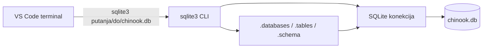

# 01 — Šta je `sqlite3` alat

## Cilj lekcije

U ovoj lekciji upoznaćeš `sqlite3` komandni alat, pokrenućeš ga iz integrisanog terminala u VS Code-u i naučićeš razliku između SQL naredbi i komandi samog alata. To je važno jer ćeš kasnije bazu koristiti iz Python aplikacije, ali ćeš pomoću ovog alata moći direktno da proveriš šta se zaista nalazi u njoj.

---

## SQLite, `sqlite3` alat i SQLite Studio nisu isto

**SQLite** je relacioni sistem za upravljanje bazom podataka. Za razliku od PostgreSQL-a ili MySQL-a, SQLite se tipično koristi kao ugrađena baza: nema zaseban serverski proces koji moraš da pokreneš, a podaci se najčešće čuvaju u običnom fajlu, na primer `app.db`.

**`sqlite3` komandni alat** (SQLite command-line shell ili CLI) je zaseban program za rad sa SQLite bazama iz komandne linije. On omogućava da SQL upite i posebne komande za upravljanje okruženjem izvršiš direktno nad bazom. CLI nije sama baza niti je obavezni deo svake SQLite instalacije.

**SQLite Studio** je grafički program za pregled i uređivanje SQLite baza. U ovom kursu ćemo umesto njega koristiti VS Code i njegov integrisani terminal. VS Code sam po sebi ne sadrži `sqlite3` CLI; potrebno je da alat bude instaliran i dostupan kroz sistemsku promenljivu `PATH`. Dostupnost Python modula `sqlite3` ne znači nužno da je instaliran i komandni alat.

U Python-u standardna biblioteka `sqlite3` omogućava aplikaciji da komunicira sa SQLite bazom. SQLAlchemy koristi DB-API drajver za tu komunikaciju, dok `sqlite3` CLI služi kao praktičan, nezavisan način da ručno pregledaš bazu i proveriš SQL.

Ako želiš da obnoviš razliku između SQLite baze, komandnog alata i DBMS-a, pogledaj lekciju [Šta je SQLite](../00_intro/01_what_is_sqlite.md).

---

## Pokretanje u VS Code-u

Otvori integrisani terminal u VS Code-u preko menija **Terminal → New Terminal**. Preporuka je da kao trenutni direktorijum imaš folder u kome želiš da radiš i da čuvaš fajl baze.

Proveri da li je komandni alat dostupan:

```bash
sqlite3 -version
```

Ako terminal prijavi da komanda ne postoji ili nije prepoznata, `sqlite3` CLI nije instaliran ili nije dodat u `PATH`. To je odvojeno od toga da li Python može da uveze modul `sqlite3`. Instalacija alata zavisi od operativnog sistema; nakon instalacije otvori novi terminal i ponovi proveru.

Pokreni CLI nad fajlom baze:

```bash
sqlite3 vezbe.db
```

Ako `vezbe.db` ne postoji, SQLite će ga napraviti. Ako već postoji, otvoriće tu bazu. Putanja se tumači u odnosu na **trenutni direktorijum terminala**, a ne nužno u odnosu na folder u kome se nalazi trenutno otvoren `.md` fajl. Zato, ako ne vidiš očekivani fajl, proveri direktorijum pomoću `pwd` (Linux/macOS) ili `Get-Location` (PowerShell).

Možeš da navedeš i putanju do fajla, na primer:

```bash
sqlite3 "data/vezbe.db"
```

Pre pokretanja proveri da folder `data` postoji. Ako putanja sadrži razmake, stavi je pod navodnike.

Kada se CLI pokrene, videćeš pozivni znak i možeš da unosiš naredbe. Iz njega izlaziš komandom:

```text
.quit
```

Alternativa je `.exit`. Obe komande zatvaraju sesiju komandnog alata.

---

## Fajl baze i privremena sesija

Za učenje i razvoj aplikacije koristi imenovani fajl, kao što je `vezbe.db`. Promene u toj bazi ostaju sačuvane kada izađeš iz CLI-ja.

SQLite CLI može da se pokrene i bez imena fajla. U tom slučaju radiš sa privremenom bazom, čiji podaci nisu namenjeni trajnom čuvanju. Nemoj računati na to da će takva baza biti dostupna nakon zatvaranja sesije. Ako želiš izričito bazu u memoriji, pokreni:

```bash
sqlite3 :memory:
```

Baza `:memory:` postoji samo dok je otvorena ta konkretna konekcija. Za povezivanje Python aplikacije sa istom trajnom bazom koristićeš istu putanju do fajla, a ne `:memory:`.

### Otvori Chinook bazu iz kursa

U ovom kursu već imaš pripremljenu bazu `chinook.db`. Iz korena repozitorijuma možeš da je otvoriš direktno:

```bash
sqlite3 "fast-api-course-my-work/sqlite_for_beginners/chinook/chinook.db"
```

Ova komanda otvara postojeći fajl kao glavnu bazu trenutne CLI konekcije. Zatim proveri putanju, tabele i strukturu albuma:

```text
.databases
.tables
.schema albums
```

| Komanda | Šta proveravaš | Šta očekuješ u Chinook bazi |
| --- | --- | --- |
| `.databases` | Putanju otvorene baze | Putanja završava sa `chinook/chinook.db`. |
| `.tables` | Dostupne tabele | Prikazuje se 11 tabela, uključujući `artists`, `albums` i `tracks`. |
| `.schema albums` | Definiciju tabele | Vidi se primarni ključ `AlbumId` i strani ključ `ArtistId` ka tabeli `artists`. |

Ovaj mali dijagram prikazuje šta se dešava kada proslediš putanju do baze:



U dijagramu terminal pokreće CLI nad postojećim fajlom. Dot-komande opisuju trenutno otvorenu konekciju; one nisu SQL naredbe koje se čuvaju u bazi. Detaljniji dijagram tabela i veza nalazi se u [ERD.drawio](../chinook/ERD.drawio).

---

## SQL naredbe i komande komandnog alata

U CLI-ju postoje dve vrste unosa:

1. **SQL naredbe** rade nad bazom i pišu se SQL jezikom. U ovoj lekciji za probu možeš da izvršiš:

   ```sql
   SELECT 'Zdravo, SQLite!' AS poruka;
   ```

   SQL naredbe se u interaktivnom CLI-ju završavaju tačkom-zarezom (`;`). Navikni se da ga uvek pišeš: čini granicu naredbe jasnom i olakšava kopiranje upita u skripte i aplikacioni kod.

2. **Dot-komande** upravljaju samim CLI okruženjem. Počinju tačkom i nisu SQL. Korisne komande su:

   | Komanda                     | Namena                                                        |
   | --------------------------- | ------------------------------------------------------------- |
   | `.help`                     | Prikazuje dostupne komande CLI-ja.                            |
   | `.databases`                | Prikazuje baze otvorene u trenutnoj sesiji i njihove putanje. |
   | `.tables`                   | Prikazuje tabele u trenutno otvorenoj bazi.                   |
   | `.schema`                   | Prikazuje definicije objekata baze, uključujući tabele.       |
   | `.open putanja/do/fajla.db` | Otvara drugu bazu ili pravi fajl ako ne postoji.              |
   | `.quit`                     | Zatvara CLI.                                                  |

Dot-komande nisu deo SQL standarda i ne mogu se proslediti bazi kao SQL upiti. SQL upiti, s druge strane, mogu da se izvršavaju i kroz CLI i iz Python koda.

---

## Kratak praktičan prolaz

U terminalu otvori bazu za vežbu:

```bash
sqlite3 vezbe.db
```

U SQLite CLI-ju izvrši:

```sql
SELECT 'Zdravo, SQLite!' AS poruka;
```

Zatim isprobaj:

```text
.databases
.tables
.schema
```

Na ovom koraku ne očekuje se da već postoje tabele. `SELECT` koji vraća tekstualnu vrednost ne zahteva tabelu, pa je pogodan za proveru da CLI radi. Izađi komandom `.quit`, pa ponovo otvori `vezbe.db` i izvrši isti upit. Imenovana baza ostaje dostupna i nakon izlaska, iako ovaj konkretan upit nije menjao njene podatke.

---

## Kako se ovo povezuje sa SQLAlchemy 2.0 i FastAPI-jem

CLI je koristan za učenje SQL-a i proveru sadržaja baze, ali produkciona FastAPI aplikacija ne bi trebalo da pokreće komandni alat i parsira njegov tekstualni izlaz. Aplikacija koristi Python drajver i SQLAlchemy za komunikaciju sa bazom.

Kod SQLite-a je putanja bitna: ako CLI i aplikacija otvore različite fajlove, gledaćeš dve različite baze čak i kada su imena fajlova ista, ali se nalaze u različitim direktorijumima. U SQLAlchemy konfiguraciji zato moraš znati na koju putanju URL baze pokazuje. Na primer, relativna SQLite URL putanja poput `sqlite:///./app.db` zavisi od radnog direktorijuma procesa koji pokreće aplikaciju.

Praktičan razvojni ciklus biće: napraviš ili proveriš bazu SQLAlchemy-jem, otvoriš istu putanju u `sqlite3` CLI-ju i direktno proveriš tabele ili podatke. CLI je alat za inspekciju; upravljanje konekcijama, transakcijama i zahtevima ostaje odgovornost aplikacionog koda.

---

## Česte nedoumice

- **`sqlite3` nije prepoznat u terminalu:** instaliraj CLI za svoj sistem ili ispravi `PATH`; Python modul `sqlite3` nije zamena za izvršni program.
- **Baza deluje prazno:** proveri `.databases` i putanju. Možda si otvorio drugi fajl ili privremenu bazu.
- **Ne vidiš tabelu:** `.tables` prikazuje tabele u trenutno otvorenoj bazi; proveri da li si otvorio očekivani fajl.
- **`SELECT` ne radi dok ne pritisneš Enter:** interaktivni CLI čeka da se SQL naredba završi, najčešće tačkom-zarezom.
- **Dot-komanda daje SQL grešku:** proveri da li je počinje tačkom i da li si je uneo kao CLI komandu, a ne unutar SQL naredbe.

## Vežbe

### Vežba 1 — Provera alata

1. Otvori integrisani terminal u VS Code-u i proveri da li je `sqlite3` CLI dostupan.
2. Zabeleži koju verziju prikazuje `sqlite3 -version`.
3. Ako CLI nije dostupan, utvrdi da li je problem instalacija ili `PATH`. Nemoj nastavljati kao da je Python modul isto što i CLI.

---

### Vežba 2 — Trajna baza

1. Izaberi direktorijum za vežbe i iz njega pokreni `sqlite3 vezbe.db`.
2. Izvrši `.databases` i zabeleži punu putanju prikazanu za bazu.
3. Izvrši `SELECT 'Moja prva provera' AS poruka;`.
4. Izađi sa `.quit`, ponovo pokreni `sqlite3 vezbe.db` i proveri da je otvorena ista putanja.

---

### Vežba 3 — Istraživanje CLI-ja

1. U CLI-ju isprobaj `.help`, `.tables` i `.schema`.
2. Svojim rečima objasni koje komande su SQL, a koje su specifične za komandni alat.
3. Objasni zašto `.tables;` nije isto što i SQL naredba koja se završava tačkom-zarezom.

---

### Vežba 4 — Privremena naspram trajne baze

1. Pokreni `sqlite3 :memory:` i proveri izlaz komande `.databases`.
2. Izađi iz CLI-ja i ponovo pokreni `sqlite3 :memory:`.
3. Objasni zašto je baza iz prethodne sesije odvojena od nove baze.
4. Navedi koji oblik pokretanja bi izabrao za lokalnu bazu FastAPI aplikacije i zašto.

---

### Vežba 5 — Priprema za povezivanje aplikacije

Pretpostavi da FastAPI aplikacija koristi `./app.db`, a ti si u terminalu pokrenuo `sqlite3 app.db`. Napiši koja dva podatka treba da proveriš pre nego što zaključiš da gledaš istu bazu. U odgovoru obavezno uključi putanju i trenutni direktorijum procesa.

---

## Provera razumevanja

1. Koja je razlika između SQLite baze i `sqlite3` CLI alata?
2. Zašto činjenica da `import sqlite3` radi u Python-u ne garantuje da će `sqlite3` komanda raditi u terminalu?
3. Šta se dešava kada pokreneš `sqlite3 vezbe.db`, a fajl još ne postoji?
4. Kako se u CLI-ju razlikuju SQL naredbe i dot-komande?
5. Zašto putanja baze mora da bude usklađena između CLI-ja i SQLAlchemy aplikacije?

---
