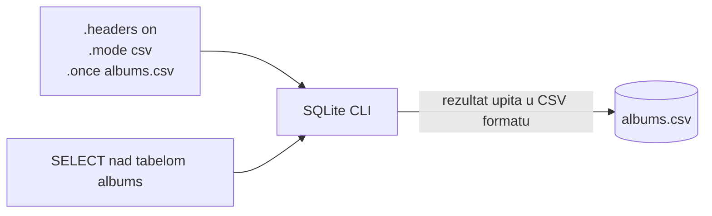

# 02 — Često korišćene `sqlite3` komande

## Cilj lekcije

U ovoj lekciji naučićeš kako da otvoriš određenu bazu, pregledaš njene tabele i strukturu, pronađeš komande komandnog alata i sačuvaš rezultate SQL upita u fajl. Sve komande izvršavaćeš u `sqlite3` CLI-ju koji si upoznao u prethodnoj lekciji.

Važno je da razlikuješ tri mesta na kojima možeš da uneseš komandu:

- **VS Code terminal** pokreće program, na primer `sqlite3 vezbe.db`.
- **SQLite CLI** prima dot-komande, na primer `.tables`, i SQL naredbe, na primer `SELECT ...;`.
- **Python aplikacija** koristi drajver i SQLAlchemy; u njoj se dot-komande ne koriste.

---

## Otvaranje konkretne baze

U VS Code integrisanom terminalu pokreni `sqlite3` i prosledi mu putanju do fajla baze:

```bash
sqlite3 vezbe.db
```

Ako fajl postoji, otvoriće se ta baza. Ako ne postoji, SQLite će napraviti novu praznu bazu na toj putanji. Relativna putanja, kao `vezbe.db` ili `data/vezbe.db`, računa se u odnosu na trenutni direktorijum terminala. Folder `data` mora već da postoji.

Na primer, ako je baza u folderu `database`, možeš da je otvoriš ovako:

```bash
sqlite3 database/Chinook.db
```

Na Windows-u je uobičajeno koristiti i obrnutu kosu crtu u putanji:

```powershell
sqlite3 database\Chinook.db
```

Ako putanja sadrži razmake, stavi je pod navodnike. Uvek proveri da li si otvorio baš željeni fajl:

```text
.databases
```

Komanda `.databases` prikazuje trenutno otvorene baze i njihove putanje. Ovo je posebno korisno kada CLI i FastAPI aplikacija naizgled rade sa različitim podacima: često je uzrok to što je svaka otvorila drugi fajl.

Dok si već u CLI-ju, drugu bazu možeš da otvoriš komandom:

```text
.open putanja/do/baze.db
```

Ako fajl na toj putanji ne postoji, `.open` ga može napraviti. Zato pažljivo proveri putanju pre komande, da ne bi slučajno napravio novu praznu bazu umesto da otvoriš postojeću.

### Otvori Chinook bazu iz kursa

Iz korena repozitorijuma možeš direktno da otvoriš postojeću bazu:

```bash
sqlite3 "fast-api-course-my-work/sqlite_for_beginners/chinook/chinook.db"
```

Posle povezivanja proveri da li je otvoren pravi fajl i da li su tabele dostupne:

| Komanda | Šta proveravaš | Očekivani rezultat |
| --- | --- | --- |
| `.databases` | Putanju aktivne baze | Prikazuje putanju do `chinook.db`. |
| `.tables` | Tabele u bazi | Prikazuje 11 Chinook tabela, npr. `artists`, `albums`, `tracks`. |
| `.schema albums` | Strukturu tabele | Prikazuje kolone, primarni ključ i strani ključ ka `artists`. |

Kompletan dijagram tabela i veza možeš da pogledaš u [ERD.drawio](../chinook/ERD.drawio). Ako `.tables` ne prikazuje očekivane tabele, proveri putanju u `.databases`; možda je otvoren drugi ili novonapravljeni prazan fajl.

---

## Pregled tabela i šeme

Kada se baza otvori, pregledaj njene tabele:

```text
.tables
```

Ova dot-komanda prikazuje imena tabela u trenutno otvorenoj bazi. Ako ne prikaže ništa, baza može biti prazna ili si možda otvorio pogrešan fajl. Proveri putanju sa `.databases`.

Za pregled definicija tabela koristi:

```text
.schema
```

Ona prikazuje SQL definicije objekata baze. Da prikažeš samo definiciju jedne tabele, dodaj njeno ime:

```text
.schema albums
```

Izlaz će, na primer, sadržati `CREATE TABLE` naredbu i kolone koje pripadaju tabeli. To je korisno za upoznavanje postojeće baze i proveru njenih ograničenja, ali `.schema` nije zamena za čitanje ili izmenu redova podataka.

Imaj na umu da `.tables` i `.schema` počinju tačkom, pa su komande SQLite CLI-ja. Ne možeš ih izvršiti kao SQL naredbe u SQLAlchemy aplikaciji. Njihova SQL alternativa za definiciju ili pregled podataka zavisi od zadatka i naučićeš je kroz naredne lekcije.

---

## Pomoć za dot-komande

Kada zaboraviš naziv ili sintaksu komande, koristi:

```text
.help
```

SQLite CLI će prikazati dostupne dot-komande i kratke opise. Spisak može da se razlikuje u zavisnosti od verzije CLI-ja, zato je `.help` pouzdaniji od pamćenja dugog spiska napamet.

Dot-komande nisu SQL standard. One su deo SQLite komandnog alata, a ne samog SQLite SQL jezika.

---

## Čuvanje rezultata upita u fajl

Za izvoz rezultata upita CLI može da preusmeri izlaz u fajl. U transkriptu se koristi `.output`, koja preusmerava izlaz sve dok ga ne vratiš na terminal. Zbog toga je za jedan upit obično bezbednije koristiti `.once`: ona preusmerava izlaz samo sledeće SQL naredbe.

Primer koji izvozi albume iz baze `Chinook.db`:

```text
.headers on
.mode csv
.once albums.csv
```

Zatim izvrši SQL upit:

```sql
SELECT AlbumId, Title
FROM albums
ORDER BY Title, AlbumId
LIMIT 24;
```

CLI će rezultate ovog upita upisati u `albums.csv`. `.headers on` uključuje nazive kolona u izlaz, a `.mode csv` formatira izlaz kao CSV, koji je pogodan za otvaranje u tabelarnim alatima. Dodavanje `AlbumId` u `ORDER BY` daje stabilniji redosled i kada više albuma ima isti naslov. `LIMIT 24` ograničava rezultat na najviše 24 reda; bez odgovarajućeg `ORDER BY`, ne treba pretpostaviti koji će redovi biti izabrani.

Fajl se pravi relativno u odnosu na trenutni direktorijum terminala, ne nužno u folderu baze. Ako fajl sa istim imenom već postoji, CLI može da ga prepiše, zato pre izvoza izaberi odgovarajuće ime i lokaciju.

Tok izvoza izgleda ovako:



| Podešavanje | Efekat |
| --- | --- |
| `.headers on` | Dodaje nazive kolona na početak izlaza. |
| `.mode csv` | Formatira rezultat kao CSV. |
| `.once albums.csv` | Šalje izlaz sledeće SQL naredbe u fajl, a zatim vraća ispis u terminal. |

Ako želiš rezultat samo u običnom tekstualnom fajlu, možeš umesto CSV formata koristiti:

```text
.mode list
.once albums.txt
```

Podrazumevani separator u `list` režimu je uspravna crta (`|`). To je tekstualni prikaz, a ne nužno pouzdan format za razmenu podataka: vrednost kolone može sadržati isti separator. Za prenos podataka između alata koristi CSV ili drugi format sa jasno definisanim pravilima.

### `.once` naspram `.output`

Za jedan upit koristi:

```text
.once izlaz.txt
```

Zatim izvrši jednu SQL naredbu. Njen rezultat ide u fajl, a naredni izlazi se vraćaju na terminal.

Ako koristiš `.output`, preusmeravanje ostaje aktivno dok ga ne isključiš. Da vratiš izlaz na terminal, izvrši:

```text
.output stdout
```

Bez ovog koraka, i sledeće komande koje prikazuju izlaz mogu završiti u fajlu. Zato je `.once` jednostavniji i manje podložan grešci za izvoz jednog upita.

Izvoz rezultata upita nije isto što i rezervna kopija cele baze. Ova lekcija čuva samo rezultat odabranog upita; kopiranje ili izvoz kompletne baze obrađivaće se posebno.

---

## Izlazak iz SQLite CLI-ja

Za izlazak iz SQLite CLI-ja koristi jednu od dot-komandi:

```text
.quit
```

ili:

```text
.exit
```

Komanda `.q` je skraćeni oblik komande `.quit`, ali je jasnije koristiti puno ime, naročito dok učiš.

Kada se vratiš u VS Code terminal, možeš nastaviti da unosiš sistemske komande, na primer `pwd` ili `Get-Location`. Komanda `exit` u terminalu zatvara komandnu ljusku, a ne SQLite bazu na isti način kao `.quit` u CLI-ju. Ne mešaj ih: prvo izađi iz SQLite CLI-ja, pa tek onda, ako želiš, zatvori terminalsku ljusku.

---

## Povezivanje sa SQLAlchemy 2.0 i FastAPI-jem

Ove komande su dijagnostički alati, a ne deo koda endpoint-a. Kada proveravaš podatke koje koristi FastAPI aplikacija, uporedi putanju prikazanu u `.databases` sa putanjom koju koristi SQLAlchemy URL. Relativne putanje zavise od radnog direktorijuma procesa, pa identično ime fajla ne garantuje da se radi o istoj bazi.

Izvoz sa `.once` ili `.output` takođe se obavlja u SQLite CLI-ju. U aplikaciji podaci se čitaju i upisuju SQLAlchemy izrazima i sesijom, a rezultate aplikacija tipično vraća kroz FastAPI odgovor. CLI je koristan da nezavisno proveriš stanje baze kada istražuješ problem.

---

## Provera razumevanja

1. Kako otvaraš imenovanu SQLite bazu iz VS Code terminala, a kako drugu bazu iz već pokrenutog CLI-ja?
2. Koja je razlika između `.tables` i `.schema albums`?
3. Koja komanda prikazuje putanju otvorene baze i zašto je to važno za FastAPI aplikaciju?
4. Zašto je `.once` pogodniji od `.output` za izvoz jednog upita?
5. Šta rade `.headers on`, `.mode csv` i `LIMIT` u primeru izvoza?
6. Zašto je izvoz rezultata upita drugačiji od rezervne kopije cele baze?
7. Koja je razlika između `.quit` unutar SQLite CLI-ja i `exit` u terminalu?

---

## Vežbe

### Vežba 1 — Otvori i proveri bazu

1. Iz VS Code terminala otvori svoju bazu za vežbe pomoću `sqlite3 putanja/do/baze.db`.
2. U CLI-ju izvrši `.databases` i zabeleži putanju.
3. Izvrši `.tables`, a zatim `.schema`.
4. Objasni šta zaključuješ ako nema prikazanih tabela.

---

### Vežba 2 — Pregledaj jednu tabelu

1. Izaberi ime postojeće tabele iz izlaza `.tables`.
2. Prikaži njenu definiciju pomoću `.schema ime_tabele`.
3. Zabeleži najmanje tri kolone i objasni koju vrstu podataka bi očekivao u njima.
4. Ako tvoja baza nema tabele, zabeleži to i ponovi vežbu kada ih napraviš u narednim lekcijama.

---

### Vežba 3 — Izvezi CSV iz Chinook baze

Otvori Chinook bazu iz kursa i izvezi prva 24 albuma u `albums.csv`. Fajl će nastati u trenutnom direktorijumu terminala, zato pre izvoza proveri gde se nalaziš i izaberi lokaciju na kojoj ti odgovara da se pojavi rezultat.

1. Uključi zaglavlja i CSV režim pomoću `.headers on` i `.mode csv`.
2. Preusmeri izlaz jednom komandom pomoću `.once albums.csv`.
3. Izvrši primer upita iz lekcije, sa `ORDER BY Title, AlbumId` i `LIMIT 24`.
4. Proveri da li fajl postoji u trenutnom direktorijumu i da li sadrži zaglavlja i očekivani broj redova.
5. Ponovi izvoz pod drugim imenom i uporedi rezultate.

---

### Vežba 4 — Uporedi `.once` i `.output`

1. Izvrši `.once jedan_upit.txt`, pa pokreni `SELECT 'prvi izvoz' AS poruka;`.
2. Proveri da li se rezultat upisao u fajl.
3. Izvrši `.output trajni_izvoz.txt`, pa pokreni jedan `SELECT`.
4. Vrati izlaz na terminal pomoću `.output stdout`.
5. Objasni šta bi se dogodilo da si zaboravio poslednji korak.

---

### Vežba 5 — Pronađi pravu bazu

1. Otvori SQLite CLI iz foldera svog projekta i izvrši `.databases`.
2. Zabeleži trenutni direktorijum terminala pomoću `pwd` ili `Get-Location` nakon izlaska iz CLI-ja.
3. Uporedi putanju baze sa SQLite putanjom u konfiguraciji svoje aplikacije, ako je već imaš.
4. Objasni kako bi pogrešan radni direktorijum mogao da dovede do toga da CLI i FastAPI gledaju različite fajlove.
