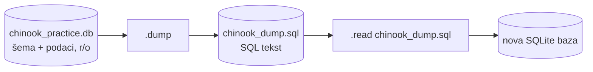
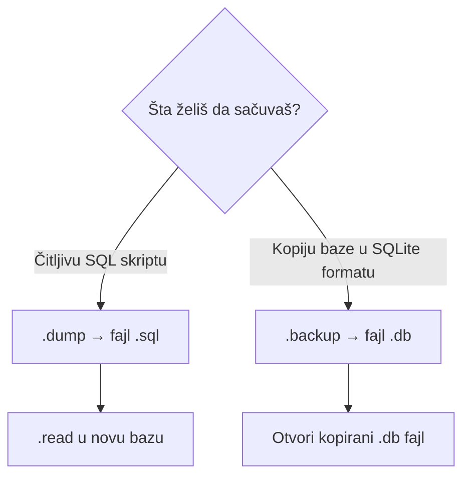

# 03 — Izvoz i vraćanje SQLite baze pomoću `.dump`

## Cilj lekcije

U ovoj lekciji naučićeš kako SQLite CLI može da izveze šemu i podatke kao SQL tekstualnu skriptu, kako tu skriptu možeš da iskoristiš za rekonstrukciju baze i po čemu se takav izvoz razlikuje od kopiranja SQLite fajla. Kao izvor koristiš radnu kopiju `playground/databases/chinook_practice.db`, otvorenu samo za čitanje. Originalna `chinook/chinook.db` i radna kopija ostaju neizmenjene; vraćanje se vežba u zasebnoj novoj bazi.

Današnji raspored, dodatni zadaci i rešenja nalaze se u [dnevnom planu za `.dump`](../pitanja_i_odgovori/dan_04_sqlite_dump_command.md).

---

## Šta radi `.dump`

Dot-komanda `.dump` čita objekte i podatke iz trenutno otvorene baze i ispisuje SQL tekst. Puna skripta tipično sadrži SQL naredbe za kreiranje tabela, upis podataka i ponovno kreiranje drugih objekata šeme.

To nije kopija SQLite fajla. `.dump` pravi čitljivu **logičku reprezentaciju** baze kao SQL skriptu, obično sa nastavkom `.sql`. Skripta može da se izvrši nad novom bazom da bi se njena struktura i podaci ponovo napravili.

| Komanda            | Ulaz/izlaz                        | Rezultat                                                      |
| ------------------ | --------------------------------- | ------------------------------------------------------------- |
| `.dump`            | Trenutna baza → CLI izlaz         | SQL skripta za bazu; bez preusmeravanja može biti veoma duga. |
| `.output fajl.sql` | CLI izlaz → tekstualni fajl       | Preusmerava CLI izlaz; sama po sebi ne pravi dump.            |
| `.read fajl.sql`   | SQL fajl → trenutna baza          | Čita i izvršava SQL skriptu u otvorenoj bazi.                 |
| `.backup fajl.db`  | Trenutna baza → drugi SQLite fajl | Pravi kopiju u SQLite formatu, a ne SQL tekstualnu skriptu.   |

---

## Priprema: radni folder i izvorna baza

Sve komande pretpostavljaju da si u Bash terminalu u **korenu repozitorijuma**. Ako već radiš u SQLite CLI-ju, ne unosi Bash komande u njegov prompt: prvo izađi sa `.quit` ili otvori drugi terminal. Proveri gde se nalaziš:

```bash
pwd
```

---

### Napravi poseban folder za ovu vežbu

U Bash-u napravi novi folder za dump i obnovljenu bazu:

```bash
mkdir fast-api-course-my-work/sqlite_for_beginners/playground/dump_vezba_2026_11_24
```

Ako `mkdir` prijavi da folder već postoji ili drugu grešku, **stani**: nemoj prepisivati postojeće fajlove. Odaberi drugo novo ime foldera i dosledno ga zameni u svim narednim putanjama. Ovde se namerno ne koristi `mkdir -p`, kako postojeći folder ne bi bio neprimetno prihvaćen. Nemoj kao odredište izabrati sam fajl izvorne baze.

---

### Otvori radnu kopiju preko `rlwrap`-a

Ako već imate otvorenu radnu kopiju `chinook_practice.db` u SQLite CLI-ju direktno, ne morate je zatvarati: posle uspešnog pravljenja foldera u drugom terminalu vrati se u otvoreni SQLite CLI i nastavi proverom `.databases`.

U suprotnom, iz korena repozitorijuma u Bash-u pokreni:

```bash
INPUTRC="$HOME/.config/sqlite-cli/sqlite3-inputrc" \
  rlwrap -a -N -c -i -A -f "$HOME/.config/sqlite-cli/sqlite3-completions" \
  sqlite3 -cmdline-edit off -readonly fast-api-course-my-work/sqlite_for_beginners/playground/databases/chinook_practice.db
```

`rlwrap` predstavlja dodatni sloj (`readline wrapper` za komandnu liniju) koji omogućava napredno uređivanje i dopunjavanje komandne linije na `tab` taster, kao i istoriju komandi i kretanje po liniji uz strelice, ali se `dot-komande` i dalje izvršavaju u `sqlite3 CLI`-ju. `rlwrap` sam po sebi ne menja ponašanje SQLite CLI-ja, već samo poboljšava interaktivno iskustvo u terminalu.

`-cmdline-edit` je opcija SQLite CLI-ja koja kontroliše ponašanje internog editora komandne linije. Kada se postavi na `off`, SQLite-ov interni editor se isključuje u toj sesiji, što omogućava spoljnim alatima kao što je `rlwrap` da preuzmu kontrolu nad uređivanjem komandne linije.

`-readonly` je režim koji služi samo za čitanje baze. To je režim koji **otvara postojeću glavnu bazu bez dozvole za upis**. Opcija **ne** garantuje da se neće napraviti drugi fajlovi ili izlazi. Kao što je slučaj sa `.output` i `.backup`, oni namerno pišu **zasebne izlazne fajlove** i ne zavise od toga da li je glavna baza otvorena u režimu `readonly`.

Detalji o opcijama nalaze se u [uputstvu za `rlwrap`](../../../docs/fastapi/cheatsheets/fastapi_extensions_vscode/sqlite_terminal_litecli_rlwrap.md#4-rlwrap-tab-dovršavanje-u-pravom-sqlite-cli-ju).

Ako ti dopunjavanje nije potrebno ili želiš jednostavniji pristup bez `rlwrap`-a, alternativno pokreni direktni CLI:

```bash
sqlite3 -readonly fast-api-course-my-work/sqlite_for_beginners/playground/databases/chinook_practice.db
```

U SQLite CLI-ju proveri izvor:

```text
.databases
.tables
SELECT COUNT(*) AS album_count FROM albums;
```

U `.databases` treba da piše `main` i putanja do `chinook_practice.db`, uz `r/o`. Ako vidiš drugu putanju ili grešku, prekini i proveri putanju. Zapiši broj albuma iz **radne kopije** za kasnije poređenje; on može biti drugačiji ako si menjao kopiju.

---

## Napravi dump radne Chinook baze

U otvorenom SQLite CLI-ju preusmeri izlaz u prethodno napravljeni folder, pokreni `.dump`, pa vrati izlaz na terminal:

```text
.output "fast-api-course-my-work/sqlite_for_beginners/playground/dump_vezba_2026_11_24/chinook_dump.sql"
.dump
.output stdout
```

`.output` stvara ili može prepisati izlazni fajl: **nov folder je zato važan**. Putanja je relativna prema trenutnom direktorijumu iz kojeg je pokrenut CLI, ne prema Markdown fajlu ili fajlu baze. Ako ponavljaš vežbu, izaberi drugo novo ime umesto da prepišeš prethodni dump. Folder mora postojati. Greške proveri na ekranu; ako se pojave, nemoj smatrati dump završenim.

Ovde koristimo `.output` da bi video kako se preusmeravanje uključuje i isključuje. **Ispravka ranije tvrdnje:** u lokalno proverenom SQLite CLI-ju 3.54.1 i `.once fajl.sql` može preusmeriti sledeći `.dump`; sledeći izlaz se zatim vraća na terminal. `.output` ostaje aktivan dok ga ne vratiš na `stdout` ili zatvoriš CLI. Pri korišćenju drugog CLI-ja ili verzije proveri `.help once` i konkretno ponašanje.

Tok izvoza i vraćanja izgleda ovako:



Otvori `chinook_dump.sql` u VS Code-u da pregledaš sadržaj. Videćeš SQL naredbe poput `CREATE TABLE` i `INSERT INTO`. Puna skripta na početku obično ima `PRAGMA foreign_keys=OFF;` i transakciju; pri `.read` te se naredbe izvršavaju u **novoj konekciji**, nisu samo tekst za prikaz. `.read` može izvršiti i druge naredbe iz fajla, zato uvek pregledaj izvor skripte i ne učitavaj nepoznat ili nepoverljiv fajl.

Možeš uporediti definicije tabela sa [ERD.drawio](../chinook/ERD.drawio). Dump sadrži podatke, zato tekstualni fajl može biti velik i može uključivati sve podatke iz baze. Ne čuvaj dump sa privatnim podacima u javnom repozitorijumu; proveri sadržaj i `git status` pre dodavanja u Git.

---

## Dump cele baze ili odabranih objekata

Bez dodatnih argumenata `.dump` izvozi sadržaj cele otvorene baze. SQLite CLI podržava i obrazac za izbor objekata:

```text
.output "fast-api-course-my-work/sqlite_for_beginners/playground/dump_vezba_2026_11_24/albums_only.sql"
.dump albums
.output stdout
```

Ovaj primer pravi dump objekata koji odgovaraju obrascu `albums`; ne treba pretpostaviti da će automatski obuhvatiti sve tabele na koje ta tabela referencira. U Chinook bazi `albums.ArtistId` upućuje na `artists.ArtistId`, pa dump samo tabele `albums` nije samostalna kopija cele baze. Za pouzdan prenos ili vraćanje svih povezanih podataka koristi puni `.dump`, osim ako pažljivo ne obrađuješ zavisnosti.

---

## Vrati bazu iz SQL dump-a

Za obnovu ti treba **druga sesija**: CLI pokrenut sa `-readonly` nad radnom kopijom ne može upisati tabele u tu bazu. Prvo se u izvornoj sesiji uveri da si vratio izlaz pomoću `.output stdout`, a zatim izađi sa `.quit`. Ne učitavaj dump u originalnu niti u `chinook_practice.db`.

Pošto si ranije napravio novi folder, cilj `chinook_restore.db` u njemu treba da bude nov. U Bash-u iz korena repozitorijuma proveri:

```bash
test ! -e fast-api-course-my-work/sqlite_for_beginners/playground/dump_vezba_2026_11_24/chinook_restore.db \
  && echo "Ciljna baza ne postoji: možeš nastaviti." \
  || echo "Cilj već postoji: stani i izaberi novi folder ili ime."
```

Ako cilj postoji, stani i koristi novo ime. Zatim pokreni **drugu, upisivu** sesiju:

```bash
INPUTRC="$HOME/.config/sqlite-cli/sqlite3-inputrc" \
  rlwrap -a -N -c -i -A -f "$HOME/.config/sqlite-cli/sqlite3-completions" \
  sqlite3 -cmdline-edit off fast-api-course-my-work/sqlite_for_beginners/playground/dump_vezba_2026_11_24/chinook_restore.db
```

Ovde namerno **nema `-readonly`**: SQLite CLI može da napravi novu bazu u tom folderu. U toj sesiji prvo proveri `.databases` i `.tables`. Putanja `main` mora završavati sa `dump_vezba_2026_11_24/chinook_restore.db`, a `.tables` ne treba da prikazuje postojeće tabele. Ako ne odgovara, izađi sa `.quit` i proveri putanju.

Tek kada potvrdiš novu, praznu ciljnu bazu i pregledaš dump, u SQLite CLI-ju izvrši:

```text
.read "fast-api-course-my-work/sqlite_for_beginners/playground/dump_vezba_2026_11_24/chinook_dump.sql"
```

Zatim proveri da li su tabele i podaci vraćeni:

```text
.tables
.schema albums
```

Kao dodatnu proveru izvrši SQL upit:

```sql
SELECT COUNT(*) AS album_count
FROM albums;
```

Uporedi broj sa vrednošću koju si pre izvoza zabeležio u radnoj kopiji. Pri proveri te kopije bilo je **347 albuma**, ali broj nije zagarantovan ako se izvor kasnije promeni. Jednak broj proverava samo jedan aspekt tabele `albums`, a ne potpunu jednakost svih tabela i vrednosti.

Dodatno pokreni:

```sql
PRAGMA integrity_check;
PRAGMA foreign_key_check;
```

`integrity_check` treba da vrati `ok`. `foreign_key_check` bez redova znači da nisu prijavljene FK povrede; to nije dokaz da su podaci identični izvoru. SQLite podešavanje `foreign_keys` je po konekciji: proveri ga sa `PRAGMA foreign_keys;`, a po potrebi uključi sa `PRAGMA foreign_keys = ON;` **izvan transakcije** za buduće upise u toj sesiji. Dump može sadržati `PRAGMA foreign_keys=OFF;` i ne treba pretpostaviti da je provera uključena posle učitavanja.

Ako se `.read` ili neka SQL naredba završi greškom, nemoj zaključiti da je baza uspešno vraćena. Baza može biti delimično obnovljena; proveri poruku i koristi novo ime za sledeći pokušaj, umesto ponovnog učitavanja preko nje.

---

## `.dump` nije isto što i rezervna kopija SQLite fajla

| Osobina                   | `.dump`                                      | `.backup`                                             |
| ------------------------- | -------------------------------------------- | ----------------------------------------------------- |
| Izlazni format            | SQL tekst, obično `.sql`                     | SQLite baza, obično `.db`                             |
| Pregled u tekst uređivaču | Da, može se pročitati kao SQL                | Ne kao običan SQL; fajl je binarni format SQLite baze |
| Vraćanje                  | Izvrši SQL skriptu u novoj bazi              | Otvori kopirani SQLite fajl                           |
| Upotreba                  | Izvoz, uvid u SQL, prenos ili rekonstrukcija | Kreiranje SQLite kopije baze                          |

Za kopiju radne baze u SQLite formatu ponovo otvori **izvornu radnu kopiju** sa `-readonly`, proveri je pomoću `.databases`, pa u toj sesiji koristi novi cilj:

```text
.backup "fast-api-course-my-work/sqlite_for_beginners/playground/dump_vezba_2026_11_24/chinook_copy.db"
```

Pre toga proveri da cilj ne postoji; `.backup` može izmeniti postojeću odredišnu bazu. Nikada ne biraj originalnu ili radnu bazu kao odredište. Iako je izvor `-readonly`, zaseban cilj se kreira/upisuje. Ako prijavi grešku, kopija nije potvrđena kao uspešna.

Za automatsko pravljenje kopija iz Python aplikacije, Python-ov `sqlite3` modul nudi `Connection.backup()`. Kada baza radi i može imati aktivne konekcije ili WAL režim, koristi SQLite-ov backup mehanizam umesto ručnog kopiranja otvorenog fajla.

Izbor alata zavisi od cilja:



---

## Veza sa SQLAlchemy-jem i FastAPI-jem

`.dump` je komanda za administraciju iz SQLite CLI-ja, a ne funkcija koju treba pokretati u svakom API zahtevu. FastAPI aplikacija koristi SQLAlchemy i drajver za čitanje ili menjanje podataka; pravljenje rezervnih kopija treba planirati kao poseban, kontrolisan zadatak.

Dump fajl može biti koristan u testiranju ili za deljenje razvojne baze, ali je SQLite SQL-specifičan i može biti velik. Nemoj pretpostaviti da je svaka SQL dump skripta prenosiva između različitih DBMS sistema bez izmene.

---

## Česte greške

- **Dump ispisuje ogromnu količinu teksta u terminal:** pre `.dump` preusmeri izlaz komandom `.output naziv.sql`.
- **Dump je ostao preusmeren na fajl:** izvrši `.output stdout` da bi se naredni izlaz vratio u terminal.
- **SQL fajl se pravi na neočekivanom mestu:** `.output` putanju računa u odnosu na trenutni direktorijum terminala.
- **Restauracija prijavljuje da tabele već postoje:** najverovatnije učitavaš skriptu u postojeću bazu; napravi i otvori novi fajl baze.

- **`attempt to write a readonly database` pri `.read`:** proveri `.databases`; za vraćanje koristi novu, zasebnu upisivu bazu, nikada original ili radnu kopiju.

- **Dump jedne tabele nema sve povezane podatke:** filter `.dump albums` nije isto što i dump cele baze; proveri strane ključeve i zavisne objekte.

- **Izvozni fajl je prepisao raniju kopiju:** pre `.output` proveri da li fajl već postoji ili koristi novo ime.

---

## Provera razumevanja

1. Šta `.dump` upisuje u fajl: binarnu kopiju baze ili SQL tekst?

- `.dump` upisuje SQL tekst koji predstavlja strukturu i podatke baze u fajl ili terminal.

2. Zašto `.output` sam po sebi ne pravi dump?

- `.output` samo preusmerava gde će naredni izlaz ići (terminal ili fajl), ali ne generiše SQL dump; za to je potrebna komanda `.dump`.

3. Koja je razlika između `.dump` i `.backup`?

- `.dump` generiše SQL tekstualnu reprezentaciju baze, dok `.backup` pravi binarnu kopiju cele baze u SQLite formatu. `.dump` je čitljiv i može se menjati, dok je `.backup` brza i pouzdana metoda za pravljenje tačne kopije baze.

4. Zašto dump tabele `albums` sam po sebi možda nije dovoljan za vraćanje svih povezanih podataka?

- Dump jedne tabele sadrži samo definiciju i podatke te tabele, ali ne uključuje zavisne tabele koje imaju strane ključeve ili druge povezane objekte. Za kompletnu obnovu baze potrebno je dump-ovati sve relevantne tabele i zavisne objekte.

5. Zašto je sigurnije učitati dump u novu bazu nego preko originalne?

- Učitavanje dump-a u novu bazu smanjuje rizik od gubitka ili oštećenja originalnih podataka. Ako dump sadrži greške ili nepotpune podatke, originalna baza ostaje netaknuta, što omogućava bezbednu obnovu ili testiranje.

6. Gde se pravi relativna putanja iz `.output` komande?

- Relativna putanja iz `.output` komande se računa u odnosu na trenutni radni direktorijum terminala, a ne u odnosu na lokaciju SQLite baze ili skripte.

- Ako želiš da dump bude u istom folderu kao baza, moraš ili da koristiš apsolutnu putanju ili da prethodno promeniš radni direktorijum terminala na lokaciju baze.

---

## Vežbe

### Vežba 1 — Napravi puni Chinook dump

1. Iz korena repozitorijuma otvori `chinook_practice.db` sa `rlwrap`-om i `-readonly`, kao u odeljku pripreme.
2. Proveri putanju komandom `.databases`.
3. U novom folderu preusmeri izlaz u `chinook_dump.sql`, pokreni `.dump`, pa vrati ispis na terminal komandom `.output stdout`.

4. Otvori SQL fajl u VS Code-u i pronađi definiciju tabele `albums` i bar jedan `INSERT` iskaz.
5. Zabeleži veličinu fajla i objasni zašto puna baza daje više teksta nego dump jedne tabele.

---

### Vežba 2 — Vrati dump u novu bazu

1. U zasebnoj upisivoj sesiji otvori **novi** `dump_vezba_2026_11_24/chinook_restore.db`, nakon provere da cilj ne postoji.
2. Proveri `.databases` i `.tables`, pa učitaj pregledani `chinook_dump.sql` pomoću `.read`.
3. Proveri `.tables`, `.schema albums`, broj albuma, `PRAGMA integrity_check` i `PRAGMA foreign_key_check`.
4. Uporedi broj albuma sa radnom kopijom iz koje si napravio dump.

---

### Vežba 3 — Uporedi SQL dump i fajl-kopiju

1. U CLI konekciji otvorenoj nad radnom kopijom pomoću `.backup` napravi novi `dump_vezba_2026_11_24/chinook_copy.db`.
2. Uporedi u VS Code Explorer-u fajlove `chinook_dump.sql` i `chinook_copy.db`.
3. Za svaki fajl napiši da li je čitljiv SQL tekst ili SQLite fajl baze i kojim postupkom bi ga koristio.

---

### Vežba 4 — Istraži ograničeni dump

1. U poseban novi fajl `dump_vezba_2026_11_24/albums_only.sql` preusmeri izlaz komandom `.output`.
2. Izvrši `.dump albums`, pa vrati izlaz na terminal.
3. Pregledaj skriptu i zapiši koje objekte i podatke sadrži.
4. Uporedi je sa punim dump-om i objasni zašto bi za kompletnu obnovu Chinook baze koristio puni `.dump`.

---
