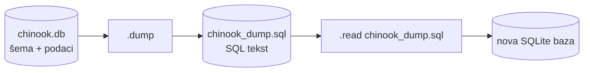
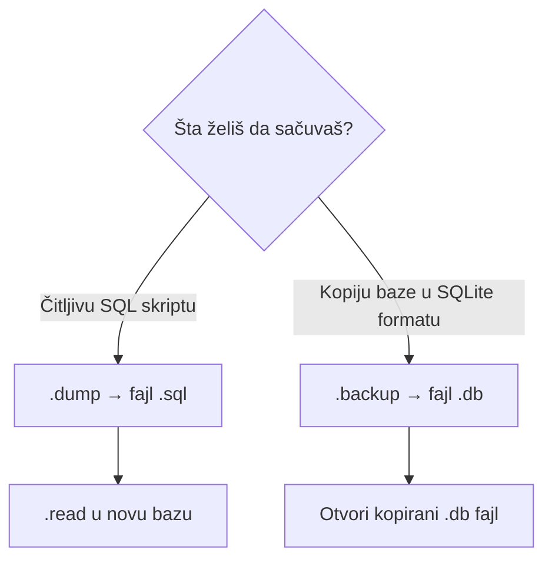

# 03 — Izvoz i vraćanje SQLite baze pomoću `.dump`

## Cilj lekcije

U ovoj lekciji naučićeš kako SQLite CLI može da izveze šemu i podatke kao SQL tekstualnu skriptu, kako tu skriptu možeš da iskoristiš za rekonstrukciju baze i po čemu se takav izvoz razlikuje od kopiranja SQLite fajla. Primeri koriste Chinook bazu iz kursa, ali originalni fajl ostaje neizmenjen.

## Šta radi `.dump`

Dot-komanda `.dump` čita objekte i podatke iz trenutno otvorene baze i ispisuje SQL tekst. Puna skripta tipično sadrži SQL naredbe za kreiranje tabela, upis podataka i ponovno kreiranje drugih objekata šeme.

To nije kopija SQLite fajla. `.dump` pravi čitljivu **logičku reprezentaciju** baze kao SQL skriptu, obično sa nastavkom `.sql`. Skripta može da se izvrši nad novom bazom da bi se njena struktura i podaci ponovo napravili.

| Komanda            | Ulaz/izlaz                        | Rezultat                                                      |
| ------------------ | --------------------------------- | ------------------------------------------------------------- |
| `.dump`            | Trenutna baza → CLI izlaz         | SQL skripta za bazu; bez preusmeravanja može biti veoma duga. |
| `.output fajl.sql` | CLI izlaz → tekstualni fajl       | Preusmerava CLI izlaz; sama po sebi ne pravi dump.            |
| `.read fajl.sql`   | SQL fajl → trenutna baza          | Čita i izvršava SQL skriptu u otvorenoj bazi.                 |
| `.backup fajl.db`  | Trenutna baza → drugi SQLite fajl | Pravi kopiju u SQLite formatu, a ne SQL tekstualnu skriptu.   |

## Napravi dump Chinook baze

Otvori Chinook bazu iz korena repozitorijuma:

```bash
sqlite3 "fast-api-course-my-work/sqlite_for_beginners/chinook/chinook.db"
```

U SQLite CLI-ju preusmeri izlaz u fajl, pokreni `.dump`, pa vrati izlaz na terminal:

```text
.output "chinook_dump.sql"
.dump
.output stdout
```

`chinook_dump.sql` se kreira u trenutnom direktorijumu terminala. Ako fajl istog imena već postoji, proveri da ga smeš zameniti pre nego što pokreneš `.output`. Nadređeni folder u putanji mora već postojati.

Zašto se ovde koristi `.output`, a ne `.once`? `.once` je namenjen izlazu sledeće SQL naredbe, dok je `.dump` dot-komanda komandnog alata. `.output` ostaje aktivan dok ga ne vratiš na `stdout` ili dok ne zatvoriš CLI, zato ga nakon dump-a eksplicitno resetuj komandom `.output stdout`.

Tok izvoza i vraćanja izgleda ovako:



Otvori `chinook_dump.sql` u VS Code-u da pregledaš sadržaj. Videćeš SQL naredbe poput `CREATE TABLE` i `INSERT INTO`. Možeš uporediti definicije tabela sa [ERD.drawio](../chinook/ERD.drawio). Dump sadrži podatke, zato tekstualni fajl može biti velik i može uključivati sve podatke iz baze. Ne čuvaj dump sa privatnim podacima u javnom repozitorijumu.

## Dump cele baze ili odabranih objekata

Bez dodatnih argumenata `.dump` izvozi sadržaj cele otvorene baze. SQLite CLI podržava i obrazac za izbor objekata:

```text
.dump albums
```

Ovaj primer pravi dump objekata koji odgovaraju obrascu `albums`; ne treba pretpostaviti da će automatski obuhvatiti sve tabele na koje ta tabela referencira. U Chinook bazi `albums.ArtistId` upućuje na `artists.ArtistId`, pa dump samo tabele `albums` nije samostalna kopija cele baze. Za pouzdan prenos ili vraćanje svih povezanih podataka koristi puni `.dump`, osim ako pažljivo ne obrađuješ zavisnosti.

## Vrati bazu iz SQL dump-a

Za probu napravi novu bazu, nemoj dump učitavati preko originalne Chinook baze. Iz korena repozitorijuma u terminalu pokreni:

```bash
sqlite3 "scratch/chinook_restore.db"
```

Ako fajl `scratch/chinook_restore.db` ne postoji, SQLite CLI će ga napraviti. U novoj konekciji učitaj SQL skriptu:

Ako taj fajl već postoji i ima tabele, izaberi drugo ime ili koristi novu praznu bazu; ponovno učitavanje dump-a u bazu koja već sadrži te tabele izaziva greške.

```text
.read "chinook_dump.sql"
```

Zatim proveri da li su tabele i podaci vraćeni:

```text
.tables
.schema albums
```

Kao dodatnu proveru izvrši SQL upit:

```sql
SELECT COUNT(*) AS album_count
FROM albums;
```

Chinook baza u ovom kursu sadrži 347 albuma, pa bi restaurirana baza trebalo da vrati isti broj. Tačan rezultat upita je korisniji od toga da fajl samo postoji: potvrđuje da su podaci za tu tabelu vraćeni.

Ako se `.read` ili neka SQL naredba završi greškom, nemoj zaključiti da je baza uspešno vraćena. Proveri poruku greške, putanju dump fajla i to da li si skriptu učitao u novu, praznu bazu.

## `.dump` nije isto što i rezervna kopija SQLite fajla

| Osobina                   | `.dump`                                      | `.backup`                                             |
| ------------------------- | -------------------------------------------- | ----------------------------------------------------- |
| Izlazni format            | SQL tekst, obično `.sql`                     | SQLite baza, obično `.db`                             |
| Pregled u tekst uređivaču | Da, može se pročitati kao SQL                | Ne kao običan SQL; fajl je binarni format SQLite baze |
| Vraćanje                  | Izvrši SQL skriptu u novoj bazi              | Otvori kopirani SQLite fajl                           |
| Upotreba                  | Izvoz, uvid u SQL, prenos ili rekonstrukcija | Kreiranje SQLite kopije baze                          |

Za pravi fajl-kopiju u CLI-ju možeš koristiti:

```text
.backup "scratch/chinook_copy.db"
```

Za automatsko pravljenje kopija iz Python aplikacije, Python-ov `sqlite3` modul nudi `Connection.backup()`. Kada baza radi i može imati aktivne konekcije ili WAL režim, koristi SQLite-ov backup mehanizam umesto ručnog kopiranja otvorenog fajla.

Izbor alata zavisi od cilja:



## Veza sa SQLAlchemy-jem i FastAPI-jem

`.dump` je komanda za administraciju iz SQLite CLI-ja, a ne funkcija koju treba pokretati u svakom API zahtevu. FastAPI aplikacija koristi SQLAlchemy i drajver za čitanje ili menjanje podataka; pravljenje rezervnih kopija treba planirati kao poseban, kontrolisan zadatak.

Dump fajl može biti koristan u testiranju ili za deljenje razvojne baze, ali je SQLite SQL-specifičan i može biti velik. Nemoj pretpostaviti da je svaka SQL dump skripta prenosiva između različitih DBMS sistema bez izmene.

## Česte greške

- **Dump ispisuje ogromnu količinu teksta u terminal:** pre `.dump` preusmeri izlaz komandom `.output naziv.sql`.
- **Dump je ostao preusmeren na fajl:** izvrši `.output stdout` da bi se naredni izlaz vratio u terminal.
- **SQL fajl se pravi na neočekivanom mestu:** `.output` putanju računa u odnosu na trenutni direktorijum terminala.
- **Restauracija prijavljuje da tabele već postoje:** najverovatnije učitavaš skriptu u postojeću bazu; napravi i otvori novi fajl baze.
- **Dump jedne tabele nema sve povezane podatke:** filter `.dump albums` nije isto što i dump cele baze; proveri strane ključeve i zavisne objekte.
- **Izvozni fajl je prepisao raniju kopiju:** pre `.output` proveri da li fajl već postoji ili koristi novo ime.

## Provera razumevanja

1. Šta `.dump` upisuje u fajl: binarnu kopiju baze ili SQL tekst?
2. Zašto `.output` sam po sebi ne pravi dump?
3. Koja je razlika između `.dump` i `.backup`?
4. Zašto dump tabele `albums` sam po sebi možda nije dovoljan za vraćanje svih povezanih podataka?
5. Zašto je sigurnije učitati dump u novu bazu nego preko originalne?
6. Gde se pravi relativna putanja iz `.output` komande?

## Vežbe

### Vežba 1 — Napravi puni Chinook dump

1. Iz korena repozitorijuma otvori `chinook.db` iz foldera kursa.
2. Proveri putanju komandom `.databases`.
3. Preusmeri izlaz u `chinook_dump.sql`, pokreni `.dump`, pa vrati ispis na terminal komandom `.output stdout`.
4. Otvori SQL fajl u VS Code-u i pronađi definiciju tabele `albums` i bar jedan `INSERT` iskaz.
5. Zabeleži veličinu fajla i objasni zašto puna baza daje više teksta nego dump jedne tabele.

### Vežba 2 — Vrati dump u novu bazu

1. Otvori ili napravi `scratch/chinook_restore.db`.
2. U CLI-ju nove baze učitaj `chinook_dump.sql` pomoću `.read`.
3. Proveri `.tables`, `.schema albums` i broj albuma pomoću `SELECT COUNT(*)`.
4. Uporedi broj albuma sa originalnom Chinook bazom.

### Vežba 3 — Uporedi SQL dump i fajl-kopiju

1. U Chinook CLI konekciji napravi kopiju pomoću `.backup "scratch/chinook_copy.db"`.
2. Uporedi u VS Code Explorer-u fajlove `chinook_dump.sql` i `chinook_copy.db`.
3. Za svaki fajl napiši da li je čitljiv SQL tekst ili SQLite fajl baze i kojim postupkom bi ga koristio.

### Vežba 4 — Istraži ograničeni dump

1. U posebnu datoteku preusmeri izlaz komandom `.output albums_only.sql`.
2. Izvrši `.dump albums`, pa vrati izlaz na terminal.
3. Pregledaj skriptu i zapiši koje objekte i podatke sadrži.
4. Uporedi je sa punim dump-om i objasni zašto bi za kompletnu obnovu Chinook baze koristio puni `.dump`.
