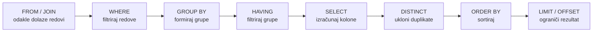
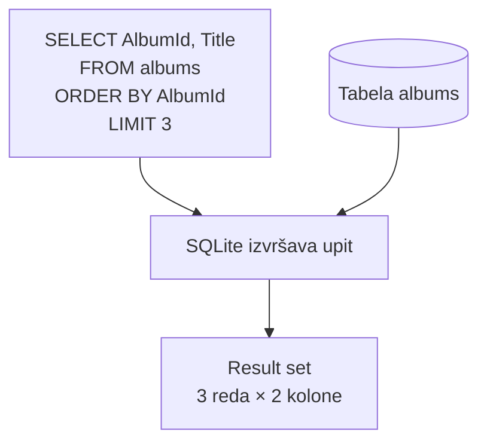

# 01 — `SELECT`: čitanje podataka i izraza

## Cilj lekcije

U ovoj lekciji naučićeš čemu služi SQL naredba `SELECT`, kako da pročitaš kolone iz Chinook baze i kako da izvršiš jednostavne izraze čak i kada ne čitaš podatke iz tabele. Upoznaćeš i redosled glavnih klauzula koje ćeš obrađivati u narednim lekcijama.

---

## Čemu služi `SELECT`

`SELECT` je SQL naredba kojom tražiš podatke ili izračunate vrednosti. Rezultat upita naziva se **result set** — skup redova i kolona koje je upit vratio. Uobičajen `SELECT` čita podatke; sam po sebi ne menja redove u tabeli.

U prikazu možeš tražiti sve kolone ili samo određene kolone. U aplikacijama je uglavnom jasnije izabrati samo kolone koje su potrebne, umesto `SELECT *`.

| Deo upita | Šta označava                                            | Primer                      |
| --------- | ------------------------------------------------------- | --------------------------- |
| `SELECT`  | Početak upita i vrednosti/kolone koje želiš u rezultatu | `SELECT Title`              |
| `FROM`    | Tabelu ili izvor podataka iz kog se čita                | `FROM albums`               |
| `;`       | Završetak SQL naredbe u SQLite CLI-ju                   | `SELECT Title FROM albums;` |

---

## `SELECT` nad izrazima, bez tabele

U transkriptu se kaže da svaki `SELECT` mora imati `FROM`. To nije tačno za SQLite: možeš da izračunaš izraz bez čitanja tabele.

```sql
SELECT 7 + 7;
```

Rezultat je jedan red sa jednom izračunatom vrednošću:

| `7 + 7` |
| ------: |
|      14 |

Možeš da izabereš više izraza, razdvojenih zarezom:

```sql
SELECT 10 / 2, 3 * 5;
```

| `10 / 2` | `3 * 5` |
| -------: | ------: |
|        5 |      15 |

Zarez ovde ne spaja redove; svaki izraz postaje posebna kolona rezultata. Da bi zaglavlja bila razumljiva, dodaj alias pomoću `AS`:

```sql
SELECT
    10 / 2 AS rezultat_deljenja,
    3 * 5 AS rezultat_mnozenja;
```

U SQLite-u deljenje dva celobrojna izraza obavlja celobrojno deljenje. Na primer, `5 / 2` daje `2`; za decimalni rezultat koristi decimalni operand, na primer `5.0 / 2`, koji daje `2.5`.

---

## Čitanje iz Chinook tabele

Kada želiš podatke iz tabele, navedi tabelu u `FROM` klauzuli. Chinook baza već sadrži tabelu `albums`:

```sql
SELECT AlbumId, Title
FROM albums;
```

Ovaj upit traži samo identifikator i naslov albuma. Da bi se rezultat lakše pregledao, možemo izričito da ga sortiramo po identifikatoru i ograničimo na prva tri reda:

```sql
SELECT AlbumId, Title
FROM albums
ORDER BY AlbumId
LIMIT 3;
```

Rezultat izgleda ovako:

| AlbumId | Title                                 |
| ------: | ------------------------------------- |
|       1 | For Those About To Rock We Salute You |
|       2 | Balls to the Wall                     |
|       3 | Restless and Wild                     |

Ovo je primer konkretnog **result set-a**. Tabela u bazi može imati mnogo više kolona i redova; rezultat sadrži samo kolone i broj redova koje je upit zatražio.

Za više informacija o tome kako su `albums` i ostale Chinook tabele povezane, pogledaj [ERD.drawio](../chinook/ERD.drawio).

---

## Oblik `SELECT` upita

Jednostavan upit sa više mogućih klauzula može izgledati ovako:

```sql
SELECT [DISTINCT] kolone_ili_izrazi
FROM tabela
JOIN druga_tabela ON uslov_veze
WHERE uslov_za_redove
GROUP BY kolone_za_grupisanje
HAVING uslov_za_grupe
ORDER BY kolone_za_sortiranje
LIMIT broj_redova OFFSET broj_preskocenih_redova;
```

Uglaste zagrade u šablonu označavaju opcione delove; nemoj ih unositi doslovno. U ovom kursu ćeš `JOIN`, `WHERE`, `GROUP BY`, `HAVING`, `ORDER BY` i `LIMIT` učiti postepeno. Ovaj šablon služi kao pregled, ne kao zahtev da svaki upit sadrži sve klauzule.

| Klauzula           | Namena                                                    | Detaljnije učiš                      |
| ------------------ | --------------------------------------------------------- | ------------------------------------ |
| `DISTINCT`         | Uklanja duplirane kombinacije izabranih vrednosti         | Lekcija o uklanjanju duplikata       |
| `FROM`             | Određuje tabelu ili izvor podataka                        | Osnove `SELECT` upita                |
| `JOIN ... ON`      | Povezuje redove iz više izvora prema uslovu               | Lekcije o upitima i relacijama       |
| `WHERE`            | Filtrira pojedinačne redove pre grupisanja                | Lekcija o filtriranju                |
| `GROUP BY`         | Grupiše redove za agregatne izračune                      | Kasnije, uz agregatne funkcije       |
| `HAVING`           | Filtrira formirane grupe                                  | Kasnije, uz agregatne funkcije       |
| `ORDER BY`         | Sortira rezultat                                          | Lekcija o sortiranju                 |
| `LIMIT` / `OFFSET` | Ograničava broj vraćenih redova i broj preskočenih redova | Koristi se uz pretragu i straničenje |

SQL klauzule pišu se u redosledu iz šablona, ali se njihovo **konceptualno** tumačenje odvija u drugom redosledu. Pojednostavljen prikaz:



Ovaj dijagram je mentalni model za razumevanje rezultata; nije opis tačnog unutrašnjeg plana izvršavanja koji SQLite bira. Ako nema grupisanja, `GROUP BY` i `HAVING` izostaju. Ako nema tabele u `FROM`, SQLite može da izračuna izraze direktno.

---

## Kako se klauzule međusobno razlikuju

- `WHERE` odlučuje koji pojedinačni redovi ulaze u dalje obrađivanje.
- `GROUP BY` pravi grupe redova, najčešće radi agregatnih funkcija kao što su `COUNT()` ili `SUM()`.
- `HAVING` filtrira grupe, a ne početne pojedinačne redove.
- `ORDER BY` određuje redosled prikazanih redova. Bez njega ne treba pretpostaviti da je rezultat sortiran.
- `LIMIT` i `OFFSET` ograničavaju prikazani deo rezultata; bez `ORDER BY` rezultat stranice nije stabilno sortiran.
- `JOIN ... ON` povezuje izvore podataka prema navedenom uslovu. To ćemo detaljnije obraditi kada budemo učili povezivanje tabela.

---

### Šta tačno radi `DISTINCT`

`DISTINCT` uklanja ponovljene **redove rezultata na osnovu svih izabranih izraza zajedno**. Ako izabereš samo `ArtistId`, uklanjaju se ponovljeni `ArtistId` rezultati. Ako izabereš i `ArtistId` i `Title`, proverava se jedinstvenost para `(ArtistId, Title)`, a ne samo naslova.

Primer koji vraća jedinstvene identifikatore izvođača iz albuma:

```sql
SELECT DISTINCT ArtistId
FROM albums;
```

`DISTINCT` ne menja niti briše ponovljene redove u tabeli; menja samo rezultat konkretnog upita.

---

## Vizuelno: od SQL teksta do result set-a



| Ulaz                    | Upit traži                           | Rezultat                       |
| ----------------------- | ------------------------------------ | ------------------------------ |
| Chinook tabela `albums` | Kolone `AlbumId` i `Title`           | Dve izabrane kolone            |
| Sortiranje po `AlbumId` | Redosled od najmanjeg identifikatora | Stabilan, eksplicitan redosled |
| `LIMIT 3`               | Najviše tri reda                     | Najviše tri albuma u rezultatu |

---

## Veza sa SQLAlchemy 2.0 i FastAPI-jem

SQLAlchemy 2.0 koristi konstrukciju `select()` za predstavljanje upita. Kada definišemo ORM model `Album`, konceptualni ORM upit može izgledati ovako:

```python
from sqlalchemy import select

statement = select(Album)
```

Ovo nije SQLite CLI komanda: Python aplikacija prosleđuje SQLAlchemy izraz kroz sesiju i drajver, a rezultat se zatim može pretvoriti u podatke za FastAPI odgovor. U SQLAlchemy lekcijama ćemo obraditi kako se rezultat izvršava i kako se biraju pojedinačne kolone ili ORM objekti.

---

## Česte greške

- **Pretpostaviš da `FROM` mora uvek da postoji:** u SQLite-u `SELECT 7 + 7;` je ispravan upit bez tabele.
- **Koristiš `SELECT *` svuda:** za čitljiv i stabilan API upit izaberi kolone koje su ti potrebne.
- **Očekuješ određeni redosled bez `ORDER BY`:** SQL ne garantuje redosled redova bez eksplicitnog sortiranja.
- **Misliš da `DISTINCT` menja bazu:** uklanjaju se duplikati samo iz result set-a, ne iz tabele.
- **Zaboraviš zarez između izraza:** svaki sledeći izraz u `SELECT` listi odvaja se zarezom.
- **Tumačiš `LIMIT` kao sortiranje:** `LIMIT` ograničava broj redova; samo `ORDER BY` određuje njihov redosled.

---

## Provera razumevanja

1. Šta vraća `SELECT 7 + 7;` i zašto mu nije potreban `FROM`?

- Vraća rezultat izraza `7 + 7`, što je `14`. `FROM` nije potreban jer se ne pristupa tabeli, već se računa konstanta. Ovaj princip važi i za druge izraze koji ne zavise od podataka u tabelama.

2. Koja je razlika između tabele `albums` i result set-a koji sadrži samo `AlbumId` i `Title`?

- Tabela `albums` sadrži sve kolone i sve redove definisane u bazi podataka, dok result set sa `AlbumId` i `Title` sadrži samo izabrane kolone i eventualno filtrirane redove. Result set je privremeni skup podataka koji se generiše izvršavanjem upita, dok tabela predstavlja trajnu strukturu u bazi.

3. Da li `SELECT DISTINCT ArtistId, Title` uklanja ponovljene naslove ili ponovljene parove vrednosti?

- Uklanja ponovljene parove vrednosti `ArtistId` i `Title`. Ako se isti naslov pojavi kod različitih izvođača, neće biti uklonjen, jer se DISTINCT primenjuje na kombinaciju svih kolona navedenih u SELECT listi.

4. Koja je razlika između `WHERE` i `HAVING`?

- `WHERE` filtrira redove pre grupisanja, dok `HAVING` filtrira grupe nakon što su formirane pomoću `GROUP BY`. Drugim rečima, `WHERE` se primenjuje na pojedinačne redove, a `HAVING` na agregirane rezultate.

5. Zašto treba koristiti `ORDER BY` pre `LIMIT` kada želiš stabilan rezultat?

- `ORDER BY` definiše redosled redova u result set-u, dok `LIMIT` samo ograničava broj redova koji se vraćaju. Ako ne koristiš `ORDER BY`, redosled redova može biti proizvoljan, pa `LIMIT` može vratiti različite redove pri svakom izvršavanju upita.

6. Da li `SELECT` sa `DISTINCT` briše ponovljene podatke iz tabele?

- Ne, `SELECT DISTINCT` ne menja podatke u tabeli, već samo uklanja duplikate u rezultatu upita. Tabela ostaje nepromenjena. Rezultat upita je privremeni skup podataka koji se generiše na osnovu trenutnog stanja tabele, ali sama tabela ostaje netaknuta.

---

## Vežbe

### Vežba 1 — Izračunaj bez tabele

U SQLite CLI-ju izvrši sledeće upite i zabeleži kolone i vrednosti rezultata:

1. `SELECT 7 + 7;`
2. `SELECT 10 / 2, 3 * 5;`
3. `SELECT 5 / 2 AS celobrojno, 5.0 / 2 AS decimalno;`
4. Dodaj smislene aliase izrazima pomoću `AS`.

---

### Vežba 2 — Pročitaj Chinook tabelu

1. Otvori Chinook bazu i prikaži pet albuma sa `AlbumId` i `Title`.
2. Koristi `ORDER BY AlbumId` i `LIMIT 5`.
3. Uporedi izabrane kolone sa poljima tabele `albums` u ERD-u i objasni zašto ERD prikazuje šemu, a ne rezultate upita.

Predložak upita:

```sql
SELECT AlbumId, Title
FROM albums
ORDER BY AlbumId
LIMIT 5;
```

---

### Vežba 3 — Istraži `DISTINCT`

1. Uporedi `SELECT ArtistId FROM albums;` i `SELECT DISTINCT ArtistId FROM albums;`.
2. Objasni zašto se rezultat drugog upita može sastojati od manje redova.

- Rezultat drugog upita može imati manje redova jer `DISTINCT` uklanja duplikate, pa se svaka vrednost `ArtistId` pojavljuje samo jednom u rezultatu. Ovo je korisno kada želiš da vidiš jedinstvene vrednosti u koloni bez ponavljanja.

3. Isprobaj `SELECT DISTINCT ArtistId, Title FROM albums;` i objasni zašto rezultat nije isto što i jedinstveni `ArtistId`-ovi.

- Kada koristiš `DISTINCT` sa više kolona, SQLite uklanja duplikate samo ako su sve kolone u rezultatu iste. Dakle, `SELECT DISTINCT ArtistId, Title` vraća jedinstvene kombinacije `ArtistId` i `Title`, što znači da može postojati više redova sa istim `ArtistId`-om ako se razlikuju po `Title`.

---

### Vežba 4 — Prepoznaj klauzule

U sledećem upitu označi šta radi svaka klauzula:

```sql
SELECT ArtistId, COUNT(*) AS album_count
FROM albums
WHERE ArtistId > 0
GROUP BY ArtistId
HAVING COUNT(*) > 1
ORDER BY album_count DESC
LIMIT 5;
```

Ne moraš još da znaš svaku funkciju napamet. Važno je da prepoznaš koji deo bira izvor, koji filtrira redove, koji grupiše, koji filtrira grupe, koji sortira i koji ograničava broj redova.

- `SELECT ArtistId, COUNT(*) AS album_count` bira kolone koje će biti prikazane u rezultatu i definiše alias za brojanje albuma.

- `FROM albums` određuje izvor podataka, tj. tabelu `albums`.
- `WHERE ArtistId > 0` filtrira redove pre grupisanja, zadržavajući samo one sa `ArtistId` većim od 0.
- `GROUP BY ArtistId` grupiše redove po `ArtistId`.
- `HAVING COUNT(*) > 1` filtrira grupe, zadržavajući samo one sa više od jednog albuma.
- `ORDER BY album_count DESC` sortira rezultat po broju albuma u opadajućem redosledu.
- `LIMIT 5` ograničava broj redova u rezultatu na 5.

---
