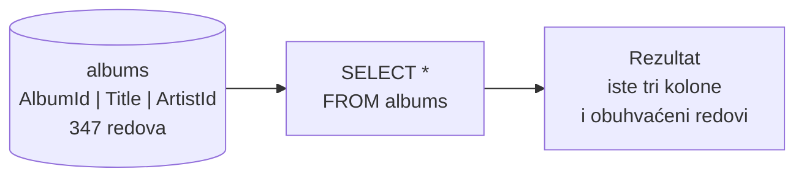

# 02 — Čitanje svih kolona iz tabele

## Cilj lekcije

U ovoj lekciji naučićeš kako da pomoću `SELECT *` zatražiš sve kolone iz jedne tabele. Videćeš šta zvezdica obuhvata, kako izgleda rezultat nad Chinook tabelom `albums` i kada je praktičnije navesti kolone pojedinačno.

Prethodna lekcija: [`SELECT`: čitanje podataka i izraza](01_sqlite_select_statement.md).

## Osnovni oblik upita

Zvezdica (`*`) u listi `SELECT` predstavlja sve kolone iz izvora navedenog u `FROM` klauzuli.

```sql
SELECT *
FROM albums;
```

Ovaj upit traži sve kolone i sve redove iz tabele `albums`. Tačan broj redova zavisi od tabele i ostatka upita. U Chinook bazi `albums` ima 347 redova.

| Deo upita               | Značenje                                 |
| ----------------------- | ---------------------------------------- |
| `SELECT *`              | U rezultat uključi sve kolone izvora     |
| `FROM albums`           | Čitaj podatke iz tabele `albums`         |
| Bez `WHERE` ili `LIMIT` | Upit ne isključuje redove tim klauzulama |

`*` nije zamena za ime tabele. Potrebna ti je i `FROM` klauzula koja određuje odakle podaci dolaze.

## Šta znači „sve kolone“

U tabeli `albums` postoje tri kolone: `AlbumId`, `Title` i `ArtistId`. Zato se upit `SELECT * FROM albums;` ponaša kao upit koji traži te tri kolone:

```sql
SELECT AlbumId, Title, ArtistId
FROM albums;
```

Uobičajeno, kolone se pojavljuju redosledom kojim su definisane u tabeli. Rezultat sadrži jedan red za svaki red tabele koji upit obuhvata.



Ako izvršiš upit bez ograničenja nad trenutnom Chinook bazom, SQLite vraća sve redove iz `albums`. SQL sam po sebi ne obećava da će redovi biti prikazani nekim određenim redosledom. Ako ti je redosled važan, dodaj `ORDER BY`:

```sql
SELECT *
FROM albums
ORDER BY AlbumId;
```

Sledeći primer koristi `ORDER BY` i `LIMIT` da bi prikazao samo prva tri reda. To je zgodno za pregled, ali ovaj upit više ne vraća sve redove:

```sql
SELECT *
FROM albums
ORDER BY AlbumId
LIMIT 3;
```

Očekivani početak rezultata:

| AlbumId | Title                                 | ArtistId |
| ------: | ------------------------------------- | -------: |
|       1 | For Those About To Rock We Salute You |        1 |
|       2 | Balls to the Wall                     |        2 |
|       3 | Restless and Wild                     |        2 |

Redosled kolona u prikazanom rezultatu odgovara tabeli `albums`. Njenu strukturu i vezu sa ostalim Chinook tabelama možeš pogledati u [ERD dijagramu](../chinook/ERD.drawio).

## Biranje svih kolona iz određene tabele

Kada upit koristi jednu tabelu, `SELECT *` je dovoljno jasno. U upitima sa više tabela možeš precizirati, na primer, da želiš sve kolone iz `albums`:

```sql
SELECT albums.*
FROM albums;
```

Zapis `albums.*` znači „sve kolone iz `albums`“. To ne znači „sve kolone iz svake tabele u bazi“. Kada se kasnije upoznaš sa `JOIN`, ovaj oblik će pomoći da se jasno vidi iz koje tabele dolaze izabrane kolone.

## Kada je `SELECT *` koristan

`SELECT *` je praktičan za:

- brzo istraživanje nepoznate tabele;
- učenje i demonstracije, kada želiš da vidiš celu strukturu rezultata;
- jednokratnu proveru podataka u SQLite CLI-ju ili grafičkom alatu.

Za istraživanje možeš najpre da ograničiš rezultat:

```sql
SELECT *
FROM albums
ORDER BY AlbumId
LIMIT 5;
```

Tako vidiš oblik redova, a ne ispisuješ svih 347 albuma u terminal ili editor. Imaj na umu da `LIMIT` ograničava broj vraćenih redova, ali nije zamena za pažljivo biranje kolona.

## Zašto se u aplikaciji obično biraju konkretne kolone

U aplikaciji koja vraća podatke preko API-ja uglavnom je bolje da upit navede samo kolone koje su potrebne:

```sql
SELECT AlbumId, Title
FROM albums
ORDER BY AlbumId
LIMIT 5;
```

U poređenju sa `SELECT *`, ovaj upit ima uži rezultat:

| Upit                                 | Kolone u rezultatu   | Pogodan za                  |
| ------------------------------------ | -------------------- | --------------------------- |
| `SELECT * FROM albums;`              | Sve kolone tabele    | Istraživanje i pregled      |
| `SELECT AlbumId, Title FROM albums;` | Samo navedene kolone | Namenski upit i API odgovor |

Izbor konkretnih kolona čini nameru upita jasnijom, smanjuje količinu podataka koju treba obraditi izvan baze i sprečava da se rezultat neočekivano proširi kada se tabela promeni. Posebno je važno da API ne izloži slučajno podatke koje klijent ne treba da dobije.

Ipak, nemoj zaključiti da je svaki `SELECT *` automatski spor ili da svaka baza mora prvo učitati sve rezultate u memoriju aplikacije. Stvarni trošak zavisi od veličine i strukture tabele, upita, drajvera i načina na koji se rezultat čita. Kod velike tabele ili velikih kolona, čitanje i prenos svih podataka može biti nepotrebno skupo.

SQLite je ugrađena baza koja se tipično koristi iz procesa aplikacije nad lokalnim fajlom baze; nije po pravilu zaseban mrežni server. Zato tvrdnja da svaki `SELECT *` opterećuje „mrežu“ nije univerzalno tačna. U svakom slučaju, aplikacija mora da obradi podatke koje traži, a alat za rad sa bazom mora da ih prikaže.

## Veza sa SQLAlchemy 2.0 i FastAPI-jem

U SQLAlchemy 2.0, `select(Album)` se koristi kada želiš ORM objekte modela `Album`:

```python
from sqlalchemy import select

statement = select(Album)
```

Ovo je ORM izraz, a ne doslovni SQL `SELECT *`. SQLAlchemy generiše upit na osnovu kolona koje su mapirane u `Album` modelu. Kada su potrebne samo određene kolone, ne-ORM upit može biti eksplicitniji:

```python
statement = select(Album.album_id, Album.title)
```

Ovde se pretpostavlja da su atributi Python modela nazvani `album_id` i `title`; stvarni nazivi zavise od definicije modela. U FastAPI aplikaciji je važno da upit, model i odgovor API-ja imaju namerno odabran oblik — ne treba pretpostaviti da je svaka kolona baze namenjena klijentu.

## Provera razumevanja

1. Šta označava `*` u `SELECT * FROM albums;`?
2. Koliko kolona i redova sadrži rezultat nad trenutnom Chinook tabelom `albums`, ako upit nema dodatna ograničenja?
3. Da li `SELECT *` garantuje redosled redova?
4. Šta ograničava `LIMIT 3`: broj kolona ili broj redova?
5. Zašto se u API upitu obično navode samo potrebne kolone?
6. Da li `SELECT albums.*` znači sve kolone iz svih tabela u bazi?

## Vežbe

### Vežba 1 — Prikaži sve kolone

1. Izvrši `SELECT * FROM albums;` nad Chinook bazom.
2. Zabeleži nazive i redosled kolona.
3. Proveri ukupan broj vraćenih redova.
4. Uporedi kolone sa tabelom `albums` u ERD dijagramu.

### Vežba 2 — Ograniči pregled

1. Napiši upit koji vraća sve kolone iz `albums`, sortira ih po `AlbumId` i prikazuje prvih pet redova.
2. Uporedi rezultat sa upitom bez `LIMIT`.
3. Objasni šta se promenilo, a šta je ostalo isto.

### Vežba 3 — Uporedi širok i uzak rezultat

1. Izvrši `SELECT * FROM albums ORDER BY AlbumId LIMIT 5;`.
2. Izvrši `SELECT AlbumId, Title FROM albums ORDER BY AlbumId LIMIT 5;`.
3. Uporedi broj i nazive kolona u rezultatima.
4. Navedi primer situacije u kojoj bi uži rezultat bio bolji izbor u FastAPI aplikaciji.

### Vežba 4 — Preciziraj izvor kolona

Izvrši sledeći upit i objasni razliku u zapisu u odnosu na `SELECT *`:

```sql
SELECT albums.*
FROM albums
ORDER BY AlbumId
LIMIT 5;
```

### Vežba 5 — Primeni na drugu tabelu

1. Izaberi neku drugu Chinook tabelu koja je prikazana na ERD-u.
2. Prikaži do pet redova sa svim kolonama.
3. Zatim napiši drugi upit koji bira samo dve kolone.
4. Uporedi rezultate i objasni zašto bi u aplikaciji mogao da izabereš drugi upit.
