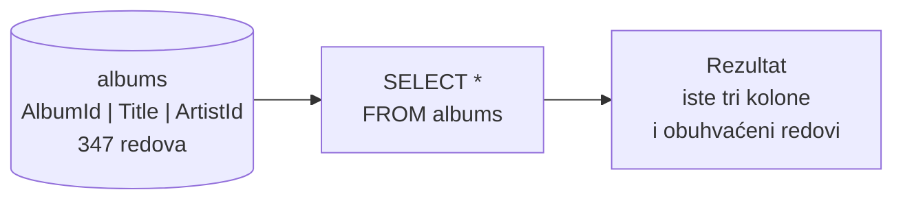

# 02 — Čitanje svih kolona iz tabele

## Cilj lekcije

U ovoj lekciji naučićeš kako da pomoću `SELECT *` zatražiš sve kolone iz jedne tabele. Videćeš šta zvezdica obuhvata, kako izgleda rezultat nad Chinook tabelom `albums` i kada je praktičnije navesti kolone pojedinačno.

Prethodna lekcija: [`SELECT`: čitanje podataka i izraza](01_sqlite_select_statement.md).

---

## Osnovni oblik upita

Zvezdica (`*`) u listi `SELECT` predstavlja sve kolone iz izvora navedenog u `FROM` klauzuli.

```sql
SELECT *
FROM albums;
```

Ovaj upit traži sve kolone i sve redove iz tabele `albums`. Tačan broj redova zavisi od tabele i ostatka upita. U Chinook bazi `albums` ima 347 redova.

| Deo upita               | Značenje                                 |
| ----------------------- | ---------------------------------------- |
| `SELECT *`              | U rezultat uključi sve kolone izvora     |
| `FROM albums`           | Čitaj podatke iz tabele `albums`         |
| Bez `WHERE` ili `LIMIT` | Upit ne isključuje redove tim klauzulama |

`*` nije zamena za ime tabele. Potrebna ti je i `FROM` klauzula koja određuje odakle podaci dolaze.

---

## Šta znači „sve kolone“

U tabeli `albums` postoje tri kolone: `AlbumId`, `Title` i `ArtistId`. Zato se upit `SELECT * FROM albums;` ponaša kao upit koji traži te tri kolone:

```sql
SELECT AlbumId, Title, ArtistId
FROM albums;
```

Uobičajeno, kolone se pojavljuju redosledom kojim su definisane u tabeli. Rezultat sadrži jedan red za svaki red tabele koji upit obuhvata.



Ako izvršiš upit bez ograničenja nad trenutnom Chinook bazom, SQLite vraća sve redove iz `albums`. SQL sam po sebi ne obećava da će redovi biti prikazani nekim određenim redosledom. Ako ti je redosled važan, dodaj `ORDER BY`:

```sql
SELECT *
FROM albums
ORDER BY AlbumId;
```

Sledeći primer koristi `ORDER BY` i `LIMIT` da bi prikazao samo prva tri reda. To je zgodno za pregled, ali ovaj upit više ne vraća sve redove:

```sql
SELECT *
FROM albums
ORDER BY AlbumId
LIMIT 3;
```

Očekivani početak rezultata:

| AlbumId | Title                                 | ArtistId |
| ------: | ------------------------------------- | -------: |
|       1 | For Those About To Rock We Salute You |        1 |
|       2 | Balls to the Wall                     |        2 |
|       3 | Restless and Wild                     |        2 |

Redosled kolona u prikazanom rezultatu odgovara tabeli `albums`. Njenu strukturu i vezu sa ostalim Chinook tabelama možeš pogledati u [ERD dijagramu](../chinook/ERD.drawio).

---

## Biranje svih kolona iz određene tabele

Kada upit koristi jednu tabelu, `SELECT *` je dovoljno jasno. U upitima sa više tabela možeš precizirati, na primer, da želiš sve kolone iz `albums`:

```sql
SELECT albums.*
FROM albums;
```

Zapis `albums.*` znači „sve kolone iz `albums`“. To ne znači „sve kolone iz svake tabele u bazi“. Kada se kasnije upoznaš sa `JOIN`, ovaj oblik će pomoći da se jasno vidi iz koje tabele dolaze izabrane kolone.

---

## Kada je `SELECT *` koristan

`SELECT *` je praktičan za:

- brzo istraživanje nepoznate tabele;
- učenje i demonstracije, kada želiš da vidiš celu strukturu rezultata;
- jednokratnu proveru podataka u SQLite CLI-ju ili grafičkom alatu.

Za istraživanje možeš najpre da ograničiš rezultat:

```sql
SELECT *
FROM albums
ORDER BY AlbumId
LIMIT 5;
```

Tako vidiš oblik redova, a ne ispisuješ svih 347 albuma u terminal ili editor. Imaj na umu da `LIMIT` ograničava broj vraćenih redova, ali nije zamena za pažljivo biranje kolona.

---

## Zašto se u aplikaciji obično biraju konkretne kolone

U aplikaciji koja vraća podatke preko API-ja uglavnom je bolje da upit navede samo kolone koje su potrebne:

```sql
SELECT AlbumId, Title
FROM albums
ORDER BY AlbumId
LIMIT 5;
```

U poređenju sa `SELECT *`, ovaj upit ima uži rezultat:

| Upit                                 | Kolone u rezultatu   | Pogodan za                  |
| ------------------------------------ | -------------------- | --------------------------- |
| `SELECT * FROM albums;`              | Sve kolone tabele    | Istraživanje i pregled      |
| `SELECT AlbumId, Title FROM albums;` | Samo navedene kolone | Namenski upit i API odgovor |

Izbor konkretnih kolona čini nameru upita jasnijom, smanjuje količinu podataka koju treba obraditi izvan baze i sprečava da se rezultat neočekivano proširi kada se tabela promeni. Posebno je važno da API ne izloži slučajno podatke koje klijent ne treba da dobije.

Ipak, nemoj zaključiti da je svaki `SELECT *` automatski spor ili da svaka baza mora prvo učitati sve rezultate u memoriju aplikacije. Stvarni trošak zavisi od veličine i strukture tabele, upita, drajvera i načina na koji se rezultat čita. Kod velike tabele ili velikih kolona, čitanje i prenos svih podataka može biti nepotrebno skupo.

`SQLite` je **ugrađena baza koja se tipično koristi iz procesa aplikacije nad lokalnim fajlom baze**. Nije po pravilu zaseban mrežni server. **Zato tvrdnja da svaki `SELECT *` opterećuje „mrežu“ nije univerzalno tačna**. U svakom slučaju, aplikacija mora da obradi podatke koje traži, a alat za rad sa bazom mora da ih prikaže.

---

## Veza sa SQLAlchemy 2.0 i FastAPI-jem

U SQLAlchemy 2.0, `select(Album)` se koristi kada želiš ORM objekte modela `Album`:

```python
from sqlalchemy import select

# Ovo generiše SQL upit koji bira sve kolone iz tabele `albums` povezane sa ORM modelom Album
statement = select(Album)
```

Ovo je ORM izraz, a ne doslovni SQL `SELECT *`. SQLAlchemy generiše upit na osnovu kolona koje su mapirane u `Album` modelu. Kada su potrebne samo određene kolone, možeš ih eksplicitno navesti u `select()` funkciji, kao što je prikazano u nastavku:

```python
statement = select(Album.album_id, Album.title)
```

Ovde se pretpostavlja da su atributi Python modela `Album` nazvani `album_id` i `title`. Stvarni nazivi zavise od definicije modela.

U `FastAPI` aplikaciji je važno da **upit, model i odgovor `API`-ja imaju smislen i svesno odabran oblik** — ne treba pretpostaviti da je svaka kolona baze namenjena klijentu. Nekoliko kolona može biti relevantno za internu logiku, ali ne i za javni API, pa je bolje eksplicitno odabrati samo one koje su potrebne.

---

## Provera razumevanja

1. Šta označava `*` u `SELECT * FROM albums;`?

- `*` označava sve kolone iz tabele navedene u `FROM` klauzuli. U primeru `SELECT * FROM albums;`, vraćaju se sve kolone iz tabele `albums`.

- Ovo je zgodno za brze preglede ili kada su sve kolone potrebne, ali **u produkcionim API upitima je bolje eksplicitno navesti samo potrebne kolone radi čitljivosti, performansi i sigurnosti**. Na taj način se izbegava nepotrebno prenošenje podataka i smanjuje rizik od izlaganja osetljivih informacija.

2. Koliko kolona i redova sadrži rezultat nad trenutnom Chinook tabelom `albums`, ako upit nema dodatna ograničenja?

- Rezultat sadrži sve kolone iz tabele `albums` i ukupan broj redova koji odgovara broju albuma u bazi. U Chinook bazi, tabela `albums` obično sadrži 347 redova i 3 kolone (`AlbumId`, `Title`, `ArtistId`).

3. Da li `SELECT *` garantuje redosled redova?

- Ne, `SELECT *` ne garantuje redosled redova. Redosled se određuje pomoću `ORDER BY` klauzule. Ako `ORDER BY` nije naveden, redosled redova može biti proizvoljan i zavisi od implementacije baze podataka.

4. Šta ograničava `LIMIT 3`: broj kolona ili broj redova?

- `LIMIT 3` ograničava broj redova u rezultatu na 3. Ne utiče na broj kolona, već samo na broj redova koji se vraćaju iz upita.

- `LIMIT` se koristi za kontrolu broja redova u rezultatu, što je korisno kada želimo pregledati samo deo podataka ili kada radimo sa velikim tabelama kako bismo smanjili opterećenje na bazu i mrežu.

- `LIMIT` se često koristi u kombinaciji sa `ORDER BY` kako bi se dobio kontrolisan i predvidiv podskup podataka, na primer, za prikaz prvih nekoliko redova po određenom kriterijumu.

5. Zašto se u API upitu obično navode samo potrebne kolone?

- U `API upitima` (npr. kada koristimo FastAPI za kreiranje RESTful servisa) je preporučljivo **navoditi samo potrebne kolone kako bi se smanjila količina prenetih podataka, poboljšale performanse i smanjio rizik od izlaganja osetljivih informacija**. Takođe, eksplicitno navođenje kolona čini kod čitljivijim i olakšava održavanje.

- **Eksplicitno navođenje kolona** omogućava bolju kontrolu nad podacima koji se vraćaju i olakšava optimizaciju upita, posebno kada tabela sadrži veliki broj kolona ili osetljive informacije.

6. Da li `SELECT albums.*` znači sve kolone iz svih tabela u bazi?

- Ne, `SELECT albums.*` znači sve kolone iz tabele `albums`. Ovaj zapis je koristan kada se u upitu koriste više tabela i želimo da preciziramo iz koje tabele uzimamo sve kolone, čime se izbegava konfuzija i potencijalni konflikti kolona sa istim nazivom u različitim tabelama.

- Ovaj pristup je posebno koristan u složenijim upitima koji uključuju `JOIN` operacije, gde različite tabele mogu imati kolone sa istim nazivom. Korišćenjem prefiksa tabele (`albums.*`) jasno se definiše koje kolone pripadaju kojoj tabeli, čime se izbegavaju konflikti i nejasnoće u rezultatima.

---

## Vežbe

> U ovoj vežbi ćemo se fokusirati na prikaz svih kolona iz tabele `albums` i razumevanje redosleda i broja kolona u rezultatu upita.
>
> Cilj ove vežbe je da se upoznamo sa načinom na koji SQL vraća sve kolone iz tabele i kako se redosled kolona u rezultatu poklapa sa definicijom tabele u ERD dijagramu.

---

### Vežba 1 — Prikaži sve kolone

**1. Izvrši `SELECT * FROM albums;` nad Chinook bazom.**

**2. Zabeleži nazive i redosled kolona.**

- Prva kolona u rezultatu je `AlbumId`, što odgovara redosledu kolona u tabeli `albums` u ERD dijagramu.
- Druga kolona je `Title`, što takođe odgovara redosledu kolona u tabeli `albums`.
- Treća kolona je `ArtistId`, što takođe odgovara redosledu kolona u tabeli `albums`.
- Ukupan broj kolona u rezultatu odgovara broju kolona u tabeli `albums` u ERD dijagramu.
- Redosled kolona u rezultatu takođe prati redosled kolona definisan u tabeli `albums`.

- Ovakvo ponašanje je važno za konzistentnost i predvidljivost rezultata, posebno kada se podaci dalje obrađuju u aplikaciji.

- U kontekstu FastAPI aplikacije, eksplicitno navođenje kolona može pomoći u smanjenju prenosa nepotrebnih podataka i poboljšanju performansi API-ja. Na primer, ako aplikacija prikazuje samo naziv albuma i ID umetnika, nije potrebno vraćati sve kolone iz tabele `albums`, što smanjuje opterećenje na mrežu i ubrzava obradu podataka na klijentskoj strani.

**3. Proveri ukupan broj vraćenih redova.**

- Broj vraćenih redova odgovara ukupnom broju albuma u tabeli `albums`.

```sql
-- Prikaz svih kolona iz tabele albums
SELECT * FROM albums;
```

- Ovo je važno kako bismo se uverili da upit zaista vraća sve podatke iz tabele, a ne samo deo njih.
- Takođe, proverom broja redova možemo potvrditi integritet podataka u bazi i osigurati da nijedan zapis nije izostavljen.

```sql
-- Provera broja redova u tabeli albums
SELECT COUNT(*) FROM albums;
```

**4. Uporedi kolone iz rezultata sa tabelom `albums` u ERD dijagramu.**

---

### Vežba 2 — Ograniči pregled

**1. Napiši upit koji vraća sve kolone iz `albums`, sortira ih po `AlbumId` i prikazuje prvih pet redova.**

```sql
SELECT * FROM albums
ORDER BY AlbumId
LIMIT 5;
```

**2. Uporedi rezultat sa upitom bez `LIMIT`.**

```sql
SELECT * FROM albums;
```

**3. Objasni šta se promenilo, a šta je ostalo isto u rezultatima upita sa i bez `LIMIT`.**

- U rezultatima sa `LIMIT` vidimo samo prvih pet redova, dok upit bez `LIMIT` vraća sve redove iz tabele `albums`.

- Broj i nazivi kolona ostaju isti u oba rezultata, jer `LIMIT` utiče samo na broj redova, a ne na strukturu kolona.

- Redosled kolona takođe ostaje nepromenjen, što omogućava konzistentno rukovanje podacima u aplikaciji.
- Korišćenje `LIMIT` je posebno korisno kada se radi sa velikim tabelama, jer smanjuje količinu podataka koja se prenosi i obrađuje, čime se poboljšava performansa aplikacije.

- U kontekstu FastAPI aplikacije, `LIMIT` može pomoći u optimizaciji odgovora API-ja tako što se klijentu šalje samo potreban broj redova, što smanjuje opterećenje servera i ubrzava vreme odziva.

- Ovo je posebno korisno kada se radi sa paginacijom, gde klijent može zahtevati podatke u manjim segmentima, čime se poboljšava korisničko iskustvo i efikasnost aplikacije.

---

### Vežba 3 — Uporedi širok i uzak rezultat

**1. Izvrši -> SELECT \* FROM albums ORDER BY AlbumId LIMIT 5;**

```text
AlbumId | Title | ArtistId
--------+-------+---------
1       | For Those About To Rock We Salute You | 1
2       | Balls to the Wall | 2
3       | Restless and Wild | 2
4       | Let There Be Rock | 1
5       | Big Ones | 3
```

**2. Izvrši -> SELECT AlbumId, Title FROM albums ORDER BY AlbumId LIMIT 5;**

```text
AlbumId | Title
--------+---------------------------------
1       | For Those About To Rock We Salute You
2       | Balls to the Wall
3       | Restless and Wild
4       | Let There Be Rock
5       | Big Ones
```

**3. Uporedi broj i nazive kolona u rezultatima.**

- U prvom rezultatu imamo tri kolone: `AlbumId`, `Title` i `ArtistId`.
- U drugom rezultatu imamo samo dve kolone: `AlbumId` i `Title`.
- Nazivi kolona koje su prisutne u oba rezultata ostaju isti, ali broj kolona se smanjuje kada izaberemo samo određene kolone.

- Ovo pokazuje kako možemo kontrolisati koje kolone želimo da dobijemo u rezultatu, što može biti korisno za optimizaciju performansi i smanjenje količine podataka koji se prenose.

**4. Navedi primer situacije u kojoj bi uži rezultat bio bolji izbor u FastAPI aplikaciji.**

- U užem rezultatu dobijamo samo kolone koje su nam zaista po`trebne, što smanjuje količinu podataka koja se prenosi između baze i aplikacije.

- Ovo može biti korisno u FastAPI aplikaciji kada želimo da optimizujemo performanse API-ja i smanjimo opterećenje servera.

- Na primer, ako klijent treba samo osnovne informacije o albumima, kao što su `AlbumId` i `Title`, nema potrebe da šaljemo i `ArtistId`, čime se ubrzava odgovor i smanjuje potrošnja resursa.

- Ovo je posebno važno kada radimo sa velikim tabelama ili kada očekujemo veliki broj zahteva, jer smanjenje količine prenetih podataka direktno utiče na brzinu i efikasnost aplikacije.

- Dakle, uvek je preporučljivo birati samo one kolone koje su zaista potrebne za konkretan upit ili funkcionalnost u aplikaciji.

- Ovo ne samo da poboljšava performanse, već i olakšava održavanje koda, jer je jasno koje podatke aplikacija koristi i smanjuje se rizik od grešaka prilikom obrade nepotrebnih kolona.

- Ukratko, biranje samo potrebnih kolona pomaže u optimizaciji performansi, smanjenju opterećenja servera i olakšava održavanje koda.

---

### Vežba 4 — Preciziraj izvor kolona

Izvrši sledeći upit i objasni razliku u zapisu u odnosu na `SELECT *`:

```sql
SELECT albums.*
FROM albums
ORDER BY AlbumId
LIMIT 5;
```

- U ovom upitu koristimo `albums.*` umesto `*`, što znači da eksplicitno biramo sve kolone iz tabele `albums`.

- Ovo je korisno kada radimo sa više tabela u `JOIN` upitima, jer nam omogućava da preciziramo iz koje tabele želimo da dobijemo sve kolone, čime se izbegava potencijalna konfuzija i kolizija imena kolona.

- Takođe, korišćenje `albums.*` čini upit čitljivijim i jasnijim, jer odmah vidimo da sve kolone dolaze iz tabele `albums`, što olakšava razumevanje strukture rezultata.

- Ovaj pristup je posebno koristan kada radimo sa složenijim upitima koji uključuju više tabela, jer nam omogućava da precizno kontrolišemo koje kolone dolaze iz koje tabele, smanjujući rizik od grešaka i poboljšavajući održivost koda.

- U suštini, korišćenje `albums.*` pruža bolju kontrolu nad rezultatima upita i doprinosi jasnijem i sigurnijem pisanju SQL upita u aplikacijama koje rade sa više tabela.

---

### Vežba 5 — Primeni na drugu tabelu

U ovoj vežbi ćemo primeniti koncept preciziranja izvora kolona na drugu tabelu iz Chinook baze. Cilj je da se uverimo kako se koristi sintaksa `tabela.*` i kako možemo selektivno birati kolone iz različitih tabela, što je posebno korisno u složenijim upitima koji uključuju više tabela.

**1. Izaberi neku drugu Chinook tabelu koja je prikazana na ERD-u.**

Na primer, možemo izabrati tabelu `artists` koja je takođe prikazana na ERD-u.

```sql
SELECT artists.*
FROM artists
ORDER BY ArtistId
LIMIT 5;
```

Zatim možemo napisati drugi upit koji bira samo dve kolone iz tabele `artists`, na primer `ArtistId` i `Name`:

```sql
SELECT ArtistId, Name
FROM artists
ORDER BY ArtistId
LIMIT 5;
```

- Prvi upit prikazuje sve kolone iz tabele `artists` koristeći sintaksu `artists.*`, dok drugi upit prikazuje samo dve kolone `ArtistId` i `Name`.

- Ova vežba ilustruje kako možemo precizno kontrolisati koje kolone želimo da dobijemo iz tabele, što je korisno za optimizaciju performansi i smanjenje količine podataka koji se prenose između baze i aplikacije.

- Kada radimo sa velikim tabelama ili složenim upitima koji uključuju više tabela, selektivno biranje kolona može značajno poboljšati efikasnost upita i smanjiti opterećenje na mreži i aplikaciji.

- Ovaj pristup takođe olakšava održavanje koda, jer jasno pokazuje koje kolone su zaista potrebne u aplikaciji, smanjujući rizik od grešaka i nepotrebnog prenosa podataka.

- U praksi, kada radimo sa više tabela i složenim upitima, korišćenje `tabela.*` u kombinaciji sa selektivnim biranjem kolona omogućava nam da balansiramo između čitljivosti koda i efikasnosti upita, čime se postiže optimalna kontrola nad podacima koji se vraćaju iz baze.

**2. Prikaži do pet redova sa svim kolonama koristeći sintaksu `tabela.*`.**

```sql
SELECT artists.*
FROM artists
ORDER BY ArtistId
LIMIT 5;
```

**3. Zatim napiši drugi upit koji bira samo dve kolone iz te tabele.**

```sql
SELECT ArtistId, Name
FROM artists
ORDER BY ArtistId
LIMIT 5;
```

**4. Uporedi rezultate i objasni zašto bi u aplikaciji mogao da izabereš drugi upit koji bira samo potrebne kolone umesto svih kolona.**

- Kada biramo samo potrebne kolone, smanjujemo količinu podataka koji se prenose između baze i aplikacije, što može poboljšati performanse, posebno kod velikih tabela.

- Selektivno biranje kolona takođe olakšava održavanje koda i smanjuje rizik od grešaka, jer jasno pokazuje koje kolone su zaista potrebne u aplikaciji.

- Korišćenje `tabela.*` je korisno kada želimo da dobijemo sve kolone iz tabele, ali u praksi je često bolje kombinovati `tabela.*` sa selektivnim biranjem kolona kako bismo postigli optimalnu kontrolu nad podacima koji se vraćaju iz baze.

- Uvek je važno razmotriti kontekst aplikacije i specifične zahteve kada odlučujemo koje kolone da izaberemo u upitu. Ako nam trebaju sve kolone za određenu operaciju, korišćenje `tabela.*` je opravdano, ali kada nam trebaju samo određene kolone, selektivno biranje kolona je efikasnije i jasnije za održavanje.

---
