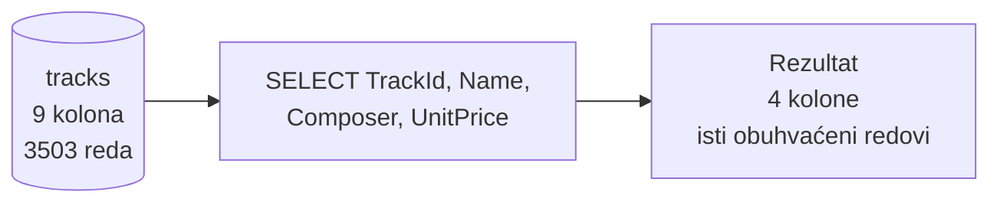

# 03 — Čitanje određenih kolona iz tabele

## Cilj lekcije

U ovoj lekciji naučićeš kako da izabereš samo određene kolone iz jedne tabele pomoću `SELECT` liste. Koristićemo tabelu `tracks` iz Chinook baze i videćemo zašto izbor kolona ne menja automatski broj redova u rezultatu.

Prethodna lekcija: [Čitanje svih kolona iz tabele](02_querying_data_from_all_columns_in_a_table.md).

## Osnovni oblik upita

Posle `SELECT` navedi nazive kolona koje želiš u rezultatu. Kada biraš više kolona, razdvoji ih zarezima. U `FROM` navedi tabelu iz koje čitaš:

```sql
SELECT kolona_1, kolona_2
FROM ime_tabele;
```

U Chinook tabeli `tracks` nalazi se devet kolona, između ostalih `TrackId`, `Name`, `Composer` i `UnitPrice`. Ako su ti potrebne samo te četiri kolone, napiši:

```sql
SELECT TrackId, Name, Composer, UnitPrice
FROM tracks;
```

Upit vraća izabrane kolone za sve redove obuhvaćene upitom. U trenutnoj Chinook bazi to je 3.503 reda.

| Deo upita                                   | Šta određuje                                                     |
| ------------------------------------------- | ---------------------------------------------------------------- |
| `SELECT TrackId, Name, Composer, UnitPrice` | Koje kolone i kojim redosledom izlaze u rezultatu                |
| `FROM tracks`                               | Iz koje tabele se čitaju podaci                                  |
| Bez `WHERE` ili `LIMIT`                     | Nema dodatnog filtriranja redova niti ograničenja njihovog broja |

Nazive kolona izaberi iz definicije tabele ili ERD-a. U SQLite Studio-u ih možeš pregledati tako što proširiš tabelu `tracks`. Tabelu i njene veze možeš pronaći i u [ERD dijagramu](../chinook/ERD.drawio).

## Kolone u rezultatu

`tracks` ima devet kolona, ali gornji upit vraća samo četiri. Kolone se pojavljuju istim redosledom kojim su navedene posle `SELECT`, a ne nužno redosledom kojim su definisane u tabeli.



Za lakši pregled, možeš privremeno da dodaš `ORDER BY` i `LIMIT`:

```sql
SELECT TrackId, Name, Composer, UnitPrice
FROM tracks
ORDER BY TrackId
LIMIT 5;
```

Ovaj upit vraća najviše pet redova, sa izabranim kolonama:

| TrackId | Name                                    | Composer                                                               | UnitPrice |
| ------: | --------------------------------------- | ---------------------------------------------------------------------- | --------: |
|       1 | For Those About To Rock (We Salute You) | Angus Young, Malcolm Young, Brian Johnson                              |      0.99 |
|       2 | Balls to the Wall                       | `NULL`                                                                 |      0.99 |
|       3 | Fast As a Shark                         | F. Baltes, S. Kaufman, U. Dirkscneider & W. Hoffman                    |      0.99 |
|       4 | Restless and Wild                       | F. Baltes, R.A. Smith-Diesel, S. Kaufman, U. Dirkscneider & W. Hoffman |      0.99 |
|       5 | Princess of the Dawn                    | Deaffy & R.A. Smith-Diesel                                             |      0.99 |

`NULL` označava nedostajuću ili nepoznatu vrednost, a nije tekst `"NULL"` niti broj nula. U ovom primeru je kompozitor za drugi zapis nepoznat. Ovu vrednost i njeno filtriranje detaljnije ćeš učiti u lekciji [Identifikovanje NULL vrednosti](07_identifying_null_values.md).

## Izbor kolona nije isto što i filtriranje redova

Izbor kolona utiče na širinu rezultata — na broj i nazive kolona. Sam po sebi ne bira samo određene redove. Na primer:

```sql
SELECT TrackId, Name
FROM tracks;
```

Upit vraća dve kolone za svaki red iz `tracks`, dakle svih 3.503 reda. Ako želiš da izabereš redove prema uslovu, koristićeš `WHERE`; ako želiš da ograničiš koliko ih se prikazuje, možeš koristiti `LIMIT`.

| Promena upita                                  | Šta se menja                             |
| ---------------------------------------------- | ---------------------------------------- |
| Dodavanje ili uklanjanje kolona posle `SELECT` | Kolone u rezultatu                       |
| Dodavanje `WHERE`                              | Koji redovi ispunjavaju uslov            |
| Dodavanje `LIMIT`                              | Najveći broj vraćenih redova             |
| Dodavanje `ORDER BY`                           | Redosled redova, ne broj ni izbor kolona |

## Pravila za listu kolona

- Svaku kolonu navedi tačnim imenom i odvoji od sledeće zarezom.
- Zarez ne stavljaj pre prve kolone niti posle poslednje.
- Redosled kolona u rezultatu prati redosled u `SELECT` listi.
- `FROM` klauzula povezuje izabrane kolone sa tabelom iz koje dolaze.

Primer upita sa čitljivim prelamanjem:

```sql
SELECT
    TrackId,
    Name,
    Composer,
    UnitPrice
FROM tracks;
```

Prelamanje upita u više redova služi čitljivosti; ne menja njegovo značenje.

## Zašto birati samo potrebne kolone

Eksplicitna lista kolona jasno pokazuje šta upit vraća. To olakšava proveru SQL-a i pomaže da rezultat aplikacije sadrži samo potrebne podatke. Takođe, ako se kasnije dodaju nove kolone u tabelu, postojeći upit neće automatski početi da ih vraća.

Za kratko istraživanje nepoznate tabele, `SELECT *` iz prethodne lekcije može biti koristan. U kodu aplikacije je često bolje da upit bude nameran i da izabere samo potrebna polja. Ipak, broj izabranih kolona nije isto što i broj redova: za ograničavanje redova koristi se `WHERE` ili `LIMIT`, u zavisnosti od cilja.

## Veza sa SQLAlchemy 2.0 i FastAPI-jem

U SQLAlchemy 2.0 možeš eksplicitno da izabereš ORM atribute modela:

```python
from sqlalchemy import select

statement = select(
    Track.track_id,
    Track.name,
    Track.composer,
    Track.unit_price,
)
```

U ovom primeru se pretpostavlja da ORM model `Track` ima navedene Python atribute. Njihova imena mogu se razlikovati od imena kolona u SQLite šemi.

`select(Track)` traži ORM objekte modela, dok izbor pojedinačnih atributa pravi rezultat sa samo tim kolonama. Takav izbor je koristan kada FastAPI endpointu treba, na primer, samo naziv numere i cena, a ne sva polja modela. Upit i API šema treba zajedno da odražavaju koje podatke endpoint zaista treba da vrati.

## Provera razumevanja

1. Kako razdvajaš više naziva kolona u `SELECT` listi?
2. Ako upit bira četiri kolone iz tabele od devet kolona, koliko kolona ima rezultat?
3. Da li izbor dve kolone automatski smanjuje broj redova?
4. Kojim redosledom se pojavljuju kolone u rezultatu?
5. Koja je razlika između izbora kolona i filtriranja redova?
6. Šta znači `NULL` u koloni `Composer`?

## Vežbe

### Vežba 1 — Izaberi četiri kolone

Napiši i izvrši upit koji iz tabele `tracks` vraća `TrackId`, `Name`, `Composer` i `UnitPrice`.

1. Koliko kolona ima rezultat?
2. Koliko redova je vraćeno?
3. Uporedi nazive kolona sa šemom tabele `tracks`.

### Vežba 2 — Promeni redosled

Napiši upit koji vraća iste četiri kolone, ali ih navedi ovim redosledom: `Name`, `TrackId`, `UnitPrice`, `Composer`.

1. Uporedi redosled kolona u rezultatu sa Vežbom 1.
2. Da li se promenio broj redova?

### Vežba 3 — Ograniči rezultat radi pregleda

1. Vrati kolone `TrackId`, `Name` i `UnitPrice`.
2. Sortiraj rezultat po `TrackId`.
3. Prikaži samo prvih pet redova pomoću `LIMIT`.
4. Objasni koje klauzule određuju kolone, redosled i broj redova.

### Vežba 4 — Primeni na drugu tabelu

1. Izaberi drugu tabelu sa Chinook ERD dijagrama.
2. Izaberi dve ili tri konkretne kolone te tabele.
3. Napiši upit koji vraća samo te kolone.
4. Uporedi rezultat sa `SELECT *` nad istom tabelom.

### Vežba 5 — Pronađi vrednosti koje nedostaju

U rezultatu Vežbe 1 proveri da li neka vrednost u `Composer` nedostaje. Zapiši njen prikaz i objasni zašto `NULL` nije isto što i prazan tekst. U narednoj lekciji o `NULL` naučićeš kako se takve vrednosti pravilno proveravaju u SQL-u.
