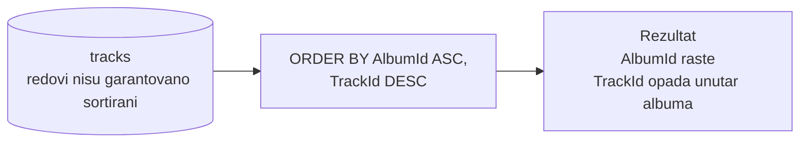

# 04 — Sortiranje rezultata pomoću `ORDER BY`

## Cilj lekcije

U ovoj lekciji naučićeš kako da sortiraš redove koje vraća `SELECT` upit. U Chinook bazi koristićemo kolone `AlbumId`, `TrackId` i `Milliseconds` iz tabele `tracks`.

Prethodna lekcija: [Čitanje određenih kolona iz tabele](03_querying_data_from_specific_columns_in_a_table.md).

## Zašto je potreban `ORDER BY`

Relacione tabele ne garantuju redosled redova. To što je red dodat ranije ili što se često pojavljuje na vrhu rezultata ne znači da će se uvek prikazati na tom mestu. Bez `ORDER BY` ne treba se oslanjati na redosled rezultata.

`ORDER BY` sortira rezultat tekućeg upita. Ne menja tabelu niti trajno premešta redove u bazi.

## Osnovni oblik

`ORDER BY` navodi se posle izvora podataka (`FROM`) i pre završne tačke-zareza:

```sql
SELECT kolone
FROM tabela
ORDER BY kolona;
```

Primer sortiranja numera prema identifikatoru albuma:

```sql
SELECT TrackId, Name, Milliseconds, AlbumId
FROM tracks
ORDER BY AlbumId;
```

Pošto ovaj upit nema `WHERE` ni `LIMIT`, on i dalje vraća sve redove iz `tracks`, ali ih prikazuje u redosledu `AlbumId`.

## Rastući i opadajući redosled

Za svaki kriterijum sortiranja možeš navesti:

- `ASC` — rastući redosled;
- `DESC` — opadajući redosled.

U SQLite-u je `ASC` podrazumevani smer, pa su ova dva upita ekvivalentna:

```sql
SELECT TrackId, AlbumId
FROM tracks
ORDER BY AlbumId;
```

```sql
SELECT TrackId, AlbumId
FROM tracks
ORDER BY AlbumId ASC;
```

Za obrnuti smer koristi se `DESC` — ne `DSC`:

```sql
SELECT TrackId, AlbumId
FROM tracks
ORDER BY AlbumId DESC;
```

Kod brojeva, rastući redosled ide od manjeg ka većem, a opadajući od većeg ka manjem. Kod teksta, redosled zavisi od kolacije koja se koristi; ne mora uvek odgovarati pravilima sortiranja srpskog rečnika.

## Sortiranje po više kolona

Možeš navesti više kriterijuma, odvojenih zarezima. Baza prvo sortira po prvom kriterijumu. Kada više redova ima istu vrednost u prvoj koloni, koristi sledeći kriterijum za njihov međusobni redosled.

```sql
SELECT TrackId, AlbumId, Name, Milliseconds
FROM tracks
ORDER BY AlbumId ASC, TrackId DESC
LIMIT 8;
```

U ovom primeru albumi idu po rastućem `AlbumId`. Numere unutar istog albuma idu po opadajućem `TrackId`.

| TrackId | AlbumId | Name                     | Milliseconds |
| ------: | ------: | ------------------------ | -----------: |
|      14 |       1 | Spellbound               |       270863 |
|      13 |       1 | Night Of The Long Knives |       205688 |
|      12 |       1 | Breaking The Rules       |       263288 |
|      11 |       1 | C.O.D.                   |       199836 |
|      10 |       1 | Evil Walks               |       263497 |
|       9 |       1 | Snowballed               |       203102 |
|       8 |       1 | Inject The Venom         |       210834 |
|       7 |       1 | Let's Get It Up          |       233926 |

`LIMIT 8` ovde ograničava broj vraćenih redova radi lakšeg pregleda. Bez njega bi upit vratio sve numere, ali sortirane po istim pravilima.



Smer možeš navesti za svaki kriterijum posebno. Na primer:

```sql
ORDER BY AlbumId DESC, Name ASC
```

To znači da albumi idu po opadajućem `AlbumId`, a nazivi numera unutar istog albuma po rastućem redosledu.

## Sortiraj po koloni koja nije prikazana

Kolona za sortiranje ne mora obavezno da bude u rezultatu. Na primer, sledeći upit prikaže samo naziv i album, ali sortira po dužini numere:

```sql
SELECT Name, AlbumId
FROM tracks
ORDER BY Milliseconds ASC
LIMIT 5;
```

`Milliseconds` utiče na redosled, ali nije prikazana kao kolona u rezultatu.

## Jednakosti i stabilan redosled

Ako više redova ima istu vrednost za kolonu sortiranja, njihov međusobni redosled nije garantovan osim ako navedeš dodatni kriterijum. U prethodnom primeru, album sadrži više numera sa istim `AlbumId`, pa `TrackId` služi kao dodatni kriterijum.

Za stabilno sortiranje dodaj kriterijume dok kombinacija ne odredi jedinstven redosled. Često se koristi primarni ključ kao poslednji kriterijum:

```sql
SELECT TrackId, Name, Milliseconds
FROM tracks
ORDER BY Milliseconds DESC, TrackId ASC
LIMIT 10;
```

Ovde se najduže numere prikazuju prve, a ako je trajanje isto, prvo ide manji `TrackId`. Ovo je važno za predvidive rezultate, naročito ako ćeš kasnije dodati straničenje pomoću `LIMIT` i `OFFSET`.

## Redosled klauzula

Kada kombinuješ `WHERE`, `ORDER BY` i `LIMIT`, pišu se ovim redosledom:

```sql
SELECT kolone
FROM tabela
WHERE uslov
ORDER BY kolona ASC
LIMIT broj_redova;
```

`WHERE` bira redove, `ORDER BY` ih sortira, a `LIMIT` ograničava broj vraćenih redova. Redosled pisanja klauzula je deo SQL sintakse.

## Veza sa SQLAlchemy 2.0 i FastAPI-jem

U SQLAlchemy 2.0 smer sortiranja možeš navesti metodama `.asc()` i `.desc()`:

```python
from sqlalchemy import select

statement = (
    select(Track.name, Track.milliseconds)
    .order_by(Track.milliseconds.desc(), Track.track_id.asc())
)
```

Ovaj primer pretpostavlja da ORM model `Track` ima navedene atribute. `ORDER BY` se izvršava u okviru upita ka bazi, pa API može da dobije rezultate u predvidivom redosledu. Ako se uz rezultat koristi `LIMIT` ili straničenje, dodaj stabilan dodatni kriterijum, kao što je jedinstveni `TrackId`.

## Česte greške

- **Očekuješ redosled bez `ORDER BY`:** SQL ne garantuje željeni redosled redova.
- **Pišeš `DSC`:** ispravna ključna reč za opadajući redosled je `DESC`.
- **Mešaš sortiranje i filtriranje:** `ORDER BY` menja redosled, a `WHERE` bira redove.
- **Zaboravljaš da je `ASC` podrazumevan:** `ORDER BY AlbumId` znači isto što i `ORDER BY AlbumId ASC`.
- **Ne rešavaš jednake vrednosti:** dodaj drugi kriterijum ako želiš predvidiv redosled među izjednačenim redovima.
- **Stavljaš `LIMIT` pre `ORDER BY`:** `ORDER BY` ide pre `LIMIT`.

## Provera razumevanja

1. Da li tabela garantuje redosled kojim su redovi ubačeni?
2. Koji je podrazumevani smer u SQLite-u ako ne napišeš ni `ASC` ni `DESC`?
3. Šta znači `ORDER BY AlbumId ASC, TrackId DESC`?
4. Da li kolona iz `ORDER BY` mora biti prikazana u `SELECT` listi?
5. Zašto dodati jedinstveni ključ kao poslednji kriterijum sortiranja?
6. Da li `ORDER BY` trajno menja raspored redova u tabeli?

## Vežbe

### Vežba 1 — Rastući redosled

1. Izaberi `TrackId`, `Name` i `AlbumId` iz tabele `tracks`.
2. Sortiraj rezultat po `AlbumId` rastuće.
3. Ponovi upit bez reči `ASC` i proveri da li rezultat ima isti smer.

### Vežba 2 — Opadajući redosled

1. Izaberi `TrackId`, `Name` i `Milliseconds`.
2. Sortiraj numere od najduže ka najkraćoj koristeći `DESC`.
3. Dodaj `LIMIT 10` da prikažeš samo prvih deset.

### Vežba 3 — Sortiraj po više kolona

Napiši upit koji:

1. prikaže `TrackId`, `AlbumId`, `Name` i `Milliseconds`;
2. sortira po `AlbumId` rastuće;
3. unutar istog albuma sortira po `TrackId` opadajuće;
4. ograniči prikaz na osam redova.

Uporedi rezultat sa primerom iz lekcije.

### Vežba 4 — Sortiraj po neprikazanoj koloni

Prikaži `Name` i `AlbumId`, ali sortiraj po `Milliseconds` rastuće. Ograniči rezultat na pet redova i objasni zašto se dužina numere ne pojavljuje u rezultatu.

### Vežba 5 — Osiguraj stabilan redosled

Napiši upit koji prikazuje deset najdužih numera. Ako dve numere imaju isto trajanje, sortiraj ih po `TrackId` rastuće. Objasni zašto je drugi kriterijum koristan.
