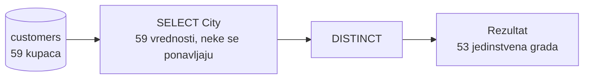

# 05 — Uklanjanje ponovljenih vrednosti iz rezultata pomoću `DISTINCT`

## Cilj lekcije

U ovoj lekciji naučićeš kako `DISTINCT` uklanja ponovljene redove iz rezultata upita. Primeri koriste tabelu `customers` iz Chinook baze i pokazuju razliku između jedinstvenih vrednosti jedne kolone i jedinstvenih kombinacija više kolona.

Prethodna lekcija: [Sortiranje rezultata pomoću `ORDER BY`](04_sorting_data_using_order_by_clause.md).

## Zašto koristiti `DISTINCT`

Kada izabereš jednu kolonu iz tabele, ista vrednost može da se pojavi u mnogo redova. U Chinook tabeli `customers` postoji 59 kupaca, a neki od njih žive u istom gradu. Ako želiš spisak gradova, ponovljeni nazivi gradova obično nisu potrebni.

Bez `DISTINCT`, upit vraća vrednost grada za svakog kupca:

```sql
SELECT City
FROM customers;
```

Sa `DISTINCT` dobijaš samo jedinstvene vrednosti izabrane kolone:

```sql
SELECT DISTINCT City
FROM customers;
```

`DISTINCT` piše se odmah posle `SELECT`, pre liste kolona. U trenutnoj Chinook bazi prethodni upit vraća 53 različite vrednosti grada umesto 59 redova.



Ako želiš rezultat po abecedi, kombinuješ `DISTINCT` sa `ORDER BY`:

```sql
SELECT DISTINCT City
FROM customers
ORDER BY City;
```

`DISTINCT` uklanja ponavljanja, a `ORDER BY` određuje redosled prikaza. Bez `ORDER BY` ne treba se oslanjati na redosled rezultata.

## Šta se smatra ponovljenim redom

Kada je izabrana jedna kolona, ponovljene vrednosti te kolone se pojavljuju samo jednom. Na primer, Chinook podaci sadrže više kupaca iz sledećih gradova:

| City   | Broj redova kupaca | Koliko puta se pojavljuje uz `DISTINCT City` |
| ------ | -----------------: | -------------------------------------------: |
| Berlin |                  2 |                                            1 |
| London |                  2 |                                            1 |
| Paris  |                  2 |                                            1 |
| Prague |                  2 |                                            1 |

Ovo ne znači da su ti redovi kupaca duplikati. Kupci su različiti; samo dele istu vrednost u koloni `City`.

## `DISTINCT` sa više kolona

Kada navedeš više kolona, `DISTINCT` proverava kombinaciju vrednosti u svim izabranim kolonama:

```sql
SELECT DISTINCT Country, City
FROM customers
ORDER BY Country, City;
```

Dva reda su duplikati za ovaj rezultat samo ako se vrednosti poklapaju i u `Country` i u `City`. Ako se država razlikuje, par je različit čak i kada bi naziv grada bio isti.

U Chinook bazi:

| Upit                                           | Šta čini vrednost jedinstvenom | Broj redova |
| ---------------------------------------------- | ------------------------------ | ----------: |
| `SELECT DISTINCT Country FROM customers`       | Država                         |          24 |
| `SELECT DISTINCT Country, City FROM customers` | Kombinacija države i grada     |          53 |

Zato drugi upit nije način da dobiješ samo jedinstvene države. On vraća jedinstvene **parove** država–grad.

## `DISTINCT` ne menja podatke u tabeli

`DISTINCT` utiče samo na rezultat upita. Ne briše redove, ne menja tabelu i ne spaja kupce koji imaju istu vrednost u `City`.

| Operacija                  | Menja rezultat upita?                  | Menja redove u tabeli?    |
| -------------------------- | -------------------------------------- | ------------------------- |
| `SELECT DISTINCT City ...` | Da, uklanja ponovljene vrednosti grada | Ne                        |
| `DELETE ...`               | Nije operacija za čitanje rezultata    | Da, briše izabrane redove |

Nemoj koristiti `DISTINCT` kao zamenu za brisanje neželjenih podataka. Ako tabela sadrži podatke koje treba ispraviti ili obrisati, to je zasebna operacija i zahteva pažljivu proveru.

Takođe, ako izabereš sve kolone, ponovljena vrednost u jednoj koloni nije dovoljna da bi ceo red bio duplikat. U tabeli `customers`, `CustomerId` je jedinstven, pa bi `SELECT DISTINCT * FROM customers;` i dalje vratio svakog kupca.

## Vrednosti `NULL`

Ako izabrana kolona sadrži više vrednosti `NULL`, SQLite ih pri primeni `DISTINCT` tretira kao ponovljene vrednosti i u rezultatu prikaže jednu `NULL` vrednost. U Chinook tabeli `customers` trenutno nema `NULL` vrednosti u `City`.

`NULL` nije isto što i prazan tekst. Detaljnije ćeš ga obrađivati u lekciji [Identifikovanje NULL vrednosti](07_identifying_null_values.md).

### Ivični slučajevi: kolacija, `NULL` i prazan tekst

`DISTINCT` koristi pravila poređenja (kolaciju) izraza. Sa podrazumevanom `BINARY` kolacijom, `Paris` i `PARIS` su različite tekstualne vrednosti. Ako izabrani izraz koristi ugrađenu `NOCASE` kolaciju, ASCII velika i mala slova se pri poređenju ne razlikuju. Ugrađeni `NOCASE` nije lokalizovano poređenje srpskog teksta niti puna Unicode provera jednakosti bez obzira na veličinu slova.

Više `NULL` vrednosti se u rezultatu `SELECT DISTINCT` svodi na jednu vrednost. Prazan tekst `''`, međutim, ostaje posebna vrednost i nije jednak `NULL`. Ispod je samostalna proba koja ne menja Chinook bazu:

```sql
WITH sample(city) AS (
    VALUES ('Paris'), ('PARIS'), ('Paris'), (NULL), (NULL), ('')
)
SELECT DISTINCT city
FROM sample
ORDER BY city;
```

Prvi upit zadržava jedan `NULL`, jedan prazan tekst i po jedan zapis za `Paris` i `PARIS`. Ako promeniš izraz u `city COLLATE NOCASE`, `Paris` i `PARIS` se svode na jednu vrednost:

```sql
WITH sample(city) AS (
    VALUES ('Paris'), ('PARIS'), ('Paris'), (NULL), (NULL), ('')
)
SELECT DISTINCT city COLLATE NOCASE AS city
FROM sample
ORDER BY city COLLATE NOCASE;
```

Ovo i dalje menja samo rezultat upita. Ne dodaje `UNIQUE` ograničenje i ne uklanja slične vrednosti iz stvarne tabele.

## Veza sa SQLAlchemy 2.0 i FastAPI-jem

U SQLAlchemy 2.0 možeš da zatražiš jedinstvene vrednosti grada ovako:

```python
from sqlalchemy import select

statement = (
    select(Customer.city)
    .distinct()
    .order_by(Customer.city)
)
```

Primer pretpostavlja da ORM model `Customer` ima atribut `city`. Naziv Python atributa može se razlikovati od naziva kolone u bazi.

Takav upit je koristan, na primer, kada API treba da ponudi listu gradova za izbor. Pažljivo odredi koje kolone uključuješ: `select(Customer.country, Customer.city).distinct()` daje jedinstvene parove država i gradova, a ne samo jedinstvene države.

## Provera razumevanja

1. Šta radi `DISTINCT` u upitu za `City`?
2. Zašto Chinook upit bez `DISTINCT` može da vrati više od jednog reda za London?
3. Da li `SELECT DISTINCT Country, City` pravi jedinstvene gradove ili jedinstvene parove država–grad?
4. Da li `DISTINCT` briše ponovljene redove iz tabele?
5. Zašto `SELECT DISTINCT * FROM customers` i dalje vraća sve kupce?
6. Da li `DISTINCT` određuje redosled redova?
7. Zašto `NULL` i `''` nisu ista vrednost u rezultatu `DISTINCT`?

## Vežbe

### Vežba 1 — Spisak gradova

1. Izvrši `SELECT City FROM customers;`.
2. Zatim izvrši `SELECT DISTINCT City FROM customers;`.
3. Uporedi broj redova i objasni zašto se razlikuje.
4. Dodaj `ORDER BY City` i proveri kako se menja redosled prikaza.

### Vežba 2 — Spisak država

1. Napiši upit koji vraća jedinstvene države iz `customers`.
2. Dodaj `ORDER BY` da bi rezultat bio pregledan.
3. Prebroj vraćene države i uporedi sa brojem u tabeli iz lekcije.

### Vežba 3 — Jedinstveni parovi

1. Napiši upit koji vraća jedinstvene kombinacije `Country` i `City`.
2. Sortiraj prvo po `Country`, pa po `City`.
3. Objasni zašto ovaj rezultat ima više redova nego spisak jedinstvenih država.

### Vežba 4 — Predvidi rezultat

Bez pokretanja upita, predvidi da li će sledeći redovi rezultata biti isti ili različiti, pa zatim proveri odgovor u SQLite-u:

| Country | City           |
| ------- | -------------- |
| Brazil  | São Paulo      |
| Brazil  | São Paulo      |
| Brazil  | Rio de Janeiro |

Objasni koje redove bi `SELECT DISTINCT Country, City` zadržao i zašto.

### Vežba 5 — Razlikuj rezultat od tabele

Izvrši:

```sql
SELECT DISTINCT City
FROM customers
ORDER BY City;
```

Zatim ponovo prikaži `City` iz tabele bez `DISTINCT`. Objasni zašto su ponovljene vrednosti i dalje prisutne u tabeli.
