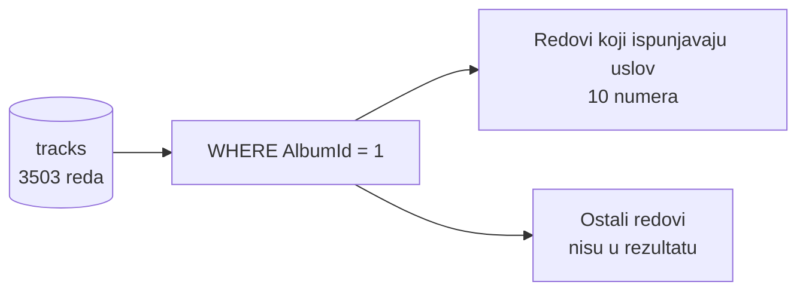

# 06 — Filtriranje redova pomoću `WHERE`

## Cilj lekcije

U ovoj lekciji naučićeš kako da pomoću `WHERE` uslova izabereš samo redove koji ispunjavaju određeni kriterijum. Koristićemo tabelu `tracks` iz Chinook baze i filtrirati numere prema albumu, trajanju i ceni.

Prethodna lekcija: [Uklanjanje ponovljenih vrednosti pomoću `DISTINCT`](05_removing_duplicate_records_using_distinct_clause.md).

## Čemu služi `WHERE`

Bez `WHERE` upit obuhvata sve redove izvora navedenog u `FROM`, osim ako neka druga klauzula ne ograniči rezultat. `WHERE` zadržava samo one redove čiji uslov je istinit.

```sql
SELECT kolone
FROM tabela
WHERE uslov;
```

U transkriptu se iz tabele `tracks` biraju numere koje pripadaju albumu sa `AlbumId` vrednošću `1`:

```sql
SELECT Name, Composer, AlbumId
FROM tracks
WHERE AlbumId = 1;
```

U Chinook bazi `tracks` ima 3.503 reda, a ovaj uslov odgovara 10 redova. Uslov bira redove; lista posle `SELECT` i dalje određuje koje će se kolone prikazati.

| Deo upita | Šta radi |
| --- | --- |
| `SELECT Name, Composer, AlbumId` | Bira kolone u rezultatu |
| `FROM tracks` | Određuje izvor redova |
| `WHERE AlbumId = 1` | Zadržava samo redove kojima je `AlbumId` jednak `1` |



Radi preglednosti, možeš sortirati izabrane redove i ograničiti prikaz:

```sql
SELECT TrackId, Name, Composer, AlbumId
FROM tracks
WHERE AlbumId = 1
ORDER BY TrackId
LIMIT 4;
```

Očekivani rezultat:

| TrackId | Name | Composer | AlbumId |
| ---: | --- | --- | ---: |
| 1 | For Those About To Rock (We Salute You) | Angus Young, Malcolm Young, Brian Johnson | 1 |
| 6 | Put The Finger On You | Angus Young, Malcolm Young, Brian Johnson | 1 |
| 7 | Let's Get It Up | Angus Young, Malcolm Young, Brian Johnson | 1 |
| 8 | Inject The Venom | Angus Young, Malcolm Young, Brian Johnson | 1 |

Ovaj primer prikazuje četiri od deset numera: `ORDER BY` određuje redosled, a `LIMIT 4` ograničava broj vraćenih redova.

## Poređenja u uslovu

Uslov može porediti kolonu sa brojem, tekstualnom vrednošću ili drugom vrednošću:

| Operator | Značenje | Primer |
| --- | --- | --- |
| `=` | Jednako | `AlbumId = 1` |
| `<>` | Nije jednako | `AlbumId <> 1` |
| `!=` | Nije jednako; SQLite ga takođe podržava | `AlbumId != 1` |
| `>` | Veće od | `Milliseconds > 300000` |
| `>=` | Veće ili jednako | `UnitPrice >= 1.00` |
| `<` | Manje od | `Milliseconds < 60000` |
| `<=` | Manje ili jednako | `UnitPrice <= 0.99` |

U SQL-u se za poređenje jednakosti koristi jedan znak `=`, a ne `==`. Tekstualne vrednosti pišu se u jednostrukim navodnicima:

```sql
SELECT FirstName, LastName, Country
FROM customers
WHERE Country = 'Brazil'
ORDER BY LastName;
```

Brojeve piši bez navodnika kada želiš da ih porediš kao brojeve:

```sql
SELECT Name, UnitPrice
FROM tracks
WHERE UnitPrice > 0.99
ORDER BY UnitPrice DESC
LIMIT 5;
```

## Kombinovanje uslova

Pomoću `AND` zahtevaš da svi povezani uslovi budu istiniti. Pomoću `OR` dovoljan je makar jedan istinit uslov:

```sql
SELECT TrackId, Name, AlbumId, Milliseconds
FROM tracks
WHERE AlbumId = 1
  AND Milliseconds > 240000;
```

Ovaj upit bira samo numere koje istovremeno pripadaju albumu 1 i traju duže od 240.000 milisekundi.

```sql
SELECT TrackId, Name, AlbumId
FROM tracks
WHERE AlbumId = 1
   OR AlbumId = 2;
```

Možeš kombinovati `AND` i `OR`, ali koristi zagrade da bi namera bila jasna:

```sql
SELECT TrackId, Name, AlbumId, Milliseconds
FROM tracks
WHERE (AlbumId = 1 OR AlbumId = 2)
  AND Milliseconds > 240000;
```

Zagrade određuju kako se grupišu uslovi. Bez zagrada `AND` ima jači prioritet od `OR`, što može dovesti do rezultata koji nisi očekivao.

Na primer:

```sql
WHERE AlbumId = 1 OR AlbumId = 2 AND Milliseconds > 240000
```

SQLite ovo tumači kao `AlbumId = 1 OR (AlbumId = 2 AND Milliseconds > 240000)`, a ne kao `(AlbumId = 1 OR AlbumId = 2) AND Milliseconds > 240000`. Ako je dužina uslov za oba albuma, zagrade su neophodne.

## Tekstualni obrasci: `LIKE` nije `GLOB`

Za tačno poređenje teksta koristi `=`, na primer `Country = 'Brazil'`. Za tekstualni obrazac možeš koristiti `LIKE`: `%` odgovara nula ili više znakova, a `_` odgovara tačno jednom znaku:

```sql
SELECT CustomerId, FirstName, LastName
FROM customers
WHERE FirstName LIKE 'A%'
ORDER BY LastName, CustomerId;
```

Ugrađeni SQLite `LIKE` podrazumevano zanemaruje razliku velikih i malih ASCII slova, ali ne pruža potpuno lokalizovano poređenje Unicode teksta. `LIKE` obrasci nisu `GLOB` obrasci: `GLOB` koristi `*` i `?` i podrazumevano je osetljiv na velika i mala slova.

## Filtriranje po `NULL`

`NULL` označava vrednost koja nedostaje ili nije poznata. Nemoj proveravati takvu vrednost pomoću `= NULL` ili `<> NULL`; poređenje sa `NULL` ne daje običan rezultat „tačno“ ili „netačno“.

Koristi `IS NULL` ili `IS NOT NULL`:

```sql
SELECT TrackId, Name
FROM tracks
WHERE Composer IS NULL;
```

```sql
SELECT TrackId, Name, Composer
FROM tracks
WHERE Composer IS NOT NULL;
```

Tabeli `tracks` nedostaju vrednosti u koloni `Composer`. Više o tome zašto `NULL` zahteva posebnu proveru nalazi se u lekciji [Identifikovanje NULL vrednosti](07_identifying_null_values.md).

SQL logika zato ima i treću mogućnost pored `TRUE` i `FALSE`: `UNKNOWN`. `WHERE` zadržava samo redove za koje je uslov `TRUE`; i `FALSE` i `UNKNOWN` se izostavljaju. Na primer, `Composer <> 'neki kompozitor'` ne uključuje redove u kojima je `Composer` `NULL`, jer poređenje nije `TRUE`. Isto važi za `NOT (Composer = 'neki kompozitor')`.

Prazan tekst i `NULL` takođe zahtevaju različite uslove:

```sql
WHERE Company IS NULL
```

pronalazi nepoznatu/nedostajuću vrednost, dok:

```sql
WHERE Company = ''
```

traži poznatu tekstualnu vrednost dužine nula. Ne zamenjuj jedno drugim.

## Gde se `WHERE` nalazi u upitu

Kada koristiš sortiranje i ograničenje rezultata, klauzule pišeš ovim redosledom:

```sql
SELECT kolone
FROM tabela
WHERE uslov
ORDER BY kolona
LIMIT broj_redova;
```

`WHERE` određuje koji redovi ulaze u rezultat, `ORDER BY` određuje njihov redosled, a `LIMIT` ograničava broj vraćenih redova. SQLite može da izabere interni plan izvršavanja koji je drugačiji od ovog konceptualnog redosleda; poenta je u značenju upita, ne u tvrdnji o tačnom redosledu internih koraka.

## Veza sa SQLAlchemy 2.0 i FastAPI-jem

U SQLAlchemy 2.0 uslov se dodaje pomoću `.where()`:

```python
from sqlalchemy import select

album_id = 1

statement = (
    select(Track.name, Track.composer, Track.album_id)
    .where(Track.album_id == album_id)
)
```

Primer pretpostavlja da ORM model `Track` ima navedene Python atribute. U Python izrazu se piše `==`; SQLAlchemy ga pretvara u SQL poređenje `=`.

Vrednosti koje dolaze od korisnika treba proslediti kroz SQLAlchemy izraze ili vezane parametre, a ne spajati ih direktno u SQL tekst. Tako upit zadržava svoju strukturu, a vrednost filtera tretira se kao podatak. Ovo je važno za ispravnost i bezbednost FastAPI endpointa.

## Česte greške

- **Izostaviš `WHERE`:** upit može vratiti sve redove iz tabele.
- **Koristiš `==` u SQL-u:** u SQL-u za jednakost piše se `=`.
- **Navodnike stavljaš oko broja:** `AlbumId = 1` je poređenje sa brojem.
- **Tekst ne staviš u jednostruke navodnike:** primer je `Country = 'Brazil'`.
- **Koristiš `= NULL`:** za nepoznatu vrednost koristi `IS NULL` ili `IS NOT NULL`.
- **Zaboraviš zagrade uz `AND` i `OR`:** grupiši uslove kada želiš da se prvo proceni određena kombinacija.
- **Mešaš filtriranje sa sortiranjem:** `WHERE` bira redove, `ORDER BY` ih raspoređuje.

## Provera razumevanja

1. Koji deo upita bira kolone, a koji izdvaja redove prema uslovu?
2. Koliko redova iz tabele `tracks` odgovara uslovu `AlbumId = 1`?
3. Koji operator znači „nije jednako“?
4. Kako se povezuju uslovi kada oba moraju biti tačna?
5. Zašto se uslovi sa `AND` i `OR` često grupišu zagradama?
6. Kako se pravilno proverava da li je `Composer` nepoznat?
7. Da li `WHERE` menja ili briše podatke u tabeli?
8. Zašto `Composer <> 'X'` ne uključuje redove sa `Composer IS NULL`?
9. Koji su džokeri za `LIKE`, a koji za `GLOB`?

## Vežbe

### Vežba 1 — Filtriraj po albumu

Napiši upit koji prikazuje `Name`, `Composer` i `AlbumId` samo za numere sa `AlbumId = 1`.

1. Koliko redova vraća upit?
2. Dodaj `ORDER BY TrackId` i `LIMIT 4`.
3. Objasni razliku između broja odgovarajućih redova i broja prikazanih redova.

### Vežba 2 — Filtriraj po poređenju

1. Prikaži `Name` i `Milliseconds` za numere duže od 300.000 milisekundi.
2. Sortiraj od najduže ka najkraćoj.
3. Ograniči rezultat na pet redova.

### Vežba 3 — Filtriraj tekst

Prikaži imena i prezimena kupaca iz Brazila. Sortiraj ih po prezimenu i dodaj limit od pet redova.

### Vežba 4 — Kombinuj uslove

Napiši upit koji bira numere sa `AlbumId` 1 ili 2, ali samo ako traju duže od 240.000 milisekundi. Koristi zagrade da bi `OR` uslovi bili jasno grupisani.

### Vežba 5 — Pronađi nepoznate vrednosti

Prikaži identifikator i naziv numere za koju `Composer` nema vrednost. Zatim napiši drugi upit koji prikazuje samo numere sa poznatim kompozitorom.
