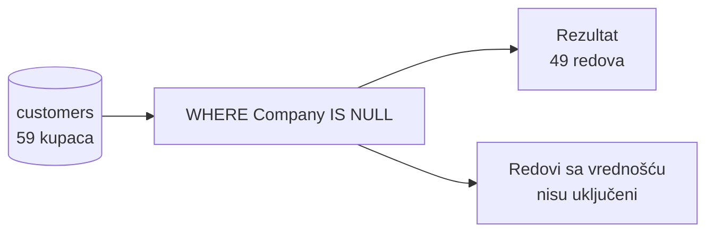

# 07 — Prepoznavanje `NULL` vrednosti

## Cilj lekcije

U ovoj lekciji naučićeš kako da pronađeš redove u kojima vrednost nedostaje, koristeći `IS NULL` i `IS NOT NULL`. Primeri koriste kolonu `Company` iz Chinook tabele `customers`.

Prethodna lekcija: [Filtriranje redova pomoću `WHERE`](06_filtering_data_with_where_clause.md).

## Šta znači `NULL`

`NULL` predstavlja nedostajuću ili nepoznatu vrednost u bazi. Može da znači da podatak nije unet, da nije poznat ili da nije primenljiv. Značenje zavisi od kolone i pravila aplikacije.

`NULL` nije isto što i:

| Vrednost | Primer značenja                       |
| -------- | ------------------------------------- |
| `0`      | Poznata numerička vrednost nula       |
| `''`     | Poznat tekst koji sadrži nula znakova |
| `'NULL'` | Običan tekst sa slovima N-U-L-L       |
| `NULL`   | Nedostajuća ili nepoznata vrednost    |

Na primer, prazan telefonski broj kao tekst i nepoznat telefonski broj nisu nužno isto. Aplikacija treba da odluči šta pojedina vrednost znači.

## Provera pomoću `IS NULL`

Za redove u kojima vrednost nedostaje koristi se `IS NULL`:

```sql
SELECT Company
FROM customers
WHERE Company IS NULL;
```

U Chinook bazi ukupno ima 59 kupaca, a vrednost `Company` je `NULL` kod 49 njih. Da bi bilo lakše videti o kojim kupcima je reč, izaberi i njihov identifikator i ime:

```sql
SELECT CustomerId, FirstName, LastName, Company
FROM customers
WHERE Company IS NULL
ORDER BY CustomerId
LIMIT 5;
```

Primer rezultata:

| CustomerId | FirstName | LastName | Company |
| ---------: | --------- | -------- | ------- |
|          2 | Leonie    | Köhler   | `NULL`  |
|          3 | François  | Tremblay | `NULL`  |
|          4 | Bjørn     | Hansen   | `NULL`  |
|          6 | Helena    | Holý     | `NULL`  |
|          7 | Astrid    | Gruber   | `NULL`  |

SQLite CLI i pojedini alati mogu prikazati `NULL` kao prazno polje u rezultatu. Zato pogled na praznu ćeliju nije uvek dovoljan da utvrdiš da li je vrednost `NULL` ili prazan tekst.



## Provera pomoću `IS NOT NULL`

Za redove koji imaju vrednost koristi se `IS NOT NULL`:

```sql
SELECT CustomerId, FirstName, LastName, Company
FROM customers
WHERE Company IS NOT NULL
ORDER BY CustomerId;
```

U ovoj bazi upit vraća 10 kupaca. `IS NOT NULL` znači da vrednost nije `NULL`; sam po sebi ne proverava da li je tekstualna vrednost prazan tekst. U Chinook koloni `Company` trenutno nema praznih tekstualnih vrednosti, ali u drugoj bazi bi moglo da ih bude.

Ako želiš posebno da tražiš prazan tekst, uslov je drugačiji:

```sql
WHERE Company = ''
```

Uslov za prazan tekst vraća vrednosti koje su poznati tekstualni nizovi dužine nula, ne `NULL` vrednosti.

## Zašto se ne piše `= NULL`

U SQL-u `NULL` ne možeš testirati običnim poređenjem:

```sql
WHERE Company = NULL
```

Ovaj uslov nije pravilan način da pronađeš nedostajuće vrednosti. Poređenje sa `NULL` daje nepoznat rezultat, a `WHERE` zadržava samo redove čiji uslov je istinit.

Umesto toga koristi:

```sql
WHERE Company IS NULL
```

ili:

```sql
WHERE Company IS NOT NULL
```

Ovo važi i za operator „nije jednako“: `Company <> NULL` ne pronalazi redove koji imaju vrednost. Koristi `IS NOT NULL`.

## `NULL` u drugim izrazima

Nepoznata vrednost se prenosi kroz mnoge izračune i poređenja. Na primer, ako je `Company` `NULL`, izraz `Company = 'Acme'` ne postaje ni tačan ni netačan — rezultat je nepoznat. Takav red neće proći `WHERE Company = 'Acme'`.

Zato treba pažljivo birati uslov:

| Šta tražiš                                | Uslov                          |
| ----------------------------------------- | ------------------------------ |
| Nedostajuću vrednost                      | `Company IS NULL`              |
| Vrednost koja nije `NULL`                 | `Company IS NOT NULL`          |
| Prazan tekst                              | `Company = ''`                 |
| Vrednost koja se tačno poklapa sa tekstom | `Company = 'JetBrains s.r.o.'` |

## Veza sa SQLAlchemy 2.0 i FastAPI-jem

U SQLAlchemy 2.0 možeš da filtriraš ORM model po `NULL` vrednosti ovako:

```python
from sqlalchemy import select

statement = select(Customer).where(Customer.company.is_(None))
```

Za postojeću vrednost koristi `.is_not(None)`:

```python
statement = select(Customer).where(Customer.company.is_not(None))
```

Primeri pretpostavljaju da ORM model `Customer` ima atribut `company`. U Python-u se koristi `None`; SQLAlchemy generiše odgovarajući SQL uslov `IS NULL` ili `IS NOT NULL`.

Kada podatak iz baze postane Python `None`, FastAPI odgovor može ga prikazati kao JSON `null` u zavisnosti od šeme odgovora i serijalizacije. Nemoj automatski menjati `None` u prazan tekst ili nulu ako te vrednosti imaju drugačije značenje u aplikaciji.

## Česte greške

- **Pišeš `Company = NULL`:** koristi `Company IS NULL`.
- **Pišeš `Company <> NULL`:** koristi `Company IS NOT NULL`.
- **Mešaš `NULL` i prazan tekst:** `''` je poznata tekstualna vrednost, `NULL` označava da vrednost nedostaje ili nije poznata.
- **Tumačiš praznu ćeliju u alatu kao dokaz da je vrednost `NULL`:** proveri je upitom `IS NULL`.
- **Pretpostaviš da `IS NOT NULL` znači da tekst ima sadržaj:** taj uslov isključuje samo `NULL`; ne isključuje prazan tekst.

## Provera razumevanja

1. Šta predstavlja `NULL`?
2. Koji uslov pronalazi kupce bez vrednosti u `Company`?
3. Koji je operator suprotan od `IS NULL`?
4. Da li `IS NOT NULL` automatski odbacuje prazan tekst?
5. Zašto `Company = NULL` nije odgovarajući uslov?
6. Koja je razlika između `None` u Python-u i SQL uslova `IS NULL`?

## Vežbe

### Vežba 1 — Pronađi kupce bez kompanije

1. Prikaži `CustomerId`, `FirstName`, `LastName` i `Company` za redove u kojima je `Company` `NULL`.
2. Sortiraj po `CustomerId`.
3. Prebroj vraćene redove i uporedi sa brojem iz lekcije.

### Vežba 2 — Pronađi kupce sa kompanijom

1. Napiši upit koji prikazuje iste kolone za redove gde `Company IS NOT NULL`.
2. Prebroj rezultate.
3. Objasni zašto ovaj broj nije isti kao broj redova iz Vežbe 1.

### Vežba 3 — Uporedi `NULL` sa praznim tekstom

Izvrši oba uslova odvojeno:

```sql
SELECT CustomerId, Company
FROM customers
WHERE Company IS NULL;
```

```sql
SELECT CustomerId, Company
FROM customers
WHERE Company = '';
```

Uporedi rezultate i objasni zašto uslovi traže različite vrednosti.

### Vežba 4 — Primeni na `Composer`

1. Pronađi numere čiji je `Composer` `NULL`.
2. Napiši drugi upit za numere sa `Composer IS NOT NULL`.
3. U oba upita prikaži `TrackId`, `Name` i `Composer`.
