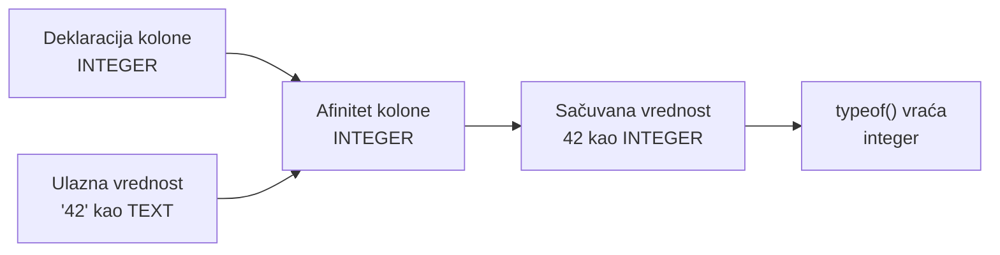

# 08 — Tipovi podataka i klase skladištenja u SQLite-u

## Cilj lekcije

U ovoj lekciji upoznaćeš pet klasa skladištenja koje SQLite koristi za pojedinačne vrednosti. Naučićeš i zašto deklarisani tip kolone nije isto što i tip vrednosti koja je zaista sačuvana, kako radi afinitet kolone i šta menjaju `STRICT` tabele.

Prethodna lekcija: [Prepoznavanje `NULL` vrednosti](07_identifying_null_values.md).

## Pet klasa skladištenja

SQLite koristi pet klasa skladištenja za vrednosti:

| Klasa skladištenja | Značenje                                              | Primer vrednosti |
| ------------------ | ----------------------------------------------------- | ---------------- |
| `NULL`             | Nedostajuća ili nepoznata vrednost                    | `NULL`           |
| `INTEGER`          | Ceo broj u rasponu 64-bitnih celobrojnih vrednosti    | `100`, `-7`      |
| `REAL`             | Broj sa pokretnim zarezom, IEEE 754 64-bitna vrednost | `10.5`, `0.99`   |
| `TEXT`             | Tekstualni niz                                        | `'SQLite'`       |
| `BLOB`             | Binarni podaci, sačuvani kao bajtovi                  | `X'53514C'`      |

Ove klase opisuju kako je **vrednost** predstavljena u SQLite-u. `INTEGER` i `REAL` su numeričke vrednosti, dok je `TEXT` niz znakova. `BLOB` se koristi kada podatak treba čuvati kao bajtove bez pretvaranja u tekst.

## Provera klase pomoću `typeof()`

SQLite funkcija `typeof()` vraća klasu skladištenja izraza koji joj proslediš:

```sql
SELECT
    typeof(100) AS ceo_broj,
    typeof(10.5) AS real_broj,
    typeof('SQLite') AS tekst,
    typeof(X'53514C') AS blob,
    typeof(NULL) AS null_vrednost;
```

Očekivani rezultat:

| ceo_broj  | real_broj | tekst  | blob   | null_vrednost |
| --------- | --------- | ------ | ------ | ------------- |
| `integer` | `real`    | `text` | `blob` | `null`        |

`X'53514C'` je BLOB literal zapisan heksadecimalno. Bajtovi `53 51 4C` odgovaraju ASCII tekstu `SQL`, ali SQLite ih u ovom izrazu tretira kao binarne podatke.

`typeof()` proverava klasu konkretne vrednosti ili izraza. Ne vraća deklarisani tip kolone u `CREATE TABLE` naredbi.

U Chinook tabeli `tracks` možeš uporediti deklarisane tipove sa stvarnim klasama vrednosti:

```sql
PRAGMA table_info(tracks);

SELECT
    typeof(TrackId),
    typeof(Name),
    typeof(Milliseconds),
    typeof(UnitPrice)
FROM tracks
LIMIT 1;
```

| Kolona         | Deklarisani tip | Klasa vrednosti |
| -------------- | --------------- | --------------- |
| `TrackId`      | `INTEGER`       | `integer`       |
| `Name`         | `NVARCHAR(200)` | `text`          |
| `Milliseconds` | `INTEGER`       | `integer`       |
| `UnitPrice`    | `NUMERIC(10,2)` | `real`          |

## Deklarisani tip i afinitet kolone

U običnoj SQLite tabeli, deklarisani tip kolone prvenstveno određuje njen **afinitet** — preporučenu klasu vrednosti i pokušaje konverzije. Afinitet nije isto što i obavezno pravilo da svaka vrednost u toj koloni mora imati jednu jedinu klasu skladištenja.

| Deklaracija kolone sadrži          | Afinitet  | Primer deklaracije                            |
| ---------------------------------- | --------- | --------------------------------------------- |
| `INT`                              | `INTEGER` | `INTEGER`, `BIGINT`                           |
| `CHAR`, `CLOB` ili `TEXT`          | `TEXT`    | `TEXT`, `VARCHAR(50)`                         |
| `BLOB`, ili nema deklarisanog tipa | `BLOB`    | `BLOB`                                        |
| `REAL`, `FLOA` ili `DOUB`          | `REAL`    | `REAL`, `DOUBLE`                              |
| Nijedno od navedenog               | `NUMERIC` | `NUMERIC`, `DECIMAL(10,2)`, `DATE`, `BOOLEAN` |

Afinitet može da konvertuje vrednost ako je to moguće. Na primer, tekstualni zapis `'42'` u koloni sa `INTEGER` afinitetom može biti sačuvan kao broj `42`; vrednost koja ne može da se protumači kao broj može ostati `TEXT`.

Sledeći primer koristi privremenu tabelu, koja postoji samo u trenutnoj SQLite konekciji. `DROP TABLE IF EXISTS` omogućava da primer bezbedno ponovo pokreneš u istoj konekciji:

```sql
DROP TABLE IF EXISTS temp.affinity_demo;

CREATE TEMP TABLE affinity_demo (
    integer_value INTEGER,
    text_value TEXT,
    blob_value BLOB
);

INSERT INTO affinity_demo
VALUES ('42', 42, X'53514C');

SELECT
    typeof(integer_value) AS integer_class,
    typeof(text_value) AS text_class,
    typeof(blob_value) AS blob_class
FROM affinity_demo;
```

Uobičajeni rezultat je `integer`, `text` i `blob`. Afinitet `INTEGER` je pretvorio `'42'` u ceo broj, a afinitet `TEXT` je broj `42` sačuvao kao tekst.



Obična tabela sa `INTEGER` afinitetom ipak može da sačuva tekst koji nije moguće pretvoriti u broj:

```sql
DROP TABLE IF EXISTS temp.flexible_integer;

CREATE TEMP TABLE flexible_integer (value INTEGER);
INSERT INTO flexible_integer VALUES ('not a number');

SELECT value, typeof(value)
FROM flexible_integer;
```

U običnoj tabeli ovaj primer vraća tekstualnu vrednost `not a number`, čiji je `typeof()` rezultat `text`. Zato deklaracija `INTEGER` sama po sebi ne garantuje da su svi sačuvani podaci celi brojevi.

## Strože proveravanje pomoću `STRICT` tabela

SQLite podržava `STRICT` tabele od verzije 3.37.0. One proveravaju tipove prilikom upisa i odbijaju vrednosti koje ne mogu bezbedno da se konvertuju u deklarisani tip.

```sql
DROP TABLE IF EXISTS temp.strict_demo;

CREATE TEMP TABLE strict_demo (
    value INTEGER
) STRICT;

INSERT INTO strict_demo VALUES (42.0);

SELECT value, typeof(value)
FROM strict_demo;
```

Vrednost `42.0` može bez gubitka podataka da se pretvori u ceo broj `42`, pa je upis dozvoljen i `typeof(value)` vraća `integer`. Nekompatibilan tekst kao `'not a number'` bio bi odbijen za ovu kolonu.

`STRICT` reguliše dozvoljene tipove, ali sam po sebi ne dodaje `NOT NULL`, `UNIQUE` ni `CHECK` ograničenja. Kolona `value INTEGER` i dalje može da primi `NULL`; obaveznost se navodi posebno kao `value INTEGER NOT NULL`. Konverzija u `INTEGER` mora biti bez gubitka: `42.0` može postati `42`, dok `42.5` ne može i biće odbijeno.

U `STRICT` tabelama mogu se deklarisati tipovi `INT`, `INTEGER`, `REAL`, `TEXT`, `BLOB` i `ANY`. Tipovi poput `VARCHAR(50)`, `BOOLEAN` i `DATE` nisu dozvoljeni kao deklaracije kolona u `STRICT` tabeli. `ANY` dozvoljava bilo koju klasu skladištenja bez uobičajenih konverzija afiniteta.

Proveri verziju SQLite-a pre nego što koristiš ovu funkciju u projektu:

```sql
SELECT sqlite_version();
```

Verzija SQLite-a u ovom kursnom okruženju je 3.45.1, pa podržava `STRICT` tabele.

## Boolean vrednosti

SQLite nema posebnu `BOOLEAN` klasu skladištenja. Logičke vrednosti se obično predstavljaju celim brojevima `0` i `1`. SQLite prihvata i reči `TRUE` i `FALSE` kao zamene za `1` i `0`:

```sql
SELECT TRUE, typeof(TRUE), FALSE, typeof(FALSE);
```

`typeof(TRUE)` vraća `integer`. Kolona deklarisana kao `BOOLEAN` ima `NUMERIC` afinitet u običnoj SQLite tabeli; sama deklaracija ne stvara strogo ograničen boolean tip.

SQLite prepoznaje `TRUE` i `FALSE` kao takve zamene počevši od verzije 3.23.0. U starijim verzijama te reči mogu biti protumačene kao nazivi kolona ili drugih identifikatora.

## Datum i vreme

SQLite nema posebnu klasu skladištenja za datum ili vreme. Datume i vremena možeš sačuvati kao:

| Predstava       | Primer                         |
| --------------- | ------------------------------ |
| ISO 8601 tekst  | `'2025-03-08 14:30:00'`        |
| Julian day broj | Realna numerička vrednost      |
| Unix vreme      | Ceo broj sekundi od Unix epohe |

SQLite ima funkcije za čitanje i obradu uobičajenih formata datuma i vremena. U aplikaciji izaberi jasan i dosledan format, uključi vremensku zonu kada je bitna i dokumentuj da li je Unix vrednost izražena u sekundama ili milisekundama.

Slično tome, deklaracija `DATE` nema poseban efekat kao namenski datum tip u strogo tipiziranoj bazi: u običnoj tabeli dobija `NUMERIC` afinitet, a stvarna vrednost i dalje ima jednu od pet klasa skladištenja.

## Brojevi sa decimalama i novčani iznosi

`REAL` koristi binarnu reprezentaciju brojeva sa pokretnim zarezom, pa neke decimalne vrednosti ne mogu biti predstavljene potpuno tačno. Deklaracija `DECIMAL(10,2)` u običnoj SQLite tabeli daje `NUMERIC` afinitet, ali ne stvara rigidnu, fiksno-decimalnu klasu.

Chinook tabela `tracks` deklariše `UnitPrice` kao `NUMERIC(10,2)`, ali `typeof(UnitPrice)` u postojećim redovima vraća `real`. Za novčane proračune koji zahtevaju tačnost nemoj pretpostaviti da sama deklaracija `NUMERIC(10,2)` rešava sve probleme preciznosti. Razmotri čuvanje najmanjih novčanih jedinica kao celih brojeva, na primer centi, ili pažljivo izaberi decimalni pristup.

## Veza sa SQLAlchemy 2.0

SQLAlchemy modeli deklarišu nameravane tipove i pretvaraju vrednosti između Pythona i baze. Model sa `Integer` i `Numeric` atributima može izgledati ovako:

```python
from decimal import Decimal

from sqlalchemy import Integer, Numeric
from sqlalchemy.orm import DeclarativeBase, Mapped, mapped_column


class Base(DeclarativeBase):
    pass


class Example(Base):
    __tablename__ = "example"

    id: Mapped[int] = mapped_column(primary_key=True)
    duration_ms: Mapped[int] = mapped_column(Integer)
    price: Mapped[Decimal] = mapped_column(Numeric(10, 2))
```

Ove anotacije i SQLAlchemy tipovi opisuju očekivani oblik podataka u aplikaciji. Kada se koristi SQLite, i dalje treba razumeti afinitet kolone, stvarnu klasu skladištenja i razliku između obične i `STRICT` tabele. ORM tip sam po sebi ne pretvara običnu SQLite tabelu u `STRICT` tabelu.

## Česte greške

- **Mešaš deklaraciju kolone sa stvarnom klasom vrednosti:** upotrebi `typeof()` da proveriš sačuvanu vrednost.
- **Pretpostaviš da `INTEGER` u običnoj tabeli odbacuje sav tekst:** SQLite može sačuvati tekst koji se ne može pretvoriti u broj.
- **Tražiš poseban `BOOLEAN`, `DATE` ili `DATETIME` storage class:** SQLite ima pet klasa skladištenja; ove deklaracije utiču na afinitet.
- **Smatraš da je `NUMERIC(10,2)` garancija tačne decimalne aritmetike:** u SQLite-u se vrednost može sačuvati kao `REAL`.
- **Mešaš `TEXT` i `BLOB`:** tekst su znakovi, a BLOB su bajtovi.
- **Misliš da `typeof()` pokazuje deklaraciju kolone:** pokazuje klasu vrednosti u tom izrazu ili redu.

## Provera razumevanja

1. Koje su pet klasa skladištenja u SQLite-u?
2. Šta vraća `typeof()`?
3. Koja je razlika između deklarisanog tipa i afiniteta kolone?
4. Može li obična kolona deklarisana kao `INTEGER` da sadrži vrednost klase `TEXT`?
5. Šta `STRICT` tabela proverava?
6. Kako se u SQLite-u obično predstavljaju boolean vrednosti?
7. Koje su tri uobičajene predstave datuma i vremena u SQLite-u?
8. Zašto `NUMERIC(10,2)` ne treba automatski smatrati garancijom tačnih novčanih proračuna?
9. Da li `STRICT` automatski znači `NOT NULL` i zašto `42.0` može u `INTEGER`, a `42.5` ne može?

## Vežbe

### Vežba 1 — Proveri klase vrednosti

Pokreni upit:

```sql
SELECT
    typeof(100),
    typeof(10.5),
    typeof('SQLite'),
    typeof(X'53514C'),
    typeof(NULL);
```

Zapiši koju klasu vraća svaki izraz i poveži je sa pet klasa iz tabele na početku lekcije.

### Vežba 2 — Istraži afinitet

1. Pokreni primer `affinity_demo` iz lekcije.
2. Zabeleži šta se dogodilo sa tekstom `'42'` u koloni `INTEGER`.
3. Zabeleži šta se dogodilo sa brojem `42` u koloni `TEXT`.
4. Proveri klase vrednosti pomoću `typeof()`.

### Vežba 3 — Uporedi običnu i strogu tabelu

1. Pokreni primer `flexible_integer` u privremenoj tabeli i proveri `typeof(value)`.
2. Pokreni primer `strict_demo`.
3. Objasni zašto se kompatibilna vrednost `42.0` prihvata u `STRICT` koloni `INTEGER`.
4. Predvidi šta bi se dogodilo kada bi pokušao da upišeš `'not a number'` u tu strogu kolonu.

### Vežba 4 — Istraži Chinook tipove

1. Izvrši `PRAGMA table_info(tracks);`.
2. Zapiši deklarisane tipove kolona `TrackId`, `Name`, `Milliseconds` i `UnitPrice`.
3. Izvrši `SELECT typeof(TrackId), typeof(Name), typeof(Milliseconds), typeof(UnitPrice) FROM tracks LIMIT 1;`.
4. Uporedi deklarisane tipove sa stvarnim klasama vrednosti.
