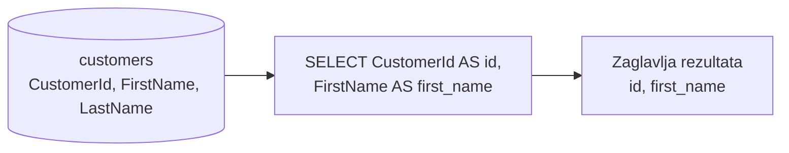

# 09 — Aliasi kolona i tabela u SQLite-u

## Cilj lekcije

U ovoj lekciji naučićeš kako da koloni ili tabeli dodeliš privremeni alias (pseudonim). Koristićemo alias za čitljivija zaglavlja rezultata i kraće reference na tabelu `customers`.

Prethodna lekcija: [Tipovi podataka i klase skladištenja u SQLite-u](08_sqllite_data_types.md).

## Šta je alias

Alias je alternativno ime koje važi u okviru jednog SQL upita. Alias kolone menja naziv kolone u rezultatu tog upita, a alias tabele daje kraće ime izvoru podataka unutar upita.

Alias ne preimenuje kolonu ili tabelu u šemi i ne menja sačuvane podatke.

## Alias kolone

Alias kolone navodi se posle izraza u `SELECT` listi. Preporučljivo je pisati `AS` da bi namera bila jasna:

```sql
SELECT
    CustomerId AS id,
    FirstName AS customer_name
FROM customers;
```

U rezultatu se zaglavlja pojavljuju kao `id` i `customer_name`, iako se kolone u tabeli i dalje zovu `CustomerId` i `FirstName`.

| Kolona u tabeli | Alias u upitu   | Zaglavlje rezultata |
| --------------- | --------------- | ------------------- |
| `CustomerId`    | `id`            | `id`                |
| `FirstName`     | `customer_name` | `customer_name`     |

Primer sa Chinook podacima:

```sql
SELECT
    CustomerId AS id,
    FirstName AS first_name,
    LastName AS last_name
FROM customers
ORDER BY CustomerId
LIMIT 3;
```

|  id | first_name | last_name |
| --: | ---------- | --------- |
|   1 | Luís       | Gonçalves |
|   2 | Leonie     | Köhler    |
|   3 | François   | Tremblay  |



### Da li je `AS` obavezno?

U SQLite-u možeš izostaviti `AS` i ostaviti razmak između izraza i aliasa:

```sql
SELECT CustomerId id
FROM customers;
```

Ovaj upit je validan, ali `AS` čini razliku između izraza i aliasa lakšom za čitanje. U materijalu i aplikacionom kodu koristićemo eksplicitni oblik `AS`.

Ako alias treba da sadrži razmak, SQLite podržava navodnike oko naziva:

```sql
SELECT FirstName AS "Customer first name"
FROM customers;
```

Za stabilna zaglavlja rezultata obično je praktičnije koristiti alias bez razmaka, kao što je `customer_name`.

## Korišćenje aliasa kolone

Alias kolone služi kao naziv izlazne vrednosti. Može se koristiti i u `ORDER BY`:

```sql
SELECT
    FirstName AS first_name,
    LastName AS last_name
FROM customers
ORDER BY last_name;
```

Uslove za filtriranje piši koristeći originalnu kolonu ili izraz. Alias kolone je ime rezultata, a ne novo polje u tabeli:

```sql
SELECT FirstName AS first_name
FROM customers
WHERE FirstName = 'Johannes';
```

## Alias tabele

Alias tabele definiše se u `FROM` klauzuli. Zatim možeš dodati alias ispred naziva kolone, odvojen tačkom:

```sql
SELECT
    c.FirstName,
    c.LastName,
    c.City
FROM customers AS c
WHERE c.City LIKE 'A%';
```

`c` je alias za tabelu `customers`, pa je `c.City` isto što i `customers.City` u ovom upitu. U Chinook bazi primer vraća kupca iz Amsterdama.

| Izraz            | Šta označava                                |
| ---------------- | ------------------------------------------- |
| `customers AS c` | Dodeljuje alias `c` tabeli `customers`      |
| `c.FirstName`    | Kolona `FirstName` iz tabele sa aliasom `c` |
| `c.City`         | Kolona `City` iz iste tabele                |

`LIKE 'A%'` bira tekstualne vrednosti koje počinju slovom `A`; znak `%` predstavlja nula ili više znakova. SQLite-ov podrazumevani `LIKE` ne razlikuje velika i mala ASCII slova, ali nije potpuno lokalizovano poređenje po pravilima srpskog jezika.

### Da li je `AS` obavezno za alias tabele?

SQLite dozvoljava i kraći zapis bez `AS`:

```sql
FROM customers c
```

I ovde ćemo koristiti `AS` radi čitljivosti, naročito kada upit kasnije povezuje više tabela.

## Alias kolone i alias tabele nisu isto

| Vrsta aliasa | Gde se definiše | Primer                    | Gde se koristi                           |
| ------------ | --------------- | ------------------------- | ---------------------------------------- |
| Alias kolone | `SELECT` lista  | `FirstName AS first_name` | Zaglavlje rezultata, a može i `ORDER BY` |
| Alias tabele | `FROM` klauzula | `customers AS c`          | Ispred kolona kao `c.FirstName`          |

Alias tabele skraćuje reference u upitu. To je naročito korisno kada upit koristi više tabela koje mogu imati kolone istog imena. Alias ne uklanja potrebu da navedeš iz koje tabele dolazi kolona.

Alias važi samo u okviru upita u kojem je definisan. Ne menja strukturu baze, ne menja nazive kolona u tabeli i ne stvara novu trajnu tabelu.

## Veza sa SQLAlchemy 2.0 i FastAPI-jem

U SQLAlchemy 2.0, alias kolone pravi se pomoću `.label()`, a alias ORM tabele/modela pomoću `aliased()`:

```python
from sqlalchemy import select
from sqlalchemy.orm import aliased

customer = aliased(Customer, name="customer")

statement = select(
    customer.id.label("id"),
    customer.first_name.label("first_name"),
)
```

Ovaj primer pretpostavlja da ORM model `Customer` ima atribute `id` i `first_name`. `.label()` dodeljuje naziv izabranoj koloni, a `aliased()` stvara alias modela za upit.

Alias rezultata baze ne preimenuje automatski polje u FastAPI response modelu. Ako želiš da API vrati polje pod određenim imenom, mapiraj rezultat upita na response šemu na odgovarajući način.

## Česte greške

- **Mešaš alias i preimenovanje kolone u tabeli:** `AS` u `SELECT` menja samo zaglavlje tog rezultata.
- **Postavljaš alias tabele u `SELECT`:** alias tabele definiše se u `FROM`.
- **Postavljaš alias kolone u `FROM`:** alias kolone definiše se u `SELECT`.
- **Koristiš alias tabele bez prefiksa kada je upit složen:** `c.City` jasno označava izvor kolone.
- **Očekuješ da alias postoji u sledećem upitu:** alias važi samo u okviru upita u kojem je definisan.
- **Koristiš alias kolone kao da je kolona tabele:** za `WHERE` uslov koristi originalnu kolonu ili izraz.

## Provera razumevanja

1. Gde se definiše alias kolone?
2. Gde se definiše alias tabele?
3. Da li `CustomerId AS id` trajno preimenuje kolonu?
4. Šta označava `c.City` u upitu sa `customers AS c`?
5. Zašto se aliasi tabela koriste u složenijim upitima?
6. Da li SQL alias automatski preimenuje polje FastAPI response modela?

## Vežbe

### Vežba 1 — Skrati zaglavlja rezultata

Napiši upit koji vraća `CustomerId`, `FirstName` i `LastName`, ali koristi aliase `id`, `first_name` i `last_name`.

1. Prikaži prva tri rezultata sortirana po `CustomerId`.
2. Uporedi zaglavlja rezultata sa imenima kolona u `customers`.

### Vežba 2 — Koristi alias tabele

Napiši upit koji koristi `customers AS c` i vraća `FirstName`, `LastName` i `City` za kupce čiji grad počinje slovom `A`.

1. Uslov napiši pomoću `c.City`.
2. Uporedi rezultat sa primerom iz lekcije.
3. Objasni šta predstavlja `c`.

### Vežba 3 — Kombinuj obe vrste aliasa

Izmeni upit iz Vežbe 2 tako da:

1. koristi alias tabele `c`;
2. prikaže `FirstName AS first_name`, `LastName AS last_name` i `City AS city`;
3. sortira po aliasu `last_name`.

### Vežba 4 — Prepoznaj opseg aliasa

Izvrši upit sa aliasom kolone `CustomerId AS id`, a zatim u novom upitu pokušaj da koristiš `id` kao da je trajni naziv kolone tabele. Objasni zašto alias iz prvog upita nije promenio šemu baze.
