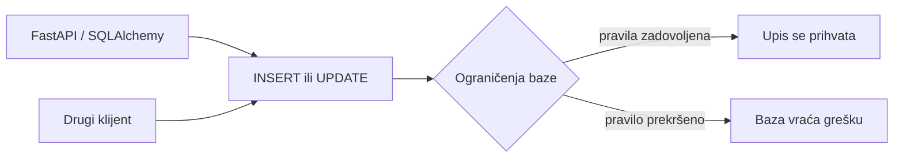

# 01 — SQLite ograničenja (constraints)

## Cilj lekcije

U ovoj lekciji naučićeš kako ograničenja štite integritet podataka i kako se definišu u SQLite-u i SQLAlchemy-ju 2.0. Obradićemo `NOT NULL`, `UNIQUE`, `PRIMARY KEY`, `FOREIGN KEY` i `CHECK`, kao i `DEFAULT` — koji je koristan uz ograničenja, ali sam po sebi ne proverava ispravnost podataka.

Primeri koriste male tabele `users` i `tasks`. Za povezivanje sa SQLAlchemy-jem 2.0 koristićemo savremeni Declarative stil sa `Mapped` i `mapped_column`.

## Šta je ograničenje?

Ograničenje je pravilo koje baza primenjuje na podatke prilikom upisa ili izmene. Na primer, ako je adresa e-pošte obavezna i mora biti jedinstvena, baza može odbiti red bez adrese ili red koji ponavlja već postojeću adresu.

Ograničenje u bazi je važno zato što podacima može pristupiti više delova sistema: FastAPI aplikacija, CLI, GUI alat, migracija ili skripta. Provera samo u Python kodu ne štiti bazu od svih tih načina upisa. Validacija aplikacije je korisna za jasnu poruku korisniku, a ograničenje u bazi je poslednja zaštita integriteta.



Ograničenja se obično definišu prilikom kreiranja tabele. U nekim slučajevima mogu se dodati kasnije, ali mogućnosti zavise od baze. SQLite ima ograničenu podršku za `ALTER TABLE`; zato nemoj pretpostaviti da je svako ograničenje moguće dodati jednom kratkom naredbom nakon kreiranja tabele.

## Ograničenja na nivou kolone i tabele

Ograničenje na nivou kolone piše se uz definiciju te kolone:

```sql
email TEXT NOT NULL UNIQUE
```

Ograničenje na nivou tabele piše se u listi ograničenja nakon definicija kolona:

```sql
CONSTRAINT uq_tasks_owner_title UNIQUE (owner_id, title)
```

Nivo tabele je potreban za pravila koja obuhvataju više kolona, kao što su složeni `UNIQUE` i složeni `PRIMARY KEY`. Pojedina ograničenja, kao `NOT NULL`, vezana su za kolonu. Nivo tabele ne znači da pravilo automatski proverava „sve kolone“ — pravilo važi za kolone koje navedeš.

Imenovanje ograničenja pomoću `CONSTRAINT ime` čini šemu čitljivijom i olakšava održavanje/migracije. Konkretna poruka greške koju vrati baza ili drajver ne mora uvek da sadrži to ime.

## Najčešća ograničenja

### `NOT NULL` — vrednost mora biti prisutna

`NOT NULL` odbija `NULL` vrednost. Koristi ga kada nedostajuća/nepoznata vrednost nije dozvoljena za tu kolonu.

```sql
email TEXT NOT NULL
```

Važno: `NOT NULL` **ne** odbija prazan tekst `''` niti tekst koji sadrži samo obične razmake. Ako naziv mora sadržati bar jedan znak koji nije razmak, dodaj posebno `CHECK` pravilo:

```sql
display_name TEXT NOT NULL
    CHECK (length(trim(display_name)) > 0)
```

`NOT NULL` govori da vrednost mora postojati; `CHECK` govori kakav sadržaj je dozvoljen.

### `UNIQUE` — vrednost ili kombinacija vrednosti ne sme se ponoviti

Jednokolonsko ograničenje:

```sql
email TEXT NOT NULL UNIQUE
```

Složeno ograničenje na nivou tabele:

```sql
CONSTRAINT uq_tasks_owner_title UNIQUE (owner_id, title)
```

Složeni `UNIQUE` sprečava ponavljanje **istog para** `(owner_id, title)`. Isti naslov kod dva različita korisnika je dozvoljen, jer parovi nisu isti.

U SQLite-u, `NULL` vrednosti se u `UNIQUE` ograničenju smatraju različitim. Zato više redova može imati `NULL` u jedinstvenoj koloni. Ako vrednost mora biti obavezna i jedinstvena, koristi oba pravila: `NOT NULL` i `UNIQUE`.

Poređenje teksta zavisi od kolacije. Podrazumevano poređenje može razlikovati `Ana@example.test` i `ana@example.test`. Ako domen zahteva poređenje bez obzira na velika/mala slova, definiši to namerno — na primer normalizacijom u aplikaciji ili odgovarajućom kolacijom/indeksom — i razmotri prenosivost kada promeniš bazu.

### `PRIMARY KEY` — identitet reda

Primarni ključ (`PRIMARY KEY`, PK) identifikuje red i ne dozvoljava ponavljanje ključa. Tabela ima najviše jedan PK; on može biti sastavljen od jedne ili više kolona.

```sql
id INTEGER PRIMARY KEY
```

U običnoj SQLite rowid tabeli, tačna deklaracija `INTEGER PRIMARY KEY` je poseban slučaj: kolona postaje alias za `rowid`. Ako ID izostaviš pri `INSERT` naredbi, SQLite dodeli celobrojni ID.

Za uobičajen generisani ID dovoljan je `INTEGER PRIMARY KEY`; nemoj automatski dodavati SQLite ključnu reč `AUTOINCREMENT`. Ona menja pravilo ponovne upotrebe obrisanih ID-jeva i dodaje trošak; koristi se samo kada poslovno pravilo izričito zahteva da se prethodni rowid nikada ne koristi ponovo.

**SQLite posebnost:** zbog istorijskog ponašanja SQLite-a, `PRIMARY KEY` nije u svim vrstama tabela automatski isto što i `NOT NULL`. `INTEGER PRIMARY KEY`, `STRICT` tabele i `WITHOUT ROWID` tabele imaju poseban tretman, ali za tekstualne ili složene ključeve izričito navedi `NOT NULL` gde je to potrebno. U ovoj lekciji eksplicitno navodimo `NOT NULL` na svim kolonama koje ne smeju biti prazne.

Složeni PK:

```sql
PRIMARY KEY (playlist_id, track_id)
```

Ovo jedinstveno identifikuje **par**, ne svaku kolonu zasebno. `playlist_id` može se ponoviti sa drugim `track_id`, a `track_id` sa drugim `playlist_id`; isti par ne sme biti ponovljen.

### `FOREIGN KEY` — referencijalna veza

Strani ključ (`FOREIGN KEY`, FK) zahteva da vrednost deteta odgovara postojećem ključu roditeljske tabele, kada je provera FK uključena. FK kolona deteta **ne mora biti jedinstvena**: više zadataka može pripadati istom korisniku.

```sql
user_id INTEGER NOT NULL,
FOREIGN KEY (user_id) REFERENCES users(id)
```

Roditeljska kolona koju referencira FK mora biti primarni ili odgovarajući jedinstveni ključ. Sam strani ključ ne „identifikuje jedinstveno red u drugoj tabeli“; on čuva referencu ka roditelju.

SQLite važna posebnost: podrška za FK deklaracije postoji, ali se njihova provera mora uključiti za **svaku konekciju**:

```sql
PRAGMA foreign_keys = ON;
PRAGMA foreign_keys;
```

Provera treba biti uključena pre početka transakcije. Druga konekcija — na primer SQLTools, SQLite CLI ili aplikacija — može imati drugo podešavanje. Ne pretpostavljaj da uključivanje u jednom klijentu važi i za ostale.

FK može definisati i ponašanje pri brisanju roditelja, kao što je `ON DELETE RESTRICT` ili `ON DELETE CASCADE`. Izaberi ga prema pravilima aplikacije; `CASCADE` može obrisati zavisne redove, pa ga nemoj dodavati rutinski.

### `CHECK` — uslov nad vrednostima reda

`CHECK` odbija red kada uslov daje nulu (false). Na primer:

```sql
priority INTEGER NOT NULL CHECK (priority BETWEEN 1 AND 5)
```

Može da proverava i više kolona istog reda:

```sql
CHECK (end_date >= start_date)
```

U SQLite-u `CHECK` koji daje `NULL` ne smatra se prekršenim. Zato `CHECK (age >= 18)` sam po sebi dozvoljava `NULL`; ako je starost obavezna, dodaj i `NOT NULL`. SQLite `CHECK` ne može sadržati podupit niti proveravati vrednosti u drugoj tabeli. Takve relacije se modeluju FK ograničenjem ili logikom aplikacije, u zavisnosti od pravila.

`CHECK` proverava rezultat izraza, ne garantuje deklarisani tip vrednosti. U običnoj, fleksibilno tipizovanoj SQLite tabeli, `CHECK (price >= 0)` može prihvatiti nenumerički tekst: SQLite poredi storage klase, pa tekstualna vrednost može biti veća od broja. Ako pravilo zahteva numeričku cenu, koristi `STRICT` tabelu sa podržanim tipom ili dodaj proveru SQLite klase skladištenja, na primer `CHECK (typeof(price) IN ('integer', 'real') AND price >= 0)`. `typeof()` pristup je SQLite specifičan; proveri primer u playground skripti.

### `DEFAULT` — vrednost kada je polje izostavljeno

`DEFAULT` daje vrednost kada `INSERT` izostavi kolonu:

```sql
status TEXT NOT NULL DEFAULT 'open'
```

Ovo prihvata:

```sql
INSERT INTO tasks (user_id, title) VALUES (1, 'Pročitaj lekciju');
```

`status` dobija `'open'`. Ali `DEFAULT` **nije validaciono ograničenje** i ne znači „vrednost mora biti open“: upit može izričito poslati drugi dozvoljeni status. Ne primenjuje se ni kada eksplicitno pošalješ `NULL` — tada `NOT NULL` odbija red.

Za dozvoljene vrednosti statusa koristi `CHECK`, a `DEFAULT` koristi kao pogodnu početnu vrednost:

```sql
status TEXT NOT NULL DEFAULT 'open'
    CHECK (status IN ('open', 'in_progress', 'done'))
```

## Primer SQLite šeme

Primer ispod sadrži sve glavne pojmove. Pokreni ga samo u privremenoj memorijskoj bazi, ne nad Chinook ili TodoApp bazom:

```bash
sqlite3 :memory:
```

U SQLite CLI-ju prvo uključi proveru stranih ključeva, pa napravi tabele:

```sql
PRAGMA foreign_keys = ON;
PRAGMA foreign_keys;

CREATE TABLE users (
    id INTEGER PRIMARY KEY,
    email TEXT NOT NULL,
    display_name TEXT NOT NULL,
    CONSTRAINT uq_users_email UNIQUE (email),
    CONSTRAINT ck_users_email_length CHECK (length(email) <= 254),
    CONSTRAINT ck_users_display_name_nonblank
        CHECK (length(trim(display_name)) > 0),
    CONSTRAINT ck_users_display_name_length CHECK (length(display_name) <= 80)
);

CREATE TABLE tasks (
    id INTEGER PRIMARY KEY,
    user_id INTEGER NOT NULL,
    title TEXT NOT NULL,
    status TEXT NOT NULL DEFAULT 'open',
    priority INTEGER NOT NULL DEFAULT 3,
    CONSTRAINT fk_tasks_user
        FOREIGN KEY (user_id) REFERENCES users(id)
        ON DELETE RESTRICT,
    CONSTRAINT uq_tasks_owner_title
        UNIQUE (user_id, title),
    CONSTRAINT ck_tasks_title_nonblank
        CHECK (length(trim(title)) > 0),
    CONSTRAINT ck_tasks_title_length CHECK (length(title) <= 200),
    CONSTRAINT ck_tasks_status
        CHECK (status IN ('open', 'in_progress', 'done')),
    CONSTRAINT ck_tasks_priority
        CHECK (priority BETWEEN 1 AND 5)
);
```

U `users`:

- `id` je primarni ključ i SQLite mu dodeljuje vrednost kada se izostavi.
- `email` je obavezan i jedinstven.
- `display_name` je obavezan i ne sme biti prazan ili sastavljen samo od razmaka.

U `tasks`:

- `user_id` mora upućivati na postojećeg korisnika, a ne sme biti `NULL`.
- `UNIQUE (user_id, title)` dozvoljava isti naslov različitim korisnicima, ali ne dva identična naslova istom korisniku. To je poslovno pravilo primera; ukloni ograničenje ako aplikacija treba dozvoliti duplirane naslove.
- `status` i `priority` imaju podrazumevane vrednosti, a `CHECK` ograničava dozvoljene vrednosti.
- `ON DELETE RESTRICT` sprečava brisanje korisnika dok postoje njegovi zadaci.

Probaj validan unos:

```sql
INSERT INTO users (email, display_name)
VALUES ('ana@example.test', 'Ana');

INSERT INTO tasks (user_id, title)
VALUES (1, 'Pročitaj lekciju');

SELECT id, user_id, title, status, priority
FROM tasks;
```

Očekivano: zadatak dobija `status = 'open'` i `priority = 3`. Zatim možeš testirati pravila **pojedinačno**. Svaki naredni primer treba da bude odbijen:

```sql
-- Ne postoji korisnik sa id=999.
INSERT INTO tasks (user_id, title) VALUES (999, 'Nevažeći roditelj');

-- Prioritet mora biti od 1 do 5.
INSERT INTO tasks (user_id, title, priority) VALUES (1, 'Prenizak prioritet', 0);

-- Ne sme se ponoviti isti par user_id + title.
INSERT INTO tasks (user_id, title) VALUES (1, 'Pročitaj lekciju');

-- Email je jedinstven.
INSERT INTO users (email, display_name) VALUES ('ana@example.test', 'Druga Ana');

-- NOT NULL odbija nedostajući email.
INSERT INTO users (display_name) VALUES ('Bez emaila');
```

SQLite CLI će prijaviti grešku ograničenja za svaki nevažeći unos. Ograničenja se proveravaju pri `INSERT` i `UPDATE`, a ne služe kao filter koji automatski popravlja podatke.

## Ista pravila u SQLAlchemy 2.0

SQLAlchemy modeli opisuju šemu, a `Base.metadata.create_all()` može napraviti tabele koje ne postoje. To nije alat za migraciju postojeće šeme: promena modela sama po sebi ne dodaje ograničenja tabelama koje već postoje. Za verzionisane promene šeme koristi migracije, najčešće Alembic.

Primer ispod koristi SQLAlchemy 2 typed Declarative mapiranje. Za probu koristi novu memorijsku bazu:

```python
from sqlalchemy import (
    CheckConstraint,
    ForeignKey,
    String,
    UniqueConstraint,
    create_engine,
    event,
    text,
)
from sqlalchemy.orm import DeclarativeBase, Mapped, mapped_column, relationship


class Base(DeclarativeBase):
    pass


class User(Base):
    __tablename__ = "users"
    __table_args__ = (
        UniqueConstraint("email", name="uq_users_email"),
        CheckConstraint(
            "length(email) <= 254",
            name="ck_users_email_length",
        ),
        CheckConstraint(
            "length(trim(display_name)) > 0",
            name="ck_users_display_name_nonblank",
        ),
        CheckConstraint(
            "length(display_name) <= 80",
            name="ck_users_display_name_length",
        ),
    )

    id: Mapped[int] = mapped_column(primary_key=True)
    email: Mapped[str] = mapped_column(String(254), nullable=False)
    display_name: Mapped[str] = mapped_column(String(80), nullable=False)

    tasks: Mapped[list["Task"]] = relationship(back_populates="user")


class Task(Base):
    __tablename__ = "tasks"
    __table_args__ = (
        UniqueConstraint("user_id", "title", name="uq_tasks_owner_title"),
        CheckConstraint(
            "length(trim(title)) > 0",
            name="ck_tasks_title_nonblank",
        ),
        CheckConstraint(
            "length(title) <= 200",
            name="ck_tasks_title_length",
        ),
        CheckConstraint(
            "status IN ('open', 'in_progress', 'done')",
            name="ck_tasks_status",
        ),
        CheckConstraint(
            "priority BETWEEN 1 AND 5",
            name="ck_tasks_priority",
        ),
    )

    id: Mapped[int] = mapped_column(primary_key=True)
    user_id: Mapped[int] = mapped_column(
        ForeignKey("users.id", ondelete="RESTRICT"),
        nullable=False,
    )
    title: Mapped[str] = mapped_column(String(200), nullable=False)
    status: Mapped[str] = mapped_column(
        String(20),
        nullable=False,
        server_default=text("'open'"),
    )
    priority: Mapped[int] = mapped_column(
        nullable=False,
        server_default=text("3"),
    )

    user: Mapped["User"] = relationship(back_populates="tasks")


engine = create_engine("sqlite+pysqlite:///:memory:")


@event.listens_for(engine, "connect")
def enable_sqlite_foreign_keys(dbapi_connection, connection_record):
    previous_autocommit = dbapi_connection.autocommit
    dbapi_connection.autocommit = True
    try:
        cursor = dbapi_connection.cursor()
        try:
            cursor.execute("PRAGMA foreign_keys=ON")
        finally:
            cursor.close()
    finally:
        dbapi_connection.autocommit = previous_autocommit


Base.metadata.create_all(engine)
```

Ovaj događaj se izvršava za svaku novu DBAPI konekciju tog engine-a, pre korišćenja konekcije. U SQLite-u je potrebno uključiti FK proveru i pre `create_all()`. Primer koristi `sqlite3` drajver iz Python 3.12+, gde je dostupan `Connection.autocommit`; ako projekat koristi stariju verziju Pythona ili drugi drajver, koristi varijantu iz dokumentacije SQLAlchemy-ja za taj konkretan drajver.

`String(254)`, `String(80)` i `String(200)` pomažu da tipovi budu jasni u modelu i pri generisanju šeme za druge dijalekte. U običnoj SQLite tabeli, međutim, sama dužina u `VARCHAR(n)`/`String(n)` nije ograničenje maksimalnog broja znakova. Zato model izričito koristi `CheckConstraint(length(...) <= n)` za dužine koje želi da baza zaista sprovede.

Mapiranja u primeru:

| SQL pravilo                         | SQLAlchemy 2 izraz                                                                 |
| ----------------------------------- | ---------------------------------------------------------------------------------- |
| PK                                  | `mapped_column(primary_key=True)`                                                  |
| `NOT NULL`                          | `nullable=False`                                                                   |
| Jedinstvenost jedne ili više kolona | `unique=True` za jednostavan slučaj ili `UniqueConstraint(...)` u `__table_args__` |
| `CHECK`                             | `CheckConstraint(...)` u `__table_args__`                                          |
| FK i akcija brisanja                | `ForeignKey("users.id", ondelete="RESTRICT")`                                      |
| DB `DEFAULT`                        | `server_default=text("'open'")`                                                    |
| ORM navigacija                      | `relationship(...)`, odvojeno od FK ograničenja                                    |

`relationship()` nije zamena za `ForeignKey`: relationship daje Python ORM-u navigaciju između objekata, dok FK ograničenje čuva referencijalni integritet u bazi.

### SQLAlchemy `default` nije isto što i `server_default`

Ovo je česta zabuna:

- `default="open"` je SQLAlchemy/podatkovni sloj: SQLAlchemy koristi vrednost kada ORM pravi `INSERT`, ali to samo po sebi ne definiše DB `DEFAULT` za druge klijente.
- `server_default=text("'open'")` ulazi u `CREATE TABLE` DDL; SQLite baza primenjuje ga kada bilo koji klijent izostavi kolonu iz `INSERT`.

Ako pravilo mora važiti i za direktne SQL upise, definiši ga na nivou baze (`server_default` za početnu vrednost, `CHECK` za dozvoljene vrednosti). Ni jedno ni drugo nije zamena za `NOT NULL`.

### Proveri FK postavku i DDL

Nakon stvaranja engine-a i prve konekcije, možeš proveriti per-connection podešavanje:

```python
with engine.connect() as connection:
    enabled = connection.exec_driver_sql("PRAGMA foreign_keys").scalar_one()
    print(enabled)  # 1 znači uključeno
```

Za pregled generisanog SQL-a možeš proveriti model ili bazu. U CLI-ju nad novom bazom:

```text
.schema users
.schema tasks
```

U SQLAlchemy modelu proveri `User.__table__.constraints` i `Task.__table__.constraints`. Tako vidiš razliku između deklaracije u Python-u i stvarne šeme baze.

### Kako greške ograničenja stižu do aplikacije

Ograničenje može da padne prilikom `flush()` ili `commit()`. SQLAlchemy obično to prijavi kao `IntegrityError`. Samo Pydantic validacija ili Python provera pre upisa ne mogu pouzdano zameniti ograničenje — na primer, dva istovremena zahteva mogu oba proveriti da je email slobodan pre nego što bilo koji od njih upiše red. Jedinstvenost mora biti potvrđena bazom.

U aplikaciji obradi očekivani konflikt smisleno (na primer, duplikat email-a kao HTTP `409 Conflict`) i ne izlaži sirovu internu poruku baze klijentu. Kada `flush()`/`commit()` u ručno upravljanoj sesiji baci grešku, uradi rollback pre ponovne upotrebe sesije. Transakcioni context manager kao `with Session(engine) as session, session.begin():` automatski radi commit pri uspehu i rollback pri izuzetku.

Ne koristi `INSERT OR IGNORE` ili sličan mehanizam kao univerzalno rešenje za greške: može sakriti razlog zbog kog upis nije izvršen. Izaberi konfliktno ponašanje samo kada je to namerno poslovno pravilo.

## Šta transkript pojednostavljuje — važne ispravke

1. **„FK jedinstveno identifikuje red u drugoj tabeli“ nije precizno.** Roditeljski PK/UNIQUE identifikuje roditeljski red; strani ključ u tabeli deteta čuva referencu i može se ponavljati.
2. **PK se često objašnjava kao `UNIQUE` + `NOT NULL`, ali SQLite ima istorijski izuzetak.** Posebno obrati pažnju na tekstualne i složene PK-ove; eksplicitno navedi `NOT NULL` gde je obavezno.
3. **`DEFAULT` se često grupiše među „constraints“, ali ne ograničava skup dozvoljenih vrednosti.** On daje vrednost kada je kolona izostavljena. `CHECK` i `NOT NULL` su ograničenja koja odbijaju nevažeći unos.
4. **SQLite nema opšti `ALTER TABLE ADD CONSTRAINT` za sva ograničenja.** SQLite ima ograničenu podršku za dodavanje/uklanjanje kolona i preimenovanja. Novije verzije (3.53.0+) mogu direktno postaviti ili ukloniti `NOT NULL`; dostupnost zavisi od SQLite verzije koju konkretni klijent koristi. `ADD COLUMN` takođe ima ograničenja i ne prihvata `PRIMARY KEY` ili `UNIQUE` na novoj koloni.
5. Za složenije izmene postojeće šeme obično je potrebna kontrolisana migracija koja napravi novu tabelu, prebaci podatke i zameni staru tabelu. Ne menjaj ručno `sqlite_schema`. SQLAlchemy `create_all()` ne menja postojeće tabele; koristi Alembic migracije (SQLite podržava batch/rebuild pristup) i napravi rezervnu kopiju pre promene podataka.

## Veza sa MySQL-om i PostgreSQL-om

Ideja iza ograničenja — obaveznost, jedinstvenost, referencijalni integritet i pravila vrednosti — prenosi se na druge relacione baze. Sintaksa i detalji nisu uvek isti: ponašanje `NULL` vrednosti u jedinstvenim ograničenjima, tipovi, kolacije, izmene šeme i akcije pri konfliktu mogu se razlikovati. SQLAlchemy olakšava deklarisanje modela, ali ne briše razlike dijalekata. Kada promeniš bazu, pregledaj generisanu migraciju i testiraj ograničenja na ciljnom DBMS-u.

## Vežbe

Izvršavaj SQL primere u novoj SQLite memorijskoj konekciji (`sqlite3 :memory:`), ne u Chinook ili TodoApp bazi.

1. Napravi tabelu `categories` sa `id` kao PK, obaveznim `name` i jedinstvenim `name`.
2. Dodaj `CHECK` koji sprečava prazan naziv ili naziv ispunjen običnim razmacima. Objasni zašto `NOT NULL` sam nije dovoljan.
3. Napravi `items` tabelu sa obaveznim `category_id` FK-om ka `categories.id`, cenom koja nije negativna i `DEFAULT 0` za broj na zalihama.
4. Umetni validan red pa pokušaj da uneseš kategoriju koja ne postoji. Pre pokušaja proveri `PRAGMA foreign_keys;`.
5. Pokušaj da uneseš negativnu cenu i duplirani naziv kategorije. Zabeleži koje ograničenje odbija svaki unos.
6. Mapiraj iste tabele u SQLAlchemy 2 sa `Mapped`, `mapped_column`, `ForeignKey`, `UniqueConstraint` i `CheckConstraint`. Uključi FK pragma pri svakom povezivanju.
7. Pokaži razliku između SQLAlchemy `default` i `server_default`: uporedi ORM insert sa direktnim SQL insertom koji izostavlja kolonu.

## Provera razumevanja

1. Koja je razlika između `NOT NULL` i `CHECK (length(trim(name)) > 0)`?
2. Zašto se `email` obično definiše kao `NOT NULL UNIQUE`, a ne samo `UNIQUE`?
3. Da li se FK kolona u detetabeli mora biti jedinstvena? Zašto?
4. Kada se primenjuje `DEFAULT`, a šta se desi ako upit izričito pošalje `NULL`?
5. Koja je razlika između SQLAlchemy `relationship()` i SQL `FOREIGN KEY`?
6. Zašto promena ORM modela ne garantuje da je postojeća tabela izmenjena?
7. Zašto moraš uključiti `PRAGMA foreign_keys = ON` za SQLAlchemy konekcije?

## Izvori za dalje čitanje

- [SQLite: CREATE TABLE i constraints](https://www.sqlite.org/lang_createtable.html)
- [SQLite: ALTER TABLE](https://www.sqlite.org/lang_altertable.html)
- [SQLite: Foreign Key Support](https://www.sqlite.org/foreignkeys.html)
- [SQLAlchemy 2.0: SQLite dialect — Foreign Key Support](https://docs.sqlalchemy.org/en/20/dialects/sqlite.html#foreign-key-support)
- [SQLAlchemy 2.0: Defining Constraints and Indexes](https://docs.sqlalchemy.org/en/20/core/constraints.html)
