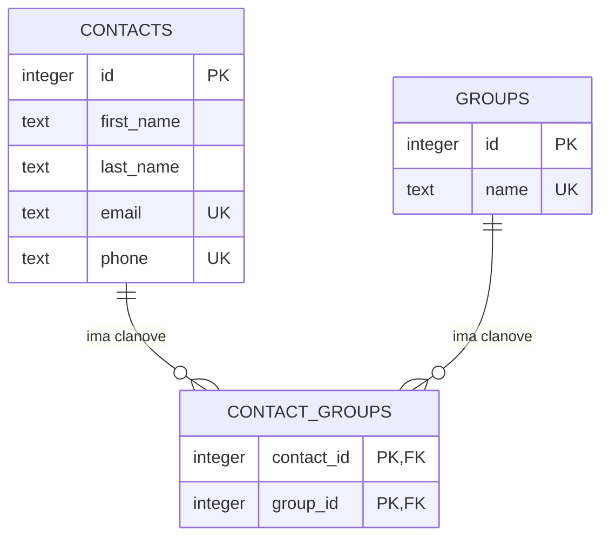

# 02 — SQLite `CREATE TABLE` izjava (1. deo)

## Cilj lekcije

U ovoj lekciji učiš osnovnu strukturu naredbe `CREATE TABLE`, izbor mesta na kom će tabela biti napravljena i način da pre pisanja SQL-a isplaniraš tabele i veze između njih. Primer iz transkripta je adresar sa tabelama `contacts`, `groups` i `contact_groups`.

Fokus je na modelovanju i razumevanju SQLite posebnosti. U sledećoj lekciji ćemo na ovom modelu detaljnije pisati i izvršavati `CREATE TABLE` naredbe.

## Čemu služi `CREATE TABLE`?

`CREATE TABLE` pravi definiciju tabele u bazi: njeno ime, kolone, deklarisane tipove i ograničenja. Ona ne ubacuje automatski podatke u tabelu. Redovi se dodaju kasnije, na primer pomoću `INSERT`.

Kreiranje tabele je važno planirati unapred: koje podatke predstavlja jedan red, koje kolone su obavezne, šta jedinstveno identifikuje red i kako se tabela povezuje sa drugima. Pogrešna struktura kasnije može zahtevati migraciju i prebacivanje podataka.

## Osnovni oblik naredbe

Pojednostavljen oblik za običnu tabelu izgleda ovako:

```sql
CREATE TABLE [IF NOT EXISTS] [schema_name.]table_name (
    column_name [data_type] [column_constraint ...],
    column_name [data_type] [column_constraint ...],
    [table_constraint ...]
) [WITHOUT ROWID];
```

U uglastim zagradama je opcioni deo notacije u ovom objašnjenju — zagrade se ne unose u SQL. Svaka definicija kolone i svako ograničenje u listi razdvajaju se zarezom; poslednji element nema zarez iza sebe.

- `CREATE TABLE` započinje naredbu.
- `IF NOT EXISTS` sprečava grešku ako tabela ili pogled istog imena već postoji.
- `schema_name` određuje bazu u kojoj će tabela biti napravljena.
- `table_name` je ime nove tabele.
- U zagradama navode se definicije kolona, a zatim mogu slediti ograničenja na nivou tabele.
- `WITHOUT ROWID` je posebna, opciona SQLite postavka o kojoj govorimo kasnije u lekciji.

Jednostavan primer:

```sql
CREATE TABLE IF NOT EXISTS reading_notes (
    id INTEGER PRIMARY KEY,
    title TEXT NOT NULL,
    created_at TEXT NOT NULL DEFAULT CURRENT_TIMESTAMP
);
```

Ovo definiše tabelu, ali je ne popunjava. `INTEGER PRIMARY KEY`, `NOT NULL` i `DEFAULT` su primeri pravila koja se navode uz kolone. Njihovo značenje detaljnije je obrađeno u prethodnoj lekciji o ograničenjima.

## Ime tabele i `IF NOT EXISTS`

SQLite rezerviše imena objekata koja počinju sa `sqlite_` za internu upotrebu. Zato se, na primer, tabela `sqlite_contacts` ne može napraviti. Reč `sqlite` sama po sebi nije zabranjena — važno je da ime ne počinje prefiksom `sqlite_`.

Izaberi imena koja jasno opisuju sadržaj tabele, na primer `contacts`, `groups` ili `contact_groups`. Izbegavaj SQL ključne reči i neobične razmake u imenima. Uobičajen stil je mala slova i donje crte.

`IF NOT EXISTS` je koristan kada skripta može biti pokrenuta više puta:

```sql
CREATE TABLE IF NOT EXISTS reading_notes (
    id INTEGER PRIMARY KEY,
    title TEXT NOT NULL
);
```

Ako `reading_notes` već postoji kao tabela ili pogled, SQLite ne pravi novu tabelu i ne prijavljuje grešku. **Ne proverava, međutim, da li postojeća tabela ima iste kolone ili ograničenja kao definicija iznad.** Ako je tabela ranije napravljena pogrešno ili je promenjen model, `IF NOT EXISTS` je neće popraviti. Nije zamena za migraciju.

Šemu možeš pregledati u SQLite CLI-ju:

```text
.schema reading_notes
```

`.schema` je meta-naredba SQLite CLI-ja, a ne SQL naredba. U sledećoj lekciji naučićemo više načina da proverimo tačnu strukturu tabele.

## U kojoj bazi se pravi tabela?

SQLite koristi ime šeme za odabir baze. Uobičajene šeme su:

- `main` — glavna baza otvorena uz konekciju;
- `temp` — privremena baza te konekcije;
- ime koje je dodeljeno bazi pomoću `ATTACH DATABASE`.

Ako izostaviš ime šeme, tabela se obično pravi u `main`. Možeš je navesti eksplicitno:

```sql
CREATE TABLE main.contacts (
    id INTEGER PRIMARY KEY,
    email TEXT NOT NULL UNIQUE
);
```

Ako je druga baza prethodno prikačena uz alias `archive`, tabela u njoj može se navesti kao `archive.contacts`. `archive` je alias šeme, a ne obavezno ime datoteke. Ovo je SQLite-ov način rada sa prikačenim bazama i ne znači da SQLite podržava proizvoljne šeme na isti način kao PostgreSQL.

Privremena tabela može se napraviti ovako:

```sql
CREATE TEMP TABLE current_import (
    source_name TEXT NOT NULL
);
```

Privremene tabele pripadaju konekciji; nisu zamena za trajnu tabelu koju očekuješ da ostane dostupna nakon zatvaranja konekcije.

## Kolone i ograničenja u definiciji tabele

Definicija kolone sadrži ime, opcioni deklarisani tip i opciona pravila:

```sql
column_name declared_type column_constraint ...
```

Na primer:

```sql
email TEXT NOT NULL UNIQUE
```

Ograničenje može biti zapisano i na nivou tabele, posle definicija kolona. To je naročito korisno za složeni ključ koji obuhvata više kolona:

```sql
CREATE TABLE contact_groups (
    contact_id INTEGER NOT NULL,
    group_id INTEGER NOT NULL,
    PRIMARY KEY (contact_id, group_id)
);
```

`PRIMARY KEY (contact_id, group_id)` tretira **par** kao ključ. Time možeš sprečiti da se ista veza između kontakta i grupe upiše dvaput, a istovremeno dozvoliti da se isti kontakt ili grupa pojavljuju u drugim parovima. U stvarnom adresaru ove kolone će imati i strane ključeve ka roditeljskim tabelama; taj završeni primer pravimo u drugom delu.

U SQLite-u deklarisani tip, kao `TEXT` ili `INTEGER`, određuje afinitet tipa, ali obična SQLite tabela nije strogo tipizovana kao tabela u nekim drugim bazama. Zato nemoj pretpostaviti da je izbor tipa jedini način da se zaštite podaci. Ograničenja poput `NOT NULL`, `UNIQUE` i `CHECK` imaju zasebnu ulogu.

## Rowid i `WITHOUT ROWID`

### Obična SQLite tabela

Obična SQLite tabela — tabela koja nije deklarisana kao `WITHOUT ROWID` — interno ima celobrojni `rowid` koji jedinstveno identifikuje svaki red. To je SQLite specifičnost, ne dodatna kolona koju si napisao u `CREATE TABLE`.

U SQLite-u se `rowid`, `_rowid_` i `oid` obično mogu koristiti kao imena za pristup toj vrednosti. To su posebna imena, nisu obične vidljive kolone: `SELECT *` ih ne prikazuje. Ako tabela ima pravu kolonu nazvanu `rowid`, `_rowid_` ili `oid`, to ime može sakriti odgovarajući poseban pristup.

Kada obična tabela ima **jednu** primarnu kolonu čiji je deklarisani tip tačno `INTEGER`, ona postaje alias za `rowid`:

```sql
id INTEGER PRIMARY KEY
```

To nije isto što i `INT PRIMARY KEY` ili `BIGINT PRIMARY KEY`. Ovaj poseban alias ne važi ni za složeni primarni ključ niti za `WITHOUT ROWID` tabelu. Za običan generisani celobrojni ID najčešće je dovoljan `INTEGER PRIMARY KEY`; ne dodaj automatski `AUTOINCREMENT` bez konkretnog poslovnog razloga.

Postoji i istorijski sintaksni izuzetak: zapis `INTEGER PRIMARY KEY DESC` u definiciji kolone ne postaje alias za `rowid`. To je neuobičajen oblik; za uobičajen auto-generisani ključ koristi jednostavno `INTEGER PRIMARY KEY`.

### Kada se koristi `WITHOUT ROWID`?

`WITHOUT ROWID` pravi tabelu koja ne koristi skriveni `rowid`. Takva tabela mora imati primarni ključ. Ključ postaje osnova za organizaciju zapisa, pa ova opcija može biti prikladna za tabelu čiji je prirodan ključ složen, kao što je tabela veza `contact_groups`.

```sql
CREATE TABLE contact_groups (
    contact_id INTEGER NOT NULL,
    group_id INTEGER NOT NULL,
    PRIMARY KEY (contact_id, group_id)
) WITHOUT ROWID;
```

Ovde primarni ključ `(contact_id, group_id)` već ima smisla kao identitet reda. `WITHOUT ROWID` uklanja dodatni, nepotrebni `rowid` za ovu strukturu.

Ne dodaj `WITHOUT ROWID` svakoj tabeli. Za uobičajenu tabelu sa `id INTEGER PRIMARY KEY`, klasična rowid tabela je jednostavnija i ta kolona je već alias za `rowid`. `WITHOUT ROWID` je SQLite specifičnost i pri promeni baze proveri da li je potrebno drugačije definisati tabelu.

## Pre `CREATE TABLE`: isplaniraj model adresara

Transkript predlaže da se tabele osmisle pre pisanja SQL-a. Ovo je dobar redosled:

1. **Odredi entitete.** Kontakt i grupa su različite stvari i zato su zasebne tabele.
2. **Navedi atribute.** Kontakt može imati ime, prezime, email i telefon; grupa može imati naziv.
3. **Izaberi ključ za svaki entitet.** U primeru koristimo `id` za kontakt i grupu.
4. **Odredi vezu i njenu kardinalnost.** Jedan kontakt može biti u više grupa, a jedna grupa može sadržati više kontakata.
5. **Realizuj vezu N:M pomoćnom tabelom.** `contact_groups` čuva jedan red po članstvu.



Oznake na dijagramu:

- `||` znači tačno jedan: svaki red u `contact_groups` povezan je sa jednim kontaktom i jednom grupom.
- `o{` znači nula ili više: kontakt može imati nula ili više članstava, a grupa nula ili više članova.
- `PK` označava primarni ključ, `FK` strani ključ, a `UK` jedinstvenu vrednost.

Zato su `contacts` i `groups` u vezi **mnogi-prema-mnogima (N:M)**, realizovanoj preko `contact_groups`. Ne čuvaj više ID-jeva grupa u jednoj tekstualnoj koloni kontakta; time se gube normalizacija, pouzdana ograničenja i jednostavnost `JOIN` upita.

Transkript kaže da svaki kontakt pripada jednoj ili više grupa. To je posebno poslovno pravilo i nije automatski nametnuto samo postojanjem pomoćne tabele: strane ključeve možemo koristiti da svaki red članstva mora imati postojeći kontakt i grupu, ali to samo po sebi ne zahteva da **svaki kontakt** ima bar jedno članstvo. Ovde modelujemo opciono članstvo (nula ili više). Ako aplikacija zaista zahteva bar jednu grupu po kontaktu, to pravilo treba posebno osmisliti i proveriti.

### Email i telefon kao podaci

Email i telefon nisu brojevi za računanje, već identifikatori/tekstualne vrednosti. Telefon je zato prikladnije čuvati kao tekst — tako se ne gube početne nule, znak `+` i formatiranje. Ako poslovno pravilo zahteva da email i telefon budu jedinstveni, navedi `UNIQUE` ograničenja. Odluči i da li su obavezni: `UNIQUE` sam po sebi ne znači `NOT NULL`, a SQLite dozvoljava više `NULL` vrednosti pod `UNIQUE`.

## Isti koncept u SQLAlchemy 2

U SQLAlchemy 2 veza N:M se mapira pomoću pomoćne `Table` sa dva strana ključa i `relationship(..., secondary=...)`. Ispod je model adresara; on demonstrira kako se dizajn mapira, a ne menja činjenicu da SQLAlchemy i SQLite imaju odvojene uloge:

```python
from sqlalchemy import (
    Column,
    ForeignKey,
    String,
    Table,
    create_engine,
    event,
)
from sqlalchemy.orm import DeclarativeBase, Mapped, mapped_column, relationship


class Base(DeclarativeBase):
    pass


contact_groups = Table(
    "contact_groups",
    Base.metadata,
    Column(
        "contact_id",
        ForeignKey("contacts.id", ondelete="CASCADE"),
        primary_key=True,
    ),
    Column(
        "group_id",
        ForeignKey("groups.id", ondelete="CASCADE"),
        primary_key=True,
    ),
    sqlite_with_rowid=False,
)


class Contact(Base):
    __tablename__ = "contacts"

    id: Mapped[int] = mapped_column(primary_key=True)
    first_name: Mapped[str] = mapped_column(String(80), nullable=False)
    last_name: Mapped[str] = mapped_column(String(80), nullable=False)
    email: Mapped[str] = mapped_column(String(254), unique=True, nullable=False)
    phone: Mapped[str | None] = mapped_column(String(32), unique=True)

    groups: Mapped[list["Group"]] = relationship(
        secondary=contact_groups,
        back_populates="contacts",
    )


class Group(Base):
    __tablename__ = "groups"

    id: Mapped[int] = mapped_column(primary_key=True)
    name: Mapped[str] = mapped_column(String(80), unique=True, nullable=False)

    contacts: Mapped[list[Contact]] = relationship(
        secondary=contact_groups,
        back_populates="groups",
    )


engine = create_engine("sqlite+pysqlite:///:memory:")


@event.listens_for(engine, "connect")
def enable_sqlite_foreign_keys(dbapi_connection, connection_record):
    previous_autocommit = dbapi_connection.autocommit
    dbapi_connection.autocommit = True
    try:
        cursor = dbapi_connection.cursor()
        try:
            cursor.execute("PRAGMA foreign_keys=ON")
        finally:
            cursor.close()
    finally:
        dbapi_connection.autocommit = previous_autocommit


Base.metadata.create_all(engine)
```

- `contact_groups` je SQLAlchemy Core `Table`, jer je to pomoćna tabela za povezivanje dve ORM klase.
- Dva `primary_key=True` polja formiraju složeni primarni ključ: isti par kontakta i grupe ne može se ponoviti.
- `secondary=contact_groups` kaže ORM-u koju pomoćnu tabelu koristi za vezu N:M. `relationship()` je ORM navigacija; dva `ForeignKey` objekta u `Table` definišu stvarna ograničenja baze.
- `sqlite_with_rowid=False` traži da SQLAlchemy za ovu SQLite tabelu generiše `WITHOUT ROWID`. Ovo je SQLite specifična opcija i nije potrebna za većinu tabela.
- `ON DELETE CASCADE` je vezan za redove članstva: brisanje kontakta ili grupe može ukloniti njihove redove iz `contact_groups`, a ne brisati druge kontakte ili grupe. SQLite provera stranih ključeva mora biti uključena na svakoj konekciji; ovde je prikazan isti `connect` event obrazac iz prethodne lekcije.

`String(254)` i slične dužine nisu u SQLite-u ograničenje broja znakova same po sebi. Ako je maksimalna dužina poslovno pravilo, definiši `CHECK` ili validaciju uz odgovarajuće ograničenje baze. Isto tako, SQLAlchemy `create_all()` pravi nedostajuće tabele, ali ne menja već postojeću šemu — za promene koristi migracije.

## Šta je transkript pojednostavio — važne ispravke

1. **Nije zabranjena svaka reč „SQLite“ u imenu.** Zabranjen je prefiks `sqlite_`, rezervisan za interne objekte SQLite-a.
2. **`IF NOT EXISTS` ne znači „proveri i sinhronizuj šemu“.** Ako tabela ili pogled istog imena već postoji, SQLite preskače kreiranje; ne upoređuje kolone i ograničenja.
3. **`rowid` nije obična skrivena kolona koju možeš isključiti na bilo kojoj tabeli.** Obična rowid tabela ga ima kao SQLite mehanizam; `WITHOUT ROWID` pravi drugi tip organizacije tabele, a ne uklanja kolonu koju je korisnik definisao.
4. **Ne mora svaki kontakt pripadati bar jednoj grupi samo zato što postoji veza N:M.** Pomoćna tabela dozvoljava da nema redova članstva za kontakt, osim ako se to pravilo posebno ne sprovede.
5. **Crow's foot dijagram opisuje kardinalnost, a ne SQL sintaksu.** Posle modela, veze se u bazi sprovode PK/FK ograničenjima i pomoćnom tabelom.

## Vežbe

Radi u novoj memorijskoj bazi, kako ne bi menjao Chinook ili TodoApp bazu:

```bash
sqlite3 :memory:
```

1. Nacrtaj model `contacts`, `groups` i `contact_groups`. Označi PK/FK i kardinalnost na obe strane veze.
2. Kreiraj jednostavnu tabelu `reading_notes` iz primera. Pregledaj je pomoću `.schema reading_notes`.
3. Ponovo izvrši istu `CREATE TABLE IF NOT EXISTS` naredbu, a zatim napravi varijantu koja izostavlja jednu kolonu. Proveri da SQLite ne menja već postojeću tabelu.
4. Objasni zašto su `contacts` i `groups` N:M i šta predstavlja jedan red u `contact_groups`.
5. Uporedi običnu tabelu sa `id INTEGER PRIMARY KEY` sa primerom `contact_groups ... WITHOUT ROWID`. Koja ima skriveni `rowid`, a koja koristi složeni primarni ključ kao osnovu?
6. Napravi lokalni SQLAlchemy 2 model iz primera i proveri da li generisana SQLite šema ima tri tabele i strane ključeve. Pokušaj da ubaciš isti par kontakta i grupe dva puta i posmatraj efekat složenog primarnog ključa.

## Provera razumevanja

1. Koji je minimalni sadržaj `CREATE TABLE` naredbe i šta se navodi unutar zagrada?
2. Šta se dešava ako tabela već postoji i ponovo pokreneš `CREATE TABLE IF NOT EXISTS`?
3. Koja je razlika između `main`, `temp` i imena prikačene baze?
4. Da li je `rowid` isto što i kolona koju si definisao u SQL-u? Da li se pojavljuje u `SELECT *`?
5. Kada `id INTEGER PRIMARY KEY` postaje alias za `rowid` i šta se menja kod `WITHOUT ROWID`?
6. Zašto model kontakata i grupa treba pomoćnu tabelu?
7. Da li strani ključevi u `contact_groups` sami garantuju da svaki kontakt ima najmanje jednu grupu?
8. Koja je razlika između SQLAlchemy `relationship()` i `ForeignKey`?

## Izvori za dalje čitanje

- [SQLite: CREATE TABLE](https://www.sqlite.org/lang_createtable.html)
- [SQLite: WITHOUT ROWID tables](https://www.sqlite.org/withoutrowid.html)
- [SQLite: Object Names](https://www.sqlite.org/lang_naming.html)
- [SQLite: ATTACH DATABASE](https://www.sqlite.org/lang_attach.html)
- [SQLAlchemy 2.0: Basic Relationship Patterns — Many To Many](https://docs.sqlalchemy.org/en/20/orm/basic_relationships.html#many-to-many)
- [SQLAlchemy 2.0: SQLite dialect — Table options](https://docs.sqlalchemy.org/en/20/dialects/sqlite.html)
