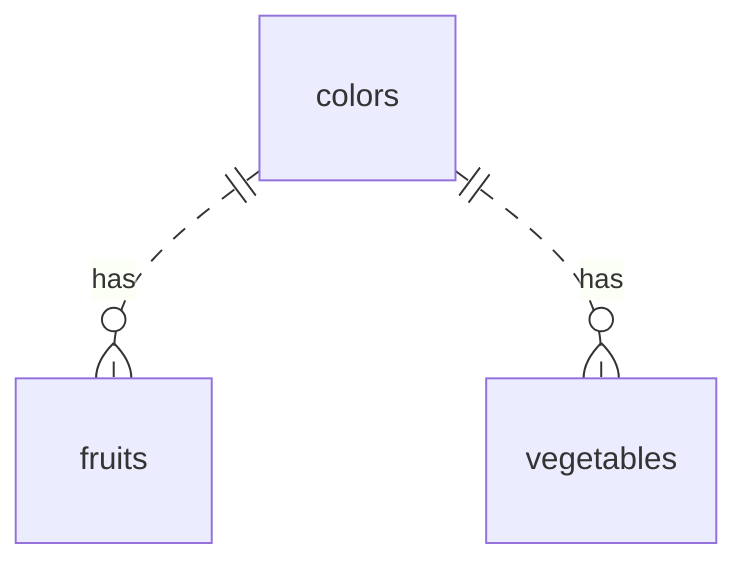
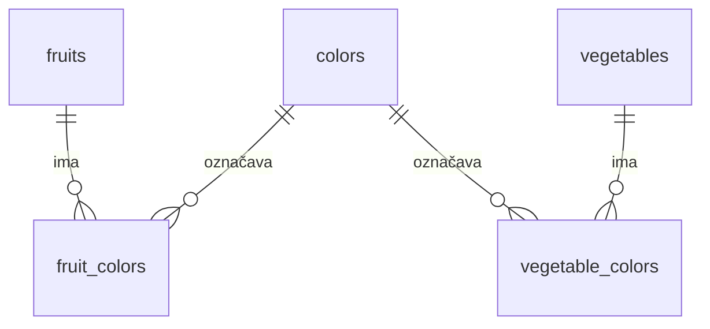
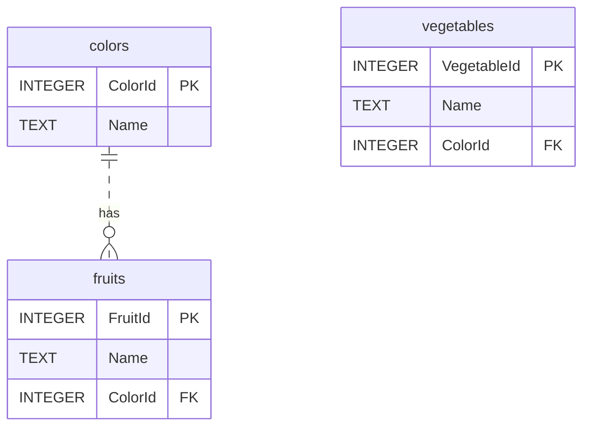

# Pitanja i odgovori — Dan 02: Uvod u SQLite

## Pitanje 1

Zašto se pored naziva terminala `python - fast-api-portfolio` pojavljuje znak uzvika? Da li svaki put treba da ugasim terminal i otvorim novi?

---

## Odgovor 1

Na tvojoj slici postoje **dva različita znaka**:

1. Narandžasti trougao sa uzvičnikom pored imena terminala je **VS Code indikator statusa terminala**.
2. `!2` u tekstu prompta, pored imena Git grane, dolazi iz podešavanja **Starship Git prompta**, ne iz VS Code upozorenja.

---

### Trougao pored naziva terminala

VS Code prikazuje indikatore kada se status terminala promeni. Sama slika nije pokazivala tekst upozorenja; naknadno si ga poslao i konkretan uzrok je objašnjen u **Odgovoru 3**.

Postavi pokazivač miša **preko trougla** i sačekaj poruku. Jedan mogući razlog je da ekstenzija želi da promeni promenljive okruženja i predlaže ponovno pokretanje terminala, ali to je samo mogućnost dok ne pročitamo poruku.

- Ako poruka traži **Relaunch Terminal**, ponovno pokretanje može biti korisno da se primene navedene promene. Pročitaj poruku pre izbora.

- Ako sve što ti je trenutno potrebno radi, **ne moraš automatski gasiti terminal samo zato što vidiš uzvičnik**.

- Pre zatvaranja sačuvaj rad i završi ili bezbedno prekini aktivne procese. Zatvaranje terminala prekida njegovu sesiju, uključujući otvoreni `litecli`; može prekinuti i druge programe koji u njemu rade.

- Ako ponovo otvoriš terminal i trougao nestane, to samo po sebi ne dokazuje šta je bio uzrok. Pošalji tekst poruke ili sliku sa otvorenim opisom ako želiš da utvrdimo baš taj slučaj.

Više o indikatorima: [VS Code Terminal Basics](https://code.visualstudio.com/docs/terminal/basics#_managing-terminals).

---

### `!2` pored Git grane

U tvojoj Starship konfiguraciji `!` je oznaka za **izmenjene praćene Git fajlove**, a broj pokazuje koliko ih je. Na primer, `!2` znači da je prompt tada prijavio dva izmenjena praćena fajla. To nije SQLite greška i nema veze sa narandžastim trouglom.

Proveri tačno stanje iz **Bash** prompta:

```bash
git status --short
```

Komanda prikazuje i druge vrste promena, na primer nove nepraćene fajlove; `!2` se ne mora odnositi na ukupan broj svih prikazanih stavki. Dok si unutar `litecli`, prvo izađi sa `exit` da bi se vratio u Bash.

---

## Pitanje 2

Ako iz korena projekta pokrenem `.venv/bin/litecli` i dobijem `(none)>`, da li je klijent pokrenut bez baze? Mogu li naknadno da otvorim bazu bez izlaska iz `litecli`-ja?

---

## Odgovor 2

Da. U tvojoj instalaciji `litecli` 1.17.1, pokretanje bez argumenta za bazu otvara klijent **bez aktivne konekcije ka bazi**. Prompt `(none)>` ukazuje da nije izabrana baza. To nije isto što i automatski otvorena `:memory:` baza.

```bash
# Pokretanje litecli bez argumenta za bazu

litecli
```

Proverio sam: kada se u tom stanju pokuša `SELECT 1;`, `litecli` prijavi `Not connected to database.`. Prompt je prilagodljiv, ali u tvojoj prikazanoj konfiguraciji `(none)` označava da nije zadata baza.

**Ne moraš da izađeš.** U postojećem `(none)>` promptu ukucaj:

```text
.open fast-api-course-my-work/sqlite_for_beginners/playground/databases/chinook_practice.db
```

Pritisni Enter. Ovo je `litecli` komanda, ne SQL: nema tačka-zareza. Očekuje se poruka da je klijent povezan sa bazom, a prompt se menja u skladu sa konfiguracijom.

Zatim u istom `litecli`-ju proveri otvoreni fajl:

```sql
PRAGMA database_list;
```

U redu `main` potraži putanju koja se završava sa `playground/databases/chinook_practice.db`. Probaj i upit:

```sql
SELECT ArtistId, Name
FROM artists
ORDER BY ArtistId
LIMIT 5;
```

Primer je proveren: `.open` otvara postojeću radnu kopiju i SQL upit vraća podatke, bez ponovnog pokretanja `litecli`-ja.

---

### Važne napomene o putanji i bezbednosti

- Relativna putanja u `.open` primeru računa se od direktorijuma iz kojeg je pokrenut `litecli` — ovde od korena repozitorijuma, ne od lokacije otvorenog `.sql` ili `.md` fajla.

- Proveri putanju pre otvaranja. Ako direktorijum postoji, a ime `.db` fajla je pogrešno, SQLite može napraviti novu praznu bazu. Komanda u primeru otvara bazu **za čitanje i pisanje**, pa se drži upita za čitanje dok ne želiš namerno da menjaš radnu kopiju.

- Ako želiš da proveriš da fajl postoji pre pokretanja, u Bash-u iz korena projekta koristi `test -f fast-api-course-my-work/sqlite_for_beginners/playground/databases/chinook_practice.db && echo "Baza postoji" || echo "Proveri putanju"`.

- Za privremenu bazu možeš u `litecli`-ju upotrebiti `.open :memory:`. To je zasebna baza u memoriji: ne sadrži Chinook podatke i nestaje po zatvaranju te konekcije.

- Kada je baza već otvorena, `.open` otvara drugu kao glavnu i zatvara prethodnu konekciju; nije isto što i SQL `ATTACH`, koji dodaje bazu postojećoj konekciji. Pre promene baze završi transakciju koju želiš da sačuvaš ili poništiš.

- Za izlazak iz `litecli`-ja upiši `exit` i pritisni Enter. To zatvara njegovu konekciju, ali ne briše fajl baze niti prekida zasebnu SQLTools konekciju.

Pokretanje `.venv/bin/litecli` direktno koristi izvršni fajl iz projektnog `.venv`, ali samo po sebi **ne aktivira `.venv` za ostale komande tog terminala**. Oznaka `py:v3.12.3` u promptu prikazuje verziju Pythona. Sama po sebi ne dokazuje da je `.venv` aktiviran.

---

## Pitanje 3

U opisu upozorenja piše da ekstenzija **Python Debugger** želi da ponovo pokrene terminal kako bi doprinela njegovom okruženju. Šta to znači?

---

## Odgovor 3

Sada znamo konkretan razlog upozorenja (trougao sa uskličnikom u VS Code-u): **Python Debugger traži ponovno pokretanje terminala da bi se primenile njegove promene okruženja**. Opis navodi podršku za debagovanje bez posebne konfiguracije i komandu `debugpy <script.py>`. To nije SQLite greška niti poruka da je `litecli` neispravan.

Ekstenzija je navedena i među onima koje su već doprinele okruženju terminala, ali istovremeno prijavljuje da želi ponovno pokretanje. Sam opis ne govori tačno koja se promenljiva promenila ni zašto. To nije potrebno da znamo unapred i ne moramo da nagađamo.

- Ako sada radiš SQLite vežbe i `litecli` funkcioniše, možeš **nastaviti u postojećem terminalu**. Ne moraš ga odmah gasiti.

- Kada budeš želeo promene za Python debugger u tom terminalu, završi rad, izađi iz `litecli` komandom `exit`, pa izaberi **Relaunch Terminal** ako ti VS Code tu opciju ponudi. Ponovno pokretanje prekida aktivne procese u tom terminalu.

- Novi terminal takođe može dobiti ažurirano okruženje. Nije potrebno ponovo pokretati terminal svaki put kada vidiš ikonicu: prvo pročitaj opis upozorenja.

`Shell integration: Rich` označava da je integracija terminala sa shell-om aktivna. Nazivi ekstenzija u odeljku „contributed“ opisuju njihove doprinose terminalu. Sami po sebi ne znače da postoji greška ili da je projektni `.venv` aktiviran.

---

## Pitanje 4

Zašto se u `litecli`-ju red sa komandom izgubi iz prikaza kada pritisnem Backspace? Želim da zadržim automatske predloge.

---

## Odgovor 4

U prvom testu problem je nestao kada si isključio **Terminal Sticky Scroll** u VS Code-u. Zatim si otvorio novi terminal i prijavio da sve radi i kada je Sticky Scroll uključen. Zato isključivanje Sticky Scroll-a ne možemo smatrati potvrđenim trajnim rešenjem niti znamo šta je bio uzrok problema.

Sticky Scroll prikazuje prethodnu shell komandu pri vrhu terminala dok se sadržaj pomera. To je podešavanje prikaza terminala, a ne `litecli`-jev meni za dovršavanje komandi: **automatski predlozi ostaju uključeni**. Ako sada sve radi, slobodno ostavi Sticky Scroll uključen.

### Kako privremeno testirati podešavanje ako se problem vrati

1. U VS Code-u otvori Settings pomoću `Ctrl+,`.
2. Potraži `Terminal Integrated Sticky Scroll Enabled`.
3. Izaberi **Workspace** ako želiš da promena važi za otvoreni workspace, pa isključi **Terminal › Integrated › Sticky Scroll: Enabled**.
4. Vrati se u `litecli`, otkucaj `.outpu` i pritisni Backspace. Proveri da li red ostaje vidljiv i da li se predlozi i dalje pojavljuju.

Postavka u odgovarajućem `settings.json` fajlu izgleda ovako:

```json
"terminal.integrated.stickyScroll.enabled": false
```

Isključivanje utiče na Sticky Scroll za terminale u izabranom opsegu podešavanja, ne samo na `litecli`. Ako želiš da ga vratiš, ponovo uključi istu opciju. Donji red `litecli`-ja sa oznakom `[F3] Multiline` i iskačući meni predloga su zasebni elementi i ovom promenom ih ne isključuješ.

Napomena: tokom prethodne provere nisam pronašao ovu postavku u projektnom `.vscode/settings.json` fajlu. U VS Code Settings možeš proveriti njenu vrednost u željenom opsegu.

---

## Pitanje 5

U novom terminalu sve radi i sa uključenim Sticky Scroll-om. Da li je problem nastao zbog upozorenja Python Debugger ekstenzije?

---

## Odgovor 5

To je mogućnost, ali **nemamo dokaz da je upozorenje izazvalo problem sa prikazom**. Upozorenje kaže da Python Debugger želi ponovno pokretanje terminala zbog svojih promena okruženja; ne navodi problem sa skrolovanjem ili `litecli`-jem.

Otvaranjem novog terminala započeta je nova terminalska sesija, pa se promenilo više stvari odjednom. Problem je mogao biti i privremeno stanje prikaza ili nešto drugo. Znamo samo da se u novoj sesiji, prema tvom testu, ne pojavljuje ni kada je Sticky Scroll uključen.

Ako se problem vrati, zabeleži da li je upozorenje prisutno, pa u **istoj sesiji** uporedi ponašanje sa uključenim i isključenim Sticky Scroll-om. Možeš zatim uporediti i novi terminal. Pre zatvaranja ili ponovnog pokretanja starog terminala završi rad u njemu, jer se aktivni procesi prekidaju.

---

## Pitanje 6

Da li `litecli` pokreće zaseban `sqlite3` proces u terminalu i kako se njegova konekcija razlikuje od SQLTools konekcije?

---

## Odgovor 6

`litecli` je zaseban klijent i otvara sopstvenu konekciju sa SQLite bazom, nezavisnu od SQLTools konekcije. Međutim, u ovoj instalaciji ne pokreće zaseban `sqlite3` CLI proces: koristi Pythonov modul `sqlite3` unutar `litecli` procesa.

Važno je razlikovati:

- **`sqlite3` CLI**: poseban program koji možeš direktno pokrenuti u terminalu komandom `sqlite3`.
- **Pythonov modul `sqlite3`**: biblioteka preko koje Python program, kao što je ovde `litecli`, pristupa SQLite bazi.
- **SQLTools**: VS Code ekstenzija u kojoj pišeš upite u editoru i izvršavaš ih preko njenog drajvera i konekcije. Sam unos u editoru nije konekcija.

`litecli` i SQLTools mogu istovremeno pristupati istom `.db` fajlu, ali koriste **odvojene konekcije**. Različite konekcije mogu koristiti i različite verzije SQLite biblioteke.

---

## Pitanje 7

Mogu li u `rlwrap` listu dopuna da dodam česte SQL reči kao što su `SELECT`, `INSERT INTO`, `VALUES` i `WHERE`?

---

## Odgovor 7

Da. Dodao sam česte SQL reči u `~/.config/sqlite-cli/sqlite3-completions` i sačuvao postojeće SQLite CLI komande sa tačkom. Lista je namenjena `rlwrap`-u, ne menja `sqlite3` ni `litecli`, i ne otkriva automatski nazive tabela i kolona.

Ako je `rlwrap` već pokrenut, izađi iz SQLite CLI-ja sa `.quit` i pokreni ga ponovo da učita izmenjenu listu. Na primer, iz Bash-a:

```bash
rlwrap -a -N -c -i -f "$HOME/.config/sqlite-cli/sqlite3-completions" sqlite3 :memory:
```

Ovo otvara privremenu bazu u memoriji, ne tvoju radnu bazu. Ukucaj `SEL` i pritisni **Tab** za `SELECT`; možeš probati i `VALU` za `VALUES` ili `WHER` za `WHERE`. Dovršavanje radi i usred upita: `SELECT * FRO` uz Tab dopunjava `FROM`.

Opcija `-i`, ispred `-f`, omogućava pronalaženje dopuna bez razlikovanja velikih i malih slova. Ne menja nužno već otkucana slova; SQLite SQL ključne reči prihvata bez obzira na veličinu slova. Ako ima više mogućih dopuna, pritisni Tab ponovo da ih vidiš ili unesi još slova.

`rlwrap` dovršava **pojedinačne reči**, pa se `INSERT` i `INTO` unose odvojeno; ne dopunjava celu frazu jednim Tab-om. Po završetku izađi sa `.quit`. Primeri dopune provereni su u privremenoj bazi i nisu menjali radnu bazu.

---

## Pitanje 8

Kako je odnos između `genres` i `tracks` 1:N ako `tracks.GenreId` može biti `NULL`? Zar nije potreban `NOT NULL` da bi jedna pesma pripadala jednom žanru? Da li postoje pesme bez žanra?

---

## Odgovor 8

Dobro primećuješ: **`NOT NULL` bi značio da svaka pesma mora imati upisan žanr**, ali nije neophodan da odnos bude 1:N. U ovoj šemi žanr pesme je **opcion**:

- Jedan žanr može biti povezan sa **nula, jednom ili više pesama**: `0..N`.
- Jedna pesma može biti povezana sa **nijednim ili jednim žanrom**: `0..1`.

Razlog je što svaki red u `tracks` ima samo jednu vrednost u koloni `GenreId`, dok više redova može sadržati isti `GenreId`. Strani ključ povezuje tu vrednost sa `genres.GenreId`. Kada je provera stranih ključeva uključena, vrednost koja nije `NULL` mora odgovarati postojećem žanru.

Na primer, zamislimo da je žanr sa ID-jem 1 rok:

| Pesma   | `GenreId` | Značenje u bazi                |
| ------- | --------: | ------------------------------ |
| Pesma A |         1 | Povezana je sa žanrom 1        |
| Pesma B |         1 | Povezana je sa istim žanrom 1  |
| Pesma C |    `NULL` | Nema zabeleženu vezu sa žanrom |

`NULL` ne mora da znači da pesma u stvarnosti nema žanr: može značiti i da žanr nije poznat ili nije unet. Šema dozvoljava oba tumačenja, ali sama ne objašnjava zašto je kolona projektovana kao opciona.

---

### Razlika između `FOREIGN KEY` i `NOT NULL`

- `FOREIGN KEY` određuje na koju tabelu i kolonu upućuje vrednost; kada je njegova provera uključena, sprečava vezu sa nepostojećim žanrom. Sam po sebi **ne zabranjuje `NULL`**.
- `NOT NULL` zabranjuje praznu vrednost. Uz uključen i ispravan strani ključ, svaka pesma bi tada morala biti povezana sa **tačno jednim postojećim žanrom**.
- Pošto `tracks.GenreId` nije `UNIQUE`, isti žanr može da se pojavi u više pesama. `NOT NULL` određuje obaveznost, a ne samo po sebi da li je veza 1:N.

U SQLite-u se provera stranih ključeva podešava **po konekciji**. Proveri svoju trenutnu konekciju:

```sql
PRAGMA foreign_keys;
```

Rezultat `1` znači da je provera uključena, a `0` da nije. Bez nje, baza može sadržati i `GenreId` koji ne postoji u `genres`.

---

### Šta je u tvojoj radnoj bazi?

Proverom radne kopije `chinook_practice.db` u režimu samo za čitanje pronađeno je **3.503 pesme, od kojih nijedna nema `NULL` u `GenreId`**. Takođe, nijedna neprazna vrednost `GenreId` nije ostala bez odgovarajućeg žanra. To je stanje u trenutku provere, ne ograničenje šeme: šema i dalje dozvoljava `NULL`.

Možeš i sam proveriti broj pesama bez zabeleženog žanra:

```sql
SELECT COUNT(*) AS pesme_bez_zanra
FROM tracks
WHERE GenreId IS NULL;
```

Za prikaz samih pesama umesto broja:

```sql
SELECT TrackId, Name, GenreId
FROM tracks
WHERE GenreId IS NULL;
```

Ako nema rezultata, to znači da ih trenutno nema u podacima, ne da ih šema zabranjuje.

Na [ER dijagramu](../chinook/ERD.drawio) veza je označena `1 : 0..N (GenreId NULL)`. Napomena `GenreId NULL` ukazuje na opcionost, ali oznaka **`0..1 : 0..N`** bi jasnije pokazala da pesma može biti bez zabeleženog žanra.

---

## Pitanje 9

Da li se `NOT NULL` i `UNIQUE` sa primarnog ključa `genres.GenreId` prenose na strani ključ `tracks.GenreId`, osim što se `NOT NULL` poništava?

---

## Odgovor 9

Ne prenose se: to su **dve zasebne kolone**, svaka sa svojim ograničenjima. Strani ključ ne poništava `NOT NULL` niti preuzima `UNIQUE` iz roditeljske kolone.

| Kolona           | Uloga i ograničenja                                                                          |
| ---------------- | -------------------------------------------------------------------------------------------- |
| `genres.GenreId` | Primarni ključ: identifikuje žanr i u ovoj tabeli je jedinstven i nije `NULL`.               |
| `tracks.GenreId` | Strani ključ: može biti `NULL` i nije `UNIQUE`, pa se isti ID može pojaviti kod više pesama. |

Na primer:

```text
genres                      tracks
GenreId | Name              TrackId | Name    | GenreId
--------+------             --------+---------+--------
1       | Rock              10      | Pesma A | 1
2       | Jazz              11      | Pesma B | 1
                            12      | Pesma C | NULL
```

U `genres` postoji samo jedan red sa ID-jem `1`, ali u `tracks` taj isti ID sme da se ponovi. Tako više pesama pripada žanru Rock.

Pesma ima najviše jedan zabeležen žanr zato što **jedan red u `tracks` ima jednu vrednost u koloni `GenreId`**. Jedinstvenost roditeljskog ključa osigurava da ta vrednost, ako postoji, određuje najviše jedan red u `genres`. Kada je provera stranih ključeva uključena, vrednost koja nije `NULL` mora odgovarati postojećem redu; `NULL` znači da veza nije zabeležena.

Kada bismo `tracks.GenreId` dodatno označili sa `UNIQUE`, isti žanr ne bi mogao da se dodeli dvema pesmama. Kada bismo dodali `NOT NULL`, svaka pesma bi morala da ima vrednost; uz uključenu proveru stranog ključa, ona bi morala da odgovara postojećem žanru. To su odvojena ograničenja koja se postavljaju na **kolonu u `tracks`**, ne nasleđuju se iz `genres`.

---

## Pitanje 10

Šta znače kolone rezultata `PRAGMA foreign_key_list('tracks')`? Od čega zavise `on_update` i `on_delete` i da li zavise od `NULL` ili `NOT NULL`?

---

## Odgovor 10

`PRAGMA foreign_key_list('tracks');` prikazuje **definicije stranih ključeva u tabeli `tracks`**. Svaki od tri reda u rezultatu opisuje jedan strani ključ:

| `id` | `seq` | `table`       | `from`        | `to`          | `on_update` | `on_delete` | `match` |
| ---: | ----: | ------------- | ------------- | ------------- | ----------- | ----------- | ------- |
|    0 |     0 | `media_types` | `MediaTypeId` | `MediaTypeId` | `NO ACTION` | `NO ACTION` | `NONE`  |
|    1 |     0 | `genres`      | `GenreId`     | `GenreId`     | `NO ACTION` | `NO ACTION` | `NONE`  |
|    2 |     0 | `albums`      | `AlbumId`     | `AlbumId`     | `NO ACTION` | `NO ACTION` | `NONE`  |

---

### Objašnjenje kolona

- **`id`**: identifikator stranog ključa u **ovom** PRAGMA rezultatu. Počinje od `0` i povećava se za svaki novi strani ključ u tabeli. **Ne označava ID žanra ili pesme i redosled nije nešto na šta se treba oslanjati kao na trajni identifikator**.

- **`seq`**: redni broj kolone unutar istog stranog ključa. Počinje od `0` i **povećava se za svaku kolonu u okviru istog FK**. Ovde svaki FK obuhvata jednu kolonu u tabeli `tracks`, pa je svuda `0`. Složeni FK sa više kolona imao bi više redova sa istim `id` i različitim `seq`.

- **`table`**: roditeljska tabela na koju FK upućuje, na primer `genres`.
- **`from`**: kolona u tabeli koju proveravamo, ovde u `tracks`.
- **`to`**: referencirana kolona u roditeljskoj tabeli.
- **`on_update`**: podešeni postupak kada se promeni vrednost **referenciranog ključa** u roditeljskoj tabeli.
- **`on_delete`**: podešeni postupak kada se obriše roditeljski red.

- **`match`**: informacija o načinu uparivanja; ovde piše `NONE`. SQLite ne sprovodi posebne `MATCH` režime, već za složene FK koristi ponašanje kao `MATCH SIMPLE`.

Red sa `genres` znači: **`tracks.GenreId` → `genres.GenreId`**. Upit ne prikazuje da li je `tracks.GenreId` `NULL` ili `NOT NULL`; to proveri sa `PRAGMA table_info('tracks');` ili `.schema tracks`. `.schema genres` prikazuje roditeljsku tabelu, ali se pravila ove veze nalaze u definiciji **`tracks`**:

```sql
FOREIGN KEY ([GenreId]) REFERENCES "genres" ([GenreId])
    ON DELETE NO ACTION ON UPDATE NO ACTION
```

---

### Šta je `NO ACTION`?

Ovo je naziv jedne od mogućih FK akcija; samostalna vrednost **`ACTION` nije SQLite FK akcija**. `NO ACTION` znači da SQLite **ne menja automatski povezane redove**. Ne znači da ignoriše strani ključ.

Zamisli žanr `GenreId = 1` i pesmu sa `tracks.GenreId = 1`. Ako je provera FK uključena i pokušaš da obrišeš žanr ili promeniš njegov ID, a pesma i dalje pokazuje na stari ID, povređuje se FK ograničenje i dobija se greška `FOREIGN KEY constraint failed`. Kod uobičajenog neposrednog FK ograničenja provera je na kraju naredbe; kod odloženog može biti na kraju transakcije. Ako nema zavisnih redova i nema drugih ograničenja koja smetaju, brisanje može uspeti.

`ON UPDATE` ovde se odnosi na promenu **`genres.GenreId`**, ne na promenu `genres.Name` niti na izmenu same pesme.

---

### Koje akcije postoje?

Za svaki FK, `ON DELETE` i `ON UPDATE` mogu se definisati zasebno u njegovoj šemi. Ako se neka izostavi, njena podrazumevana vrednost je `NO ACTION`.

| Akcija        | Kada se briše ili menja referencirani roditeljski ključ                                                                |
| ------------- | ---------------------------------------------------------------------------------------------------------------------- |
| `NO ACTION`   | Ne menja automatski dete; FK ograničenje se i dalje proverava.                                                         |
| `RESTRICT`    | Zabranjuje brisanje/promenu ako postoji povezano dete, i proverava to odmah, čak i kod odloženog FK.                   |
| `CASCADE`     | Kod brisanja briše povezane redove deteta; kod promene ID-ja ažurira njihove FK vrednosti.                             |
| `SET NULL`    | Postavlja FK vrednosti povezanih redova na `NULL`.                                                                     |
| `SET DEFAULT` | Postavlja FK vrednosti na podrazumevanu vrednost kolone. Ta vrednost i dalje mora zadovoljiti ostala ograničenja i FK. |

---

### Kakve veze ima `NULL`?

Akcija se **ne bira automatski** prema tome da li je FK kolona `NULL` ili `NOT NULL`: projektant je zadaje u definiciji FK. Ali akcija mora biti **u skladu sa drugim ograničenjima**:

- `NO ACTION` može postojati i uz opcionu i uz `NOT NULL` kolonu. Ako postoje povezane pesme, brisanje žanra može biti odbijeno u oba slučaja.
- `SET NULL` može se definisati i uz `NOT NULL`, ali ako bi zaista morao da postavi tu kolonu na `NULL`, naredba će pasti zbog `NOT NULL` ograničenja.
- `CASCADE` može raditi i uz `NOT NULL`: pri brisanju uklanja dete, a pri promeni ID-ja upisuje novi ID.

Ove primere proverio sam u zasebnim privremenim bazama u memoriji, ne nad radnom bazom.

---

### Važno za SQLite

Sama tabela iz `foreign_key_list` pokazuje **šta je definisano**, a ne da li se to sprovodi u trenutnoj konekciji. Proveri:

```sql
PRAGMA foreign_keys;
```

`1` znači uključeno, `0` isključeno. U SQLite-u se ova opcija podešava po konekciji; `PRAGMA foreign_keys = ON;` treba izvršiti van aktivne transakcije, pre rada koji zahteva proveru. Različiti klijenti mogu imati različita podešavanja. Sa isključenom proverom FK ne treba očekivati ni sprovođenje navedenih FK akcija.

Izvor: [SQLite Foreign Key Support — ON DELETE and ON UPDATE Actions](https://www.sqlite.org/foreignkeys.html#fk_actions).

---

## Pitanje 11

Da li PK i FK kolone moraju imati isto ime? U SQLAlchemy primeru PK je `users.id`, a FK je `user_id`.

---

## Odgovor 11

Ne moraju. Ime kolone je stvar dogovorene konvencije; vezu određuje **definicija stranog ključa**, ne podudaranje imena.

Na primer:

```sql
CREATE TABLE users (
    id INTEGER PRIMARY KEY
);

CREATE TABLE posts (
    id INTEGER PRIMARY KEY,
    user_id INTEGER REFERENCES users(id)
);
```

Ovde `posts.user_id` upućuje na `users.id`, iako se kolone različito zovu. U SQLAlchemy-ju se ista ciljna kolona može navesti kao `ForeignKey("users.id")`.

U Chinook bazi `tracks.GenreId` i `genres.GenreId` imaju isto ime, ali to je izbor autora šeme, ne zahtev SQLite-a ili SQLAlchemy-ja. Naziv `user_id` u drugoj tabeli koristan je jer jasno govori na kog korisnika kolona upućuje.

---

## Pitanje 12

Ako u `tracks` dodamo još jednu kolonu koja upućuje na `genres.GenreId`, da li će njen `seq` biti `1`?

---

## Odgovor 12

Ne ako tu kolonu definišemo kao **zaseban strani ključ**. `seq` ne broji ni pesme ni sve FK kolone u tabeli, nego poziciju kolone **unutar jedne definicije stranog ključa**. `PRAGMA foreign_key_list` opisuje strukturu tabele, ne konkretne redove sa pesmama.

Zamisli primer sa dve nezavisne veze ka istom žanru:

```sql
CREATE TABLE primer (
    primarni_zanr_id INTEGER REFERENCES genres(GenreId),
    dodatni_zanr_id INTEGER REFERENCES genres(GenreId)
);
```

Ovo su **dva odvojena strana ključa**, svaki sa po jednom kolonom. U `PRAGMA foreign_key_list('primer')` imaju različit `id`, ali oba imaju `seq = 0`. Različit `id` ne znači različitu pesmu: on razlikuje FK definicije.

---

### Kada se pojavljuje `seq = 1`?

Kada je **jedan strani ključ sastavljen od više kolona**. Na primer, u izmišljenom modelu žanr identifikujemo parom `(genre_id, region_id)`:

```sql
CREATE TABLE genre_regional (
    genre_id INTEGER,
    region_id INTEGER,
    PRIMARY KEY (genre_id, region_id)
);

CREATE TABLE regional_tracks (
    genre_id INTEGER,
    region_id INTEGER,
    FOREIGN KEY (genre_id, region_id)
        REFERENCES genre_regional (genre_id, region_id)
);
```

Ovde su obe kolone deo **jednog složenog FK**. Ako u `regional_tracks` upišemo par `(1, 2)`, on kao celina upućuje na red sa parom `(1, 2)` u `genre_regional`; ne radi se o dva zasebna žanra. U SQLite-u, ako je neka od kolona složenog FK `NULL`, ne zahteva se odgovarajući roditeljski red.

Rezultat `PRAGMA foreign_key_list('regional_tracks')` sadrži, između ostalog:

| `id` | `seq` | `from`      | `to`        |
| ---: | ----: | ----------- | ----------- |
|    0 |     0 | `genre_id`  | `genre_id`  |
|    0 |     1 | `region_id` | `region_id` |

Isti `id` znači isti FK, a `seq` razlikuje prvu i drugu kolonu tog FK-a. Ovo je izmišljeni primer za objašnjenje, ne struktura tvoje Chinook baze. Primeri su provereni u privremenoj bazi u memoriji.

---

## Pitanje 13

Zašto `.schema employees` prikazuje tabelu iz priključene baze `chinook`, a `.schema chinook.employees` ne prikazuje ništa?

---

## Odgovor 13

Razlika je u tome što `.schema` **nije SQL naredba**, već komanda SQLite CLI-ja. Njen argument je obrazac za izbor objekata, a ne SQL izraz u obliku `naziv_baze.naziv_tabele`.

U tvojoj sesiji `.databases` potvrđuje da je `chinook_practice.db` priključen pod imenom `chinook`. Tabela se zove **`employees`**, dok je `chinook` ime priključene baze u toj konekciji.

```text
.schema employees
```

Komanda pronalazi objekte povezane sa tabelom `employees` i prikazuje i njenu definiciju iz priključene baze. Prefiks `chinook.` u ispisu pokazuje kojoj bazi pripadaju prikazani objekti. U tvom izlazu vidiš i definiciju tabele i njen indeks.

```text
.schema chinook.employees
```

U proveri na tvojoj verziji SQLite CLI-ja taj argument **ne bira tabelu `employees` u bazi `chinook`**; ne nalazi odgovarajuće objekte i zato nema ispisa. To ne znači da tabela ne postoji. Navodnici ne menjaju tu razliku, a u poslednjem pokušaju `empoyees` ima i slovnu grešku: nedostaje `l` u `employees`.

---

### Razlika u odnosu na SQL

U SQL upitu prefiks baze se koristi upravo tako:

```sql
SELECT *
FROM chinook.employees
LIMIT 5;
```

Ako želiš definiciju samo iz baze `chinook`, možeš upitati njenu sistemsku tabelu `sqlite_schema`:

```sql
SELECT sql
FROM chinook.sqlite_schema
WHERE type = 'table' AND name = 'employees';
```

Ovaj upit vraća sačuvanu SQL definiciju **tabele**, ali ne i njen indeks. Ako želiš i definicije indeksa povezane sa tabelom:

```sql
SELECT type, name, sql
FROM chinook.sqlite_schema
WHERE tbl_name = 'employees'
  AND type IN ('table', 'index');
```

Za pregled kolona postoji i SQL PRAGMA sa navedenom bazom:

```sql
PRAGMA chinook.table_info('employees');
```

Ako i `main` i `chinook` imaju tabelu `employees`, `.schema employees` može prikazati definicije iz obe baze. Zato je upit nad `chinook.sqlite_schema` koristan kada želiš rezultat samo iz konkretne priključene baze.

Primeri su provereni sa privremenom glavnom bazom u memoriji i Chinook bazom priključenom u režimu samo za čitanje. `rlwrap` samo omotava SQLite CLI; ne određuje značenje `.schema` komande.

---

## Pitanje 14

Zašto SQLite prihvata i `'user'` i `"user"` kao ime tabele ako se za tekst koriste jednostruki navodnici?

---

## Odgovor 14

Dobro primećuješ: SQLite zaista može prihvatiti oba oblika u određenim kontekstima. Preporuka da za tekst koristimo jednostruke navodnike i dalje je važna, ali trebalo je naglasiti da SQLite ima **izuzetke radi kompatibilnosti**.

Uobičajeno SQL pravilo je:

- `'Rock'` je **tekstualna vrednost** (string).
- `"Name"` je **identifikator**: na primer, ime kolone. Isto važi za `"genres"` kao ime tabele.

Razlika se jasno vidi na stvarnoj tabeli `genres`:

```sql
SELECT 'Name' AS tekst, "Name" AS kolona
FROM genres
WHERE GenreId = 1;
```

`'Name'` vraća doslovni tekst `Name`, dok `"Name"` vraća vrednost kolone `Name` za izabrani red. Navodnici dakle nisu uopšteno zamenljivi.

---

### Zašto `'genres'` funkcioniše posle `FROM`?

U `FROM` SQLite očekuje naziv tabele, ne tekstualnu vrednost. Radi kompatibilnosti sa starijim SQL kodom može protumačiti i ime u jednostrukim navodnicima kao identifikator:

```sql
SELECT COUNT(*) FROM 'genres';  -- SQLite prihvata, ali nije preporučen stil
SELECT COUNT(*) FROM "genres";  -- identifikator
SELECT COUNT(*) FROM genres;    -- takođe ispravno
```

Proverio sam: u trenutnoj radnoj bazi sva tri oblika nalaze tabelu `genres`. To ne znači da su `'genres'` i `"genres"` svuda isto: značenje zavisi od konteksta. Za imena tabela i kolona koristi identifikator bez navodnika kada je to moguće, a po potrebi dvostruke navodnike.

---

### A dvostruki navodnici oko tekstualne vrednosti?

SQLite ima i zaseban režim kompatibilnosti u kome nerazrešen identifikator u dvostrukim navodnicima može biti protumačen kao tekst. Da li je to dozvoljeno zavisi od podešavanja i klijenta. U mojoj proveri tvog `sqlite3` CLI-ja `dqs_dml` je bio isključen; u zasebnoj testnoj konekciji uključivanje te opcije omogućilo je da se `"NepostojecaKolona"` protumači kao tekst. Nisam menjao trajnu konfiguraciju.

Opasnost je što `"Name"` može označavati postojeću kolonu umesto teksta `Name`, pa upit može raditi, ali dati drugačiji rezultat od očekivanog.

Zato piši, na primer:

```sql
SELECT "Name"
FROM genres
WHERE "Name" = 'Rock';
```

Ovde je `"Name"` kolona, a `'Rock'` tekst koji tražimo. To je jasnije i prenosivije od oslanjanja na SQLite izuzetke. Više: [SQLite Keywords and quoting rules](https://www.sqlite.org/lang_keywords.html).

---

## Pitanje 15

Šta je `sqlite_schema`, kada i kako se čuvaju SQL definicije i gde se nalaze?

---

## Odgovor 15

`sqlite_schema` je SQLite-ova **sistemska tabela sa metapodacima**: opisuje strukturu baze, a ne njene poslovne podatke. Možeš je zamisliti kao katalog objekata u bazi.

Na primer:

- Tabela `employees` sadrži podatke o zaposlenima.
- `sqlite_schema` sadrži red koji opisuje kako je tabela `employees` definisana, kao i zasebne redove za druge objekte, kao što su indeksi.

---

### Gde se čuva?

Za običnu bazu na disku, šema se čuva **u samom SQLite fajlu baze**, zajedno sa ostalim sadržajem baze, a ne u posebnom `.sql` fajlu. SQLite fajl ima unutrašnju organizaciju; to nije tekstualni fajl koji možeš otvoriti i ručno uređivati, već binarni fajl koji SQLite koristi za skladištenje podataka i metapodataka.

U tvojoj sesiji:

```text
main     → sandbox.db              → main.sqlite_schema
chinook  → chinook_practice.db     → chinook.sqlite_schema
```

Svaka baza ima sopstvenu tabelu šeme. `chinook` je naziv koji si dodelio priključenoj bazi za tu konekciju; ne znači da je `sqlite_schema` posebna baza ili poseban fajl. Kada otvoriš istu bazu kao `main`, njen katalog možeš čitati kao `main.sqlite_schema`. Kod `:memory:` baze šema je u memoriji i nestaje zajedno sa tom bazom.

**Napomena:** u WAL režimu neke potvrđene izmene mogu privremeno biti zapisane u pratećem WAL fajlu pre nego što budu prenete u glavni `.db` fajl. Zato tokom aktivnog rada ne treba pretpostaviti da je kopiranje samo `.db` fajla uvek potpuna i bezbedna rezervna kopija.

---

### Kada se definicija upisuje?

SQLite automatski održava katalog kada uspešno izvršava naredbe koje menjaju strukturu baze, na primer:

1. `CREATE TABLE` kreira tabelu i upisuje njen opis u `sqlite_schema`.
2. `CREATE INDEX`, `CREATE VIEW` i `CREATE TRIGGER` stvaraju odgovarajuće objekte i njihove opise.
3. `ALTER TABLE` može izmeniti sačuvanu definiciju, a `DROP TABLE` uklanja opis obrisane tabele i relevantnih objekata.

Na primer, ovo je **ilustracija**, ne naredba koju treba da pokreneš u radnoj bazi:

```sql
CREATE TABLE primer (
    id INTEGER PRIMARY KEY,
    naziv TEXT
);
```

Nakon uspešnog izvršavanja, `sqlite_schema` ima red sa `type = 'table'`, `name = 'primer'` i SQL tekstom koji opisuje definiciju tabele. SQLite sam obavlja taj posao: ne moraš ručno praviti ili dopunjavati sistemsku tabelu.

Promene šeme učestvuju u transakcijama. U eksplicitnoj transakciji vidiš novu definiciju u toj konekciji pre `COMMIT`; `ROLLBACK` može poništiti kreiranje. Bez eksplicitnog `BEGIN`, pri uobičajenom autocommit režimu uspešna samostalna naredba se automatski potvrđuje. Proverio sam kreiranje i poništavanje u privremenoj bazi u memoriji.

---

### Šta znače njene kolone?

```sql
SELECT type, name, tbl_name, rootpage, sql
FROM chinook.sqlite_schema
ORDER BY type, name;
```

| Kolona     | Značenje                                                                                                       |
| ---------- | -------------------------------------------------------------------------------------------------------------- |
| `type`     | Vrsta objekta: `table`, `index`, `view` ili `trigger`.                                                         |
| `name`     | Ime objekta.                                                                                                   |
| `tbl_name` | Tabela ili pogled kojem objekat pripada; kod same tabele jednako je njenom imenu.                              |
| `rootpage` | Broj početne stranice strukture podataka za tabelu ili indeks; za pogled ili trigger obično je `0` ili `NULL`. |
| `sql`      | SQL tekst koji opisuje kreiranje objekta.                                                                      |

`sql` je obično početna `CREATE` definicija, ali SQLite može normalizovati njen zapis i izmeniti ga nakon `ALTER TABLE`. To **nije istorija svih izvršenih upita**, niti se tu čuva svaka `INSERT`, `UPDATE` ili `SELECT` naredba. Za neke automatske indekse kolona `sql` je `NULL`. `sqlite_schema` ne sadrži red za samu sebe.

Za definiciju konkretne tabele u priključenoj bazi:

```sql
SELECT sql
FROM chinook.sqlite_schema
WHERE type = 'table' AND name = 'employees';
```

`.schema employees` je praktična CLI komanda za prikaz šeme; upit nad `sqlite_schema` je SQL i omogućava da izabereš konkretnu bazu i filtriraš rezultat. Čitanje kataloga je bezbedno, ali **nemoj ručno menjati `sqlite_schema`**: SQLite njime upravlja i nepravilne izmene mogu oštetiti bazu.

Starije ime `sqlite_master` je alternativno ime za istu tabelu šeme.

---

## Pitanje 16

Kako `.sql` fajl izvršava naredbe nad SQLite bazom i može li da je trajno promeni?

---

## Odgovor 16

Da, dobro si razumeo. `.sql` fajl je tekstualni fajl sa naredbama; on se **ne izvršava sam**. Program kao što je `sqlite3` CLI pročita fajl, a zatim SQL naredbe prosledi SQLite biblioteci. Biblioteka ih obrađuje i izvršava nad bazom otvorenom u toj konekciji.

```text
skripta.sql → sqlite3 CLI → SQLite biblioteka → otvorena baza
```

Na primer, fajl može sadržati:

```sql
CREATE TABLE primer (id INTEGER PRIMARY KEY, naziv TEXT);
ALTER TABLE primer ADD COLUMN opis TEXT;
INSERT INTO primer (naziv) VALUES ('Test');
SELECT * FROM primer;
```

`CREATE` i `ALTER` menjaju strukturu, `INSERT` dodaje podatke, a `SELECT` ih čita. `DROP TABLE` bi uklonio tabelu i njene podatke. SQLite automatski ažurira i `sqlite_schema` kada se šema promeni.

U SQLite CLI-ju komanda `.read putanja/do/skripte.sql` učitava fajl. **Samo je ilustracija: pre izvršavanja proveri sadržaj skripte i koja je baza otvorena**, jer pisanje u fajl ili njegovo otvaranje u editoru samo po sebi ne menja bazu, ali `.read` izvršava sadržaj. CLI komande sa tačkom poput `.read` obrađuje CLI; one nisu SQL naredbe koje biblioteka izvršava.

Ako je otvorena baza na disku i promene su uspešno **potvrđene** (`COMMIT`, ili automatska potvrda kada nema otvorene eksplicitne transakcije), one ostaju i nakon zatvaranja konekcije. U aktivnoj transakciji `ROLLBACK` može poništiti nepotvrđene izmene. Otvaranje baze samo za čitanje sprečava upis u nju, a baza `:memory:` je privremena.

Ako je dodatna baza priključena sa `ATTACH`, naredba može ciljati i nju, na primer pomoću prefiksa `chinook.`. Zato pre izvršavanja proveri `.databases`, sadržaj skripte i bazu na koju se svaka naredba odnosi. Za vežbanje koristi privremenu bazu ili radnu kopiju i napravi rezervnu kopiju pre potencijalno destruktivnih izmena.

---

## Pitanje 17

Kako rešiti Vežbu 5 „Poveži lekciju sa aplikacijom“ iz lekcije o povezivanju sa SQLite bazom?

---

## Odgovor 17

U [konfiguraciji TodoApp aplikacije](../../TodoApp/db/database.py) SQLAlchemy koristi:

```python
SQLALCHEMY_DATABASE_URL = "sqlite:///./TodoApp/data/todosapp.db"
```

`sqlite:///` označava SQLite URL, a `./TodoApp/data/todosapp.db` je **relativna putanja**. Ona se računa od trenutnog radnog direktorijuma **procesa aplikacije**, ne automatski od direktorijuma u kojem se nalazi `database.py`.

Postojeći fajl sam proverio bez menjanja, iz korena repozitorijuma:

```bash
sqlite3 -readonly fast-api-course-my-work/TodoApp/data/todosapp.db
```

U SQLite CLI-ju:

```text
.databases
```

Rezultat za `main` je:

```text
/home/jole-pavlovic-dev/code/python-automation-lab/fast-api-portfolio/fast-api-course-my-work/TodoApp/data/todosapp.db
```

`r/o` znači da je ta **CLI konekcija** otvorena samo za čitanje; ne znači da je i konekcija aplikacije samo za čitanje. Izađi sa `.quit`.

### Da li su to isti fajl?

Zavisi od radnog direktorijuma procesa koji pokreće aplikaciju:

| Radni direktorijum aplikacije                        | URL se razrešava u                                                            | Poklapanje sa proverenim CLI fajlom |
| ---------------------------------------------------- | ----------------------------------------------------------------------------- | ----------------------------------- |
| `fast-api-portfolio/fast-api-course-my-work`         | `fast-api-portfolio/fast-api-course-my-work/TodoApp/data/todosapp.db`         | Da                                  |
| `fast-api-portfolio`                                 | `fast-api-portfolio/TodoApp/data/todosapp.db`                                 | Ne                                  |
| `fast-api-portfolio/fast-api-course-my-work/TodoApp` | `fast-api-portfolio/fast-api-course-my-work/TodoApp/TodoApp/data/todosapp.db` | Ne                                  |

Ovo su poređenja putanja: **nisam utvrdio stvarni radni direktorijum pokrenute aplikacije**, pa ne mogu potvrditi koju bazu ona trenutno koristi. `pwd` u terminalu prikazuje direktorijum tog shell-a; za aplikaciju pokrenutu iz drugog terminala ili VS Code debug konfiguracije treba proveriti direktorijum njenog procesa. U prethodnom primeru sa `sandbox.db` i priključenom Chinook bazom, `.databases` je prikazivao druge fajlove, ne ovaj TodoApp fajl.

Ako je putanja pogrešna, SQLite može napraviti novi prazni fajl kada direktorijum postoji i upis je dozvoljen, ili prijaviti grešku ako putanja nije dostupna. Zato nemoj pokretati aplikaciju samo radi probe nad neproverenom putanjom.

---

## Pitanje 18

Da li je zapisano rešenje Vežbe 5 u lekciji „How to connect to SQLite“ dobro?

---

## Odgovor 18

Tvoje novo rešenje je znatno potpunije od prethodnog šablona: koristi stvarne putanje, odvaja Bash i SQLite CLI komande i objašnjava zavisnost od radnog direktorijuma. Ispravio sam i dopunio sledeće:

1. Projektno okruženje je `.venv`, pa je komanda iz korena repozitorijuma `source .venv/bin/activate`, ne `source venv/bin/activate`. Za `cat` i `sqlite3` aktivacija nije obavezna.

2. Za bezbedniji pregled postojeće baze upotrebio sam `sqlite3 -readonly`, dodao `pwd` i prikazao provereni rezultat `.databases`.

3. Zaključak je uslovan: putanje vode do istog fajla **ako** je radni direktorijum procesa aplikacije `fast-api-course-my-work`. Promena direktorijuma u terminalu za CLI sama ne dokazuje radni direktorijum aplikacije pokrenute u drugom procesu.

4. `.tables` dodatno pokazuje sadržaj, ali ne dokazuje sama po sebi identitet fajla. `r/o` u izlazu odnosi se na CLI konekciju, ne nužno na aplikaciju.

---

## Pitanje 19

Koji je radni direktorijum procesa TodoApp aplikacije i da li ona koristi isti fajl kao SQLite CLI?

---

## Odgovor 19

Pri proveri nisam pronašao pokrenut proces TodoApp aplikacije niti FastAPI servera, pa **nije bilo procesa aplikacije čiji radni direktorijum mogu da proverim**. Nisam pokretao aplikaciju ni menjao bazu.

Pronašao sam pokrenut `sqlite3` CLI proces. Njegov radni direktorijum je:

```text
/home/jole-pavlovic-dev/code/python-automation-lab/fast-api-portfolio/fast-api-course-my-work
```

Proverom otvorenih fajlova tog procesa utvrdio sam da njegov CLI koristi:

```text
/home/jole-pavlovic-dev/code/python-automation-lab/fast-api-portfolio/fast-api-course-my-work/TodoApp/data/todosapp.db
```

To je **proces SQLite CLI-ja, ne proces aplikacije**. Ako se aplikacija pokrene sa istim radnim direktorijumom i koristi trenutno zapisani URL `sqlite:///./TodoApp/data/todosapp.db`, njena relativna putanja vodi do istog fajla. Dok ne proverimo stvarni proces aplikacije, to je uslovni zaključak, a ne potvrda njene aktivne konekcije.

U Linux/WSL okruženju se radni direktorijum već pokrenutog procesa može proveriti komandom u Bash-u:

```bash
readlink /proc/PID/cwd
```

Zameni `PID` stvarnim brojem **procesa aplikacije**, ne brojem SQLite CLI-ja. Ako proces nije pokrenut ili nemaš pravo pristupa, provera neće dati traženi rezultat.

---

## Pitanje 20

Kako da pokrenem TodoApp radi provere — preko Uvicorn-a?

---

## Odgovor 20

Da. Uvicorn je server koji pokreće FastAPI aplikaciju. U ovom projektu objekat `app` nalazi se u `TodoApp/main.py`, pa je oznaka aplikacije `TodoApp.main:app`.

**Važno pre pokretanja:** `main.py` pri učitavanju poziva `Base.metadata.create_all(bind=engine)`. To može napraviti nedostajuće tabele u bazi, pa pokretanje nije nužno samo za čitanje. Proveri putanju i, ako ne želiš moguće izmene postojeće baze, nemoj pokretati aplikaciju nad njom. Za samo rešavanje vežbe dovoljno je uslovno poređenje URL-a i radnog direktorijuma; pokretanje nije obavezno.

Ako želiš da pokreneš aplikaciju koristeći postojeću TodoApp bazu, otvori **novi Bash terminal**. Iz korena repozitorijuma:

```bash
source .venv/bin/activate
cd fast-api-course-my-work
pwd
python -m uvicorn TodoApp.main:app
```

Prvi red aktivira projektni `.venv`; `cd` određuje radni direktorijum iz kojeg će proces naslediti relativnu putanju baze. `python -m uvicorn` koristi Uvicorn iz aktivnog Python okruženja. Ne dodajemo `--reload` u ovaj primer, kako bismo jednostavnije identifikovali proces servera.

Ako pokretanje uspe, Uvicorn ispisuje `Started server process [broj]` i adresu, obično `http://127.0.0.1:8000`. Dokumentacija API-ja je na `http://127.0.0.1:8000/docs`. Ako prijavi da adresa već postoji ili da nedostaje podešavanje, pročitaj poruku o grešci; aplikacija zahteva `JWT_SECRET_KEY` u okruženju ili `.env` fajlu. Ne ispisuj niti deli vrednost ključa.

Dok server radi, u **drugom** Bash terminalu proveri njegov direktorijum pomoću broja iz `Started server process`:

```bash
readlink /proc/PID/cwd
```

Zameni `PID` stvarnim brojem, bez uglastih zagrada. Ako ispiše direktorijum `fast-api-course-my-work`, sadašnja relativna putanja iz `database.py` vodi do `fast-api-course-my-work/TodoApp/data/todosapp.db`. Za kraj vrati se u terminal servera i pritisni `Ctrl+C`.

Ovo su uputstva, ne potvrda da sam pokrenuo server ili proverio njegov proces. Ako želiš da ja proverim pokrenutu aplikaciju, prvo je pokreni na opisani način, ako prihvataš moguću promenu šeme, i javi rezultat.

---

## Pitanje 21

Pokrenuo sam FastAPI u drugom terminalu. Da li aplikacija i SQLite CLI koriste isti fajl?

---

## Odgovor 21

Da. Nakon što si pokrenuo aplikaciju, proverio sam njen proces i otvorene fajlove. U trenutku provere:

- Radni direktorijum procesa aplikacije bio je `fast-api-portfolio/fast-api-course-my-work`.
- I aplikacija i ranije pokrenuti SQLite CLI imali su otvoren isti fajl: `fast-api-portfolio/fast-api-course-my-work/TodoApp/data/todosapp.db`.
- Aplikacija je odgovarala: zahtev za `/openapi.json` vratio je HTTP `200`.

To su **odvojene konekcije prema istom fajlu**. Prethodna napomena da proces aplikacije nije pronađen odnosila se na raniji trenutak, pre nego što si je pokrenuo.

Koristio si `--reload`, pa postoje odvojeni nadzorni i serverski proces; proverio sam radni direktorijum i otvorenu bazu serverskog procesa. Brojevi procesa mogu se promeniti pri ponovnom pokretanju ili reload-u.

Server je pokrenut sa `--host 0.0.0.0`, što ga sluša na svim dostupnim mrežnim interfejsima, a ne samo na `127.0.0.1`. Za lokalno vežbanje možeš sledeći put koristiti `--host 127.0.0.1` ili izostaviti tu opciju. Nisam menjao ni zaustavljao tvoj server; kada završiš, možeš ga zaustaviti sa `Ctrl+C` u njegovom terminalu.

---

## Pitanje 22

Kako da Vežba 5 uključi pokretanje FastAPI aplikacije i proveru baze?

---

## Odgovor 22

Dopunio sam [Vežbu 5](../00_intro/03_how_to_connect_to_sqlite.md) koracima za pokretanje Uvicorn-a, proveru radnog direktorijuma server procesa i poređenje sa `.databases` u drugom terminalu. Uputstvo upozorava da pokretanje aplikacije može napraviti nedostajuće tabele; SQLite CLI se otvara samo za čitanje.

---

## Pitanje 23

Kako se kreira Mermaid ER dijagram i šta znači sintaksa `colors ||--o{ fruits : has`?

---

## Odgovor 23

Mermaid je način da **tekstom opišeš dijagram**, a alat ga zatim prikaže kao sliku. To nije SQL: pisanje Mermaid dijagrama ne kreira tabele i ne menja bazu.

Za učenje sintakse prvo koristi pojednostavljen primer u kojem za svaki zapis beležimo **jednu glavnu boju**. To nije tvrdnja da voće ili povrće u stvarnosti može imati samo jednu boju. U Markdown fajl upiši blok koda označen sa `mermaid`:



`erDiagram` kaže Mermaid-u da crta **ER dijagram** — dijagram entiteta i njihovih veza. Sačuvaj fajl i u VS Code-u otvori Markdown pregled pomoću `Ctrl+Shift+V`. Ako se vidi samo tekst koda, za prikaz je potrebna podrška za Mermaid u Markdown pregledu.

---

### Kako se čita jedan red?

```text
colors ||..o{ fruits : has
```

| Deo      | Značenje                                                                             |
| -------- | ------------------------------------------------------------------------------------ |
| `colors` | Prvi entitet; ovde predstavlja tabelu boja.                                          |
| `\|\|`   | Na strani `colors`: za jedan red u `fruits` predviđena je **tačno jedna boja**.      |
| `..`     | Isprekidana linija; označava neidentifikujuću vezu.                                  |
| `o{`     | Na strani `fruits`: jedna boja može biti povezana sa **nula, jednim ili više voća**. |
| `fruits` | Drugi entitet; ovde predstavlja tabelu voća.                                         |
| `: has`  | Tekstualni opis veze: boja „ima“ voće. Ne nameće pravilo bazi.                       |

Oznaku uz `colors` čitaj kao broj boja za jedan red tabele `fruits`, tj. za **jedno voće**, a oznaku uz `fruits` čitaj kao broj voća za jedan red tabele `colors`, tj. za **jednu boju**. Drugi red se čita analogno za `vegetables`.

U izvornoj sintaksi iz pitanja, `--` označava **identifikujuću** vezu, kada je strani ključ deo primarnog ključa deteta. U ovom pojednostavljenom primeru `ColorId` nije deo primarnog ključa tabele `fruits`, pa je ispravno `..`. Oblik linije opisuje vrstu veze, dok kardinalnost određuju oznake na njenim krajevima.

---

### Važna razlika u tvojoj vežbi

Ranija verzija Vežbe 2 imala je po jedan `ColorId` koji je dozvoljavao `NULL`. Ta šema je tehnički dopuštala nula ili jednu **zabeleženu** boju; to nije tvrdnja da stvarno voće nema boju. Takođe nije mogla da zabeleži više boja za isti zapis. Zato je Vežba 2 sada promenjena: koristi povezničke tabele za više boja.



Na primer, svaki **red** tabele `fruit_colors` povezuje tačno jedan red `fruits` i tačno jedan red `colors`: to pokazuju oznake `||`. Jedno voće može imati više redova u `fruit_colors`, a svaka boja može se koristiti u više tih redova. To je veza **više-prema-više (N:M)** između voća i boja; ista logika važi za povrće. `--` je puna, identifikujuća veza jer su strani ključevi deo složenog primarnog ključa povezničke tabele.

Željeno pravilo je **najmanje jedna zabeležena boja** za svaki zapis voća ili povrća. Međutim, sama SQL šema Vežbe 2 ne garantuje postojanje poveznog reda, pa je u dijagramu `o{` — **nula ili više redova**, a ne kolona. To opisuje stvarne mogućnosti šeme, ne idealno poslovno pravilo. Aplikacija treba dodatno da proveri da svako voće i povrće ima bar jednu vezu i da ne ukloni poslednju. Detalji, SQL i primer jabuke sa dve boje nalaze se u [Vežbi 2](../00_intro/04_database_concepts.md#vežba-2--ispravi-model-voća-i-povrća).

---

### Česte oznake kardinalnosti

| Levo od linije | Desno od linije | Značenje       |
| -------------- | --------------- | -------------- |
| `\|\|`         | `\|\|`          | Tačno jedan    |
| `\|o`          | `o\|`           | Nula ili jedan |
| `}o`           | `o{`            | Nula ili više  |
| `}\|`          | `\|{`           | Jedan ili više |

Oznake su ogledalne jer stoje na različitim krajevima linije. Brojevi u dijagramu opisuju **pravila modela**, a ne koliko redova trenutno postoji u bazi. SQLite sprovodi strani ključ samo kada je njegova provera uključena za konekciju.

---

### Kako prikazati kolone?

Možeš dodati blokove sa tipom i imenom atributa, kao i oznake `PK` i `FK`:



Ovo je ponovo **pojednostavljeni model jedne glavne boje**, a ne model sa više boja iz Vežbe 2. `PK` i `FK` su ovde oznake u dijagramu, ne naredbe koje menjaju bazu. Da bi dijagram ostao tačan, treba ga uskladiti sa stvarnom SQL šemom.

Izvor: [Mermaid — Entity Relationship Diagrams](https://mermaid.js.org/syntax/entityRelationshipDiagram.html).

---

## Pitanje 24

Kako je moguće da veza `albums`–`tracks` dopušta album sa nula pesama?

---

## Odgovor 24

`0..1 : 0..N` znači da numera može imati **nula ili jedan zabeležen album**, a album **nula ili više povezanih numera**. Nula numera ne znači `NULL` pesmu, već da trenutno nema reda u `tracks` koji upućuje na album.

Šema baze dopušta album bez numera; to nije isto što i tvrdnja da je takav album smislen prema svakom poslovnom pravilu. Album može, na primer, biti unet pre numera. Pravilo „album mora imati barem jednu numeru“ zahteva dodatno sprovođenje; sam strani ključ ga ne obezbeđuje.

U proveri radne Chinook baze nijedan od 347 albuma nije bio bez numera, a nijedna od 3.503 numere nije imala `NULL` kao `AlbumId`. To je trenutno stanje, iako šema dozvoljava oba slučaja. Objašnjenje, ispravljeni dijagram i upiti nalaze se u [Vežbi 3](../00_intro/04_database_concepts.md).

---

## Pitanje 25

Kako prepoznati ključeve u `albums` i `tracks` i zašto postoji `playlist_track`?

---

## Odgovor 25

`albums.AlbumId` i `tracks.TrackId` su primarni ključevi svojih tabela. Strani ključevi upućuju na povezane tabele: na primer, `tracks.AlbumId` upućuje na `albums.AlbumId`.

`playlist_track` je međutabela za vezu **više-prema-više**: jedna plejlista može sadržati više numera, a ista numera može biti u više plejlista. Svaki red predstavlja jedan par plejliste i numere; složeni primarni ključ sprečava ponavljanje istog para.

Detaljno rešenje sa SQL definicijama, primerom parova, dijagramom i proverenim `JOIN` upitima nalazi se u [Vežbi 3](../00_intro/04_database_concepts.md).

---

## Pitanje 26

Kako povezati tabelu `albums` sa SQLAlchemy i Pydantic pojmovima i prikazati tok HTTP zahteva? Da li su ostale vežbe ispravne?

---

## Odgovor 26

Detaljna rešenja nalaze se u [Vežbama 4 i 5](../00_intro/04_database_concepts.md): `Album` je ilustrativni ORM model, `AlbumResponse` je zasebna API šema, a dijagram opisuje zamišljeni POST zahtev od validacije do potvrđenog upisa i odgovora. To nije postojeći TodoApp endpoint.

Pregledao sam i vežbe 1–3. U Vežbi 1 ispravio sam primer reda i uklonio `ALTER TABLE ... ADD PRIMARY KEY`, koji SQLite ne podržava. Vežba 2 je kasnije prepravljena za više boja po zapisu; vidi [Vežbu 2](../00_intro/04_database_concepts.md#vežba-2--ispravi-model-voća-i-povrća). Vežba 3 dopunjena je opisima ključeva i međutabele.

Ilustrativni ORM model i Pydantic pretvaranje provereni su nad Chinook bazom u režimu samo za čitanje; vežba 5 opisuje tok, a ne pokretanje novog endpoint-a.

---
