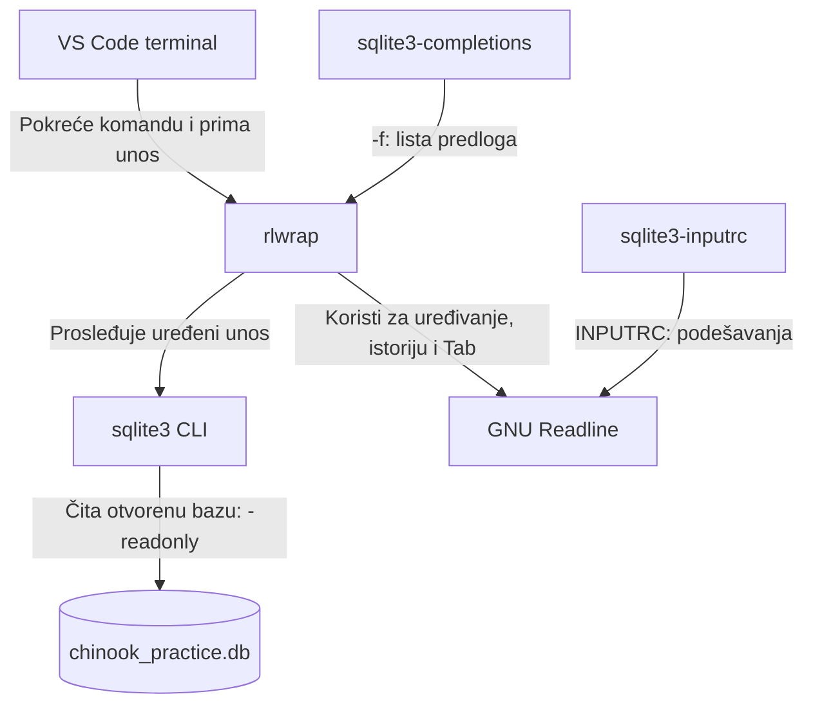

# Dan 04 — SQLite `.dump`: plan učenja, vežbe i odgovori

## Namena ovog fajla

Ovde su plan i dodatne vežbe za današnji rad. U ovaj dokument dopunjavaćemo i odgovore na tvoja naredna pitanja iz današnjeg rada, kako bi pitanja, objašnjenja i primeri ostali na jednom mestu.

**Današnji datum:** 24. novembar 2026. Ne moraš pratiti prvobitne datume iz [opšteg plana](../plan_ucenja/README.md): trenutno si na lekciji o povezivanju, a `.dump` je sledeća tema koju želiš da pripremiš. Napreduj kada razumeš gradivo, bez preskakanja.

---

## 1. Cilj dana

Do kraja rada treba samostalno da:

1. Razlikuješ **fajl baze** od aktivne SQLite konekcije i proveriš putanju sa `.databases`.
2. Otvoriš `chinook_practice.db` samo za čitanje sa svojim `rlwrap` podešavanjem.
3. Objasniš šta `.dump`, `.output`, `.once`, `.read` i `.backup` rade i gde se unose.
4. Napraviš SQL dump, pregledaš ga i vratiš u **novu, zasebnu** bazu.
5. Proveriš ishod i razlikuješ SQL dump od SQLite kopije baze.

> **Zaštita podataka:** radna kopija je izvor, ne odredište za `.read`. Originalna i radna Chinook baza ostaju netaknute. `.output` i `.backup` mogu kreirati ili prepisati zasebne izlazne fajlove čak i kada je izvor otvoren sa `-readonly`. Vežbaj samo u novom, posebno napravljenom folderu i ne pokreći komande ako nisi siguran u ciljnu putanju.

---

## 2. Predlog rasporeda — četiri sata

Pauze pravi između blokova; nisu uračunate u četiri sata. Ako negde zastaneš, nastavi kasnije: vreme je okvirno, a ne rok.

| Trajanje            | Aktivnost                                                                                                                                                                                         | Šta treba da ostane kao rezultat                                                                   |
| ------------------- | ------------------------------------------------------------------------------------------------------------------------------------------------------------------------------------------------- | -------------------------------------------------------------------------------------------------- |
| **30 min**          | Završavanje i ponavljanje povezivanja: pročitaj [lekciju 03 — povezivanje](../00_intro/03_how_to_connect_to_sqlite.md), otvori radnu kopiju i proveri `.databases`, `.tables` i `.schema albums`. | Zapiši razliku između fajla, konekcije i CLI-ja i proverenu putanju.                               |
| **60 min**          | Pročitaj ažuriranu [lekciju o `.dump`](../01_some_basic_sql_commands/03_sqlite_dump_command.md): pripremu, izvoz, obnovu i razliku između `.dump` i `.backup`.                                    | Svojim rečima objasni `.sql` naspram `.db` i zašto se za obnovu pokreće nova sesija.               |
| **120 min**         | Prvo uradi postojeće vežbe povezivanja i izvoza navedene ispod; zatim reši tri dodatna zadatka iz odeljka 4.                                                                                      | Zabeleži komande, zapažanja i eventualne greške; za praktične fajlove koristi zaseban novi folder. |
| **30 min**          | Uporedi rezultate i rešenja, proveri da nema grešaka i odgovori na pitanja iz lekcije bez gledanja.                                                                                               | Zapiši šta ti je jasno i koje pitanje želiš da postaviš.                                           |
| **Ukupno: 240 min** | Četiri sata aktivnog učenja.                                                                                                                                                                      | Nije potrebno da sve uradiš bez pauze.                                                             |

---

### Već postojeće vežbe — bez dupliranja zadataka

1. U [vežbama lekcije o povezivanju](../00_intro/03_how_to_connect_to_sqlite.md#vežbe) uradi naročito **vežbu 1** i **vežbu 3**. U vežbi 1 koristi radnu kopiju i `-readonly` iz ovog dnevnika umesto izvorne baze iz primera; `.databases` treba da pokaže `chinook_practice.db`. Ostale vežbe radi po potrebi. Vežba 5 pokreće aplikaciju koja može menjati bazu, pa **nije potrebna za današnji `.dump`**.

2. U [vežbama lekcije o `.dump`](../01_some_basic_sql_commands/03_sqlite_dump_command.md#vežbe) uradi vežbe 1–4: puni dump, obnova, poređenje sa `.backup` i dump tabele `albums`. Koristi tačne korake i bezbednosne provere iz ažurirane lekcije.

3. Po potrebi ponovi [često korišćene SQLite komande](../01_some_basic_sql_commands/02_some_commonly_used_sqlite3_commands.md#vežbe) i [uputstvo za `rlwrap`](../../../docs/fastapi/cheatsheets/fastapi_extensions_vscode/sqlite_terminal_litecli_rlwrap.md#4-rlwrap-tab-dovršavanje-u-pravom-sqlite-cli-ju).

4. Svoje CLI beleške možeš sačuvati u [predviđenom fajlu za vežbe](../playground/cli/03_sqlite_dump_command.txt). On je namenjen beleškama; nemoj automatski izvršavati njegov ceo sadržaj pomoću `.read` bez prethodnog pregleda.

---

## 3. Priprema terminala i siguran redosled rada

Iz korena repozitorijuma, u **Bash terminalu**, pokreni:

```bash
INPUTRC="$HOME/.config/sqlite-cli/sqlite3-inputrc" \
  rlwrap -a -N -c -i -A -f "$HOME/.config/sqlite-cli/sqlite3-completions" \
  sqlite3 -cmdline-edit off -readonly fast-api-course-my-work/sqlite_for_beginners/playground/databases/chinook_practice.db
```

Ako već koristiš tu sesiju, nema potrebe da je pokrećeš ponovo. U otvorenom **SQLite CLI-ju**:

```text
.databases
.tables
SELECT COUNT(*) AS album_count FROM albums;
```

Proveri da `main` pokazuje `chinook_practice.db` i `r/o`; zapiši broj albuma. Rezultat je podatak iz konkretne radne kopije, ne nepromenljivo pravilo baze. SQL naredba završava se sa `;`; dot-komande se unose bez `;`.

Zatim prati odeljke **Priprema**, **Napravi dump** i **Vrati bazu** u [lekciji o `.dump`](../01_some_basic_sql_commands/03_sqlite_dump_command.md). Ukratko:

1. U Bash-u napravi novi folder za vežbu (npr. `fast-api-course-my-work/sqlite_for_beginners/playground/dump_vezba_2026_11_24`) ako već postoji, stani i odaberi drugo novo ime.

2. U `-readonly` sesiji radne kopije (otvorene iz korena repozitorijuma sa `rlwrap` i `sqlite3 -readonly fast-api-course-my-work/sqlite_for_beginners/playground/databases/chinook_practice.db`) napravi `chinook_dump.sql` u novom folderu za vežbu koji si prethodno kreirao (npr. `fast-api-course-my-work/sqlite_for_beginners/playground/dump_vezba_2026_11_24/chinook_dump.sql`). Završi `.dump` i vrati izlaz na terminal.

3. Izađi iz izvorne sesije sa `.quit`. Proveri da ciljni `.db` fajl (npr. `fast-api-course-my-work/sqlite_for_beginners/playground/dump_vezba_2026_11_24/chinook_restored.db`) ne postoji pre nego što otvoriš novu sesiju.

4. Otvori zasebnu **upisivu** SQLite CLI sesiju nad novim fajlom baze (npr. `fast-api-course-my-work/sqlite_for_beginners/playground/dump_vezba_2026_11_24/chinook_restored.db`) i potvrdi `.databases` i da je baza prazna.

5. Pregledani dump učitaj sa `.read` i proveri broj albuma, `integrity_check` i `foreign_key_check`.

Nemoj pomešati prozore ili promptove: ista komanda `.read` izvršava sadržaj fajla u **onoj konekciji u kojoj je uneseš**. Ako u bilo kom koraku putanja ili poruka nije očekivana, stani i proveri je pre nastavka.

---

## 4. Dodatni zadaci za samostalnu vežbu

Prvo odgovori sam. Rešenja su izdvojena u odeljku 5. Zadatke sa izmišljenim podacima možeš rešiti bez upisivanja u bazu.

### Zadatak 1 — Koji alat i koja sesija?

Popuni tabelu tako što ćeš napisati odgovarajuću naredbu ili opis sesije:

| Želim da uradim                                              | Moj odgovor |
| ------------------------------------------------------------ | ----------- |
| Proverim putanju otvorene baze.                              |             |
| Pošaljem izlaz u novi SQL fajl dok ga ne vratim na terminal. |             |
| Izvezem šemu i podatke otvorene baze kao SQL.                |             |
| Vratim izlaz na terminal.                                    |             |
| Izvršim pregledani dump u novoj bazi.                        |             |
| Napravim SQLite kopiju u zasebnom `.db` fajlu.               |             |
| Napišem gde je `-readonly` poželjan, a gde je upis potreban. |             |

---

### Zadatak 2 — Šta dokazujemo proverom?

Zamisli da izvorna radna kopija sadrži 347 albuma, a novi obnovljeni fajl takođe vrati 347 za `SELECT COUNT(*) FROM albums;`.

1. Šta ti to poređenje govori, a šta **ne dokazuje**?

- Broj albuma se poklapa, što znači da su svi redovi u tabeli `albums` preneti, ali to ne dokazuje da su svi povezani podaci u drugim tabelama takođe preneti.
- Ovo poređenje dokazuje samo da je broj redova u tabeli `albums` isti, ali ne garantuje integritet celokupne baze.
- Dakle, iako se broj albuma poklapa, moguće je da su neki redovi u povezanim tabelama izostavljeni ili da postoje narušene veze između tabela.
- Drugim rečima, broj redova u jednoj tabeli ne garantuje da su svi strani ključevi validni ili da su sve zavisne tabele pravilno prenete.

2. Ako `PRAGMA integrity_check;` vrati `ok`, šta si dodatno proverio?

- Ako `PRAGMA integrity_check;` vrati `ok`, to znači da SQLite nije pronašao nikakve unutrašnje greške u strukturi baze, uključujući korupciju podataka i narušene indekse. Drugim rečima, baza je konzistentna sa stanovišta SQLite engine-a, ali to ne garantuje da su svi strani ključevi validni ili da su svi podaci u povezanim tabelama prisutni.

- Dakle, i dalje je moguće da postoje logičke greške u podacima, kao što su nedostajući redovi u povezanim tabelama ili nevalidni strani ključevi, koje `integrity_check` ne može otkriti.

- Drugim rečima, `integrity_check` proverava tehničku ispravnost baze, dok logičku ispravnost i potpunost podataka moraš proveriti dodatnim upitima i proverama veza između tabela.

3. Ako `PRAGMA foreign_key_check;` **ne vrati nijedan red**, kako tumačiš rezultat? Da li to znači da je `PRAGMA foreign_keys` uključena za naredne upise?

- Ako `PRAGMA foreign_key_check;` **ne vrati nijedan red**, to znači da **SQLite nije pronašao narušene strane ključeve u bazi**. Drugim rečima, svi strani ključevi koji postoje u tabelama su **validni i upućuju na postojeće redove u povezanim tabelama**. Međutim, to ne garantuje da su svi podaci u povezanim tabelama prisutni, niti da su svi strani ključevi uključeni u bazu. Takođe, ovo ne utiče na to da li je `PRAGMA foreign_keys` uključena za naredne upise.

- Da bi se uključila provera stranih ključeva za naredne upise, potrebno je eksplicitno izvršiti `PRAGMA foreign_keys = ON;`. Sam rezultat `foreign_key_check` ne menja stanje ove postavke.

4. Šta radiš ako `.read` prijavi grešku i u novoj bazi se pojave samo neke tabele?

- Ako `.read` prijavi grešku i u novoj bazi se pojave samo neke tabele, to znači da dump fajl nije uspešno primenjen u celosti. U tom slučaju treba:
  1. Proveriti sadržaj dump fajla i identifikovati gde je došlo do greške.
  2. Osigurati da su sve zavisne tabele kreirane pre nego što se ubace podaci koji zavise od njih.
  3. Ponovo pokušati učitavanje dump fajla, vodeći računa o redosledu kreiranja tabela i ubacivanja podataka.

  4. Ako je potrebno, izvršiti dump cele baze bez filtera kako bi se obezbedila potpuna kopija svih tabela i njihovih zavisnosti.

  5. Uvek proveriti da li su sve tabele i podaci uspešno učitani u novu bazu nakon ponovnog učitavanja dump fajla.

- Ukratko, **greške pri učitavanju dump fajla mogu dovesti do nepotpunih baza**, pa je važno pratiti redosled kreiranja tabela i ubacivanja podataka, kao i proveriti integritet i potpunost podataka nakon učitavanja.

---

### Zadatak 3 — Ograničeni dump i zavisnosti

Posmatraj Chinook vezu: `albums.ArtistId` upućuje na `artists.ArtistId`. U izvozu sa `.dump albums` nema podataka cele baze.

1. Zašto `albums_only.sql` ne treba smatrati potpunom kopijom baze?

- `albums_only.sql` sadrži samo tabele i podatke vezane za `albums`, ali ne uključuje sve ostale tabele i njihove zavisnosti. Zbog toga ne predstavlja potpunu kopiju cele baze, jer nedostaju povezane tabele kao što su `artists`, `tracks` i druge koje su neophodne za integritet podataka.

- Čak i ako broj redova u `albums_only.sql` odgovara broju redova u originalnoj tabeli `albums`, to ne garantuje da su svi povezani podaci prisutni, jer zavisne tabele mogu biti nepotpune ili odsutne.

- Dakle, broj redova u izolovanom dump-u ne može biti jedini kriterijum za procenu potpune rekonstrukcije baze, jer integritet podataka zavisi od prisustva svih povezanih tabela i njihovih redova.

- Čak i ako se broj redova poklapa, odsustvo zavisnih tabela ili nepotpuni podaci u njima mogu dovesti do neispravne ili nepotpune baze.

2. Zašto broj 347 redova u izdvojenom dump-u, čak i ako se podudari sa izvorom, ne potvrđuje da je moguće rekonstruisati sve povezane podatke?

- Broj redova u izdvojenom dump-u ne potvrđuje prisustvo svih zavisnih tabela i njihovih podataka. Čak i ako se broj redova u tabeli `albums` poklapa sa izvorom, odsustvo ili nepotpunost povezanih tabela kao što su `artists` ili `tracks` može onemogućiti potpunu rekonstrukciju baze. Integritet podataka zavisi od prisustva svih povezanih tabela i njihovih redova, a ne samo od broja redova u jednoj tabeli.

3. Koji izvoz biraš za obnovu cele baze: `.dump albums` ili `.dump` bez filtera?

- Za obnovu cele baze treba koristiti `.dump` bez filtera, jer on uključuje sve tabele i njihove podatke, čime se obezbeđuje potpuna rekonstrukcija baze sa svim zavisnostima. `.dump albums` je ograničen samo na tabelu `albums` i ne uključuje povezane tabele, što može dovesti do nepotpunih podataka i narušenog integriteta baze.

- `.once` je idealan za privremeno preusmeravanje izlaza samo za jednu naredbu, dok `.output` menja izlaz za sve naredne naredbe dok se eksplicitno ne vrati na `stdout`. Dakle, za jednokratni dump ili privremeno preusmeravanje izlaza koristi `.once`, a za dugotrajno preusmeravanje koristi `.output`.

4. U lokalno proverenom SQLite CLI-ju 3.54.1 može li `.once` da preusmeri sledeći `.dump`? Po čemu se razlikuje od `.output`?

- `.once` preusmerava izlaz samo za sledeću komandu, dok `.output` preusmerava izlaz za sve naredne komande dok se ponovo ne promeni ili ne vrati na `stdout`. Dakle, ako želiš da privremeno preusmeriš rezultat jednog `.dump` ili bilo koje druge komande u fajl, koristi `.once putanja/do/fajla.sql`. Ako želiš da trajno preusmeriš izlaz u fajl dok ne promeniš, koristi `.output putanja/do/fajla.sql`.

- `.once` je koristan kada želiš da privremeno preusmeriš izlaz samo za jednu komandu, dok `.output` menja izlaz za sve naredne komande dok se eksplicitno ne vrati na `stdout`. Dakle, za jednokratni dump ili privremeno preusmeravanje izlaza koristi `.once`, a za dugotrajno preusmeravanje koristi `.output`.

---

## 5. Rešenja i objašnjenja dodatnih zadataka

### Rešenje 1 — Komande i sesije

| Želim da uradim                                  | Rešenje i razlog                                                                                                                                                             |
| ------------------------------------------------ | ---------------------------------------------------------------------------------------------------------------------------------------------------------------------------- |
| Proverim putanju otvorene baze.                  | `.databases` u SQLite CLI-ju prikazuje ime i putanju trenutne baze.                                                                                                          |
| Pošaljem izlaz u novi SQL fajl dok ga ne vratim. | `.output putanja/do/novog_fajla.sql` u CLI-ju; cilj može biti prepisan ako postoji.                                                                                          |
| Izvezem šemu i podatke kao SQL.                  | `.dump` u CLI-ju otvorenom nad željenim izvorom. Pre toga preusmeri izlaz.                                                                                                   |
| Vratim izlaz na terminal.                        | `.output stdout` u istoj CLI sesiji.                                                                                                                                         |
| Izvršim pregledani dump u novoj bazi.            | `.read putanja/do/dumpa.sql` u **zasebnoj upisivoj sesiji** otvorenoj nad novom praznom bazom.                                                                               |
| Napravim SQLite kopiju.                          | `.backup putanja/do/nove_kopije.db` u CLI-ju otvorenom nad izvorom.                                                                                                          |
| Izaberem režim.                                  | `-readonly` koristi za pregled i izvoz iz radne kopije; upis u posebnu novu ciljnu bazu potreban je za `.read`. `.output` i `.backup` svejedno pišu zasebne izlazne fajlove. |

`.read` ne znači „samo prikaži fajl”: komande u njemu se izvršavaju. Nikada ne učitavaj nepoznatu skriptu bez provere.

---

### Rešenje 2 — Granice provere

1. Jednak broj pokazuje da tabela `albums` u oba posmatrana trenutka ima isti broj redova; **ne dokazuje** da su sadržaj tih redova, druge tabele ili šema identični.

2. `integrity_check` proverava unutrašnju ispravnost strukture baze; `ok` ne dokazuje da je sadržaj jednak izvoru.
3. Nijedan red iz `foreign_key_check` znači da nisu prijavljene FK povrede. To samo po sebi ne uključuje FK proveru za buduće upise; njeno stanje u konkretnoj konekciji proveravaš sa `PRAGMA foreign_keys;`.

4. Obnova nije potvrđena kao uspešna. Pročitaj poruku, proveri izvor i cilj; baza može biti delimično obnovljena. Sledeći pokušaj izvedi u drugom novom fajlu, ne ponavljaj `.read` preko delimične baze.

---

### Rešenje 3 — Izdvojeni dump

1. `.dump albums` izvozi objekte koji odgovaraju tom obrascu, a ne automatski čitavu Chinook bazu i sve zavisnosti. Posebno ne treba pretpostaviti da sadrži tabelu i podatke `artists`.

2. Broj albuma ne proverava da li su prisutni odgovarajući izvođači ili ostale tabele i objekti.
3. Za obnovu cele baze izaberi puni `.dump` bez filtera, uz pregled skripte i proveru rezultata.

4. Da: u proverenom CLI-ju 3.54.1 `.once` preusmerava izlaz sledećeg `.dump`, nakon čega se izlaz vraća na terminal. `.output` ostaje aktivan do `.output stdout` ili zatvaranja sesije. Obe komande mogu pisati u fajl iako je izvor otvoren sa `-readonly`.

---

## 6. Pitanja i odgovori tokom dana

U ovaj odeljak dodavaćemo tvoja naredna pitanja i odgovore, uz proverene primere kada su potrebni. Već pripremljena uputstva i vežbe ostaju u povezanim lekcijama; ovde nećemo nepotrebno umnožavati isti materijal.

### Pitanje 1 — Šta znači `rc` u `inputrc`?

`rc` se istorijski povezuje sa **„run commands”** — „izvrši komande”. Naziv potiče od starog sistema `RUNCOM` za izvršavanje komandi iz fajla. Danas sufiks `rc` često označava konfiguracioni fajl, kao što su `.bashrc` i `.inputrc`.

U nazivu `inputrc`, `input` se odnosi na unos, a fajl sadrži podešavanja za biblioteku **Readline**, koja upravlja uređivanjem komandne linije. Tvoj `sqlite3-inputrc` je zaseban fajl sa tim podešavanjima; promenljiva `INPUTRC` govori Readline-u koji fajl da učita za tu pokrenutu komandu. To nije SQLite baza niti SQL skripta.

Izvor za istoriju naziva: [What does “rc” mean in dot files?](https://stackoverflow.com/questions/11030552/what-does-rc-mean-in-dot-files).

---

### Pitanje 2 — Čemu pripada biblioteka Readline?

**GNU projekat** je slobodni softverski projekat koji razvija razne alate i biblioteke, uključujući i Readline. Projekat je poznat po svom doprinosu slobodnom softveru i standardizaciji alata koji se koriste u Unix-like okruženjima.

**GNU Readline** je biblioteka u okviru **GNU projekta**. Nije deo SQLite baze niti pripada isključivo Bash-u. **Različiti programi je mogu koristiti za uređivanje unosa u terminalu, istoriju komandi i dovršavanje unosa putem tab-dopunjavanja.**

U tvojoj komandi je koristi **`rlwrap`**. Provera instaliranog `rlwrap`-a pokazuje da je povezan sa bibliotekom `libreadline.so.8`. Pojednostavljeno:



**Kako čitati dijagram:** strelice prikazuju pokretanje, prosleđivanje, korišćenje ili čitanje, u zavisnosti od natpisa; ne predstavljaju sve isti tip veze. Izlaz se vraća iz `sqlite3` preko `rlwrap`-a u terminal; radi preglednosti taj smer nije posebno nacrtan. `sqlite3` obrađuje dot-komande unutar CLI-ja, dok SQL naredbe izvršava pomoću SQLite biblioteke. Dot-komande se ne izvršavaju u fajlu baze.

Isto prikazano u tekstualnom obliku:

```text
terminal → rlwrap → sqlite3 → chinook_practice.db
              ↓
         GNU Readline
```

`rlwrap` koristi Readline za uređivanje unosa, dok `sqlite3` izvršava SQL i dot-komande nad otvorenom bazom. Opcija `-cmdline-edit off` isključuje SQLite-ov interni editor u toj sesiji, a ne Readline koji koristi `rlwrap`.

Promenljiva `INPUTRC` u tvojoj komandi usmerava Readline na `sqlite3-inputrc`, koji uključuje tvoj `~/.inputrc` i podešava `completion-ignore-case on`. Lista predloga je zaseban fajl koji `rlwrap` dobija preko `-f`.

Izvor: [GNU Readline Library](https://tiswww.case.edu/php/chet/readline/rltop.html).

---

### Pitanje 3 — Kako detaljno da razumem dijagram terminala, `rlwrap`-a i SQLite-a?

U dijagramu iz prethodnog odgovora prikazano je više različitih stvari: **programi**, **biblioteka**, **konfiguracioni fajlovi** i **fajl baze**. Prvo ćemo ih razdvojiti, a zatim pratiti šta se dešava kada ukucaš komandu.

#### 1. Šta predstavlja svaki deo?

| Deo na dijagramu          | Šta je?                                 | Njegova uloga u ovom primeru                                                               |
| ------------------------- | --------------------------------------- | ------------------------------------------------------------------------------------------ |
| **VS Code terminal**      | Terminalski interfejs.                  | Prikazuje tekst i prima tvoj unos; u njemu se pokreće komandna ljuska, na primer Bash.     |
| **`rlwrap`**              | Zaseban program — omotač.               | Pokreće `sqlite3` i omogućava uređivanje njegovog ulaza pomoću Readline-a.                 |
| **GNU Readline**          | Biblioteka koju program može koristiti. | Pruža funkcije za uređivanje reda, istoriju i dovršavanje; nije samostalni SQLite klijent. |
| **`sqlite3 CLI`**         | SQLite komandni alat.                   | Prima SQL i dot-komande; za rad sa bazom koristi SQLite biblioteku.                        |
| **`chinook_practice.db`** | Fajl SQLite baze.                       | Čuva šemu i podatke radne kopije; sam ne prima komande sa tastature.                       |
| **`sqlite3-inputrc`**     | Tekstualni konfiguracioni fajl.         | Sadrži Readline podešavanja za ovu komandu.                                                |
| **`sqlite3-completions`** | Tekstualni fajl sa predlozima.          | `rlwrap` ga učitava preko opcije `-f` i koristi pri dovršavanju.                           |

> **Biblioteka nije isto što i program:** program poput `rlwrap`-a može koristiti funkcije biblioteke Readline. Zato je na dijagramu strelica **`rlwrap` → GNU Readline** označena sa „koristi”; to nije putanja SQL upita ka bazi.
>
> **Terminal nije isto što i Bash:** terminal je samo interfejs koji prikazuje tekst i prima tvoj unos, dok Bash tumači komande i pokreće programe. Zato strelica sa terminala ide ka Bash-u, a ne direktno ka `rlwrap` ili `sqlite3`.
>
> U suštini, terminal je „prozorski okvir“ za interakciju sa komandnom linijom, dok Bash (ili bilo koja druga ljuska/shell) zapravo izvršava komande koje uneseš i pokreće odgovarajuće programe.

---

#### 2. Kako počinje rad?

Tvoja komanda, uneta u **Bash-u iz korena repozitorijuma**, izgleda ovako:

```bash
INPUTRC="$HOME/.config/sqlite-cli/sqlite3-inputrc" \
  rlwrap -a -N -c -i -A -f "$HOME/.config/sqlite-cli/sqlite3-completions" \
  sqlite3 -cmdline-edit off -readonly fast-api-course-my-work/sqlite_for_beginners/playground/databases/chinook_practice.db
```

Prati redom:

1. **Bash** pokreće program `rlwrap` i za tu komandu postavlja promenljivu okruženja `INPUTRC` na putanju do posebnog Readline konfiguracionog fajla. Ovim zapisom ne menjaš trajno konfiguraciju drugih terminalskih sesija.

2. `rlwrap` dobija svoje opcije, između ostalog `-f` sa putanjom do liste predloga. On zatim pokreće navedeni program **`sqlite3`** sa njegovim argumentima.

3. `sqlite3` otvara `chinook_practice.db` kao glavnu bazu te konekcije. `-readonly` znači da je ta glavna baza otvorena samo za čitanje.

4. `-cmdline-edit off` isključuje SQLite-ov interni editor u toj sesiji; uređivanje ulaza koje ti vidiš obezbeđuje `rlwrap` uz Readline.

5. U terminalu se pojavljuje SQLite prompt i možeš da unosiš dot-komande ili SQL.

Prva strelica na dijagramu je pojednostavljena: preciznije, **ti unosiš komandu u Bash koji radi unutar terminala**, a Bash pokreće `rlwrap`. Terminal nije SQLite baza niti sam obrađuje SQL.

---

#### 3. Dva fajla sa različitim zadatkom

Iako oba pomažu pri unosu, ovi fajlovi nisu ista stvar:

| Fajl                                       | Kako se bira?           | Šta radi?                                                                                                                                                   |
| ------------------------------------------ | ----------------------- | ----------------------------------------------------------------------------------------------------------------------------------------------------------- |
| `~/.config/sqlite-cli/sqlite3-inputrc`     | Promenljivom `INPUTRC`. | Zadaje Readline podešavanja. Pri proveri uključuje `~/.inputrc` i postavlja `completion-ignore-case on`, radi dopunjavanja bez razlikovanja veličine slova. |
| `~/.config/sqlite-cli/sqlite3-completions` | Opcijom `rlwrap -f`.    | Sadrži reči koje mogu biti ponuđene, na primer `.tables`, `SELECT` i `foreign_keys`.                                                                        |

Opcija `rlwrap -i` takođe uključuje dopunjavanje bez razlikovanja velikih i malih slova pri radu sa listom predloga; `-c` uključuje i dovršavanje putanja. Predlozi iz liste nisu automatski ažuriran pregled svih tabela iz baze.

Na dijagramu strelice od fajlova znače da se **koriste njihovi sadržaji**, ne da su to programi koji izvršavaju SQL ili izmene u bazi.

---

#### 4. Šta se dešava kada uneseš `.tab`, Tab, pa Enter?

Pretpostavimo da je SQLite CLI već otvoren sa navedenom komandom:

1. U promptu ukucaš `.tab`. To je još uvek **nezavršen unos**, a ne izvršena naredba.

2. Pritisneš **Tab**. `rlwrap` uz Readline i raspoložive predloge pokušava da dopuni reč; u ovom podešavanju `.tab` može postati `.tables`.

3. Pre pritiska na Enter proveriš da li na liniji zaista piše `.tables`. Ako postoji više mogućnosti, rezultat zavisi od dostupnih predloga; možda je potrebno dopisati još slova.

4. Pritisneš **Enter**. `rlwrap` prosleđuje uneti red `sqlite3` CLI-ju.

5. `sqlite3` prepoznaje `.tables` kao **dot-komandu CLI-ja** i prikazuje tabele otvorene baze.Rezultat se vraća kroz `rlwrap` i vidiš ga u terminalu.

**Tab dopunjava unos; Enter ga šalje na obradu.** Sama lista predloga ne izvršava naredbe. Dot-komanda `.tables` nije SQL naredba zapisana u fajlu baze.

---

#### 5. Šta se dešava sa SQL upitom?

Na primer, u otvorenom SQLite CLI-ju uneseš:

```sql
SELECT COUNT(*) AS album_count FROM albums;
```

1. `rlwrap` uz Readline pomaže pri unosu i po potrebi dovršavanju, ali **ne odlučuje** šta SQL upit znači.

2. Nakon što dovršiš upit i pošalješ ga, `sqlite3` CLI koristi SQLite biblioteku da obradi SQL i pročita potrebne podatke iz otvorene baze.

3. CLI prikaže rezultat, koji se kroz `rlwrap` vraća u terminal.

Ako je SQL naredba podeljena u više redova, Enter posle prvog reda ne mora odmah pokrenuti ceo upit: CLI može čekati da naredba bude dovršena. Tačka-zarez `;` u ovom primeru označava kraj SQL naredbe. Dot-komande poput `.tables` unose se drugačije — na zasebnom redu i bez `;`.

---

#### 6. Šta tačno štiti `-readonly`?

U ovoj komandi `-readonly` odnosi se na **otvorenu glavnu bazu**. Na primer, `SELECT` je čita, dok bi pokušaj upisa u tu bazu bio odbijen. To ne znači da je čitav proces bez mogućnosti pisanja u bilo koji fajl.

Na primer, SQLite CLI dot-komanda `.output` može poslati izlaz u **poseban tekstualni fajl**, a `.backup` može upisati zasebnu kopiju. Zato i dalje moraš pažljivo proveriti odredišnu putanju i da li fajl već postoji. Isto tako, izlaz naredbe ne mora uvek završiti na ekranu ako si ga preusmerio.

---

#### 7. Kratka provera razumevanja

Pokušaj prvo sam, pa pogledaj odgovore ispod:

1. Da li Readline izvršava `SELECT` nad bazom?

- Ne; Readline samo pomaže pri unosu i dovršavanju, ali ne izvršava SQL upite. Uloga Readline-a je isključivo u interaktivnom unosu i dopunjavanju teksta, dok stvarno izvršavanje SQL upita obavlja SQLite.

2. Koji fajl sadrži podešavanja, a koji reči za dovršavanje?

- `sqlite3-inputrc` sadrži podešavanja za Readline, kao što su prečice i ponašanje tastera, dok `sqlite3-completions` sadrži listu reči koje Readline koristi za automatsko dovršavanje unosa u SQLite CLI-ju.

3. Da li Tab sam po sebi izvršava `.tables`?

- Ne; Tab samo pokreće automatsko dovršavanje unosa, dok Enter šalje dovršeni red CLI-ju. Dakle, Tab ne izvršava komandu, već samo pomaže pri njenom unosu.

4. Da li `-readonly` sprečava `.output` da napravi zaseban fajl?

- Ne; `-readonly` štiti samo otvorenu glavnu bazu od upisa. Komanda `.output` može i dalje kreirati i upisivati u zaseban fajl, jer to nije deo glavne baze. Dakle, `-readonly` ne blokira sve operacije pisanja u fajl sistemu, već samo upis u glavnu bazu. Ostale operacije pisanja, kao što su kreiranje novih fajlova ili upis u postojeće fajlove van glavne baze, i dalje su moguće.

5. Šta je **aktivna konekcija** u kontekstu SQLite CLI-ja?

- Aktivna konekcija je **instanca SQLite CLI-ja koja je trenutno povezana na određenu bazu podataka**. To znači da sve SQL naredbe koje uneseš u CLI dok je konekcija aktivna, izvršavaju se nad tom bazom. Ako ne postoji aktivna konekcija, SQLite CLI ne može izvršavati SQL naredbe nad bazom.

>**Odgovori:** 1. Ne; SQL obrađuje SQLite. 2. `sqlite3-inputrc` sadrži podešavanja, a `sqlite3-completions` predloge. 3. Ne; Enter šalje dovršeni red CLI-ju. 4. Ne; štiti otvorenu glavnu bazu od upisa, ne sve druge fajlove. 5. Aktivna konekcija je instanca SQLite CLI-ja koja je trenutno povezana na određenu bazu podataka.

---

## Pitanje 4 — Provera vežbe 2 iz `03_how_to_connect_to_sqlite.md`

**Nalaz:** vežba je tražila *tri konekcije ka istom fajlu*, a bila su nacrtana tri odvojena dijagrama. Time se ne vidi da je fajl jedan i zajednički. Strelice su išle od fajla ka konekciji, što sugeriše da fajl pokreće konekciju; ispravno je da program otvara fajl.

**Ispravka:** u lekciji je sada jedan `flowchart LR` sa tri programa (CLI, GUI, FastAPI), tri konekcije i jednim cilindrom `chinook.db`, uz tabelu (fajl / konekcija / program) i objašnjenje kako svaka konekcija nastaje.

**Dodatno razjašnjeno:**

- GUI profil je samo podešavanje, a ne konekcija.
- SQLAlchemy engine konekcije otvara po potrebi (često iz pula), pa ne moraju trajati celo vreme rada aplikacije.
- URL `sqlite:///relativna.db` ima tri kose crte, a apsolutna putanja `sqlite:////apsolutna.db` četiri.
- Više konekcija može istovremeno čitati; piše jedna po jedna, pa druge mogu dobiti `database is locked`.

---

## Pitanje 5 — Šta znači da `.once` „preusmerava sledeći dump“?

`.dump` po podrazumevanju piše SQL tekst na ekran. Preusmeriti znači poslati taj tekst u fajl. `.once fajl.sql` to radi samo za **prvu sledeću komandu koja ispisuje izlaz**, a zatim se izlaz sam vraća na ekran.

```text
.once "fajl.sql"
.dump      -> ide u fajl.sql
.dump      -> ide na ekran
```

Provereno u izolovanom testu: prvi `.dump` je završio u fajlu, drugi na ekranu.

| Komanda         | Trajanje preusmeravanja                 | Vraćanje na ekran            |
| --------------- | --------------------------------------- | ---------------------------- |
| `.output fajl`  | Sve komande dok ga ne isključiš         | Ručno: `.output stdout`      |
| `.once fajl`    | Samo sledeća komanda sa izlazom         | Automatski                   |

Obe komande mogu prepisati postojeći fajl, pa koristi novo ime.

---

## Pitanje 6 — Kako se otvara zasebna upisiva sesija?

Zasebna upisiva sesija je **drugi SQLite CLI proces**, pokrenut **bez `-readonly`**, koji otvara **novu** bazu. Lekcija: [03_sqlite_dump_command.md](../01_some_basic_sql_commands/03_sqlite_dump_command.md).

1. Prvu sesiju (`-readonly`, `chinook_practice.db`) ostavi otvorenu u jednom terminalu, a otvori **drugi terminal** u VS Code-u (ikonica `+`), ili izađi iz prve sa `.quit`.
2. Iz korena repozitorijuma proveri da cilj ne postoji:

   ```bash
   test ! -e fast-api-course-my-work/sqlite_for_beginners/playground/dump_vezba_2026_11_24/chinook_restore.db \
     && echo "OK: cilj ne postoji"
   ```

3. Pokreni novu sesiju (bez `-readonly`, druga baza):

   ```bash
   INPUTRC="$HOME/.config/sqlite-cli/sqlite3-inputrc" \
     rlwrap -a -N -c -i -A -f "$HOME/.config/sqlite-cli/sqlite3-completions" \
     sqlite3 -cmdline-edit off fast-api-course-my-work/sqlite_for_beginners/playground/dump_vezba_2026_11_24/chinook_restore.db
   ```

4. Proveri `.databases` (putanja završava sa `chinook_restore.db`, bez `r/o`) i `.tables` (mora biti prazno).
5. Tek onda `.read` dump fajla.

**Zašto zasebna sesija:** `-readonly` važi za celu konekciju, pa se u prvoj sesiji dump ne može vratiti. Nova baza se stvara tek pri prvom upisu, a zasebna sesija štiti `chinook_practice.db` od greške.
