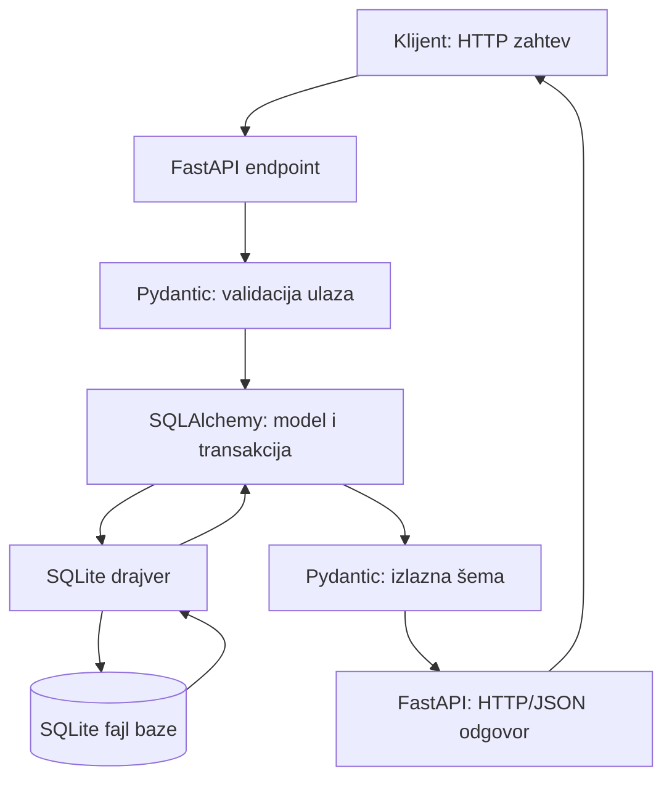
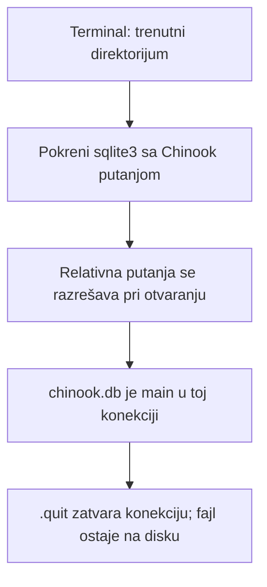
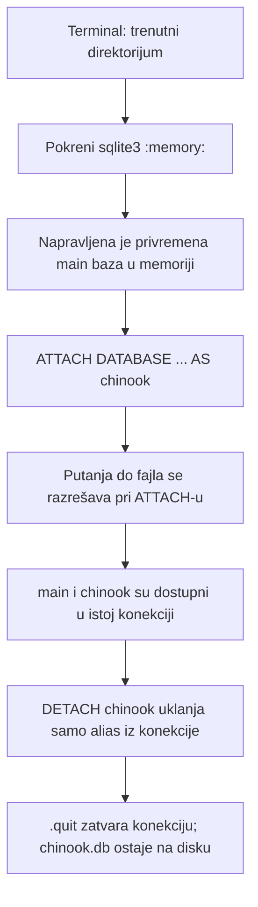
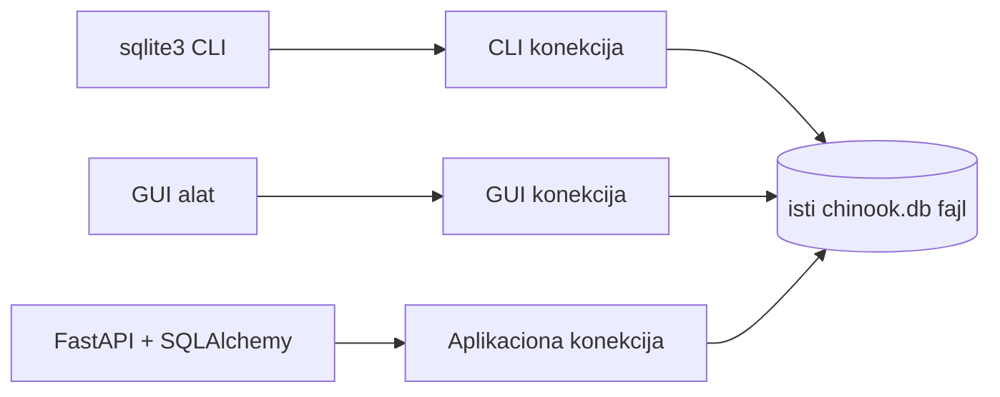
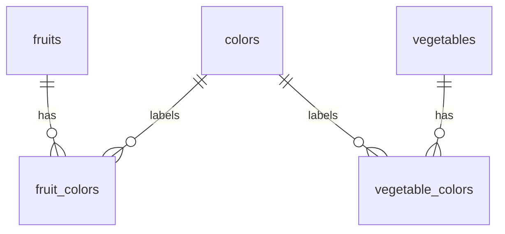
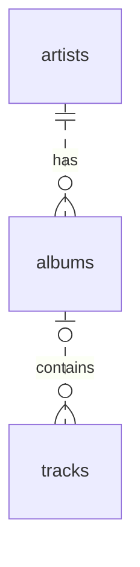
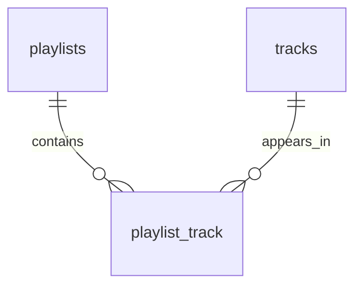
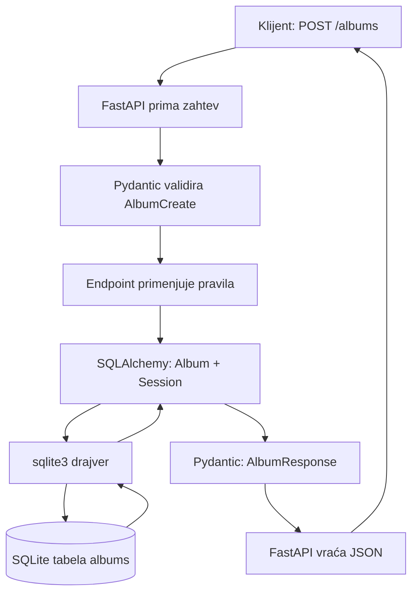

# Dan 05 — Uvod i vežbe u `playground`

## Cilj dana

Danas ponavljaš vežbe iz [oblasti 00 — Uvod](../00_intro/README.md) i uvežbavaš gde da sačuvaš odgovore, kako da ih pokreneš i kojim alatom. Najvažnije je da razdvojiš tri stvari:

1. **Lekcija** (`.md`) objašnjava pojmove i postavlja vežbe.
2. **Radni fajl** (`.sql` ili `.txt`) čuva tvoje upite, CLI komande i beleške.
3. **Klijent** (`sqlite3`, po želji obavijen sa `rlwrap`, ili `litecli`) otvara konekciju i izvršava unos.

Radni fajlovi **ne zamenjuju** `litecli`, `rlwrap` ili SQLite CLI. Oni zamenjuju potrebu da rešenja čuvaš samo u istoriji terminala ili da ih svaki put prekucavaš. I dalje moraš da otvoriš odgovarajući klijent i pokreneš fajl ili pojedinačni upit.

---

## 1. Kako da biraš između `playground/cli` i `playground/sql`

### `playground/cli/` — komande SQLite alata i beleške

Fajlovi `.txt` u ovom folderu služe za **SQLite CLI komande**, uputstva i beleške. Mogu sadržati:

- dot-komande koje počinju tačkom, npr. `.databases`, `.tables`, `.schema`
- SQL naredbe koje se unose u SQLite CLI i završavaju sa `;`
- komentare koji opisuju očekivani rezultat ili upozorenje.

Dot-komande nisu SQL, pa ovaj fajl pokreći u **SQLite CLI-ju**, ne kao SQL upit. Na primer, iz korena repozitorijuma:

```text
.read fast-api-course-my-work/sqlite_for_beginners/playground/cli/01_what_is_sqlite3_tool.txt
```

`.read` je dot-komanda: **unosi se nakon što si već pokrenuo `sqlite3` i vidiš SQLite prompt**. Ova komanda učitava fajl red po red u **trenutnoj konekciji nad bazom (npr. `:memory:` ili fajl-bazom) sa kojom je konekcija preko SQLite CLI-ja uspostavljena**. Pročitaj sadržaj pre pokretanja, jer `.read` izvršava sve komande u njemu. Ako fajl sadrži samo komentare, neće biti vidljivog izlaza.

---

### `playground/sql/00_intro/` — SQL rešenja za uvodne lekcije

Fajlovi `.sql` odgovaraju lekcijama u `00_intro/`. U njih upisuješ SQL upite i komentare koji objašnjavaju rešenja. Pokreni ih na jedan od sledećih načina:

1. **SQLite CLI:** otvori odgovarajuću bazu, pa učitaj fajl sa `.read`:

   ```text
   .read fast-api-course-my-work/sqlite_for_beginners/playground/sql/00_intro/01_what_is_sqlite.sql
   ```

2. **SQLTools:** poveži ekstenziju sa odgovarajućom bazom, otvori `.sql` fajl i pokreni označeni `-- @block` ili selektovani SQL upit. Ovo je pogodno za samostalne upite za čitanje. Skripte koje zavise od redosleda stanja konekcije, kao što su `ATTACH`/`DETACH` u fajlu 02, **pokreni kao celinu** iz SQLite CLI-ja. Fajl 04 sadrži `CREATE TABLE` i `INSERT`, zato ga nemoj pokretati kroz SQLTools konekciju ka Chinook-u.

Sam nastavak `.sql` **ne** pokreće fajl i ne čini ga automatski bezbednim. Pročitaj komande pre izvršavanja. `SELECT` i `PRAGMA` provere iz prvih lekcija su namenjene pregledu; `CREATE`, `INSERT`, `UPDATE` i `DELETE` menjaju bazu.

---

### SQLTools konekcija i vizuelni pregled baze

Pošto već imaš uspostavljenu SQLTools konekciju **ChinookPractice**, možeš da radiš i kroz VS Code, bez pokretanja terminalskog klijenta:

1. U SQLTools panelu proveri da je pored **ChinookPractice** zelena oznaka konekcije.
2. Otvori odgovarajući `.sql` fajl iz `playground/sql/00_intro/`.
3. Iznad `-- @block` videćeš **Run on active connection**. Klikni ga da izvršiš taj blok na trenutno aktivnoj konekciji. Možeš i da označiš samo SQL naredbu i izabereš **Run Selected Query**.
4. Pregledaj rezultat i istoriju upita u SQLTools panelu. Query History je istorija pokretanja, nije zamena za čuvanje rešenja u `.sql` fajlu.

Na primer, u [03_how_to_connect_to_sqlite.sql](../playground/sql/00_intro/03_how_to_connect_to_sqlite.sql) pokreni blokove `PRAGMA database_list;`, `SELECT sqlite_version();` i `PRAGMA foreign_keys;`. Oni prikazuju putanju, SQLite verziju i FK postavku **SQLTools konekcije**. Te vrednosti mogu biti drugačije u `rlwrap`/CLI ili aplikaciji, jer su to zasebne konekcije.

U [02_attaching_sample_database_to_sqlite.sql](../playground/sql/00_intro/02_attaching_sample_database_to_sqlite.sql) blokovi koji koriste `practice.sqlite_schema` zavise od aliasa `practice`. Ako ga nema u SQLTools konekciji, prvo izvrši `ATTACH DATABASE ... AS practice;` iz istog SQLTools konektora, a zatim izvrši blokove koji ga koriste. `ATTACH` u terminalskom CLI-ju ne priključuje bazu u SQLTools: alias pripada samo onoj konekciji gde je naredba pokrenuta. Ako je `ChinookPractice` već glavna baza te konekcije, možeš umesto aliasa koristiti `sqlite_schema` i `PRAGMA foreign_key_list(albums);`. Za vežbanje celog redosleda `ATTACH`/upiti/`DETACH`, jednostavnije je učitati ceo fajl u svežoj `sqlite3 :memory:` sesiji.

Možeš i da koristiš ekstenziju koja prikazuje tabele i redove vizuelno:

1. Otvori bazu u njenom Explorer/Viewer panelu.

2. Proveri **ime i punu putanju fajla** pre nego što tumačiš prikazane tabele.

3. Proširi tabelu, na primer `albums`, i pregledaj kolone i redove. Koristi ovo kao vizuelnu proveru; za zadatke i ponovljive rezultate i dalje sačuvaj SQL upit u `.sql` fajlu.

4. Nemoj menjati ćelije ili šemu tokom ovog ponavljanja; ostani na pregledu.

Na tvojim slikama SQLTools konektor je nazvan `ChinookPractice`, dok je otvoreni Viewer tab nazvan `chinook_restore.db`. Imena su različita, zato nemoj pretpostaviti da prikazuju isti fajl: uporedi punu putanju svakog konektora. Viewer prikazuje **13** tabela, među kojima su `sqlite_sequence` i `sqlite_stat1`; to su SQLite pomoćne/system tabele koje služe internim mehanizmima SQLite-a i ne računaju se kao korisničke tabele. Ostalih **11** su Chinook tabele koje se broje u vežbi i predstavljaju stvarni sadržaj baze. One se vide u CLI-ju bez pomoćnih tabela. Zato broj u Viewer-u može biti veći od broja korisničkih tabela prikazanog u CLI-ju.

---

### Da li da koristim `litecli` ili `rlwrap`?

Za ove lekcije preporuka je **zvanični SQLite CLI obavijen sa `rlwrap`**:

- `sqlite3` je SQLite komandni klijent i razume SQLite dot-komande kao `.read`, `.tables` i `.schema`.
- `rlwrap` je omotač koji dodaje uređivanje komandne linije, istoriju i dovršavanje; on sam nije baza niti zamena za `sqlite3`.
- `litecli` je zaseban SQL klijent sa SQL predlozima. Nije `sqlite3` obavijen sa `rlwrap` i ne treba pretpostaviti da prihvata iste SQLite dot-komande.

Za pokretanje `rlwrap` sesije nad **radnom kopijom samo za čitanje**, iz korena repozitorijuma:

```bash
INPUTRC="$HOME/.config/sqlite-cli/sqlite3-inputrc" \
  rlwrap -a -N -c -i -A -f "$HOME/.config/sqlite-cli/sqlite3-completions" \
  sqlite3 -cmdline-edit off -readonly fast-api-course-my-work/sqlite_for_beginners/playground/databases/chinook_practice.db
```

U CLI-ju možeš direktno uneti SQL ili koristiti `.read`. Za privremenu `:memory:` bazu, npr. vežbu sa `ATTACH`, koristi istu `rlwrap` komandu, ali zameni deo `sqlite3 ... chinook_practice.db` sa:

```bash
sqlite3 :memory:
```

U ovoj varijanti nemoj dodavati `-readonly` za glavnu bazu u memoriji: `-readonly` nije potreban za `:memory:` i može ograničiti šta možeš uraditi u toj konekciji.

`litecli` je dostupan u projektnom okruženju. Ako želiš da probaš njegove SQL predloge, iz korena repozitorijuma možeš pokrenuti:

```bash
.venv/bin/litecli fast-api-course-my-work/sqlite_for_beginners/playground/databases/chinook_practice.db
```

Ova komanda ne otvara bazu read-only, zato se za pregled drži `SELECT` upita. Za vežbe koje zavise od SQLite CLI komandi kao što su `.read`, `.tables` ili `.schema`, koristi `rlwrap` + `sqlite3`. SQLTools je još jedan način izvršavanja SQL-a, ali nije terminalski SQLite CLI.

### Važne razlike u fajlovima

| Fajl ili alat                       | Sadrži / radi                             | Kako se koristi                                                          |
| ----------------------------------- | ----------------------------------------- | ------------------------------------------------------------------------ |
| Lekcija `.md`                       | Objašnjenje i zadaci                      | Čitaš je; vežbu rešavaš u radnom fajlu ili beleškama.                    |
| `.sql` u `playground/sql/00_intro/` | SQL i komentari za uvodne lekcije         | `.read` u SQLite CLI-ju ili pokretanje SQL bloka kroz SQLTools.          |
| `.txt` u `playground/cli/`          | SQLite dot-komande, SQL primeri i beleške | `.read` u SQLite CLI-ju; ne pokreće se kao Bash komanda.                 |
| `sqlite3`                           | Zvanični SQLite CLI klijent               | Prima SQL i svoje dot-komande.                                           |
| `rlwrap`                            | Omotač oko drugog programa                | U ovom slučaju pokreće `sqlite3` uz bolje uređivanje i dovršavanje.      |
| `litecli`                           | Poseban SQL klijent                       | Koristiš ga opciono za SQL upite; nije zamena za SQLite CLI dot-komande. |

Napomena o imenima: `playground/cli/01_what_is_sqlite3_tool.txt` odgovara lekciji o **sqlite3 alatu** u `01_some_basic_sql_commands/`, a ne lekciji `00_intro/01_what_is_sqlite.md`. Slični brojevi i nazivi ne znače da su to isti zadaci. Proveri zaglavlje `-- Lekcija:` u `.txt` fajlu.

---

## 2. Bezbedan redosled rada

1. Iz korena repozitorijuma otvori radnu kopiju `chinook_practice.db` sa `-readonly` za vežbe čitanja.
2. Proveri `.databases`, a zatim `.tables`; nemoj pretpostaviti da je baza ispravna samo zato što je prompt otvoren.

3. SQL upite i rešenja sačuvaj u odgovarajućem `.sql` fajlu. Dot-komande i terminalska zapažanja stavi u `.txt` fajl ili dnevnik.

4. Pre `.read`, otvori fajl i pregledaj sve njegove naredbe. `.read` može izvršiti i naredbe koje menjaju bazu.
5. Vežbu koja pravi tabele, kao što je model voća i boja, izvršavaj u novoj `:memory:` konekciji ili pažljivo izabranom novom sandbox fajlu — nikada u Chinook bazi.

6. Ne pokreći TodoApp samo radi provere putanje bez provere radnog direktorijuma i baze: inicijalizacija aplikacije poziva `create_all()` i može napraviti nedostajuće tabele.

---

## 3. Rešenja vežbi — `00_intro/01_what_is_sqlite.md`

Radni fajl: [01_what_is_sqlite.sql](../playground/sql/00_intro/01_what_is_sqlite.sql). U njemu su već pripremljeni bezbedni SQL upiti i objašnjenja; CLI dot-komande iz vežbe pokreću se u SQLite promptu.

---

### Vežba 1 — Pronađi Chinook bazu

Iz korena repozitorijuma pokreni:

```bash
pwd
sqlite3 -readonly fast-api-course-my-work/sqlite_for_beginners/playground/databases/chinook_practice.db
```

Ako želiš uređivanje i Tab dovršavanje, koristi komandu `rlwrap` iz odeljka 1. U SQLite promptu:

```text
.databases
.tables
```

`main` treba da pokazuje na `playground/databases/chinook_practice.db` i `r/o`. `.tables` treba da prikaže Chinook tabele kao što su `artists`, `albums`, `tracks`, `customers` i `invoices`. U ovoj vežbi koristi se kopija, a ne originalni `chinook/chinook.db`.

---

### Vežba 2 — Istraži šemu

U CLI-ju:

```text
.schema albums
.schema tracks
.schema playlist_track
```

Pročitaj ključne delove:

| Tabela           | Primarni ključ                     | Strani ključevi i napomena                                                                                          |
| ---------------- | ---------------------------------- | ------------------------------------------------------------------------------------------------------------------- |
| `albums`         | `AlbumId`                          | `ArtistId` referencira `artists.ArtistId` i u ovoj šemi je `NOT NULL`.                                              |
| `tracks`         | `TrackId`                          | `AlbumId` referencira `albums.AlbumId` i može biti `NULL`; `GenreId` može biti `NULL`; `MediaTypeId` je `NOT NULL`. |
| `playlist_track` | Složeni PK `(PlaylistId, TrackId)` | Svaka od te dve kolone je zaseban FK: `PlaylistId` ka `playlists`, `TrackId` ka `tracks`.                           |

ERD daje pregled odnosa i kardinalnosti. SQL šema definiše konkretne kolone, ključeve, `NOT NULL` i ponašanje poput `ON DELETE NO ACTION`. Zbog toga ERD i šemu treba čitati zajedno; dijagram može izostaviti detalje ograničenja.

---

### Vežba 3 — Verzija i strani ključevi

U konekciji čiji rezultat želiš da proveriš:

```sql
SELECT sqlite_version();
PRAGMA foreign_keys;
```

Zabeleži prikazanu verziju; ona zavisi od SQLite biblioteke koju koristi taj klijent. `PRAGMA foreign_keys` vraća `1` ako su provere uključene u toj konekciji i `0` ako nisu. Nemoj unapred upisivati očekivanu vrednost: `CLI`, `SQLTools` i aplikacija mogu koristiti različite konekcije/podešavanja. To je per-connection postavka i važi samo za trenutnu konekciju.

---

### Vežba 4 — Izaberi bazu za scenario

1. **Lična kolekcija muzike na jednom računaru:** `SQLite` je razuman, jednostavan izbor za lokalni fajl i mali broj upisa.

2. **Lokalni FastAPI testovi na jednom računaru:** `SQLite` je često praktičan za brze, izolovane testne baze. Ako produkcija koristi drugu bazu, deo testova treba pokretati i na toj bazi radi provere kompatibilnosti.

3. **Mnogo istovremenih izmena iz više instanci API-ja:** razmotri klijent-server bazu, npr. `PostgreSQL`. `SQLite` može opslužiti više čitalaca, ali pisanja se serijalizuju tako da u jednom trenutku piše jedna konekcija; veća konkurentnost može čekati ili izazvati `database is locked`.

---

### Vežba 5 — Putanja podatka kroz FastAPI

Primer toka za zapis:



- **FastAPI** prima HTTP zahtev i poziva endpoint.
- **Pydantic** proverava oblik i tipove ulaznih/izlaznih podataka; sam po sebi ne proverava da li FK vrednost postoji u bazi.

- **SQLAlchemy** upravlja ORM objektima, SQL upitima i transakcijom (`commit`/`rollback`).
- **SQLite drajver** prenosi naredbe između Python koda i SQLite biblioteke.
- **SQLite baza** izvršava SQL i čuva potvrđene promene u fajlu.
- **FastAPI** vrši serijalizaciju odgovora i šalje ga klijentu. Pod **serijalizacijom** podrazumeva pretvaranje `Python` objekata u `JSON` format koji se može poslati preko HTTP protokola. **Pydantic** se koristi za validaciju i serijalizaciju podataka, ali ne upravlja direktno bazom. To radi **SQLAlchemy** i drajver baze. Uloga `Pydantic`-a je da osigura da podaci koji **ulaze i izlaze iz FastAPI endpointa** imaju očekivani oblik i tipove.

---

## 4. Rešenja vežbi — `00_intro/02_attaching_sample_database_to_sqlite.md`

Radni fajl: [02_attaching_sample_database_to_sqlite.sql](../playground/sql/00_intro/02_attaching_sample_database_to_sqlite.sql). `.schema`, `.tables` i `.databases` ostaju CLI dot-komande; SQL fajl sadrži SQL naredbe za `ATTACH`, upite i `DETACH`.

### Vežba 1 — Otvori Chinook kao `main`

Iz korena repozitorijuma pokreni SQLite CLI nad kopijom:

```bash
sqlite3 -readonly fast-api-course-my-work/sqlite_for_beginners/playground/databases/chinook_practice.db
```

Zatim u CLI-ju:

```text
.databases
.tables
.schema albums
.quit
```

`chinook_practice.db` je glavna baza i u toj konekciji se zove `main`. `.schema albums` treba da prikaže `AlbumId` kao PK i `ArtistId` kao FK ka `artists.ArtistId`. `-readonly` štiti ovu konekciju od pisanja u radnu kopiju.

---

### Vežba 2 — `ATTACH` kao dodatna baza

Otvori privremenu glavnu bazu u memoriji:

```bash
sqlite3 :memory:
```

U SQLite CLI-ju izvrši:

```sql
ATTACH DATABASE 'fast-api-course-my-work/sqlite_for_beginners/chinook/chinook.db' AS chinook;
```

Zatim proveri:

```text
.databases
```

`main` je prazna, privremena baza u memoriji. `chinook` je alias dodatne baze koja pokazuje na Chinook fajl. Da bi upit pročitao umetnike iz priključene baze, koristi alias kao prefiks:

```sql
SELECT Name
FROM chinook.artists
ORDER BY Name
LIMIT 5;
```

Po završetku:

```sql
DETACH DATABASE chinook;
```

`DETACH` uklanja bazu iz te konekcije, ali ne briše fajl. `.databases` nakon toga više ne treba da prikazuje `chinook`. Izađi sa `.quit`.

---

### Vežba 3 — Relativne putanje i direktorijum

Iz korena repozitorijuma:

```bash
pwd
sqlite3 -readonly fast-api-course-my-work/sqlite_for_beginners/chinook/chinook.db
```

Kraći primer radi **iz samog foldera `chinook`**:

```bash
cd fast-api-course-my-work/sqlite_for_beginners/chinook
pwd
sqlite3 -readonly chinook.db
```

Relativna putanja se računa prema trenutnom radnom direktorijumu procesa, a ne prema `.md` ili `.sql` fajlu. Promena direktorijuma zato može da učini da ista relativna putanja pokazuje na drugo mesto ili ne postoji. Ako je direktorijum dostupan i upisiv, pogrešna putanja uz običan read-write CLI može napraviti praznu bazu; ako direktorijuma nema ili nema dozvole, otvaranje može pasti. `-readonly` sprečava da se nepostojeći fajl tiho napravi kao baza za pisanje.

---

### Vežba 4 — Dva toka otvaranja

**Otvaranje Chinook kao glavne baze:**



**`main` u memoriji i dodatni `chinook` alias:**



U oba toka CLI konekcija je privremena. Samo prva otvara Chinook kao `main`; u drugoj je `main` memorijska, a Chinook je dodatna baza pod aliasom.

---

## 5. Rešenja vežbi — `00_intro/03_how_to_connect_to_sqlite.md`

### Vežba 1 — Otvori bazu i proveri putanju

Za ponavljanje koristi radnu kopiju:

```bash
sqlite3 -readonly fast-api-course-my-work/sqlite_for_beginners/playground/databases/chinook_practice.db
```

U CLI-ju:

```text
.databases
.tables
.schema albums
```

Očekivano: `main` pokazuje na `chinook_practice.db` i `r/o`; `.tables` prikazuje 11 korisničkih tabela u datoj Chinook kopiji; `.schema albums` prikazuje definiciju albuma. Ako ne odgovara putanja, izađi i ispravi je pre bilo kakvog upisa.

---

### Vežba 2 — Tri konekcije ka istom fajlu

Ispravan crtež ima **jedan fajl** i **tri odvojene konekcije**:



Svaki program zasebno otvara fajl. Tri konekcije nisu jedan zajednički kanal, a fajl ostaje na disku kada se zatvore. Ista imena fajlova nisu dovoljna: putanje moraju voditi do istog fajla. GUI profil je podešavanje, ne aktivna konekcija. SQLAlchemy može uzimati konekcije iz pool-a po potrebi; ne treba crtati da jedna konekcija obavezno traje koliko i cela aplikacija.

---

### Vežba 3 — Pogrešna putanja

U Bash-u proveri direktorijum sa `pwd`. Ako otvoriš `chinook.db` pogrešnom relativnom putanjom, SQLite može da napravi **novu praznu bazu** ako odredišni direktorijum postoji i ima dozvole za pisanje. Ako direktorijum ne postoji, nema dozvole ili sesija je read-only, otvaranje može dati grešku umesto da napravi fajl.

U CLI-ju proveri:

```text
.databases
.tables
```

`.databases` prikazuje putanju otvorene baze. `.tables` daje dodatni trag: prazna lista može značiti novu praznu bazu, ali sama po sebi ne dokazuje zašto nema tabela.

---

### Vežba 4 — CLI i GUI

| Pitanje              | CLI                                            | GUI alat                                                |
| -------------------- | ---------------------------------------------- | ------------------------------------------------------- |
| Izbor fajla          | Putanja kao argument `sqlite3 path/to/file.db` | Izbor postojećeg fajla kroz interfejs/profil            |
| Pregled tabela       | `.tables`                                      | Lista tabela u panelu alata                             |
| Zatvaranje konekcije | `.quit` ili `.exit`                            | Disconnect ili zatvaranje konekcije/profila prema alatu |
| Da li se fajl briše? | Ne; zatvara se CLI konekcija, fajl ostaje      | Ne; zatvara se GUI konekcija, fajl ostaje               |

---

### Vežba 5 — FastAPI TodoApp

Konfiguracija pregledana u [database.py](../../TodoApp/db/database.py) sadrži:

```python
SQLALCHEMY_DATABASE_URL = "sqlite:///./TodoApp/data/todosapp.db"
```

Relativni SQLite URL razrešava se u odnosu na **radni direktorijum procesa aplikacije**. U lekciji aplikacija se pokreće iz `fast-api-course-my-work/`, pa očekivana putanja je `TodoApp/data/todosapp.db` ispod tog direktorijuma. To treba potvrditi za konkretan proces, ne nagađati na osnovu mesta gde je `database.py`.

**Upozorenje:** [main.py](../../TodoApp/main.py) poziva `Base.metadata.create_all(bind=engine)` pri učitavanju aplikacije. Zato je pokretanje aplikacije operacija koja može napraviti nedostajuće tabele. Nemoj pokretati je nad bazom koju ne želiš da menjaš; prvo proveri punu putanju i napravi rezervnu kopiju ako su podaci važni.

Postupak iz lekcije:

1. U prvom terminalu, iz korena repozitorijuma:

   ```bash
   source .venv/bin/activate
   cd fast-api-course-my-work
   pwd
   python -m uvicorn TodoApp.main:app
   ```

   Pre toga proveri zavisnosti i eventualni `JWT_SECRET_KEY` iz bezbednog `.env`/okruženja. Nemoj ispisivati tajnu u dnevnik.

2. Zabeleži Uvicorn-ov `Started server process [PID]`. U drugom terminalu u Linux/WSL-u proveri:

   ```bash
   readlink /proc/PID/cwd
   ```

   Zameni `PID` brojem stvarnog server procesa. Ovo pokazuje radni direktorijum tog procesa, ne direktorijum drugog terminala.

3. U drugom terminalu otvori TodoApp bazu read-only i proveri `.databases`:

   ```bash
   sqlite3 -readonly fast-api-course-my-work/TodoApp/data/todosapp.db
   ```

   Putanja u izlazu treba da bude ista puna putanja do koje se razrešava SQLite URL. `r/o` se odnosi samo na CLI konekciju.

4. Zatvori pregled sa `.quit`, pa zaustavi server sa `Ctrl+C`.

Ako se radni direktorijum ili putanja razlikuju, nemoj zaključiti da su obe konekcije otvorile isti fajl. Rešenje vežbe je dokazati putanju za oba procesa i uporediti je; za današnje ponavljanje nije neophodno pokretati aplikaciju.

---

## 6. Rešenja vežbi — `00_intro/04_database_concepts.md`

Radni fajl [04_database_concepts.sql](../playground/sql/00_intro/04_database_concepts.sql) sadrži izvršiv primer šeme za vežbu 2. Pokreći ga samo u novoj `:memory:` konekciji, jer sadrži `CREATE TABLE` i `INSERT`.

### Vežba 1 — Prepoznaj delove tabele

Za primer voća sa jednom glavnom bojom:

| Kolona    |  Primer | Uloga                                                           |
| --------- | ------: | --------------------------------------------------------------- |
| `FruitId` |     `1` | PK koji identifikuje red voća.                                  |
| `Name`    | `Apple` | Ime voća.                                                       |
| `ColorId` |     `1` | FK ka `colors.ColorId`; u prikazanom primeru boja 1 je `Green`. |

Celovit red: `FruitId = 1, Name = 'Apple', ColorId = 1`. PK nije nužno naziv: `FruitId` je stabilan identifikator. `Name` možda nije jedinstven, na primer ako se više sorti čuva kao zasebni redovi. Broj `ColorId` je veza samo ako je FK definisan i provera stranih ključeva uključena; ID sam po sebi ne proverava da roditeljski red postoji.

---

### Vežba 2 — Voće i povrće sa više boja

Ponovljeni tekstovi poput `Red` u kolonama ne stvaraju sami po sebi vezu niti sprečavaju typo-e (`Red`, `Redd`). Tabela `colors` i FK ograničenja daju jedan autoritativan zapis boje, a povezničke tabele omogućavaju više boja po voću/povrću.

U novoj `:memory:` konekciji možeš pokrenuti:

```text
.read fast-api-course-my-work/sqlite_for_beginners/playground/sql/00_intro/04_database_concepts.sql
```

Šema koristi:

- `INTEGER PRIMARY KEY` za ID-jeve;
- `NOT NULL` da naziv ili ID veze ne izostane;
- `UNIQUE` nad `colors.Name` da spreči dupliranje naziva boje;
- složeni PK `(FruitId, ColorId)` ili `(VegetableId, ColorId)` da spreči dupliranje istog para, ali dozvoli više boja po zapisu;
- FK-ove da bi svaki poveznički red pokazivao na postojeće roditeljske zapise kada je `PRAGMA foreign_keys = ON`.

`UNIQUE` nad bojom ne znači automatski case-insensitive poređenje, a FK proveru treba uključiti za svaku konekciju. Ova šema dopušta da voće nema nijednu boju: FK proverava povezničke redove, ali ne nameće najmanje jedan poveznički red za svaki roditelj. To poslovno pravilo traži dodatnu logiku aplikacije ili pažljivo projektovane okidače/ograničenja.

Očekivani rezultat upita za uzorak jabuke jeste dva reda: `Apple | Green` i `Apple | Red`. To je jedan zapis jabuke povezan sa dve boje. ERD:



`o{` označava da je dozvoljeno nula ili više veza sa roditeljske strane; zato dijagram prikazuje šta šema stvarno dopušta, ne poslovnu želju da svako voće ima boju.

---

### Vežba 3 — Relacije u Chinook-u

**`artists`–`albums`:** jedan umetnik može imati nula ili više albuma; svaki album mora da upućuje na jednog umetnika (`albums.ArtistId NOT NULL`). Uz uključenu FK proveru, taj umetnik mora postojati.

**`albums`–`tracks`:** album može imati nula ili više numera; numera može imati nula ili jedan album jer `tracks.AlbumId` dozvoljava `NULL`. To što trenutni podaci imaju vrednost ne znači da šema zahteva da je vrednost prisutna.



Isprekidana veza je neidentifikujuća: FK nije deo PK-a deteta. Proveri stvarne definicije sa `.schema albums`, `.schema tracks` i `.schema playlist_track`. Brojevi redova u bazi su stanje podataka i mogu se menjati.

`playlists`–`tracks` je N:M veza koju razlaže `playlist_track`: svaki red te tabele sadrži `PlaylistId` i `TrackId`; složeni PK sprečava dupliranje istog para, ali dopušta da jedna plejlista sadrži mnogo numera i ista numera bude u više plejlista.



Oba ID-ja u međutabeli su zasebni strani ključevi i zajedno čine složeni primarni ključ. Zato `(PlaylistId, TrackId)` može da se pojavi samo jednom, ali isti `TrackId` može biti u drugoj plejlisti.

Primeri za pregled samo za čitanje:

```sql
SELECT a.AlbumId, a.Title
FROM albums AS a
WHERE NOT EXISTS (
    SELECT 1 FROM tracks AS t WHERE t.AlbumId = a.AlbumId
);

SELECT TrackId, Name
FROM tracks
WHERE AlbumId IS NULL;

SELECT p.PlaylistId, p.Name AS plejlista, t.TrackId, t.Name AS numera
FROM playlists AS p
JOIN playlist_track AS pt ON p.PlaylistId = pt.PlaylistId
JOIN tracks AS t ON t.TrackId = pt.TrackId
WHERE p.PlaylistId = 1
ORDER BY t.TrackId
LIMIT 3;
```

Prvi upit nalazi albume bez povezanih numera; drugi numere bez zabeleženog albuma; treći prikazuje tri numere iz plejliste 1. Poslednji `ORDER BY TrackId` daje stabilan prikaz, ne tvrdi da model čuva redosled numera.

---

### Vežba 4 — Poveži Chinook sa ORM pojmovima

| Pojam              | Primer                                                                                                                     |
| ------------------ | -------------------------------------------------------------------------------------------------------------------------- |
| SQLAlchemy model   | Klasa `Album` mapirana na `albums`.                                                                                        |
| Red / ORM instanca | Red sa `AlbumId = 1`, naslovom `For Those About To Rock We Salute You` i `ArtistId = 1`; Python objekat je instanca klase. |
| Mapirani atribut   | `Album.title` može mapirati SQL kolonu `albums.Title`.                                                                     |
| Pydantic odgovor   | `AlbumResponse` sa `album_id`, `title`, `artist_id`.                                                                       |
| FK                 | `albums.ArtistId` ka `artists.ArtistId`.                                                                                   |

Ilustrativni model:

```python
from pydantic import BaseModel, ConfigDict
from sqlalchemy import ForeignKey, Integer, String
from sqlalchemy.orm import DeclarativeBase, Mapped, mapped_column


class Base(DeclarativeBase):
    pass


class Album(Base):
    __tablename__ = "albums"

    album_id: Mapped[int] = mapped_column("AlbumId", Integer, primary_key=True)
    title: Mapped[str] = mapped_column("Title", String(160), nullable=False)
    artist_id: Mapped[int] = mapped_column(
        "ArtistId", ForeignKey("artists.ArtistId"), nullable=False
    )


class AlbumResponse(BaseModel):
    album_id: int
    title: str
    artist_id: int

    model_config = ConfigDict(from_attributes=True)
```

Klasa mapira tabelu; instanca predstavlja jedan zapis. Samo pravljenje Python objekta ne upisuje ga u bazu. `ForeignKey` opisuje baznu vezu; ORM `relationship()` je drugi, opciono dodati mehanizam za navigaciju između objekata. Ovaj skraćeni primer pretpostavlja da je tabela `artists` takođe definisana ili reflektovana kada se kompletna šema pravi.

---

### Vežba 5 — Putanja podatka



Pydantic proverava oblik/tip ulaznih podataka, ne postojanje `artist_id`. Endpoint/servis pravi ORM instancu. SQLAlchemy i drajver predaju SQL SQLite-u. SQLite primenjuje ograničenja tabele; FK kontrola zahteva da bude uključena na konekciji. Nakon uspešnog `commit()` aplikacija može pripremiti odgovor, dok greška treba da vodi u rollback i odgovor koji ne tvrdi da je upis uspeo. Ovo je primer toka, ne postojeći endpoint u TodoApp-u i ne treba ga izvršavati nad Chinook bazom.

---

## 7. Kratka provera razumevanja

Pre nego što završiš, probaj bez gledanja u rešenja da odgovoriš:

1. Da li `.sql` ili `.txt` fajl sam po sebi otvara bazu? **Ne** — klijent mora da ga učita/izvrši.
2. Da li `rlwrap` izvršava SQL? **Ne** — prosleđuje unos programu `sqlite3`.
3. Gde se unosi `.read`? **U SQLite CLI promptu**, ne u Bash-u.
4. Da li `.tables` SQL naredba? **Ne**, to je SQLite CLI dot-komanda.
5. Da li dve konekcije sa istim nazivom `chinook.db` sigurno vide isti fajl? **Ne** — moraju imati istu putanju.
6. Da li treba praviti tabele iz Vežbe 2 u Chinook-u? **Ne** — koristi novu `:memory:` sesiju.

---

## Pitanje — Zašto Viewer prikazuje SQLite interne tabele, a `.tables` ne?

To ne mora značiti da Viewer i SQLite CLI gledaju različite šeme. Uobičajena SQLite CLI komanda `.tables` po podrazumevanom prikazu izostavlja interne tabele čija imena počinju sa `sqlite_`. Mnogi Viewer-i, nasuprot tome, prikazuju sve objekte koje pronađu u SQLite katalogu `sqlite_schema`, uključujući i interne. Zato se `sqlite_sequence` i `sqlite_stat1` mogu videti u Viewer-у, a ne pojaviti u običnom `.tables` izlistavanju.

- **`sqlite_sequence`** SQLite interno održava za tabele koje koriste `INTEGER PRIMARY KEY AUTOINCREMENT`. U njoj se čuva poslednja dodeljena sekvencijalna vrednost.

- **`sqlite_stat1`** čuva statistiku koju SQLite optimizer može koristiti pri izboru plana upita; obično nastaje kada se nad bazom izvrši `ANALYZE`.

Možeš ih eksplicitno proveriti iz SQLite CLI-ja:

```sql
SELECT name, type
FROM sqlite_schema
WHERE name GLOB 'sqlite_*'
ORDER BY name;
```

Ili pregledati sve tabele, uključujući SQLite interne, pomoću:

```sql
PRAGMA table_list;
```

Za prikaz definicije pojedinačne interne tabele, `.schema` može dobiti njeno ime:

```text
.schema sqlite_sequence
.schema sqlite_stat1
```

U `Viewer`-u sa tvoje slike videlo se ukupno 13 tabela: 11 Chinook tabela i dve interne. Broj „11 tabela“ u vežbi odnosi se na korisničke Chinook tabele, ne na svaki objekat koji SQLite čuva u katalogu. Napomena: da li se interni objekti prikazuju u GUI-ju zavisi od načina na koji je konkretna ekstenzija napravljena; `.tables` podrazumevano skriva ih iz svog uobičajenog prikaza.

---

## Pitanje — Šta predstavlja `sqlite_schema`, šta znači `GLOB` i koji su SQLite tipovi podataka?

### 1. Šta je `sqlite_schema`?

`sqlite_schema` je SQLite-ov **katalog šeme**: posebna sistemska tabela koja opisuje objekte napravljene u bazi. Ona ne sadrži uobičajene redove poput albuma ili umetnika; sadrži metapodatke o tabelama, indeksima, pogledima i okidačima. Starije ime za isti katalog je `sqlite_master`.

Upit iz priloženog izlaza:

```sql
SELECT * FROM sqlite_schema;
```

čita sve kolone i sve objekte koje katalog prikazuje za tu bazu. `*` znači „vrati sve kolone“, a ne „sve redove“ sam po sebi. U tvom rezultatu SQLTools je prikazao:

| Kolona     | Šta predstavlja                                                                                                                                                  | Primer iz izlaza                                                  |
| ---------- | ---------------------------------------------------------------------------------------------------------------------------------------------------------------- | ----------------------------------------------------------------- |
| `type`     | Vrstu objekta: `table`, `index`, `view` ili `trigger`. To je tekst, a ne SQL tip podatka koji bi se dodelio koloni neke tvoje tabele.                            | `table`, `index`                                                  |
| `name`     | Ime objekta.                                                                                                                                                     | `albums`, `sqlite_sequence`, `IFK_AlbumArtistId`                  |
| `tbl_name` | Tabelu sa kojom je objekat povezan. Kod indeksa je to tabela koju indeks ubrzava; kod tabele je to obično njeno ime.                                             | Indeks `IFK_AlbumArtistId` ima `tbl_name = albums`.               |
| `rootpage` | Broj korenske stranice u SQLite fajlu za tabelu ili indeks. To je detalj fizičkog skladištenja, ne ID reda i ne nešto što obično treba ručno menjati.            | `albums` ima `2`; indeks ima `156`.                               |
| `sql`      | SQL definicija kojom je objekat napravljen, poput `CREATE TABLE` ili `CREATE INDEX`. Može biti `NULL` za indeks koji SQLite napravi automatski radi ograničenja. | `CREATE TABLE "albums" ...`; automatski indeks može imati `NULL`. |

Zato je u priloženom rezultatu `albums` red tipa `table`, dok je `IFK_AlbumArtistId` tipa `index`. Red `sqlite_autoindex_playlist_track_1` je indeks koji SQLite automatski pravi zbog primarnog/unikatnog ograničenja; njegovo `sql` polje je `NULL`, jer nije nastao iz zasebne korisničke `CREATE INDEX` naredbe.

Katalog je koristan za **pregled** šeme, na primer:

```sql
SELECT type, name, tbl_name, rootpage, sql
FROM sqlite_schema
WHERE name = 'albums';
```

Za strukturu tabele možeš koristiti i `.schema albums` u SQLite CLI-ju ili `PRAGMA table_info(albums);`. Uobičajen rad je da šemu menjaš sa `CREATE`, `ALTER` i `DROP` naredbama, a ne direktnim `INSERT`, `UPDATE` ili `DELETE` nad `sqlite_schema`.

---

### 2. Šta znači `GLOB`?

`GLOB` je **SQL operator za poređenje teksta sa šablonom**. Nije tabela, tip podatka niti promenljiva. Naziv potiče od `glob`-šablona (patterna sa zvezdicom `*` i drugim specijalnim znakovima) koji se često koriste za pronalaženje naziva fajlova u fajl sistemu, **ali SQLite `GLOB` poredi tekst u upitu i sam po sebi ne pretražuje fajl sistem**.

U upitu:

```sql
SELECT name, type
FROM sqlite_schema
WHERE name GLOB 'sqlite_*'
ORDER BY name;
```

- `name` je kolona čija se tekstualna vrednost proverava.
- `GLOB` je operator za poređenje teksta sa šablonom.
- `'sqlite_*'` je tekstualni šablon u navodnicima.
- `sqlite_` mora se pojaviti doslovno na početku; `*` poklapa nula ili više bilo kojih znakova nakon tekstualnog prefiksa. Validni primeri su `sqlite_sequence`, `sqlite_stat1` i `sqlite_autoindex_playlist_track_1` ali i `sqlite_` sam po sebi. Nije validno `xsqlite_` jer prefiks `sqlite_` nije na početku, niti `sqlite` bez `_` posle njega.

Zato se poklapaju nazivi poput `sqlite_sequence`, `sqlite_stat1` i `sqlite_autoindex_playlist_track_1`. U upitu `type` ostaje vrednost vrste objekta (`table` ili `index`). GLOB samo bira redove na osnovu vrednosti `name` u tabeli.

```sql
╭─────┬─────────────────────────────────┬───────────────┬────────┬────────────────────────────────────────╮
│type │              name               │   tbl_name    │rootpage│                  sql                   │
╞═════╪═════════════════════════════════╪═══════════════╪════════╪════════════════════════════════════════╡
│table│             albums              │    albums     │   2    │CREATE TABLE "albums"                   │
│     │                                 │               │        │(                                       │
│     │                                 │               │        │    [AlbumId] INTEGER PRIMARY KEY       │
│     │                                 │               │        │AUTOINCREMENT NOT NULL,                 │
│     │                                 │               │        │    [Title] NVARCHAR(160)  NOT NULL,    │
│     │                                 │               │        │...                                     │
├─────┼─────────────────────────────────┼───────────────┼────────┼────────────────────────────────────────┤
│table│        sqlite_sequence          │sqlite_sequence│   3    │CREATE TABLE sqlite_sequence(name,seq)  │
├─────┼─────────────────────────────────┼───────────────┼────────┼────────────────────────────────────────┤
│table│            artists              │    artists    │   7    │CREATE TABLE "artists"                  │
│     │                                 │               │        │(                                       │
│     │                                 │               │        │    [ArtistId] INTEGER PRIMARY KEY      │
│     │                                 │               │        │AUTOINCREMENT NOT NULL,                 │
│     │                                 │               │        │    [Name] NVARCHAR(120)                │
│     │                                 │               │        │...                                     │
├─────┼─────────────────────────────────┼───────────────┼────────┼────────────────────────────────────────┤
│table│           customers             │    customers    │   10   │CREATE TABLE "customers"                │
│     │                                 │               │        │(                                       │
│     │                                 │               │        │    [CustomerId] INTEGER PRIMARY KEY    │
│     │                                 │               │        │AUTOINCREMENT NOT NULL,                 │
│     │                                 │               │        │    [FirstName] NVARCHAR(40)  NOT NULL, │
│     │                                 │               │        │...                                     │
├─────┼─────────────────────────────────┼───────────────┼────────┼────────────────────────────────────────┤
│table│           employees              │    employees    │   13   │CREATE TABLE "employees"                │
│     │                                 │               │        │(                                       │
│     │                                 │               │        │    [EmployeeId] INTEGER PRIMARY KEY    │
│     │                                 │               │        │AUTOINCREMENT NOT NULL,                 │
│     │                                 │               │        │    [LastName] NVARCHAR(20)  NOT NULL,  │
│     │                                 │               │        │...                                     │
├─────┼─────────────────────────────────┼───────────────┼────────┼────────────────────────────────────────┤
│table│            genres               │    genres     │   14   │CREATE TABLE "genres"                   │
│     │                                 │               │        │(                                       │
│     │                                 │               │        │    [GenreId] INTEGER PRIMARY KEY       │
│     │                                 │               │        │AUTOINCREMENT NOT NULL,                 │
│     │                                 │               │        │    [Name] NVARCHAR(120)                │
│     │                                 │               │        │...                                     │
├─────┼─────────────────────────────────┼───────────────┼────────┼────────────────────────────────────────┤
│table│            invoices             │    invoices   │   15   │CREATE TABLE "invoices"                 │
│     │                                 │               │        │(                                       │
│     │                                 │               │        │    [InvoiceId] INTEGER PRIMARY KEY     │
│     │                                 │               │        │AUTOINCREMENT NOT NULL,                 │
│     │                                 │               │        │    [CustomerId] INTEGER  NOT NULL,     │
│     │                                 │               │        │...                                     │
├─────┼─────────────────────────────────┼───────────────┼────────┼────────────────────────────────────────┤
│table│          invoice_items          │ invoice_items │   25   │CREATE TABLE "invoice_items"            │
│     │                                 │               │        │(                                       │
│     │                                 │               │        │    [InvoiceLineId] INTEGER PRIMARY KEY │
│     │                                 │               │        │AUTOINCREMENT NOT NULL,                 │
│     │                                 │               │        │    [InvoiceId] INTEGER  NOT NULL,      │
│     │                                 │               │        │...                                     │
├─────┼─────────────────────────────────┼───────────────┼────────┼────────────────────────────────────────┤
│table│           media_types           │  media_types  │   39   │CREATE TABLE "media_types"              │
│     │                                 │               │        │(                                       │
│     │                                 │               │        │    [MediaTypeId] INTEGER PRIMARY KEY   │
│     │                                 │               │        │AUTOINCREMENT NOT NULL,                 │
│     │                                 │               │        │    [Name] NVARCHAR(120)                │
│     │                                 │               │        │...                                     │
├─────┼─────────────────────────────────┼───────────────┼────────┼────────────────────────────────────────┤
│table│           playlists             │   playlists   │   40   │CREATE TABLE "playlists"                │
│     │                                 │               │        │(                                       │
│     │                                 │               │        │    [PlaylistId] INTEGER PRIMARY KEY    │
│     │                                 │               │        │AUTOINCREMENT NOT NULL,                 │
│     │                                 │               │        │    [Name] NVARCHAR(120)                │
│     │                                 │               │        │...                                     │
├─────┼─────────────────────────────────┼───────────────┼────────┼────────────────────────────────────────┤
│table│        playlist_track           │playlist_track │   41   │CREATE TABLE "playlist_track"           │
│     │                                 │               │        │(                                       │
│     │                                 │               │        │    [PlaylistId] INTEGER  NOT NULL,     │
│     │                                 │               │        │    [TrackId] INTEGER  NOT NULL,        │
│     │                                 │               │        │    CONSTRAINT [PK_PlaylistTrack]       │
│     │                                 │               │        │...                                     │
├─────┼─────────────────────────────────┼───────────────┼────────┼────────────────────────────────────────┤
│index│sqlite_autoindex_playlist_track_1│playlist_track │   42   │NULL                                    │
├─────┼─────────────────────────────────┼───────────────┼────────┼────────────────────────────────────────┤
│table│           tracks                │    tracks     │   95   │CREATE TABLE "tracks"                   │
│     │                                 │               │        │(                                       │
│     │                                 │               │        │    [TrackId] INTEGER PRIMARY KEY       │
│     │                                 │               │        │AUTOINCREMENT NOT NULL,                 │
│     │                                 │               │        │    [Name] NVARCHAR(200)  NOT NULL,     │
│     │                                 │               │        │...                                     │
├─────┼─────────────────────────────────┼───────────────┼────────┼────────────────────────────────────────┤
│table│       sqlite_stat1              │sqlite_stat1   │   155  │CREATE TABLE sqlite_stat1(tbl,idx,stat) │
├─────┼─────────────────────────────────┼───────────────┼────────┼────────────────────────────────────────┤
│index│    IFK_AlbumArtistId            │albums         │   156  │CREATE INDEX [IFK_AlbumArtistId] ON     │
│     │                                 │               │        │"albums" ([ArtistId])                   │
├─────┼─────────────────────────────────┼───────────────┼────────┼────────────────────────────────────────┤
│index│    IFK_CustomerSupportRepId     │customers      │   157  │CREATE INDEX [IFK_CustomerSupportRepId] │
│     │                                 │               │        │ON "customers" ([SupportRepId])         │
├─────┼─────────────────────────────────┼───────────────┼────────┼────────────────────────────────────────┤
│index│    IFK_EmployeeReportsTo        │employees      │   158  │CREATE INDEX [IFK_EmployeeReportsTo] ON │
│     │                                 │               │        │"employees" ([ReportsTo])               │
├─────┼─────────────────────────────────┼───────────────┼────────┼────────────────────────────────────────┤
│index│    IFK_InvoiceCustomerId        │invoices       │   159  │CREATE INDEX [IFK_InvoiceCustomerId] ON │
│     │                                 │               │        │"invoices" ([CustomerId])               │
├─────┼─────────────────────────────────┼───────────────┼────────┼────────────────────────────────────────┤
│index│    IFK_InvoiceLineInvoiceId     │invoice_items  │   160  │CREATE INDEX [IFK_InvoiceLineInvoiceId] │
│     │                                 │               │        │ON "invoice_items" ([InvoiceId])        │
├─────┼─────────────────────────────────┼───────────────┼────────┼────────────────────────────────────────┤
│index│    IFK_InvoiceLineTrackId       │invoice_items  │   167  │CREATE INDEX [IFK_InvoiceLineTrackId] ON│
│     │                                 │               │        │"invoice_items" ([TrackId])             │
├─────┼─────────────────────────────────┼───────────────┼────────┼────────────────────────────────────────┤
│index│   IFK_PlaylistTrackTrackId      │playlist_track │   174  │CREATE INDEX [IFK_PlaylistTrackTrackId] │
│     │                                 │               │        │ON "playlist_track" ([TrackId])         │
├─────┼─────────────────────────────────┼───────────────┼────────┼────────────────────────────────────────┤
│index│       IFK_TrackAlbumId          │   tracks      │   197  │CREATE INDEX [IFK_TrackAlbumId] ON      │
│     │                                 │               │        │"tracks" ([AlbumId])                    │
├─────┼─────────────────────────────────┼───────────────┼────────┼────────────────────────────────────────┤
│index│       IFK_TrackGenreId          │    tracks     │   207  │CREATE INDEX [IFK_TrackGenreId] ON      │
│     │                                 │               │        │"tracks" ([GenreId])                    │
├─────┼─────────────────────────────────┼───────────────┼────────┼────────────────────────────────────────┤
│index│     IFK_TrackMediaTypeId        │    tracks     │   216  │CREATE INDEX [IFK_TrackMediaTypeId] ON  │
│     │                                 │               │        │"tracks" ([MediaTypeId])                │
╰─────┴─────────────────────────────────┴───────────────┴────────┴────────────────────────────────────────╯
```

Glavni džokeri za SQLite `GLOB` su:

| Znak u šablonu | Značenje                                 | Primer                                                          |
| -------------- | ---------------------------------------- | --------------------------------------------------------------- |
| `*`            | Nula ili više znakova.                   | `'sqlite_*'` poklapa bilo koji tekst koji počinje sa `sqlite_`. |
| `?`            | Tačno jedan znak.                        | `'track?'` poklapa `track1`, ali ne `track10`.                  |
| `[abc]`        | Jedan znak iz navedenog skupa.           | `'[at]able'` poklapa `aable` ili `table`.                       |
| `[a-z]`        | Jedan znak iz opsega.                    | `'[a-z]*'` poklapa tekst koji počinje malim ASCII slovom.       |
| `[^abc]`       | Jedan znak koji nije iz navedenog skupa. | `'[^a-z]*'` poklapa tekst koji ne počinje malim ASCII slovom.   |

`GLOB` je po pravilu **osetljiv na velika i mala slova**: `sqlite_*` ne poklapa `SQLite_*`. Za poređenje velikih i malih slova ne koristi se isto ponašanje kao kod Python promenljivih; to je osobina tekstualnog poređenja.

`LIKE` takođe poredi tekst sa šablonom, ali koristi druge džokere: `%` znači nula ili više znakova, a `_` tačno jedan znak. Pošto je `_` u `LIKE` džoker, za isti doslovni prefiks `sqlite_` možeš ga escape-ovati:

```sql
name GLOB 'sqlite_*'
```

približno odgovara:

```sql
name LIKE 'sqlite!_%' ESCAPE '!'
```

Ovde je `_` doslovna podvlaka, a `%` poklapa ostatak. `GLOB` i `LIKE` imaju različite šablone i pravila poređenja. Uvek vodi računa o tome kada biraš koji operator da koristiš, jer se ponašanje džokera i osetljivost na velika i mala slova razlikuju.

**NAPOMENA** UKod MySQL-a i PostgreSQL-a operator `LIKE` je po pravilu **neosetljiv na velika i mala slova**, dok je `GLOB` specifičan za SQLite i osetljiv na velika i mala slova. Ovo je važno imati na umu kada se prebacuješ između različitih SQL sistema!

---

### 3. Koji su tipovi podataka u SQLite-u?

Važno je razlikovati **tip skladištenja konkretne vrednosti** od **tipa/afiniteta kolone**:

1. SQLite vrednost se čuva u jednoj od pet osnovnih storage klasa:

   | Storage klasa | Šta predstavlja                                 | Primer      |
   | ------------- | ----------------------------------------------- | ----------- |
   | `NULL`        | Nedostajuću ili nepoznatu vrednost.             | `NULL`      |
   | `INTEGER`     | Ceo broj.                                       | `42`        |
   | `REAL`        | Broj sa pokretnim zarezom.                      | `3.14`      |
   | `TEXT`        | Tekstualni niz.                                 | `'Chinook'` |
   | `BLOB`        | Bajtove koji se čuvaju bez tumačenja kao tekst. | `X'4142'`   |

2. Deklaracija u `CREATE TABLE`, kao što je `Title NVARCHAR(160)`, daje koloni **afinitet** i opis namere. SQLite je fleksibilan i u običnim tabelama može čuvati različite storage klase u istoj koloni, uz pravila konverzije afiniteta. Zato `NVARCHAR(160)` ne funkcioniše baš kao strogo ograničenje od 160 znakova u nekim drugim bazama.

SQLite ima pet afiniteta kolona: `INTEGER`, `TEXT`, `BLOB`, `REAL` i `NUMERIC`. Afinitet se izvodi iz deklarisanog tipa. Na primer, `NVARCHAR(160)` dobija `TEXT` afinitet, `INTEGER` dobija `INTEGER`, a `DECIMAL(10,2)` dobija `NUMERIC`. Afinitet nije isto što i storage klasa vrednosti koja se trenutno nalazi u ćeliji.

U `sqlite_schema` su, pojednostavljeno, `type`, `name`, `tbl_name` i `sql` tekstualna polja, dok je `rootpage` celobrojno polje; `sql` može biti `NULL`. Ove kolone kataloga imaju tipove, dok tekstualne vrednosti unutar kolone `type` (`table`, `index` itd.) opisuju **vrstu objekta**. To su dve različite upotrebe reči „tip“.
